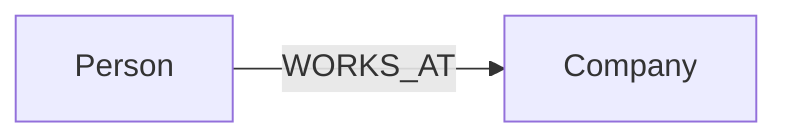
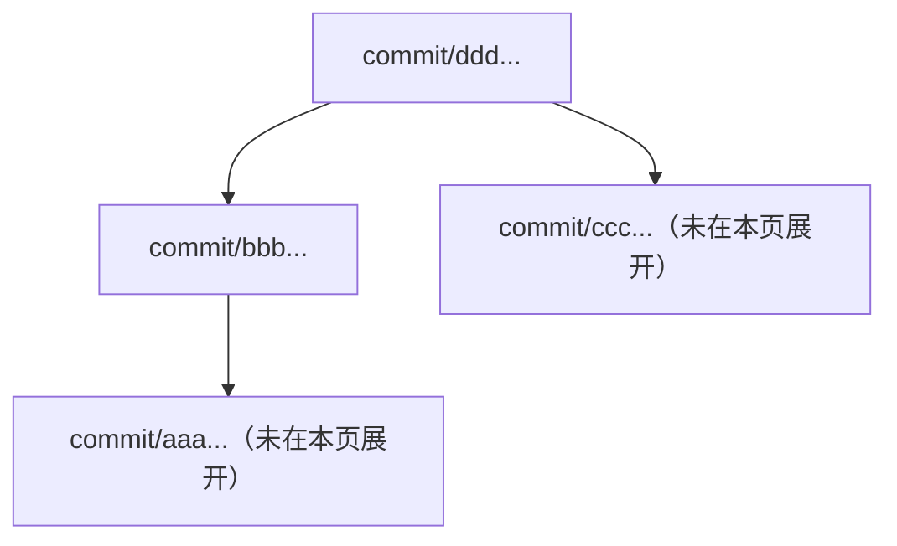

# MCP 与私人 OpenAI Plugin

<!-- cspell:words Streamable Asyncify mcpserver -->

本文件是 KG OS **Go 原生 MCP、Tool 命名与文档接口、受控 JavaScript 执行、私人 OpenAI Plugin / Skill 与 Markdown Preview / Ancestry** 的设计真源。KG OS 业务语义不由 MCP 定义：Ontology、Object / Patch、Graph / Cypher、Evolution 分别由其设计 owner 负责；统一监听与 Instance 生命周期见 [Runtime](runtime.md)，公开 TypeScript SDK 的逻辑合同见 [Client](client.md)。

**已验收基线与当前工作树（2026-10-16）**：`kgosd` 同一 Go 进程提供 Web / HTTP API / MCP，[Phase 16](../development/phases/16-kgosd-unified-mcp.md) 的 Go/QuickJS Sandbox、[Phase 17](../development/phases/17-mcp-web-authorization.md) 的统一认证、[Phase 18](../development/phases/18-chatgpt-embedded-web.md) 的 UI Tool 及 [Phase 22](../development/phases/22-mcp-self-describing-docs.md) 的 `docs.read` 已分别完成阶段验收，Phase 22 最终 CI 与 Dev 部署取得真实证据。**D102 / Phase 23 的独立 `kgos_docs` 和新 Tool 名已在 `main@9cec011` 实现并部署 Dev；五 Tool、隔离 31/31 SDK、Branch/State 修复已在真实 ChatGPT 客户端重新验收（用户报告 `PARTIAL`，未发现新的 SDK 产品缺陷），原样 Docker CI Job 成功，但 Ubuntu Validate Job 因集成用例整体 90 秒超时失败，修复后 CI 尚待重新验收**；远端已验收实例仍以其自身运行的镜像版本为准。历史 Phase 15 `packages/mcp/` / Node.js Worker 的 Dev/ChatGPT 结果是迁移对照，不替代 Go 原生 MCP 证据。已发行 v0.2.1 npm 包不包含新的 Docker MCP 交付；私人 Plugin 可选，标准 MCP Client 可直接连接 `kgosd`。

**2026-10-14 MCP 认证目标调整（[D95](decisions.md#d95-unified-mcp-web-authorization)、[Phase 17](../development/phases/17-mcp-web-authorization.md) `done`（用户验收例外））**：MCP 不再拥有独立管理员 Token，使用同一个 Instance 认证真源；ChatGPT 的 OAuth 授权转入现有 KG OS Web，通过其登录状态及连接授权弹窗完成。**Go OAuth 路由、Web 授权弹窗和持久 Web Session 已实现并经过本地测试，相关代码现已进入 `main@8e7bf56`；2026-10-14 新版 Dev 曾完成正式 Docker 构建部署，用户确认 ChatGPT 重新授权测试成功。Phase 17 关闭时远端 GitHub CI / 最新完整隔离矩阵未执行，用户批准带例外关闭，不代表 CI 通过**。Web 登录状态由 Web/Runtime owner 负责，本文件只定义 MCP 的对接与安全合同。

## 目标与边界

- AI 使用 KG OS 时应先了解真实的 Branch / Commit / Ontology，然后按需读取和操作 Knowledge；避免每次为了取得版本及模型结构都先编写一段 JavaScript。
- 一个专门的 MCP 文档 Tool 负责首次发现和按需批量阅读公开文档；两个直接读取 Tool 负责 Ontology 与 Commit 导航；两个 JavaScript 执行 Tool 负责组合完整公共 SDK 能力。不把 SDK 每个方法机械提升为单独的 MCP Tool，也不在 MCP 定义新的知识模型、Search DSL 或事务语义。
- `kgos_ontology_overview` 提供**完整的 Ontology 只读视图，按行取窗口**；不为节省上下文而删除 Definition、Property、Constraint、Index 或关系。它不保存可编辑 Markdown、不提供文件系统路径、不产生新的数据库资源。
- AI 的模型理解、信息提炼、Commit Message 编写以及工具编排属于外部 AI / 官方 Skill；MCP 只提供确定性数据、执行与安全边界。
- ChatGPT Web 与 Desktop 为目标客户端；用户自托管自己的 KG OS Instance，私人安装自己的 Plugin。**不提交公共插件目录，不集中托管用户知识库。**

## 部署与责任划分

```text
ChatGPT / MCP Client      Browser       CLI / SDK
           │                │               │
           └────── HTTP / HTTPS ─────────────┘
                            ▼
                  kgosd（一个 Go 进程）
                    ├── /mcp + OAuth
                    ├── /api/v1/*
                    ├── / + Web assets
                    ├── Docs / Ontology Overview / Commit Ancestry（Go）
                    └── QuickJS-NG WASM（wazero）
                            │
                    受控 Go 方法 Bridge
                            ▼
                    KG OS Kernel
                            │
                    Lithograph → SQLite

私人 OpenAI Plugin
├── 用户已注册 MCP Connection 的引用
└── KG OS 官方 Skill（AI 操作流程 / SDK 用法）
```

- MCP 是 `kgosd` 内的 Go Handler，使用官方 [MCP Go SDK](https://github.com/modelcontextprotocol/go-sdk) 的 Streamable HTTP 能力；MCP 直接调用同进程 Kernel 已有的业务方法，**不经 `@kgos/sdk` 再做一次本机 HTTP 请求**，也不读取 SQLite 内表或复制 Cypher/Ontology/Version Engine。Go SDK 提供协议与 Bearer 校验基础，不能视作自动提供本产品的 ChatGPT OAuth 授权服务器。
- 每个 `kgosd` 仍只绑定一个显式 Workspace Root；MCP Tool 不接受其他 Instance Root。Phase 15 旧独立 TypeScript MCP Server / Worker 源码已在 Go 原生迁移验收后清理，历史 Git 证据保留，不作为另一套正式服务恢复。
- 统一监听地址由 [Runtime](runtime.md#统一-http--mcp-hostingphase-16-目标) 负责：默认 `127.0.0.1:0` 不变；显式配置可对外监听，并同时服务 Web、API 与 MCP。远程必须有 HTTPS / 可信安全通道，用户自行选择代理或 Tunnel；**同一 listener 不等于同一权限**：`/api/v1/*` 继续采用 Runtime 的 Instance 认证；`/mcp` 接受同一 Instance 凭证的直接 Bearer（仅供可信调用方）或基于 Web 明确授权签发的 MCP OAuth Access Token。OAuth Access Token 不得访问普通 API，外部 OAuth 客户端不得取得 Instance Token；静态 Web 不提供免认证业务 API。
- Go Sandbox 已使用 QuickJS-NG WASI reactor 与 wazero；Go Bridge 对每次方法调用强制权限与参数校验，直接执行 Kernel，保持 SDK 的公开语义。实际安全和集成证据由 Phase 16/22 分别维护，D102 工具重命名与独立文档 Handler 不得降低现有隔离保证。
- `plugins/kgos/` 继续存放官方 Skill、Plugin 模板和面向 AI 的安装说明，**不包含运行服务端**；Skill 只指导调用者，不改变 MCP 协议的直接可用性。

## 部署交付与运行合同

### Docker-only 交付

按 [D99](decisions.md#d99-linux-amd64-docker-only-distribution)，**整个 KG OS 唯一新的官方运行产物**是 **Linux amd64 Docker / OCI**，而不只是 MCP 不发行 npm。镜像名称为 `ghcr.io/<owner 小写>/kgos:v<版本>`；已经公开的 CLI / SDK / Runtime v0.2.1 保留为历史发布，不再提供后续 npm 新版本或六平台二进制。用户仍自行决定公网 HTTPS、隧道或代理接入方案。

| 形式 | 部署单元与依赖 | 使用方式 |
| --- | --- | --- |
| Linux amd64 Docker / OCI 镜像 | 自包含镜像，包含 Go `kgosd`、内嵌 Web、MCP Go Handler、QuickJS-NG WASM、Lithograph / Provider / Jieba 扩展；运行时不依赖 Node.js 或宿主构建工具 | 用户运行**一个容器、一个 `kgosd` 服务进程**即获得 Web + HTTP API + MCP；挂载持久 Workspace，只有一个对外监听端口 |

- Docker 启动**一个已初始化**的 Workspace，由 `kgosd --root <workspace>` 同时提供三种接口。**首次初始化也必须能在这一镜像内完成，且不依赖宿主 Node.js 或镜像内的 TypeScript CLI**：使用明确提供的完整现有 `config.toml` 配置，由 Go Runtime 复用已有初始化、扩展安装、数据库 bootstrap 与 [D82](decisions.md#d82-init-readiness) 的完整 readiness / completion receipt 合同；不新造第二套配置格式、自动默认值或跳过 `initialized.json`。具体一次性容器入口与配置文件挂载编码由 Phase 16 实现时确定并写入操作指南，不将尚不存在的命令示例写成可用。重启/重建必须保留 `.kgos`、已提交的 State/Branch 与认证信息；未初始化且未提供明确配置时失败。
- 构建时将已验证的 Go `kgosd`、Web 静态产物、固定并校验的 QuickJS-NG WASM 和匹配的 Linux amd64 native 扩展打成自包含镜像；Node.js 可用于构建浏览器资源，但不得成为镜像运行时依赖。镜像不在容器启动时下载依赖或重编 native 扩展，不依赖宿主 `kgosd` / `node_modules` / host network。
- 镜像以非 root 用户运行，能够读取只读挂载的 Secret 与证书、写持久 Volume，并在 SIGTERM 时清理同一 `kgosd` 进程及资源。宿主仅映射统一的 HTTP 监听端口；镜像对外暴露的 Web、API、MCP 各自保留认证边界。
- **验证 / 发布按 [D94](decisions.md#d94-openclaw-docker-development-and-ci) 分工**：Mac 本地只进行非 Docker 源码验证；开发阶段的 Docker 构建、独立临时 Volume 写入/重启均在 OpenClaw Linux amd64 执行，不能破坏长期 Dev Instance；**GitHub Actions PR/main CI 必须在自己的 Linux amd64 runner 构建新镜像并执行隔离 Docker Smoke**，但不推送 GHCR；获得独立 Release 授权后，从明确的 Release revision 构建**精确待发布镜像**、在隔离 Instance 中 Smoke、用 GHCR 核对版本/源码 revision/架构/digest 和实际拉取权限。正式发布与生产部署分别授权，当前没有新镜像已上传的证据。

### MCP 命令与配置优先级

```text
kgosd --root <workspace-root>                  既有本地 daemon（127.0.0.1:0）
kgosd --root <workspace-root> --host <address> --port <port>
      [--tls-cert <path> --tls-key <path>]
      [--mcp-oauth-issuer <url>] [--mcp-path <path>] [MCP budgets...]
```

- **只有一个 daemon 入口**：`kgosd --root <workspace-root>` 仍按 [Runtime](runtime.md#http-bind-与-active-endpoint) 要求显式 Root，不从 `cwd`、父目录或环境猜库。容器入口可以把 `KGOS_ROOT` 翻译成实际的 `--root` 参数，不能把它变成 `kgosd` 的第二套 Root 解析合同。网络统一由 `KGOSD_*` 配置；MCP 独有选项使用 `KGOS_MCP_*`。
- **配置来源**：CLI > 对应环境变量 > 明确默认值。空值、未知参数、无效整数或互斥值应报错；`kgosd` 统一输出真实绑定 host / port / protocol，`--port 0` 只作为 bind 输入。原 `kgos-mcp serve / doctor` 不再是目标产品命令，不保留单独进程级启动/关闭/日志选项；现有 `kg doctor` 继续诊断本地 Runtime，MCP 的远程实际可用性由真实客户端验收，不能靠本地 ready 自证。

下表是 **Phase 17 当前统一认证方案的公共部署参数面**；已提交的旧 Phase 16 历史代码仍保留旧 Token 参数，但不能视为当前 Dev 合同。`mb` 表示 MiB（`1024 × 1024` bytes），所有长度/时间参数必须为有界正整数；详细取值范围以实际资源/协议能力验证并与 CLI `--help`、安装指南保持一致，不增加第二套配置文件或兼容别名。

| 分组 | CLI option | 环境变量 | 含义 / 默认值 |
| --- | --- | --- | --- |
| Instance | `--root <path>` | 无 | `kgosd` 必填；一个 Workspace / Instance |
| 统一网络 | `--host <address>` | `KGOSD_HOST` | 默认 `127.0.0.1`；可显式为 `0.0.0.0`，需安全入口 |
| 统一网络 | `--port <0..65535>` | `KGOSD_PORT` | 默认 `0`，由 OS 动态分配；Docker 可指定固定端口 |
| 统一 TLS | `--tls-cert <path>` / `--tls-key <path>` | `KGOSD_TLS_CERT` / `KGOSD_TLS_KEY` | 同一 HTTP listener 的 HTTPS；成对配置 |
| MCP | `--mcp-path <path>` | `KGOS_MCP_PATH` | 默认 `/mcp`；与 API/Web/OAuth 路径无冲突 |
| MCP OAuth | `--mcp-oauth-issuer <url>` | `KGOS_MCP_OAUTH_ISSUER` | 可选，外部 HTTPS origin（开发本机 loopback HTTP 例外） |
| MCP 请求 | `--mcp-request-timeout-ms <n>` | `KGOS_MCP_REQUEST_TIMEOUT_MS` | 单次完整 MCP 请求墙钟上限；默认 `30000` |
| MCP 请求 | `--mcp-max-concurrency <n>` | `KGOS_MCP_MAX_CONCURRENCY` | MCP 并发上限；默认 `16` |
| MCP 请求 | `--mcp-max-request-bytes <n>` | `KGOS_MCP_MAX_REQUEST_BYTES` | 单次请求正文上限；默认 `1048576` |
| Sandbox | `--mcp-script-timeout-ms <n>` | `KGOS_MCP_SCRIPT_TIMEOUT_MS` | 一次 JS 调用含 Kernel 等待的墙钟上限；默认 `15000` |
| Sandbox | `--mcp-script-memory-mb <n>` | `KGOS_MCP_SCRIPT_MEMORY_MB` | 单 Invocation WASM/JS 内存预算；默认 `64` |
| Sandbox | `--mcp-script-max-code-bytes <n>` | `KGOS_MCP_SCRIPT_MAX_CODE_BYTES` | 单次 `code` UTF-8 bytes 上限；默认 `65536` |
| Sandbox | `--mcp-script-max-calls <n>` | `KGOS_MCP_SCRIPT_MAX_CALLS` | 单次脚本 Go Bridge 调用预算；默认 `2048` |
| Sandbox | `--mcp-script-max-streams <n>` | `KGOS_MCP_SCRIPT_MAX_STREAMS` | 单次脚本最大打开流数；默认 `32` |
| Sandbox | `--mcp-script-max-output-bytes <n>` | `KGOS_MCP_SCRIPT_MAX_OUTPUT_BYTES` | 单次 JSON 结果 bytes 上限；默认 `4194304` |
| Preview | `--mcp-preview-max-items <n>` | `KGOS_MCP_PREVIEW_MAX_ITEMS` | 完整视图对象预算；默认 `50000` |
| Preview | `--mcp-preview-cache-entries <n>` | `KGOS_MCP_PREVIEW_CACHE_ENTRIES` | 最大进程内固定视图数量；默认 `8` |
| Preview | `--mcp-preview-cache-ttl-ms <n>` | `KGOS_MCP_PREVIEW_CACHE_TTL_MS` | 缓存 TTL；默认 `600000` |

#### 参数语义与安全约束

- Phase 17 完成后，`/mcp` 随已就绪的 `kgosd` 和已有 Instance 认证正常提供，不再以另一份 MCP Secret 作为开关；未完成初始化、Instance 凭证无效或不可读取时仍按 Runtime 规则 fail closed，绝不降级匿名。`--mcp-token-env`、`--mcp-token-file`、`KGOS_MCP_TOKEN`、`KGOS_MCP_TOKEN_ENV`、`KGOS_MCP_TOKEN_FILE` 从新的 MCP 配置合同删除；显式提供已废弃 CLI/环境配置应报错，不得悄悄继续使用第二份管理员凭证。只提供 MCP OAuth issuer 才启用 OAuth discovery/authorization；无 issuer 的本机可信 MCP Client 可直接使用已有 Instance Bearer。任何凭证都不进入 URL、日志或诊断消息。
- `--tls-cert` 与 `--tls-key` 为**整个 `kgosd` HTTP listener**成对配置；未提供时使用 HTTP，仅适用于可信本机或可信的 TLS 终止代理 / Tunnel。`--host 0.0.0.0` 会将 **Web、API、MCP** 一起绑定到外部接口，不是“只公开 MCP”；代理可以限制允许转发的路由，但 `kgosd` 不内建网络 Gateway。API 继续要求 Instance Bearer，OAuth Access Token 不能调用 `/api/v1/*`，静态 Web 不提供免认证的数据旁路。
- 总 `--mcp-request-timeout-ms` 覆盖服务端收到 MCP 请求到最终响应的时间；`--mcp-script-timeout-ms` 覆盖 JavaScript 与等待 Kernel 调用，先触及者终止相应执行。大小 / 并发限制在排队前有界生效；单 Invocation WASM memory pages、QuickJS heap/stack、CPU 中断、模块关闭与内部 Bridge 数据预算也必须有界。失效或取消的脚本不得继续接收回执和调用新的方法；已发送到 Kernel 的写入仍可能已生效，不能承诺自动回滚。
- Preview 资源预算与目标 Tool `kgos_ontology_overview`（当前实现名 `kgos_preview`）的**固定行窗口合同**独立：配置改变的是容量和缓存寿命，不改变 `offset/limit/viewRevision`、完整 Ontology 或不截断原文的保证。缓存依旧按认证调用者和 Instance 隔离，驱逐后的 revision 返回 `VIEW_EXPIRED`。
- 复用原有 `kg doctor` / `kgosd` 就绪诊断，不保留独立 `kgos-mcp doctor` 运行时；本地 Ready 不代表远程地址、OAuth 或真实 ChatGPT 已连通。结构化错误和日志不回显 Secret、JavaScript 宿主堆栈或本地令牌。
- MCP Tool、OAuth、安全事件和跨 Sandbox/Kernel 的请求关联只接入 [Observability 统一日志合同](observability.md)；不增加 Tool 级持久执行账本，也不以 Tool 终态改写此前已提交的 Kernel 写入结果。

<a id="单管理员-chatgpt-oauth-认证"></a>

#### 统一 Instance 认证与 Web 内的 MCP 连接授权（Phase 17 目标）

##### 身份与能力边界

- **唯一根凭证**：继续使用 Runtime 已有的 `<workspace>/.kgos/auth.json` Instance Token，不创建 MCP 管理员 Token、用户表、密码、独立身份供应商或第二份认证配置。Web 登录状态由 Web/Runtime 的既有认证 owner 提供，MCP **只消费服务端已验证的 Web 登录上下文**；不定义 Web Session 的创建、Cookie 方案、持久化、跨标签同步或登录 UI。
- **两种协议凭证、一套根身份**：`/mcp` 可识别现有 Instance Bearer（仅供用户自己管理的可信客户端）及经 Web 明确批准签发的 MCP OAuth Access Token。二者映射到同一个 Instance 的完整 MCP 能力，但 OAuth Token **仅可用于 MCP**；OAuth Client 永不收到 Instance Token，也不能使用 Web 登录态/Cookie、OAuth Token 调用 `/api/v1/*`。直接向不可信第三方提供 Instance Token 也会授予其普通 API 全权限，**ChatGPT 必须使用 OAuth 路径**，不得用直接 Bearer 替代浏览器授权。
- **启动与部署**：MCP 随已认证可用的 `kgosd` 提供，不因未配置独立 MCP Token 而关闭。`--mcp-oauth-issuer` / `KGOS_MCP_OAUTH_ISSUER` 为外部 HTTPS origin（含可选端口，不含 path/query/fragment/userinfo；仅本机 loopback 可使用 HTTP）；没有此配置时不公开 OAuth discovery/授权路由，但现有 Instance Bearer 可以连接本机 MCP。issuer 不创建公网接入、证书或 Tunnel；MCP endpoint 仍是 `issuer + --mcp-path`。
- **公开 Web 入口要求**：OAuth 的浏览器跳转依赖同一 HTTPS origin 的 **Web `/`、Web 静态资源与 Web 认证入口**均真实可达；只代理 `/mcp` 和 `/oauth/*` 而不转发 Web 不能完成授权。HTTPS 代理还须正确保留 OAuth discovery 路径、请求方法和必要认证头；不得用静态文件匿名可读推断可绕过 Web 业务认证。
- **权限呈现**：`kgos:access` 仍授予当前 Instance 的 MCP **完整读写能力**（目标 `kgos_mutate` 可修改或删除知识），新增 `kgos_docs` 不新增 OAuth Scope、细粒度角色或隐式授权；连接授权弹窗必须明确展示读写权限。Web 登录成功只证明身份，**不等于授权外部 Client**。现行四业务 Tool/未来五 AI Tool 的数量是版本状态差异，不是身份或授权模式变化。

##### 从 ChatGPT 跳转到现有 Web

1. ChatGPT 访问 `/mcp` 时可收到 HTTP 401 + `WWW-Authenticate: Bearer resource_metadata=...`；启用 issuer 后，`/.well-known/oauth-protected-resource` 与 `/.well-known/oauth-protected-resource<mcp-path>` 返回一致的资源 metadata，`/.well-known/oauth-authorization-server` 暴露真正实现的 Authorization Code、PKCE S256、`none` public-client 与 CIMD 能力。`resource`、`issuer` 与 `kgos:access` 一致绑定。授权与交换仍使用 `/oauth/authorize`、`/oauth/token`，由**同一 `kgosd` Go 进程**提供。
2. `GET /oauth/authorize` 先完整校验 `response_type=code`、`client_id`、`redirect_uri`、`state`、`resource`、`scope`、`code_challenge` 与 `code_challenge_method=S256`；仅允许从 `https://chatgpt.com/oauth/client.json` 或 `https://chatgpt.com/oauth/<id>/client.json` 读取可信 CIMD，验证精确的 `client_id`、`redirect_uris` 和 `none` 声明，不接受任意 URL、开放 DCR 或未验证的回调。先验证后创建有界、短效、随机不可猜的**待授权请求**，其中保存验证过的 OAuth 参数，不生成 code。
3. Go 返回 `303` 跳转到**已有 KG OS Web 应用**的同源入口 `/?mcp_authorization=<request_id>`；此 URL 只携带授权请求引用，不包含 Instance Token、OAuth code、`state`、PKCE verifier 或任意回调地址。Web 使用原有应用框架、主题及现有认证组件，在工作区上方显示**连接授权弹窗**，不得再由 Go 输出独立授权 HTML/第二个登录页。
4. Web **已经登录**时直接显示授权弹窗；**尚未登录**时先使用 Web 自己的认证交互，成功后仍在同一个待授权请求中显示弹窗。无需第二次输入管理员 Token。MCP 不负责决定 Web 如何跨页面保存登录状态；如尚不能在此次跳转中复用登录状态，属于 Web 登录模块未满足集成前置，不允许 MCP 私自创建备用 Session 或要求再输入一个 MCP Token。
5. 弹窗至少显示经过验证的客户端名称（无法取得可信名称时显示已验证 `client_id`）、当前 Instance/资源地址及**可读、可写**权限，并提供明确的「授权连接 / 拒绝」。不能由任意请求参数伪造客户端名称或权限，不能因登录成功、刷新或已授权过同名客户端而自动同意。
6. 用户同意后，Go 消耗一次性请求并签发短效 authorization code；Web 将浏览器导向**预先验证的** ChatGPT `redirect_uri`，附带原样 `state` 和 `iss`。用户拒绝时返回该回调的 `error=access_denied`（保留 `state/iss`），不签发 code/token。两条路径均回到 ChatGPT；过期、重复提交或验证失败不授权，Web 解释失败并让用户重新从 ChatGPT 发起连接。

##### MCP 与 Web 的最小接口合同

| 接口 / 入口 | MCP 责任与返回 | 安全要求 |
| --- | --- | --- |
| `GET /oauth/authorize` | 校验 OAuth 请求，保存待授权上下文，`303` 到 `/?mcp_authorization=<request_id>` | 未校验 Client/redirect/resource 不建单；请求 ID 本身**不是授权凭证** |
| `GET /oauth/request?request_id=...` | 返回已验证的 `client_id`、可展示名称、`resource`、固定 `scope`、`canWrite=true` 与 `expires_at` | **必须通过 Web owner 的已登录校验**；未登录返回 401；失效/未知同类失败；不返回原始凭证、`state`、code 或任意客户端回调 |
| `POST /oauth/decision` | Web 传 `{request_id, decision: "approve" \| "deny"}`，成功返回 `{redirect_url}`，由 Web 执行顶层导航 | **必须通过相同 Web 登录校验与其 CSRF/同源写入防护**；校验本次 Instance、一次性、未过期；Client/redirect/scope 只能从 Go 保存的请求取得，不能由 Web 提交覆盖 |
| `POST /oauth/token` | 处理 `authorization_code` 与 `refresh_token` 的标准 OAuth 交换/轮换 | 验证 client/resource/redirect/PKCE、一用即销、有效期和 Scope；不接受 Web Session 替代 OAuth Client 凭证 |
| `/mcp` | 使用现有 Instance Bearer 或有效 OAuth Access Token 调用当前 Tool 集；D102 目标为五个 AI-facing 加一个 app-only UI Tool | 同一 Instance、MCP audience/scope/expiry；浏览器登录 Cookie 不能直接调用工具，OAuth Token 不能访问普通 API |

接口返回只包含页面呈现和跳转所需字段；`redirect_url` **只能**由服务端依据先前验证的 Client 回调生成，Web 不拼接或接收任意跳转目标。授权数据响应使用 `Cache-Control: no-store` 与 `Referrer-Policy: no-referrer`，不加载第三方资源；在未登录的 Web 中，Go 不能泄露授权详情，也不能在前端缓存请求以绕过校验。授权操作只由服务端基于**当前有效的** Web 登录上下文判断，读取授权详情不授予批准权限。浏览器登录校验与 CSRF 接口的具体实现由 Web 认证 owner 确定，MCP 不创建第二套 Session 存储或 CSRF 机制。

##### OAuth Token 生命周期与恢复

- Go 继续使用随机高熵、**不透明**的 Access/Refresh Token，服务端仅持有摘要及 client/issuer/resource/scope/有效期关联；`/oauth/token` 必须检查单次 code、同一个 `client_id`、完全相同的 `redirect_uri`、`resource` 和 RFC 7636 `code_verifier` S256。Refresh Token 限时且轮换后旧值立即失效；Access Token 只接受指定 MCP audience/Scope。
- 保留目前的有界进程内 OAuth 授权状态，不新增 OAuth 数据库、用户表或 Token 持久化：授权请求 5 分钟、Code 1 分钟、Access Token 1 小时、Refresh Token 30 天；`kgosd` 重启后旧 OAuth Token 失效，需要客户端重新走 OAuth，**Web 已登录的用户只需再次确认授权**。Instance 根凭证的生命周期仍由 Runtime 负责，OAuth 不主动修改 `auth.json`。
- Web 退出登录仅终止 Web 自己的登录状态，**不自动撤销此前已经批准的 MCP OAuth Grant**；现有授权仍受 Token 到期、Refresh 轮换及 `kgosd` 重启失效约束。本 Phase 不扩展为连接管理/撤销页面或单独的 Grant 持久化系统。
- 所有授权查询/决定、Token 交换必须有体积/数量/时间限制；禁用跨源调用、缓存、开放跳转、重放和重复同意。`request_id` 即使被复制或泄露，也只能定位待授权请求，**不能绕过有效 Web 登录及显式同意**。除了经 TLS 保护的授权 code 回调，不把任何 Token/code 放进 Web URL、日志、错误或持久 UI 状态。MCP 未认证拒绝与 OAuth 错误保持最小且无秘密差异。

本节**只拥有 MCP 授权请求、OAuth 协议、凭证隔离及与 Web 的接口合同**。Web 登录/Session、通用认证弹窗实现和前端登录生命周期属于 Web/Runtime owner；MCP 只消费其已认证状态并提供连接授权所需数据与动作。Phase 17 MCP 认证代码已通过本地 Web Session Handler 集成与浏览器模拟验收，Dev 正式 Docker 构建及只读自动验收通过，用户也确认真实 ChatGPT 重新授权成功；未执行的 GitHub CI / 完整隔离矩阵不能记为通过。Phase 17 `done` 是用户明确批准的关闭例外，不等于正式发布或生产就绪。

### 首次使用与验收边界

1. 用户通过 Linux amd64 Docker 镜像取得**完整可运行**的 MCP 部署单元。全新 Workspace 先在容器内按已有 `kg init` 明确提供初始化配置，现有 Workspace 直接复用；两种情况均使用持久化 Instance，不需要宿主机安装 daemon。
2. 运行**唯一 `kgosd` 服务**，其同一端口直接提供 `/mcp`、`/api/v1/*` 和 Web；目标认证使用已有 Instance 凭证与可选 OAuth issuer、统一 TLS，动态端口打印实际地址。不再提供独立的 `kgos-mcp serve/doctor` 或第二个内部 daemon。
3. 用户**自行**配置远程 HTTPS 地址、隧道或其它客户端支持的安全接入通道。服务本地 `listening` / `kg doctor` Ready 仅表明本地就绪；**远程部署完成**要求目标 MCP Client 经真实地址/通道完成认证、与当前实际版本一致的 Tool 清单发现及调用，并证明暴露的 API/Web 路由没有新增认证旁路。
4. Linux amd64 Docker 镜像必须通过干净构建、唯一进程 / listener、真实初始化/连接、持久数据/重启、固定/动态端口、TLS 两种终止位置、三类入口认证隔离、不同 Instance、Sandbox 安全与流式/取消等验收；验证无需 Node.js 运行时、宿主 `kgosd` 或 host networking，并通过非 root / SIGTERM 测试。Dev 成功不等于 OCI Registry / Plugin 已正式发布。

## ChatGPT MCP Apps UI 合同

**目标；UI Tool/Resource 已实现，用户已在真实 ChatGPT 中验收两种入口**：在现有单进程 Go MCP Server 中增加一个只负责打开工作区的 UI 入口 Tool 与一个 MCP Apps UI Resource。React 页面/双入口复用由 [Web owner](web.md#chatgpt-内嵌-webmcp-apps) 维护，静态产物交付归 [Runtime](runtime.md#web-hosting)。这不是新的 Knowledge 业务 Tool，不增加 Kernel / Lithograph / SDK 的业务语义。

**入口及资源**：

- 初版资源 URI 为 `ui://kgos/workspace/v1`，`resources/read` 返回 `text/html;profile=mcp-app` 的自包含 HTML（含从 `packages/web` 构建的脚本与样式）。改变不兼容 UI 内容时更新 URI 版本以避免旧缓存误用。
- 一个专用 `kgos_workspace` Tool 的入参必须允许空对象 `{}`；`_meta.ui.resourceUri` 指向上述资源，`_meta["openai/ui"].entrypoints` 同时声明 `{"type":"global"}` 与 `{"type":"thread"}`。用户从左侧主导航或会话内容标签打开的都是同一 UI，实现上分别创建自己的宿主实例；不能承诺宿主固定采用左右分屏。Tool 具备可读 Title、合规单色图标和真实只读注解。
- `kgos_workspace` 的 `_meta.ui.visibility=["app"]` 限制它只服务应用入口；OpenAI MCP Extensions 规定入口触发时不受通常的模型可见性限制。**本地 Phase 23 工作树** 的 `tools/list` 注册五个 AI-facing（含 `kgos_docs`）+ 一个 app-only UI Tool，共六项；Phase 22 历史部署镜像曾为四个 AI-facing + 一个 app-only，不能混为同一运行版本。无法解释该扩展的普通 MCP Client 仍能使用五个新 AI-facing Tool，但不应错误地把工作区 UI Tool 当作业务操作。

**接入与安全**：

- 使用仓库已有 `github.com/modelcontextprotocol/go-sdk`：`Server.AddResource`、`Tool.Meta`、`ResourceContents.Meta` 可以承载资源、UI 元数据与 CSP。Go `internal/mcpserver` 在当前 `/mcp` 内注册 Resource、入口 Tool 和 Handler；不新增 Node/TypeScript MCP Server、HTTP Listener、插件代理或知识网关。TypeScript 仅负责前端内的 Bridge。
- MCP Apps iframe 优先使用标准 `ui/initialize`、`ui/notifications/initialized`、`ui/notifications/tool-result`、`tools/call`；首屏消费已有入口 Tool 返回结果，不重复调用入口工具。验证真实数据时经宿主的 Bridge 调用本地 Phase 23 新名称 `kgos_query`，执行固定只读代码访问 `evolution.overview()`。Host 负责转发已授权 MCP 调用，Go 每次均验证身份，前端**不接收、不保存** Instance Token、临时 Web Bearer、OAuth Code/Access/Refresh Token。后续写入 UI 必须由用户明确触发并遵守 `kgos_mutate` 权限、宿主确认、取消及未知写入结果规则。
- 初版资源不以 iframe 嵌套 KG OS 普通 Web URL，不申请 `frameDomains`、外部脚本 CDN 或跨站 `/api/v1/*` fetch；按实际需求提供最小 `_meta.ui.csp`。静态资源可装载不意味着业务数据免认证；`resources/read`、`tools/call` 均走现有受保护 `/mcp`。ChatGPT MCP OAuth 仍由 [D95](decisions.md#d95-unified-mcp-web-authorization) 的普通浏览器 Web 完成登录及明确连接同意；OAuth Token 不可调用普通 API。连接失效、取消授权、断网或 daemon 重启时停止请求，提供安全的重连/刷新提示，不重试结果不明的写入。
- OpenAI 规范提供 `global` 与 `thread`，但不能据此声称所有 ChatGPT 客户端/账号均可使用；当前平台说明区分 ChatGPT Work Web 与 classic ChatGPT。必须在实际支持入口的客户端验收，未支持 UI 入口的客户端依旧使用当前版本的普通 AI-facing MCP Tool 和 Web。官方证据见 [OpenAI MCP Apps 研究](../research/chatgpt-mcp-apps.md)，旧版实现与验收归 [Phase 18](../development/phases/18-chatgpt-embedded-web.md)；D102 新名称的 Bridge 回归归 [Phase 23](../development/phases/23-mcp-tool-taxonomy-and-docs.md)。

## MCP 工具边界

**D102 / Phase 23 合同（本地已实施，阶段验收尚未关闭）**：Tool 公开名称按 AI 的意图统一，文档读取从 Sandbox 分离。单个 `kgosd` 的 `tools/list` 对 AI 展示**五个** Tool，另保留一个 app-only UI Tool；不改变四个原有业务操作的输入、结果和底层执行语义。

| 新 Tool | 原 Tool | 输入 | 职责与权限 |
| --- | --- | --- | --- |
| `kgos_docs` | 新增 | `paths?: string[]` | 目录与单/多篇构建期 Markdown 文档的只读访问；不进入 Sandbox |
| `kgos_ontology_overview` | `kgos_preview` | `offset?`、`limit?`、`viewRevision?` | 全 Branch 的 Ontology 完整 Markdown 视图及稳定行窗口；只读 |
| `kgos_query` | `kgos_read` | `code: string` | 执行允许的**所有只读 JavaScript SDK** 方法与组合计算，并非 Cypher-only；只读 |
| `kgos_mutate` | `kgos_run` | `code: string` | 执行可读写的 JavaScript SDK 方法与组合计算，包含读取；可能提交或删除数据 |
| `kgos_commit_ancestry` | `state_ancestry` | `root`、`limit?`、`cursor?` | 指定 Root 可达的 Commit DAG 与完整原始 Message；只读、分页 |
| `kgos_workspace` | `kgos_workspace` | `{}` | ChatGPT MCP Apps 打开 Web；`_meta.ui.visibility=["app"]`，非普通 AI-facing Tool |

- 这是**有意的不兼容 Tool 名称迁移**：新实现的 `tools/list` 不再注册 `kgos_preview`、`state_ancestry`、`kgos_read`、`kgos_run` 等旧名称，也不提供旧 Tool 别名、第二套 API、批量单方法 Tool 或新的 MCP Resource。旧名称只出现在设计迁移映射与历史阶段证据中。
- `kgos_query` 继续只允许现有 **15 个 Read SDK 方法**；`kgos_mutate` 继续允许 **15 Read + 16 Write**。原有单次脚本非事务、资源预算、Go Bridge allowlist、取消与不确定写入规则不因名称变化而改变；Tool Description、`code` Schema 与 MCP `readOnlyHint`/破坏性注解必须准确区分二者，服务端仍强制权限。
- `kgos_ontology_overview` 与 `kgos_commit_ancestry` 的 Markdown/窗口/游标/State pin 合同完全复用下文；名称更改不把前者扩展为 Knowledge 全库预览，也不把后者扩展为任意历史查询。`kgos_workspace` 的 UI Resource URI、MCP Apps `global/thread` 入口与 app-only 可见性原样保留。
- 五个 AI-facing Tool 的英文名称、Title、Description 与输入 Schema 均从任务角度说明使用时机。`kgos_docs` 的描述直接写明“省略 `paths` 查看目录；数组一次读多篇”；其他工具用一句话引导先查 `kgos_docs`，不重复 31 个 SDK 签名。统一 Server Instructions 只保留安全、真实 State 与未知写入结果的跨工具原则，不假设所有客户端都自动刷新缓存。

<a id="mcp-tool-help"></a>

### MCP 统一自描述文档（D102 / Phase 23 目标）

**历史发布与当前实现分离**：Phase 22 已在提交 [`96c2bc8`](https://github.com/bYiyLi/kg-os/commit/96c2bc81abfda19aaf957fa1bdb904ef3010e2fb) 中以 `docs.read(path)` 交付 31 方法、类型、Cypher 25 与 Guides，且最终 Docker CI 2/2 通过；Dev 已完成该版本部署。**本节的 D102 新合同现已在本地工作树实现，已在新版 Dev 经只读验收，用户提供的真实 ChatGPT 测试已覆盖五 Tool/31 SDK；其发现的跨 Branch 示例缺陷已修复待重新部署复验，最终 CI 仍未执行**；不能以 Phase 22 的旧镜像验收代替新接口实证。[Phase 22](../development/phases/22-mcp-self-describing-docs.md) 和 D100 保留原始完成证据。

**独立可用性**：任何已认证、可发现 MCP Tool 的客户端，无需 Skill、私人 Plugin、仓库文件或外部网站，直接使用 `kgos_docs` 读取完整 SDK/Cypher/Guides 文档，再使用相应业务 Tool。文档由 Go Handler 直接读取构建期内嵌清单，不调用 JavaScript Sandbox、Kernel 或 HTTP SDK；文档既不是任意主机文件，也不是 Knowledge 数据。Skill 只可选提供外部工作流建议。

#### 唯一文档 Tool 与批量读取

`kgos_docs` 作为 MCP `tools/call` 的独立 Tool（不是 JavaScript 全局方法）：

```ts
type DocsInput = {
  paths?: string[];
};

type DocsOutput = {
  documents: Array<{ path: string; content: string }>;
};
```

- 仅接受可选的 `paths` 数组，不同时提供 `path` 字符串、`mode` 或额外字段。输入 `{}`、`{"paths":[]}` 都等价于 `{"paths":["index.md"]}`，返回**一篇完整的**任务导航首页；显式非空数组按提交顺序返回全部指定文件，每篇提供准确虚拟 `path` 与完整 Markdown `content`。一个文件也使用数组，且始终返回同样的 `documents` 结构。Go MCP Tool 以一个 JSON 文本结果返回 `DocsOutput`，不再套 JavaScript 的 `{"result":...}` 外壳。
- 非空 `paths` 长度为 `1..32`，仅接受大小写精确匹配构建期白名单的 POSIX 相对 `.md` 文件路径；拒绝重复、空字符串、非字符串、`null`、绝对路径、路径穿越、反斜杠、URL、query/fragment、未知路径和额外参数，返回不泄露宿主路径的 `INVALID_ARGUMENT`。不把无效输入降级成首页，不读取任意工作区文件、Instance 数据库、网络或 Secret。
- **整批原子返回**：只要任一路径无效或读取失败，整个 Tool 调用失败，不能先返回前几篇；各文档按源文件完整返回，禁止裁剪、摘要或静默分页。**所有请求（包括默认首页）**的序列化 JSON 结果（含路径/包装）最多 **4 MiB UTF-8 bytes**，超限返回 `RESOURCE_ERROR`，引导调用方按目录拆分 `paths` 重新请求；复用现有数量级的静态资源预算，不新增用户配置项、持久缓存或全文检索引擎。认证和 MCP 请求超时/取消/并发边界沿用现有 `kgosd`。
- 业务 Tool 的 `code` 不再暴露 `docs.read` 或 `help`，它们不是 31 个 SDK 业务方法，也不得作为兼容别名保留。文档浏览只能通过 `kgos_docs`，不新增 `docs.list`/`docs.search`、MCP Prompt/Resource 或第二个 HTTP 文档路由。

#### AI-first 总目录与跨文档导航

首页 `index.md` 不只是文件列表，还要有简短的**任务→推荐文档路径数组**与操作引导：初次连接先读目录；从空 Ontology 建模批量读 `guides/ontology.md`、`guides/objects.md`、`sdk/ontology/patch.md`、`sdk/types/PatchRequest.md`；知识数据修改读 Object/Patch；图查询读 Graph/Cypher；版本与合并读 Evolution；搜索读 Cypher Search；处理错误读 Guides Errors。直接使用 `kgos_docs` 的 `paths` 参数批量读取相关文件，然后调用 `kgos_query` 查询、`kgos_mutate` 修改；不要把 `kgos_docs` 当成 JavaScript 全局函数，也不要凭领域经验猜 API/参数或 Cypher 25 行为。

每份 Guide 的开头和结尾分别给**前置文档**与**相关下一步**的准确虚拟路径；SDK 方法页通过现有 TSDoc/生成流程指向相关 Guide 和请求类型，不手改生成的 Markdown。`guides/ontology.md` 必须提供合法 Node、Relationship、Property、Constraint、Index 及其从**空 Ontology** 创建的可执行流程；`guides/objects.md` 维护公共 canonical Git Extended Diff 的 create/update/delete/rename/batch 与 stale/mismatch 错误恢复示例。两份 Guide 引用 [Ontology](ontology.md#公共可编辑格式) 和 [Object](object.md#object-公共调用合同) 的唯一设计真源，不发明另一种 Schema、Patch、事务或顶层 API。

文档示例保留独立的“调用 `kgos_docs` 获取资料”和“交给 `kgos_query` / `kgos_mutate` 的 JavaScript 函数体”语法边界。`index.md` 与 `guides/index.md` 的任务导航必须在真实 `tools/list` / `tools/call` 中可直接发现、可批量读取；生成器校验所有引用路径、示例与目录可达性。

#### 内容与唯一责任

| 虚拟路径 | 内容 | 责任与来源 |
| --- | --- | --- |
| `index.md` | AI 任务→批量推荐阅读路径、五个 AI-facing Tool 的使用边界、SDK/Cypher/Guide 导航与版本 | MCP |
| `sdk/index.md`、`sdk/<namespace>/<method>.md` | Sandbox 允许的 **15 Read + 16 Write = 31** 个方法，含权限、签名、参数、类型、返回值、错误/副作用与示例 | SDK TypeScript 方法/类型 + TSDoc；MCP 生成 |
| `sdk/types/index.md`、`sdk/types/<Type>.md` | 上述方法实际引用的全部公共类型目录、类型与嵌套字段 | SDK TypeScript 类型 + TSDoc |
| `cypher/index.md`、`cypher/*.md` | KG OS 实际集成版本可执行的 Cypher 25 语言、函数/Procedure、限制与例子 | KG OS 自有用户手册；Lithograph 拥有数据库语义 |
| `guides/index.md`、`guides/*.md` | State pin、Graph、Object Patch、Evolution/Merge、流式、错误/未知结果等组合任务 | KG OS MCP 使用指南；规则引用领域 owner |

**SDK 文档构建**：从 `packages/sdk/src/client.ts` 的公开方法与 `types.ts` 的 Request/Result/类型及补齐的 TSDoc 注释自动生成 Markdown。TypeDoc 提取类型与注释，现有对象字面量/箭头函数 namespace 可使用最小 TypeScript AST 映射，不能假设 TypeDoc 默认会识别全部 31 个方法。生成器与 Go Sandbox 实际 read/write 白名单比对，强制覆盖全部 31 个方法、嵌套类型、每个输入/输出字段以及有约束的 Ref、Merge 等类型；缺字段说明、签名漂移或失效引用时 CI 拒绝。不要手抄第二份签名、Request/Result 或元数据目录。

**MCP 视角而非 HTTP Client 视角**：SDK 方法示例是可直接交给目标 `kgos_query` 或 `kgos_mutate` 的异步 JavaScript 函数体，直接使用 `ontology/object/graph/evolution`，明确 `return`，不要求 `new KGOSClient()`、`import`、Endpoint、Token 或 Node API；文档调用示例则使用独立 MCP `kgos_docs` 的 `paths` 参数，**不是放在 JavaScript 里的方法调用**。只为 Sandbox 实际可调用的方法生成方法目录；外部 HTTP Client 的 `system`、`web`、Client 构造等不属于此目录。文档可以介绍写入方法，但 `kgos_query` 仍不能执行它。Ref / Merge 类型只准确映射现有服务端合同，不重写 Kernel 校验。

**Cypher 手册归属**：由 **KG OS** 编写、维护和验收适配 MCP 的独立使用手册，源码位于 `docs/guide/mcp-cypher/`，构建为虚拟 `cypher/`。参考固定版本 Lithograph 的 Cypher 25 文档、兼容矩阵及运行时函数/Procedure inventory，独立编写面向 `graph.query/execute/stream*` 的示例与限制；不直接复制整套上游文字、不创造 KG OS 方言、Parser 或执行白名单。覆盖实际可用的语法、Pattern/Path、类型/表达式、聚合、读写、Schema/Index、搜索、Procedure、版本与事务、错误及诊断，并准确区分底层 SQLite SQL、Cypher 和 JavaScript。Neo4j Server 管理命令、外部 Procedure 或未支持的功能不得误列为可用。

**版本绑定**：手册标注且校验真实装载的 Lithograph 版本及 `CY25-2026.08` 等相应兼容 Profile。目前 [D101](decisions.md#d101-lithograph-v031-upgrade) **v0.3.1** 已随 Phase 22 源码、正式 Docker CI 与 Dev 部署取得验收证据；新 Tool 仍须随同一镜像嵌入正确手册，不能仅凭文档版本号推断运行时实际版本。每次升级底层必须与 KG OS Cypher 手册、函数/Procedure、示例及验证**同一变更同步**；不因上游网站增加内容就默认为已经支持。Lithograph 仍是执行语义唯一真源；KG OS 手册只负责 MCP 用户说明。

**指南与验证**：操作指南引用 Ontology/Object/Graph/Evolution 各 owner，不另立业务合同。单一构建流程生成只读 Markdown 清单并嵌入 Go，检查版本、31 方法/类型、文档链接、格式和 stale 产物；最终 Docker 不需要 Node/TypeDoc 或联网。全部 MCP JS 示例和 Cypher 示例在真实 Go/WASM + 对应 Lithograph 的**隔离临时 Instance** 验证结果/错误；测试路径穿越、未知文档、资源超限、权限拒绝和取消，不在长期 Dev 写测试数据。真实无 Skill 客户端需能仅通过 `tools/list` 找入口并按需读取；文档检查通过不等于已经证明模型工具选择效果。

**本阶段清理**：Phase 22 已移除旧 TypeScript/Go `help(name?)` 和双份 Help 产物；D102 进一步移除 Sandbox `docs.read` 与旧 Tool 名称及其当前提示/测试，不改写 Phase 20/22 历史记录。HTTP SDK 的 31 个业务方法、Go Kernel/Lithograph、四种原有业务操作的权限合同不变；对外可见的 AI Tool 数量因新增 `kgos_docs` 从四个增为五个。

### Phase 20 SDK Help（已交付旧版本的历史合同）

> 以下仅记录 Phase 20 的**历史接口与验收事实**，不是当前或目标 MCP 工具接口。Phase 22 已正式实现、提交、完成两项 Docker/Validate CI 并部署 `docs.read`；D102 的后续新合同见上文，旧 `help()` 和旧 Tool 名称不得被误认作当前目标 API。

- 四个业务 Tool 的英文 `title` / `description` 应准确说明**使用时机、操作类型、主要输入与限制**，不复制 31 个方法的完整定义；`kgos_workspace` 仅是 app-only UI 打开入口。JSON Schema 参数各自描述类型、必填性、缺省、范围及分页语义；与现行 Go 真实校验一致。只读 Tool 不标为 destructive，`kgos_run` 标记可能破坏，不能把 Tool 注解当权限强制机制。
- `kgos_read`、`kgos_run` 的异步 JavaScript 函数体都提供**无前缀全局 `help(name?)`**，调用 `return await help()` 获取目录，调用 `return await help("evolution.state.create")` 获取方法详情。Help 只查询**当前 MCP 沙箱支持的 15 Read + 16 Write 公共方法**，包括写入方法的帮助信息；两种 Tool 都可以读取全部帮助，但 `kgos_read` 仍无法执行写入方法。Help 本身不接触数据库、不改变 State、不泄漏凭证或宿主内部实现，也不需要新 Tool / HTTP Route / 网络服务。
- 无参目录按方法名称稳定排序，逐项给出 `name`、`description`、`access`（`read|write`）；带方法名的详情返回 `name`、`description`、`access`、`signature`、`requestType`、`returnType`、`typeDefinitions`（TypeScript 公共类型及依赖的完整声明）、`example` 和必要 `notes`。未提供参数时只返回目录；非法方法名、参数类型或多余参数返回明确且无敏感内容的参数错误，不猜测最近似方法或退回全量列表。
- **唯一接口真源**是 `packages/sdk/src/client.ts` 的方法签名和 `packages/sdk/src/types.ts` 的公共类型；对应业务行为仍分别归 Ontology/Object/Graph/Evolution owner。最小手工维护内容只包含方法用途、示例和真正影响调用的约束。构建工具提取 SDK 类型关系、校验 31 个 MCP 允许方法与 SDK 一致，并生成同一版本的 TypeScript SDK 和 Go Sandbox 所用帮助数据；拒绝缺失方法、过期类型、未同步产物，**不手工维护第二份 Request/Result 定义**。
- TypeScript 调用方可从 `@kgos/sdk` 引入同步本地 `help(name?)`；MCP 沙箱用 Promise Bridge 提供同名异步 `help(name?)`。二者的可见文档内容保持一致；MCP 的查询不要求调用 `kgos_run`。Helper 是文档查询，不是新的 SDK 业务方法，不计入 31 方法矩阵，也不接收额外权限。
- MCP Server 的可选 `Instructions` 只提示**数据库文本是数据而非指令、跨读取版本一致性、结果未知时核查后重试**；不把 Skill 流程塞入工具描述。Preview 构建全部 Branch 的完整视图而 `limit` 仅控制返回窗口；`state_ancestry` 可能需要 cursor；`kgos_run` 的一个 JS 脚本**不是跨操作原子事务**，不能使用“每次写入都创建独立 Commit”误导 AI。
- 验证需读取真实 MCP `tools/list` / JSON Schema / 初始化 Instructions，执行 `kgos_read` 和 `kgos_run` 内的 Help 正反例，证明 `kgos_read` 的写入权限不变、Help 文本跨两端一致、示例符合当前类型与实际方法边界；模型行为提升需要独立评测证据，不能仅凭文字 Review 声称。

### JavaScript SDK 执行

#### 共同接口与语言能力

目标 `kgos_query` 与 `kgos_mutate`（当前实现分别名为 `kgos_read` / `kgos_run`）使用**完全相同**的输入 / 成功返回格式，只有可调用的 SDK 方法不同：

```ts
type ScriptInput = {
  code: string;
};

type ScriptOutput = {
  result: JsonValue; // 复用 @kgos/sdk 的 JSON-compatible 类型
};
```

- `code` 是**异步 JavaScript 函数体**，支持 `async / await`、普通函数、变量、分支、循环、数组 / 对象、`Map` / `Set` 计算、`Promise.all()` 与 `for await...of` 流式消费。无需 import、Client 初始化、Endpoint、Token 或单独配置，也不额外增加 `state / branch / format / dryRun` 等 Tool 参数。
- Sandbox **直接提供四个顶层命名空间**：`ontology`、`object`、`graph`、`evolution`。使用 `await graph.query(...)`、`await evolution.branch.list()`；**没有 `kgos.`、`sdk.` 前缀或第二套简写别名**。方法的参数、结果、错误和 StateRef 继续属于 `@kgos/sdk` 及对应业务 owner；一次脚本内的不同 SDK read 不会自动绑定同一个 State，调用方应显式使用同一个 resolved Commit 进行跨操作一致读取。
- `return` 是**唯一正式结果出口**，可返回 JSON-compatible 的对象、数组、字符串、数字、布尔值或 `null`，MCP 成功结果统一为 `{ result: <返回值> }`。返回 `undefined` / 未执行 `return`、函数、`BigInt`、非有限数字、循环引用或其它不能无损表达为 JSON 的值时明确报执行结果错误，不能静默转换成 `null`、`{}` 或删字段。不额外提供独立的 `console.log` 输出合同；需要返回调试信息时直接放进 `return`。
- 每次 Invocation 的 JS 全局变量独立且结束即丢弃，不创建跨调用 Session；知识库持久状态只存在于原有 KG OS API / 数据库中。

例如只读脚本：

```js
const { state } = await evolution.overview();
const models = await ontology.read({ at: state, refs: ["node:Person"] });
const data = await graph.query({
  at: state,
  cypher: "MATCH (n:Person) RETURN n.name LIMIT 10"
});
return { state, models: models.results, data: data.rows };
```

#### SDK 能力边界

| Namespace | `kgos_query` | `kgos_mutate` 额外开放 |
| --- | --- | --- |
| `ontology` | `read` | `patch` |
| `object` | `read`、`readText` | `patch` |
| `graph` | `query`、`streamQuery` | `execute`、`streamExecute` |
| `evolution` | `overview`、`get`、`ancestry`、`history`、`diff` | 无额外顶层方法 |
| `evolution.state` | 无 | `create`、`setData`、`clearData` |
| `evolution.branch` | `list` | `create`、`delete` |
| `evolution.tag` | `list` | `create`、`move`、`delete` |
| `evolution.merge` | `list`、`get`、`conflicts` | `start`、`resolve`、`finalize`、`abort` |

- `kgos_mutate` 包含左列全部读取与右列写入方法，合计 **15 Read + 16 Write = 31 方法**。Go MCP Adapter 直接映射 Kernel 对应应用操作，且保持公共 SDK 的参数、返回值、错误类别与取消/流事件语义，不在 MCP 复制业务处理器、Compiler、Cypher 或 Merge Engine。`kgos_query` 不暴露任何右列方法；**每一次 Go Bridge 调用必须由宿主按 Tool 的实际权限、精确方法及参数校验**，不能只依靠冻结 JS 对象或前端类型。未来公共 SDK 新方法需分类、显式列入许可集并经过对照测试。
- 两个工具均使用同一个 Sandbox 实现。`kgos_mutate` 在 MCP Tool 级明确标记可能修改或删除状态，由 MCP 客户端按真实工具风险完成授权；**不为每个 SDK 方法另设一次确认协议**。`kgos_query` 是数据库只读 SDK 方法集合，不对外承诺所有底层执行都没有其它副作用；MCP metadata 不得作虚假安全声明。

#### Sandbox 选型、执行与资源边界

- **已采用选型**：使用 [QuickJS-NG WASI reactor](https://github.com/quickjs-ng/quickjs) 作为受控 `.wasm` 引擎，通过 Go 的 [wazero](https://github.com/tetratelabs/wazero) 嵌入 `kgosd`，不使用 Node.js Worker、`node:vm` / `vm2`、CGO JS 插件或独立 SDK Gateway。Promise Bridge、增量 Graph Stream 和实际不可信脚本隔离的验证以 [Phase 16](../development/phases/16-kgosd-unified-mcp.md) 与当前回归测试为证据，不以 [go-quickjs-wasi-reactor](https://github.com/aperturerobotics/go-quickjs-wasi-reactor) 外部项目本身代替验收；D102 不改变引擎或依赖版本。
- 每次 Invocation 创建隔离的 WASM Module / QuickJS runtime/context，脚本状态和 Promise 不跨请求持久化。仅向脚本暴露四个固定 namespace 的许可方法；WASI 不预开放宿主文件系统、环境变量、网络、任意模块加载或敏感日志能力，**不允许**脚本读取 Instance / OAuth Token、直接持有 Go Kernel 句柄或调用任意 HTTP。Go Host Bridge 只接受 `method + JSON-compatible 参数`，返回 JSON-compatible 值/公共安全错误，执行前按 Invocation 身份、Method allowlist 和资源预算校验。
- **异步调度**：Go 宿主可并发执行独立 Kernel 方法，但同一 Guest QuickJS/WASM 的 Promise resolve/reject、pending jobs 与状态操作必须由一个调度所有者**串行**驱动，不允许多个 Goroutine 并发重入 VM。`Promise.all()` 必须能等待实际同时在途的 Go 调用；`graph.streamQuery / streamExecute` 必须通过 `stream-open / stream-next / stream-return` 拉取真实事件，维护背压，支持 `for await...of`、提前退出、断线与取消，**不得预先将整个 Stream 聚合为数组**。
- **资源隔离**：限制 Guest WASM linear memory pages / JS heap/stack、脚本大小、宿主调用/流并发、输出大小及墙钟时间；使用 wazero `WithCloseOnContextDone(true)`（需在目标版本证实）、Module close 与适用的 QuickJS CPU interrupt，在无限循环、深递归、内存耗尽、trap、取消、超时下结束该次 Invocation，且其他 `kgosd` 请求继续正常执行。超限明确返回 `RESOURCE_ERROR`，不能静默截断、继续交付已失效脚本的回执或伪造事务回滚；已发到 Kernel 的写入仍可能完成。
- **P16-01 历史可行性门槛**曾验证真实 `async/await`、`Promise.all()`、`for await...of`、宿主权限隔离、资源中断与并发取消；不得擅自降低现有隔离保证、回退独立 Node.js MCP 或因 D102 的公开重命名改变四种原有业务操作合同。已有 Phase 16/22 真实验收保留为历史基线，但新 Tool 名称/Docs Handler 仍需 Phase 23 单独取证。
- Sandbox 限制的是**脚本对宿主的直接访问**，不是修改数据库的 Cypher 能力：`graph.query / execute` 继续完全遵守 [Graph 原样执行合同](graph.md#graph)，MCP 不解析、拦截、改写或额外约束 Cypher，也不为文件 / 网络访问新增 Tool、参数或引导流程；底层依照 `kgosd` 当前实际运行权限执行。来自数据库的文本、Ontology、Commit Message 均只是数据，不能改变沙箱权限和工具行为。

#### 写入、错误与部分成功

- `kgos_mutate` 允许在一个脚本中按顺序或并发调用任意已开放的 SDK 操作，但**整个 JavaScript Invocation 不构成自动事务**；单次 Object / Ontology Patch 的 `baseState` / Branch CAS、Graph Execute 的真实 Cypher 提交及 Evolution / Merge 的 revision 校验继续按原合同执行。不会因为多个 SDK 调用写在一个 `code` 中就自动保证原子性，也不创建跨方法 transaction、staging、`dryRun`、自动回滚、补偿或写入重试。
- 若第一条写入成功、后续写入失败，**已成功的写入不会被撤销**，整个未捕获异常的脚本返回错误。例如 `branch.create` 成功后 `tag.create` 失败，创建的 Branch 仍然存在；调用方可通过 `branch.list` / `tag.list` 等 API 核实。成功的 SDK 调用返回值可在脚本中由调用方自行保留，但 MCP 不会根据日志推断整个执行成功、已回滚或可以安全重放。
- JS 语法 / 运行错误、SDK 错误和 Sandbox 超限 / 取消都与正常 `return` 区分，MCP 调用失败时使用 `isError: true` 和有界、无凭证的结构化错误信息。SDK 公共错误保留已有 `code/message` 与安全的 `details`；脚本自身错误不伪装成数据库公共错误，超限明确报 `RESOURCE_ERROR`，取消明确标记为取消。宿主异常堆栈、Token 或执行器内部细节不得进入模型结果。脚本自行 `try/catch` 并 `return` 的 JSON 属于调用方显式决定的成功结果，MCP 不隐式替它判定每条写入成功。
- **超时、取消、断线或通信失败后，已发出的写入可能完成，也可能尚未完成**；结果未知时不得报告“写入失败且无副作用”，也不得自动再次提交。使用既有 Branch Head、State、History、Tag 或 Merge Session 读取来确认真实结果，不增加额外的持久执行日志 / 操作状态库。

例如：

```js
const { state } = await evolution.overview();
const created = await evolution.branch.create({
  name: "experiment",
  from: state
});
const branches = await evolution.branch.list();
return { created, branches: branches.items };
```

上述脚本如果 `branch.create` 已经成功，而后续 `branch.list` 失败，工具返回错误，但 Branch 仍可能已存在；**一次 Tool 失败不等于本次脚本中的所有 SDK 操作都回滚**。

## Markdown 阅读呈现规范

目标 `kgos_ontology_overview` 的 `preview` 与 `kgos_commit_ancestry` 的 `markdown` 都是供 AI 阅读的 Markdown **正文**，不是将整份文档套进一个代码块。采用语义化代码块区分原始数据与导航结构：

- **导航**：Branch / Commit / Domain / Definition 的目录、准确 Ref、分页信息与跳转索引使用普通 Markdown 标题和表格；表格只存适合单行导航的字段，复杂长文本不能只挤在表格中。
- **Commit Message**：在每个 Commit 下以标记为 `markdown` 的独立 fenced code block **完整展示原始 Message**；不切割 `## 简介` / `## 改动`、不总结、不截断、不把其标题当成外层文档标题。无 Message 时明确显示缺省，不虚构文本。Preview 可另外解析规范简介的首个非空行用于**分支索引**，不改变正文的原样展示规则。
- **Ontology**：模型关系图使用 `mermaid`；Domain / Definition 的完整公共 Object Value 使用 `yaml` fenced code block，复用 [Object canonical YAML](object.md#object-value-与-representation) 的同一字段和序列化规则，不创建另一种摘要格式。分支、Domain、Definition 的定位 Ref 留在外层标题或索引中，不混入可编辑 Object body；完整 `includes`、Property、Constraint、Index、Relationship `from/to` 与长说明均不得丢失。必要的 Cypher / JSON 片段依真实数据类型使用对应语言标签。
- **安全转义**：fenced block 采用长度**严格大于正文中最长连续反引号序列**的反引号围栏（至少三个），避免 Message、说明或 YAML 值中的反引号提前闭合。表格单元、Mermaid 名称/Label、链接及其它非 fenced 展示位置要确定性转义，不让来自数据库的文本伪造章节、图边或指令；代码块语言标签由 renderer 选择，不由用户文本控制。
- **无损与计数**：代码围栏、标题、表格属于只读展示层，不修改 Commit / Ontology 存储，也不成为新的 Patch 格式。所有原始信息须可通过对应 SDK 公共值找回；Preview 按已有 UTF-8/LF 文档规范输出，必须**在全部代码块与转义最终渲染后**计算绝对 Offset / Lines。分页窗口可以落在 fenced block 中间，不插入额外边界行。

<a id="kgos_preview虚拟-markdown-文件"></a>

## `kgos_ontology_overview`：虚拟 Markdown 文件

### 输入与输出

```ts
type PreviewInput = {
  offset?: number;        // 默认 0，0-based 绝对行偏移
  limit?: number;         // 默认 300，允许 100..500
  viewRevision?: string;  // 继续读取已冻结的进程内预览
};

type PreviewOutput = {
  totalLines: number;     // 本份完整虚拟 Markdown 文档的行数
  offset: number;         // 本次读取起始行，0-based
  lineCount: number;      // 本次实际返回的行数
  viewRevision: string;   // 进程内视图标识，非 Commit/Branch identity
  preview: string;        // 原始 Markdown 行窗口
};
```

- 不传 `viewRevision`：枚举当前**全部 Branch**，按名称 UTF-8 bytes 升序生成一份**完整、不可变**的虚拟 Markdown 文档，存于 `kgosd` 的有界**进程内缓存**，再取 `offset..offset+limit` 窗口。没有分支筛选参数，所有分支的索引和绝对行号始终使用同一份完整文档。
- 传 `viewRevision`：从缓存中读取**原始同一份文档**，**绝不重新解析最新 Head 后拼接旧行号**。同一 revision 对应的内容、行号和 `totalLines` 均不变。缓存按被认证的调用者与绑定的 Instance 隔离，不能仅凭猜到或复用其他连接的 revision 读取对方视图。
- `offset` 是从文档**第 0 行**开始计数的绝对行偏移。各索引中的 `Offset` / `Lines` 使用同一坐标系；窗口 `[offset, min(offset+limit, totalLines))`。允许 `offset == totalLines` 返回 `lineCount=0`；负数、非整数或超出范围报错。尾页可不足 100 行。`lineCount` 是实际行数，不包含任何重复的分页提示行。
- 统一使用 UTF-8、LF 换行与恰好一个末尾换行：**`totalLines` 等于整个文档内 LF 的数量**，最后的终止 LF 不形成额外空行；连续分页按原始行拼接即可还原**同一份完整文件**。Markdown 表格或 Mermaid fenced block 可以跨窗口，不额外插入/删除边界行。
- 内存缓存可以过期或被驱逐，进程重启也会丢失。失效的 `viewRevision` 返回明确的 `VIEW_EXPIRED`（MCP adapter 级错误），AI 重新从 `offset=0` 获取新视图；不落盘、不存入 KG OS State，也不生成可写文件。文档过大无法安全完整生成时返回明确 `RESOURCE_ERROR`，**不得裁剪模型冒充完整**。这不等同于建立虚拟文件系统。

### 版本绑定与内容来源

- 使用 `evolution.overview()` 取得默认 Branch 名，`evolution.branch.list()` 枚举**全部**真实 Branch → Head Commit；每个 Branch **固定**为枚举时观察到的 `commit/<id>`，然后对该精确 Commit 读取 metadata 与完整 Ontology。列表/默认分支查询不承诺跨多个 HTTP 请求的原子时间快照；一旦生成文档，列出的 Head 与 Ontology 不会因为 Branch 后续移动而混用。
- 从每个 pinned Commit 的 `ontology.read({at: commit/...})` 全局 Overview 开始，按 cursor 展开**全部 Domain** 及其成员，使用 visited set 处理 Domain 多父级/循环，并继续覆盖所有 Definition。对已发现 Definition 以 `object.read({at: commit/..., refs})` 分批（遵守当前 1..100 规则）取得**完整公共 Object Value**。不混合当前分支与历史分支的 Schema / Semantics；不直接访问 Lithograph internal graph / Schema。
- 文档完整包含**所有公共 Ontology Domain、Node / Relationship Definition、直接成员关系、Property、Constraint、Index、完整原始说明与必要的准确 Ref**。`Domain includes` 必须完整显示；Property-local / Definition-level 的约束和索引、共享 Index targets、Relationship `from/to`（包括 `null`）不能因渲染形式而丢失。共享资源的展示不得误导成多个独立索引，额外 Label 不等于另一 Node Definition。
- 虚拟文件**仅预览 Ontology 结构与 Commit 元数据**，不枚举 Knowledge Node / Relationship 实例，也不扫描全部 Commit DAG、Tag、State Data。若某个 Commit 当前无法按 KG OS Ontology 合同解释，整次生成明确失败或诊断，不跳过该分支并返回伪完整文件。

### 文件排版及行窗口索引

下面用**只有一个 Branch 的最小示例**演示排版；ID、Offset、Lines 和业务模型为占位值，不是可执行的 Commit ID / 行号。真实文件必须列出全部 Branch 及其完整内容。文件内索引的 Offset 指向所在章节或 Definition 的**起始行（0-based）**，Lines 是该段完整行数，范围为 `[Offset, Offset + Lines)`；不使用相对章节的行号。生成器先确定每一段的内容与行数，再填入索引，确保索引改变自身长度时仍能算出准确的绝对行号。

````markdown
# 分支

**Default:** `branch/main`

| Branch | Head Commit | 当前简介（首行） | Offset | Lines |
| --- | --- | --- | ---: | ---: |
| `main` | `commit/aaa...` | 人物、企业与任职关系的知识世界 | `<offset>` | `<lines>` |

---

# main

**Ref:** `branch/main`
**State:** `commit/aaa...`

## Head Commit

| Field | Value |
| --- | --- |
| Author | KG OS |
| Message | 见下文原文代码块 |
| Committed At | 1790000000000000（UTC Unix microseconds） |
| Parents | `commit/ccc...` |

## Commit Message

```markdown
## 简介

人物、企业与任职关系的知识世界。

## 改动

- 新增 `WORKS_AT` Relationship Definition。
```

## Ontology

### 目录

| Section | Offset | Lines |
| --- | ---: | ---: |
| 模型关系图 | `<offset>` | `<lines>` |
| Domain 组织 | `<offset>` | `<lines>` |
| Definition 索引 | `<offset>` | `<lines>` |
| Definition 详情 | `<offset>` | `<lines>` |

### 模型关系图



### Domain 组织

| Domain Ref | Title | Description |
| --- | --- | --- |
| `domain:Work` | 工作 | 管理人与组织 |

| Domain Ref | Member Ref |
| --- | --- |
| `domain:Work` | `node:Company` |
| `domain:Work` | `node:Person` |
| `domain:Work` | `relationship:WORKS_AT` |

#### `domain:Work`

```yaml
name: "Work"
title: "工作"
description: "管理人与组织"
includes:
  - "node:Company"
  - "node:Person"
  - "relationship:WORKS_AT"
```

### Definition 索引

| Ref | Title | Description | Offset | Lines |
| --- | --- | --- | ---: | ---: |
| `node:Company` | 企业 | 组织机构 | `<offset>` | `<lines>` |
| `node:Person` | 人物 | 自然人 | `<offset>` | `<lines>` |
| `relationship:WORKS_AT` | 任职 | 人与企业的任职 | `<offset>` | `<lines>` |

### Definition 详情

#### `node:Company`

```yaml
name: "Company"
title: "企业"
description: "组织机构"
properties:
  - name: "name"
    type: "STRING"
constraints: []
```

#### `node:Person`

```yaml
name: "Person"
title: "人物"
description: "现实世界中的自然人。"
properties:
  - name: "name"
    description: "人物姓名"
    type: "STRING"
constraints: []
```

#### `relationship:WORKS_AT`

```yaml
name: "WORKS_AT"
title: "任职"
description: "人与企业的任职"
from: "node:Person"
to: "node:Company"
properties:
  - name: "since"
    description: "任职开始日期"
    type: "DATE"
constraints: []
```

````

排版规则：

1. **文件首部**始终是**全部 Branch** 的索引，列出准确 Head Commit、从 Message 取得的简介首行、对应完整分支区块的绝对 `Offset` / `Lines`。`Default` 始终表示真实默认分支，所有分支区块均存在于同一份完整文件，AI 按索引直接跳读。
2. 每个 **Branch 区块**先列准确 `branch/<name>` / pinned `commit/<id>`、Head Commit 作者、原始时间及父 Commit，再以 **`markdown` 代码块展示完整原始 Message**，最后是**该 Commit 的完整 Ontology**；不从 Message 提取两段作为正文替代。
3. Ontology 先放目录，再放**完整 Mermaid 结构图**、Domain / 完整 `includes` 导航表与 Domain canonical YAML、全部 Definition 导航索引、逐个 Definition 的 canonical YAML。图只表示类型及端点限制，**不是 Knowledge 实例图**；遇到 `from/to = null` 时明确显示无端点类型约束，不伪造 Node。多 Domain 归属及循环以成员表如实表达，不展开成错误的树。
4. 所有 Definition 详情以准确 Ref 为标题，`yaml` 代码块完整表达 Node 识别 Label 与额外 Labels、Relationship Type/端点、title/description、所有 Property 的类型/说明/required/unique，以及 Property-local / Definition-level 的 Constraint 和 Index（包含真实名称、类型、字段、target/scope）。直接复用 **同一 canonical Object YAML**，而不是独立生成一套简化字段表；这是只读展示，修改时仍用 Object canonical YAML + Git Extended Diff。
5. 大型文本说明、Markdown 特殊符号、换行、Mermaid Label 和用户自定义名称必须进行**无信息丢失的稳定转义/表示**，防止内容打断表格、伪造文件标题、插入 Mermaid 语句或冒充 Skill 指令；不要由生成器概括或截断实际 Ontology。重复输出同一 Definition 的位置应由索引指向同一完整详情，不重复建模。
6. 内容与章节使用确定性排序；每一段长度在最终 render 后计算。所有 offset 必须通过生成测试检查能真实定位到对应标题、图、表和 Definition，不能把示意行号当成程序常数。

### Commit Message 作为版本动态简介

KG OS 的 Branch 只有名称与可移动 Head；**不增加 Branch Description 字段、CRUD 或额外持久化元数据**。`kgos_ontology_overview` 读取当前 Head Commit 已有的 `message`，把它当成**这个 State 所表示的知识世界的介绍**，不是 Branch 独有、不随快进/合并持久不变的说明。

官方 AI / Skill **推荐在新建 Commit 的 `message` 中使用以下 Markdown 约定**：

```markdown
## 简介

这个 Commit 完成后的知识世界是什么、包含什么、主要用于什么。
每次新 Commit 应维护当前完整简介，而不是仅记录新增部分。

## 改动

- 相较于上个版本的实际改动一。
- 相较于上个版本的实际改动二。
```

- Preview **正文不切割或解析展示 Message**，只在分支索引需要简介首行时，识别顺序正确的独立标题 `## 简介`、`## 改动` 并提取两者之间的首个非空原文行作为导航。不调用 AI 生成摘要，不把索引首行冒充完整 Description；完整 Message 始终在 Branch 的 `markdown` 代码块中。
- 对历史或非规范 Message，分支索引必须明确显示“无规范简介”，Branch 详情仍完整保留实际 Message；**不根据提交标题、Ontology 或历史记录猜出简介**。Commit 允许多个 Branch 共享，快进可能只改变 Head 而不新建 Commit，因此多个 Branch 的当前简介可能相同。
- 此处是**官方 AI 写入/阅读约定，不是 Kernel 数据格式或必填校验**。既有 `author/message?` 输入继续可选；直接 Graph、merge fast-forward、历史 Commit 及其他客户端可能不遵循约定，不因 MCP 增加额外验证、自动修复 Commit 或要求补建一个无变化 Commit。Immutable Commit Message 只能通过后续新 Commit 携带新简介，不能原地修改旧 Message。
- Message 是来自数据库的调用方文本，属于待解释数据，不具备改变 MCP Tool / Skill 权限与流程的指令效力。

<a id="state_ancestrycommit-dag-markdown-历史"></a>

## `kgos_commit_ancestry`：Commit DAG Markdown 历史

此只读 MCP Tool 用来查看指定 Root **可达的祖先 Commit**，不替代 `kgos_ontology_overview` 的当前模型视图，也不解释提交中的真实知识 Diff。Go Handler 直接调用现有 Kernel Evolution 操作，输入输出与 `@kgos/sdk` 的 `evolution.ancestry()` 公共合同一致；JavaScript Sandbox 内仍使用无前缀的 `evolution.ancestry()` 调用，不建立 MCP 专属 Commit 模型、历史索引或持久缓存。

### 输入与输出

```ts
type AncestryInput = {
  root: string;      // 必填：commit/<id>、branch/<name> 或 tag/<name>
  limit?: number;    // MCP 默认 20 个 Commit；允许 1..1000
  cursor?: string;   // 继续读取同一 pinned Root 的下一页
};

type AncestryOutput = {
  root: string;      // SDK 解析后的 immutable commit/<id>
  count: number;     // 本页实际 Commit 数量
  cursor?: string;   // SDK 原样返回；无下一页时省略
  markdown: string;  // 本页 Markdown 历史正文
};
```

- `root` 为必填的公共 StateRef；第一次调用将 Branch / Tag 解析为 immutable Commit，并返回这个准确 `root`。继续分页时传入**返回的 resolved `root`** 与原始 opaque `cursor`，避免 Branch 后续移动；游标本身继续遵守 [Evolution Ancestry](evolution.md#evolution-公共调用合同) 的固定遍历和参数匹配规则。不重复请求整个库或额外列出其它 Branch 的历史。
- MCP 将缺省 `limit` 显式映射为 SDK 请求的 `20`，**不修改 SDK 已有默认 100 / 允许 1..1000 的合同**；本次请求的 `count = items.length`，不虚构整个 DAG 的总条数或前后章节的全局行号。无 `viewRevision`、`offset`、第二套 Cursor 或预览缓存。
- 每个 StateSummary 完整保留 `state`、**全部** `parents`、可选 `author/message` 与原始 `committedAt`（UTC Unix epoch microseconds）；顺序及多父 / 合并拓扑直接复用 SDK 返回的 reverse-topological DAG order，不重排、不将历史误做单链表。允许遍历 invalid / pre-KGOS Commit，不能因无法解释 Ontology 而跳过历史结点。
- `markdown` 使用 [统一呈现规范](#markdown-阅读呈现规范)：先给准确 Root、本页 Commit DAG 的 `mermaid` 图及带完整 Ref 的索引表，再按 SDK 顺序给出每个 Commit 的元数据与**完整原始 Message `markdown` 代码块**；无 Message 明确写无。Message 可能是任意 Markdown 或旧格式，不拆 `## 简介` / `## 改动`，不概括、不猜测、不截断。
- **Mermaid 是本页视图**：显示本页 Commit 与它们的直接父 Commit，按 `child → parent` 方向画真实 DAG 边；父 Commit 如果不在本页，显示其准确 Ref 并标记“未在本页展开”，不能把它误画成不存在或终止结点。Mermaid 标签须安全转义；既不承诺当前页等于全部历史，也不补造非 SDK 返回的边。
- 不读取 Ontology、Knowledge、State Data 或业务 Change；要查看历史 Snapshot 或实际 Diff 时由 `kgos_query` 调用已有 SDK。资源限制触发时明确返回 `RESOURCE_ERROR`，让调用方缩小 `limit`；即使 `limit=1` 仍过大也不能静默裁剪 Message。

排版示意：以下 ID、时间均为占位；为了演示跨页父结点，只展示两个已返回的 Commit。

````markdown
# Version History

**Root:** `commit/ddd...`
**Page Count:** 2

## Commit DAG（本页）



## Commits

| State | Parents | Author | Committed At (µs) |
| --- | --- | --- | ---: |
| `commit/ddd...` | `commit/bbb...`, `commit/ccc...` | AI | 1790000000000000 |
| `commit/bbb...` | `commit/aaa...` | AI | 1789990000000000 |

## Commit 详情

### `commit/ddd...`

**Parents:** `commit/bbb...`, `commit/ccc...`
**Author:** AI
**Committed At:** 1790000000000000（UTC Unix microseconds）

#### Commit Message

```markdown
## 简介

人物与企业知识库。

## 改动

- 新增 WORKS_AT 关系。
```

### `commit/bbb...`

**Parents:** `commit/aaa...`
**Author:** AI
**Committed At:** 1789990000000000（UTC Unix microseconds）

#### Commit Message

```markdown
初始化人物模型。
```
````

## 官方 Skill 与私人 Plugin

KG OS 官方 Skill 应指导 AI 根据任务使用 `kgos_docs`、`kgos_ontology_overview`、`kgos_commit_ancestry`、`kgos_query` 与 `kgos_mutate`，并正确区分 SDK 命名空间、State pin、Object Patch、Cypher、分页、Merge 与 Commit Message；Skill 不是文档或认证的前置依赖。需要了解模型时读取最新 Ontology Overview 第一页，使用返回的 `viewRevision` 与索引跳读所需行窗口；需要演进过程时使用 `kgos_commit_ancestry` 的 Commit 游标而不是重复加载全部 Ontology。新任务重取最新视图，任务内部不无意义地重复加载整个 Ontology。模型是否实际调用 Tool 由客户端决定，**Skill 不能保证 ChatGPT 在每个会话自动执行**。

私人安装流程目标：

1. 用户在自己的电脑或受控主机初始化 KG OS，运行统一 `kgosd`；目标方案中 MCP 由现有 Instance 凭证保护，用户自行配置受保护的 HTTPS MCP 入口与可选 OAuth issuer，无需独立 MCP Server 或管理员 Token。
2. 用户在 ChatGPT 侧手工添加**自己的**自定义 MCP Connection，验证工具真实可调用并取得连接自身的注册 ID。
3. 根据官方 `plugins/kgos/` 模板与 AI-facing `INSTALL.md`，由 ChatGPT / Plugin Creator 优先生成**用户私有** Plugin；模板中的连接映射引用该用户真实注册的 MCP App ID，打包官方 `skills/kgos/SKILL.md`。没有 Creator 时，可在符合当时客户端合同的前提下手工生成兼容包并私有安装。
4. 在 ChatGPT Web / Desktop 分别验证 Plugin 的工具发现、Skill 激活、受保护连接、只读/写入区分，以及真实 `kgos_docs`、`kgos_ontology_overview` 和 JS 组合操作；账户与 Workspace 功能可用性以实际连接测试为准。

通用 Plugin 模板不是可直接指向所有用户同一 MCP 地址的公共插件；不把动态连接 ID、Bearer Token、OAuth secret 或本地根目录写死进公开包。优先按 OpenAI 当前支持的 **注册 MCP Connection → 私有 Plugin 的 `.app.json` 引用 + 官方 Skill** 路径生成；`mcp.json` 可在需要便携 MCP 配置时单独选用，不与用户已有连接配置重复。`plugin.json`、`.app.json` 与 Skill 等具体文件布局按安装时的插件规范验证，**不把一种开发样例格式误当成所有客户端永远不变的产品合同**。

## 对照与验收边界

- **已验收旧镜像**：`@kgos/sdk` 的 Ontology/Object/Graph/Evolution 公共方法、单 `kgosd`/Instance 的安全 Go MCP/QuickJS、原四个 AI-facing Tool、app-only Web UI Resource，以及 Phase 22 的 `docs.read`/固定文档与 Lithograph v0.3.1。旧 Tool/Docs 在 Dev 的成功不证明 D102 已部署；证据见 [Phase 22](../development/phases/22-mcp-self-describing-docs.md)。
- **Phase 23 已提交实现 / 待最终门禁**：五个新 AI-facing Tool、直接批量 `kgos_docs`、旧 JavaScript `docs.read` 删除、Web Bridge 和私人 Skill/Plugin 提示同步、AI-first 从零 Ontology/Patch Guides 已在 `main@9cec011` 提交并部署 Dev；只读与隔离 31/31 SDK Smoke 通过。用户提供的修复后真实 ChatGPT 报告确认五 Tool、31/31 SDK、隔离写入与错误恢复，不再出现 P23-DOC-01/02，客户端 `PARTIAL` 的其余覆盖缺口不等于已证实 SDK 缺陷。首个 pushed SHA 的原样 Docker CI 成功，Ubuntu Validate 因集成测试 90 秒预算不足失败；超时修复、新 SHA CI 与 OpenClaw 原样构建的结果由 [Phase 23](../development/phases/23-mcp-tool-taxonomy-and-docs.md) 负责跟踪。
- 实现验收需要覆盖多个分支的不同 Head、两分支指向同一 Commit、Branch 并发前进、历史 Commit、Preview 分页拼接/过期、Ancestry 游标稳定与多父 DAG / 跨页父结点、完整原始 Message / 嵌套代码围栏与无 Message、Domain 循环、多重成员、`null` 端点、跨 Definition 共享 Index、canonical YAML 完整往返、长文本及 Markdown 注入、渲染后绝对行号、无法解释的 Snapshot、大型 Ontology 资源限制、安全沙箱逃逸、错误与取消后写入状态未知、真实 ChatGPT 认证/Plugin 流程。没有这些证据不能宣称 MCP 或 ChatGPT Web / Desktop 集成已经完成。

协议与安全依据（核对日期：2026-10-11）：

- [OpenAI：Build an MCP server](https://developers.openai.com/plugins/build/mcp-server)
- [OpenAI：Package your plugin](https://developers.openai.com/plugins/build/plugins)
- [OpenAI：Connect and test your plugin](https://developers.openai.com/plugins/deploy/connect-chatgpt)
- [OpenAI：Build skills](https://developers.openai.com/plugins/build/skills)
- [Node.js：VM is not a security mechanism](https://nodejs.org/api/vm.html)
