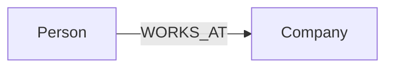
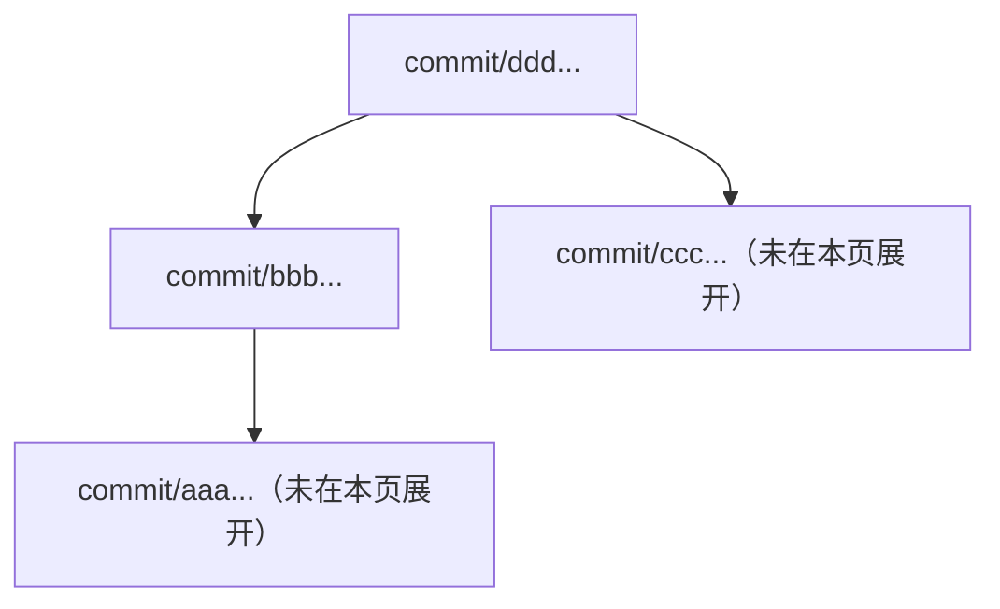

# MCP 与私人 OpenAI Plugin

<!-- cspell:words Streamable Asyncify -->

本文件是 KG OS **MCP Server、受控 JavaScript SDK 执行、私人 OpenAI Plugin / Skill 连接，以及 `kgos_preview` / `state_ancestry` 只读 Markdown 视图**的设计真源。KG OS 的业务语义不由 MCP 重新定义：Ontology 见 [Ontology](ontology.md)，Object / Patch 见 [Object](object.md)，Cypher 见 [Graph](graph.md)，State / Branch / Commit 见 [Evolution](evolution.md)，本地 daemon 与认证见 [Runtime](runtime.md)，公共 TypeScript SDK 见 [Client](client.md)。

此处定义的是**MCP 目标设计**，不把在开发中的实现或本地打包误写成已正式发布。当前公开的 v0.2.1 SDK / CLI / `kgosd` 不包含 MCP Server、OpenAI Plugin、沙箱或 Preview 生成器。私人 Plugin 是可选的 ChatGPT 集成方式，MCP Server 本身独立服务其他标准 MCP Client；二者都不是 Lithograph 模块。

## 目标与边界

- AI 使用 KG OS 时应先了解真实的 Branch / Commit / Ontology，然后按需读取和操作 Knowledge；避免每次为了取得版本及模型结构都先编写一段 JavaScript。
- 少量高价值的 MCP 直接读取工具负责导航；两个 JavaScript 执行工具负责组合完整公共 SDK 能力。不把 SDK 每个方法机械提升为单独的 MCP Tool，也不在 MCP 定义新的知识模型、Search DSL 或事务语义。
- `kgos_preview` 提供**完整的 Ontology 只读视图，按行取窗口**；不为节省上下文而删除 Definition、Property、Constraint、Index 或关系。它不保存可编辑 Markdown、不提供文件系统路径、不产生新的数据库资源。
- AI 的模型理解、信息提炼、Commit Message 编写以及工具编排属于外部 AI / 官方 Skill；MCP 只提供确定性数据、执行与安全边界。
- ChatGPT Web 与 Desktop 为目标客户端；用户自托管自己的 KG OS Instance 和 MCP Server，私人安装自己的 Plugin。**不提交公共插件目录，不集中托管用户知识库。**

## 部署与责任划分

```text
ChatGPT Web / Desktop 或其他 MCP Client
                   │
                   │ 用户提供的 HTTPS / 安全通道
                   ▼
       MCP Server（Linux amd64 Docker 镜像）
            ├── MCP 认证与授权
            ├── kgos_preview（只读视图）
            ├── state_ancestry（历史导航）
            ├── kgos_read / kgos_run（JavaScript）
            ├── QuickJS WASM Sandbox / Node.js Worker
            ├── 同进程受控 SDK 方法桥接
            └── 固定的 Workspace / Instance
                   │
                   ▼ @kgos/sdk（HTTP + Bearer）
               kgosd（本地 IPv4 loopback）
                   │
                   ▼
          KG OS Kernel → Lithograph → SQLite

私人 OpenAI Plugin
├── 用户已注册 MCP Connection 的引用
└── KG OS 官方 Skill（AI 操作流程 / SDK 用法）
```

- MCP 是独立的 TypeScript 服务进程，不嵌入 `kgosd`，也不需要让 `kgosd` 改为公网监听。**进程独立不等于用户必须部署两个服务**：官方仅交付一个完整的 Linux amd64 Docker 镜像，镜像内部包含 MCP、CLI / SDK 和 Runtime，不要求宿主机部署 `kgosd`。每个 MCP Server 实例**绑定一个显式 Workspace Root**；工作代码不能通过 Tool 参数选择另一个 Instance。容器内复用现有 CLI / Runtime 能力连接或确保 `kgosd` 启动，解析 `<root>/.kgos` 的 active daemon locator / credential，再为真实 SDK 构造明确的 endpoint / token；`@kgos/sdk` 继续**不读取本地文件或自动启动 daemon**。
- MCP 只使用 KG OS 公开 HTTP / SDK 业务合同，不读 SQLite 内部表、不直接实现 Cypher、Ontology compiler 或 Version Engine；MCP 客户端是否安装官方 Skill 不影响 MCP Tool 的协议可用性。
- 对外使用 Streamable HTTP，默认路径 `/mcp`。用户自行选择 Tunnel、反向代理、直接公网 HTTPS 或其它目标客户端支持的安全接入方式；MCP **不内置、不指定、不要求**任何 Tunnel/代理供应商、域名或公网地址配置。远程访问必须具备可用的加密传输与有效认证，可以由 MCP 直接配置 TLS，或由用户可信的 HTTPS 终止层提供。**不得把 `kgosd` 的单 Token loopback HTTP 直接代理成无保护的公网 API**；MCP 外部认证与本地 `kgosd` Bearer 是不同的信任边界。认证、会话或隧道安全策略必须在部署时真实生效，不能只在 Plugin 中写个 Token。ChatGPT 使用单管理员 OAuth 2.1 授权入口，其它支持静态凭证的 MCP Client 可继续使用原 Bearer；OAuth 与原 Bearer 均在 MCP 侧验证，绝不把 `kgosd` 的 Instance Token 提供给外部。
- Source 布局计划为 `packages/mcp/`（服务端）与 `plugins/kgos/`（官方 Skill、Plugin 模板、面向 AI 的安装说明），与现有 `packages/sdk/` / `packages/cli/` 并列。这是**同一 KG OS 仓库**内的构建职责划分，不是第二个仓库或第二套知识系统。发送给 ChatGPT 的 Plugin 包**不包含需要在用户电脑运行的 MCP Server**。

## 部署交付与运行合同

### Docker-only 交付

KG OS MCP 官方仅交付**Linux amd64 Docker / OCI 镜像**。不交付独立 MCP npm 包，也不提供 Linux arm64 Docker 镜像；此范围不影响已公开的 `@kgos/cli`、`@kgos/sdk` 及六平台 Runtime npm 产品。用户仍自行决定公网 HTTPS、隧道或代理接入方案。

| 形式 | 部署单元与依赖 | 使用方式 |
| --- | --- | --- |
| Linux amd64 Docker / OCI 镜像 | 自包含镜像，包含 Node.js、MCP、CLI / SDK、`kgosd`、QuickJS WASM 与匹配的官方 Lithograph / Provider / Jieba 扩展；不向 Docker Host 索取运行依赖 | 用户运行**一个容器**得到 MCP 服务；容器内 MCP 与 `kgosd` 可为不同进程，内部依旧使用 loopback，不要求宿主机 daemon、host network 或宿主机的 `kgosd.lock` |

- `packages/mcp/` 保留为仓库内部 **private TypeScript 模块**，容器内可执行的 `kgos-mcp` 命令属于镜像内部接口。构建时可用临时 npm tarball 将 MCP / SDK / CLI 安装到镜像，但它们只是**内部构建中间物**，不得作为官方 MCP npm 发布产物或用户部署路径，也不新增六平台 MCP npm CI。最终镜像包含已构建的 JS、WASM 与匹配 Linux amd64 的 Runtime；运行时不能依赖仓库 `node_modules`、源码路径、本机缓存或宿主构建工具。镜像正式发布是独立动作，不能仅因本地构建成功而宣称已公开交付。
- `kgos-mcp serve` 连接**一个已初始化**的 Workspace；正常启动会按既有 Runtime 规则复用或确保 `kgosd` 就绪，不要求用户另起第二个部署服务。初始化仍由现有 `kg init` 负责，MCP 不复制数据库配置或隐式替用户选择初始化参数。Docker 镜像需支持在**同一镜像内**执行初始化并将 Workspace 固定在持久化 volume；重建容器不得删除 `.kgos` 数据。未初始化时 `serve` 清晰失败，不以隐藏默认参数创建知识库。
- Docker 内的服务入口负责启动、退出信号转发、清理自己管理的内部进程和重启后恢复，避免留下孤儿进程或陈旧运行状态；容器内只需对外暴露 MCP 监听端口，**不发布内部 `kgosd` 端口**。Docker 镜像的普通运行路径采用非 root 用户，持久卷、secret 与证书权限须可由该用户正常访问。
- Linux amd64 镜像使用与官方预构建 Runtime 匹配的运行环境，不因 Alpine/musl 不兼容而在容器运行时自行重编译扩展。官方镜像使用 GitHub Container Registry：`ghcr.io/<GitHub owner 小写>/kgos-mcp:v<版本>`。镜像版本与仓库 `v<版本>` Release Tag 对应，附带源 Commit revision 与 GitHub repository OCI label；正式运行建议固定已发布的 digest。**当前配置发布流程不等于镜像已实际上传或已开放匿名拉取**。
- 正式发布沿用现有 `v*` Release 验证链：先完成同版本 CLI / SDK / 六平台 Runtime npm 发布与 registry smoke，确保镜像构建需要的官方 Linux x64 Runtime 扩展已可取得；再从相同的 Release Commit 构建 **linux/amd64** 镜像，使用一次性 Volume/Instance 对**待发布的精确镜像**执行 MCP 四 Tool、真实 SDK、重启持久化测试，成功后以 GitHub Actions `GITHUB_TOKEN` 的 `packages:write` 权限推送 GHCR 并验证 revision/架构/digest。Github Release 最终关闭必须等待镜像发布验收成功，不能从曾经通过的 Dev 镜像或一次无关 npm smoke 推断镜像发布完成。镜像正式发布和生产部署是不同动作，镜像首次入库后的公开可见性/拉取权限按 GHCR 实际设置验收。
- **验证与发布职责按 [D92](decisions.md#d92-mcp-dev-acceptance-and-release-ci) 分离**：MCP 的 Linux amd64 Docker 全功能/集成验收在独立 Dev 中完成（真实服务只读检查与独立临时 Instance 写入 Smoke 分开）；普通 PR/main CI 只执行现有工程检查和 CLI/SDK/Runtime 六平台 native/package 回归，**不构建或发布 MCP Docker 镜像**。只有获准的正式 Release 才按上一条构建并验证拟发布的镜像；Release 的产物 Smoke 不能替代此前 Dev 全功能验收，也不作为 Phase 15 `done` 的前置发布动作。各阶段的实际验收状态由 [Phase 15](../development/phases/15-mcp.md) 记录。

### MCP 命令与配置优先级

```text
kgos-mcp serve [options]       启动独立 MCP HTTP 服务；Docker 默认服务入口
kgos-mcp doctor [options]      只读诊断 Instance、服务配置与本机就绪条件
kgos-mcp [--help | --version]  入口帮助与当前版本
kgos-mcp serve --help          Serve 专属选项：常用优先、高级参数按组显示
kgos-mcp doctor --help         Doctor 专属选项及 --json
```

- **配置来源：显式命令参数 > 对应环境变量 > 已公开的内部默认值**。唯一例外是 Workspace Root：`--root` > 非空 `KGOS_ROOT` > 明确错误，不使用 `cwd`、父目录搜索或自动选库。除了 `KGOS_ROOT`，下面的 MCP 参数使用固定的 `KGOS_MCP_` 前缀环境变量；空值、未知参数、无效整数 / 枚举或互斥选项均明确拒绝，不静默忽略、裁剪或猜测配置。
- `serve` 必须用真实的指定 IP/loopback 地址监听，可选动态/指定端口；日志启动行返回**实际**绑定的 host、port、path、HTTP/HTTPS scheme；`--port 0` 只作为 bind 输入，不把 `:0` 宣称为已可用 endpoint。启动日志不回显任何凭证，也不根据本机监听推断公网已经可访问。
- `doctor` 复用同一配置解析和校验，支持 `--json` 的有界机器可读就绪结果；只读检查 Workspace 初始化状态、native Runtime / 扩展可用性、现有 daemon / SDK 连接状态、MCP 监听与 TLS 配置以及凭证来源是否可读取。它**不**自动初始化、启动 daemon、绑定公网端口、开启 Tunnel 或修改配置，也**不能**凭本地诊断宣称远程地址已连通。`serve` 在启动前执行必要就绪检查并可按现有 Runtime 规则启动 daemon。

下表是完整的**公共部署参数面**。`mb` 表示 MiB（`1024 × 1024` bytes），所有长度/时间参数必须为有界正整数；详细取值范围在首次实现时以实际资源/协议能力验证并同时固定到 CLI `--help` 与安装指南，不增加第二套配置文件或兼容别名。

| 分组 | CLI option | 环境变量 | 含义 / 默认值 |
| --- | --- | --- | --- |
| Instance | `--root <path>` | `KGOS_ROOT` | 必填来源；绑定唯一 Workspace Root |
| 网络 | `--host <address>` | `KGOS_MCP_HOST` | 默认 `127.0.0.1`；允许指定接口 IP、`0.0.0.0`；与 TLS / 上游网络保护配合 |
| 网络 | `--port <0..65535>` | `KGOS_MCP_PORT` | 默认 `3777`；`0` 由 OS 动态分配 |
| 网络 | `--path <path>` | `KGOS_MCP_PATH` | 默认 `/mcp`；单一规范 HTTP 路径，以 `/` 开始，不含 query/fragment |
| 认证 | `--token-env <name>` | `KGOS_MCP_TOKEN_ENV` | Token 环境变量的**名称**；没有其它来源时默认读取 `KGOS_MCP_TOKEN` |
| 认证 | `--token-file <path>` | `KGOS_MCP_TOKEN_FILE` | 从受保护的文件读取 MCP Token，适用于容器 Secret；默认不使用 |
| 认证 | `--oauth-issuer <url>` | `KGOS_MCP_OAUTH_ISSUER` | 可选，启用单管理员 ChatGPT OAuth；值为外部 HTTPS 公共 origin（仅本机开发允许 HTTP loopback）；无默认值 |
| TLS | `--tls-cert <path>` | `KGOS_MCP_TLS_CERT` | 服务端直接 HTTPS 时证书路径，默认无 |
| TLS | `--tls-key <path>` | `KGOS_MCP_TLS_KEY` | 对应私钥路径，默认无 |
| 生命周期 | `--startup-timeout-ms <n>` | `KGOS_MCP_STARTUP_TIMEOUT_MS` | 等待已初始化 Instance / 内部 daemon 就绪的上限；默认 `10000` |
| 生命周期 | `--shutdown-timeout-ms <n>` | `KGOS_MCP_SHUTDOWN_TIMEOUT_MS` | 服务退出时等待在途请求清理的上限；默认 `10000` |
| HTTP | `--request-timeout-ms <n>` | `KGOS_MCP_REQUEST_TIMEOUT_MS` | 单次完整 MCP 请求的墙钟上限；默认 `30000` |
| HTTP | `--max-concurrency <n>` | `KGOS_MCP_MAX_CONCURRENCY` | 同一 MCP 服务所有客户端在途请求数；默认 `16` |
| HTTP | `--max-request-bytes <n>` | `KGOS_MCP_MAX_REQUEST_BYTES` | 单次请求正文长度上限；默认 `1048576` |
| Sandbox | `--script-timeout-ms <n>` | `KGOS_MCP_SCRIPT_TIMEOUT_MS` | 单次 JS 脚本含 SDK 等待的墙钟上限；默认 `15000` |
| Sandbox | `--script-memory-mb <n>` | `KGOS_MCP_SCRIPT_MEMORY_MB` | 单个 QuickJS 执行上下文内存预算；默认 `64` |
| Sandbox | `--script-max-code-bytes <n>` | `KGOS_MCP_SCRIPT_MAX_CODE_BYTES` | 单次 `code` UTF-8 bytes 上限；默认 `65536` |
| Sandbox | `--script-max-calls <n>` | `KGOS_MCP_SCRIPT_MAX_CALLS` | 单次脚本 SDK 调用预算；默认 `2048` |
| Sandbox | `--script-max-streams <n>` | `KGOS_MCP_SCRIPT_MAX_STREAMS` | 单次脚本最大同时打开的 SDK Stream；默认 `32` |
| Sandbox | `--script-max-output-bytes <n>` | `KGOS_MCP_SCRIPT_MAX_OUTPUT_BYTES` | 单次 JSON 结果 bytes 上限；默认 `4194304` |
| Preview | `--preview-max-items <n>` | `KGOS_MCP_PREVIEW_MAX_ITEMS` | 生成完整视图允许处理的最大对象数量；默认 `50000` |
| Preview | `--preview-cache-entries <n>` | `KGOS_MCP_PREVIEW_CACHE_ENTRIES` | 进程内最多缓存多少份固定 Preview；默认 `8` |
| Preview | `--preview-cache-ttl-ms <n>` | `KGOS_MCP_PREVIEW_CACHE_TTL_MS` | 一份 Preview 缓存有效期；默认 `600000` |
| 日志 | `--log-level <level>` | `KGOS_MCP_LOG_LEVEL` | `error / warn / info / debug`；默认 `info` |
| 日志 | `--log-format <format>` | `KGOS_MCP_LOG_FORMAT` | `text / json`；默认 `text` |

#### 参数语义与安全约束

- 认证凭证只接受上述**两种 Token 来源**，不提供明文 `--token`、匿名模式或在镜像中预置凭证。`--token-env` 和 `--token-file` 在同一显式配置层互斥；高优先级的来源覆盖低优先级选择，默认只从 `KGOS_MCP_TOKEN` 取得值。Token 文件须有界读取，允许去除一个终止换行，不能对任意空白或其它有效内容做静默修改；凭证缺失、不可读取或不足现有最小长度时启动拒绝。MCP Token 与 `<root>/.kgos/auth.json` 的 daemon Token 必须隔离，任何凭证都不出现在 URL、日志、`doctor`、镜像或诊断消息。
- `--tls-cert` 与 `--tls-key` 必须一起提供；未提供时 MCP 仅提供 HTTP，可用于可信本机或由用户自行负责的可信内网反向代理 / Tunnel。`--host 0.0.0.0` **只决定绑定地址，不提供 TLS、身份验证豁免或公网安全保证**；公网明文暴露 Token 不符合远程部署完成标准。用户自行选择直接 TLS 或上游 HTTPS 终止，MCP 不管理公网域名、证书签发、Tunnel 或代理供应商。
- 总 `--request-timeout-ms` 覆盖服务端收到请求到最终响应的时间；`--script-timeout-ms` 仅覆盖 JavaScript 执行（含等待 SDK），对同一脚本以**先触及的限制**生效。HTTP 请求大小 / 并发限制不能让无界请求在入队前占用资源；超限返回明确安全错误，不阻塞其它请求，也不改变已发出写入可能部分成功的事实。Sandbox 其余 CPU interrupt、Worker 终止及内部 Bridge 数据预算仍必须有界，但不因此增加重复的公共参数。
- Preview 资源预算与 `kgos_preview` 的**固定行窗口合同**独立：配置改变的是容量和缓存寿命，不改变 `offset/limit/viewRevision`、完整 Ontology 或不截断原文的保证。缓存依旧按认证调用者和 Instance 隔离，驱逐后的 revision 返回 `VIEW_EXPIRED`。
- `doctor` 的机器输出区分 `config`、`instance`、`runtime`、`mcp` 的本地状态以及是否缺少用户侧远程验证证据；避免把 `ready=true` 误写成目标 ChatGPT 已连通。服务运行的日志可按级别和格式切换，日志/结构化错误都不回显 secret、JavaScript 宿主堆栈或本地令牌。

#### 单管理员 ChatGPT OAuth 认证

- 默认维持 MCP 外部静态 Bearer 认证；显式设置 `--oauth-issuer` / `KGOS_MCP_OAUTH_ISSUER` 后，**同一 MCP Server**额外提供 ChatGPT 可用的 OAuth Authorization Code + PKCE（S256）授权。此地址为用户已部署的公网 HTTPS **origin**（含 scheme/host/可选 port，不含 path/query/fragment/userinfo）；只有 `http://127.0.0.1` / `http://localhost` 的开发验证例外。它只确定外部公开 issuer/resource、OAuth metadata 与回调地址，不创建域名、证书、代理或 Tunnel；MCP Tool endpoint 仍为 `issuer + --path`。
- MCP 资源服务器匿名提供 `/.well-known/oauth-protected-resource` 和按实际 MCP path 定位的 `/.well-known/oauth-protected-resource<mcp-path>`（默认 `/.well-known/oauth-protected-resource/mcp`），两者返回一致 metadata；OAuth 授权服务器匿名提供 `/.well-known/oauth-authorization-server`。对未授权 MCP 请求返回 HTTP 401 + `WWW-Authenticate: Bearer resource_metadata=...`，指向按 path 定位的资源 metadata，兼容 OAuth 自动发现。metadata 中的 canonical `resource` 和 `issuer` 为配置的 issuer origin，授权与 Token 请求必须携带并匹配该 `resource`；`kgos:access` 是单管理员四 Tool 的最小独立 Scope。OAuth endpoints 为 `/oauth/authorize` 和 `/oauth/token`，不额外新建网络进程。
- ChatGPT 客户端使用 **Client ID Metadata Documents（CIMD）**：仅接受实际来自 `https://chatgpt.com/oauth/client.json` 或回调 ID 专用的 `https://chatgpt.com/oauth/<id>/client.json`，从该固定可信来源通过 HTTPS 获取 metadata，校验文档 `client_id` 与 URL 精确相等、所请求的 `redirect_uri` 在 `redirect_uris` 中、声明兼容 public client `none`；不接受任意客户端传入的 metadata URL 或未校验回调。Authorization Server metadata 只声明真正实现的 `client_id_metadata_document_supported: true`、`token_endpoint_auth_methods_supported: ["none"]` 和 `code_challenge_methods_supported: ["S256"]`，**不**虚报 DCR / private_key_jwt。未来其它 OAuth 客户端兼容另行设计；现有普通 MCP Client 保留静态 Bearer。
- 浏览器首次授权只展示本服务器提供的受保护 Token 表单；用户输入**现有 MCP 管理员 Token**，服务端以恒时摘要校验，通过后向已校验 ChatGPT 回调发送一次性短效 authorization code、客户端 `state` 和 issuer `iss`，不向客户端泄露管理员 Token。授权表单使用限时一次性 ticket（POST）、明确的拒绝操作、禁止缓存/第三方资源、必要的来源校验及尝试次数限制。**授权 HTML** 使用 `Referrer-Policy: strict-origin`：保障浏览器同源 POST 携带可校验的 `Origin`，但 Referer 只透露公开 origin、不包含 OAuth query；**其余 OAuth 响应**保留 `no-referrer`。凭证、code、access/refresh Token 均不得进入 URL 日志或普通诊断，只有一次性 code 出现在 TLS 保护的 OAuth 回调 URL。
- `/oauth/token` 对 authorization_code 严格校验一次性 code、`client_id`、完全相同的 `redirect_uri`、`resource` 与 RFC 7636 `code_verifier` S256，成功后签发随机高熵**不透明** Bearer access/refresh Token。服务器存储 Token 摘要与 issuer/resource/client/scope/有效期关联，MCP 每次调用验证存续期、Audience 和 Scope；Refresh Token 限时、一次性轮换，服务重启失效后重新授权。Token / Code / Ticket 状态均有过期、容量上限、无凭证日志；不引入用户表、数据库或独立认证服务。默认 Access Token 1 小时、Refresh Token 30 天、Code 1 分钟、授权 ticket 5 分钟，凭证变更重启后原授权自然失效。
- 浏览器授权只提供单管理员全部四 Tool 权限；不假装实现多账户、多 Scope 的细粒度权限模型。认证与 HTTPS 两者缺一不可；OAuth 与静态 Bearer 都不得接触本地 `kgosd` 的 Instance Token。是否真正被 ChatGPT Web/Desktop 接受须用真实客户端另行验证，不能用协议模拟测试冒充。

### 首次使用与验收边界

1. 用户通过 Linux amd64 Docker 镜像取得**完整可运行**的 MCP 部署单元。全新 Workspace 先在容器内按已有 `kg init` 明确提供初始化配置，现有 Workspace 直接复用；两种情况均使用持久化 Instance，不需要宿主机安装 daemon。
2. 使用 `kgos-mcp serve` 启动，`doctor` 可以做本地预检。MCP 成功确保本地 `kgosd` 后按配置监听 `/mcp`，若动态端口则打印实际地址；使用 Token 来源和可选 TLS，绝不把内部 daemon endpoint 作为公网入口。
3. 用户**自行**配置远程 HTTPS 地址、隧道或其它客户端支持的安全接入通道，产品不代替用户选择。服务本地 `listening` / `doctor ready` 仅表明本地就绪；**远程部署完成**要求目标 MCP Client 经其实际远程地址/通道完成认证、四 Tool 发现及真实调用。远程地址或通道的具体实现不进入 KG OS 的参数表。
4. Linux amd64 Docker 镜像必须通过干净构建、实际容器初始化/连接、持久数据/重启恢复、指定/动态监听、参数优先级、TLS 两种终止位置、缺失/错误凭证、不同 Instance 与流式/取消等验收；特别验证不借助宿主 `kgosd` / host networking、非 root 与 SIGTERM 清理。测试成功不等于 OCI Registry 或 Plugin 已经实际公开发布。

## MCP 工具边界

| Tool | 输入 | 职责 |
| --- | --- | --- |
| `kgos_preview` | 虚拟文件行窗口 | 所有 Branch / Head Commit / 完整 Ontology 的按行只读预览 |
| `state_ancestry` | `root`、`limit?`、`cursor?` | 指定 Root 可达的 Commit DAG 与完整原始 Message，按 Commit 分页 |
| `kgos_read` | `code: string` | 在隔离 JavaScript 中执行只读 SDK 方法与计算 |
| `kgos_run` | `code: string` | 在隔离 JavaScript 中执行完整公共 SDK 方法与计算，包括写入 |

首版 MCP Tool 收敛为上述**四个工具**：两个直接读取入口与两个 JavaScript 入口。`kgos_preview` / `state_ancestry` 的输入、输出和 Markdown 合同见下文；`kgos_read` / `kgos_run` 的统一执行合同见下一节。独立 `ontology_read`、`state_get`、`evolution_overview`、`branch_list` 均已决定不提供，相关信息分别由 Preview / Ancestry 或 JavaScript SDK 获取。首版不额外建立 MCP Resources、Prompts 或专用 Search Tool。

### JavaScript SDK 执行

#### 共同接口与语言能力

`kgos_read` 和 `kgos_run` 使用**完全相同**的输入 / 成功返回格式，只有可调用的 SDK 方法不同：

```ts
type ScriptInput = {
  code: string;
};

type ScriptOutput = {
  result: JsonValue; // 复用 @kgos/sdk 的 JSON-compatible 类型
};
```

- `code` 是**异步 JavaScript 函数体**，支持 `async / await`、普通函数、变量、分支、循环、数组 / 对象、`Map` / `Set` 计算、`Promise.all()` 与 `for await...of` 流式消费。无需 import、Client 初始化、Endpoint、Token 或单独配置，也不额外增加 `state / branch / format / dryRun` 等 Tool 参数。
- Sandbox **直接提供四个顶层命名空间**：`ontology`、`object`、`graph`、`evolution`。使用 `await graph.query(...)`、`await evolution.branch.list()`；**没有 `kgos.`、`sdk.` 前缀或第二套简写别名**。方法的参数、结果、错误和 StateRef 继续属于 `@kgos/sdk` 及对应业务 owner；一次脚本内的不同 SDK read 不会自动绑定同一个 State，调用方应显式使用同一个 resolved Commit 进行跨操作一致读取。
- `return` 是**唯一正式结果出口**，可返回 JSON-compatible 的对象、数组、字符串、数字、布尔值或 `null`，MCP 成功结果统一为 `{ result: <返回值> }`。返回 `undefined` / 未执行 `return`、函数、`BigInt`、非有限数字、循环引用或其它不能无损表达为 JSON 的值时明确报执行结果错误，不能静默转换成 `null`、`{}` 或删字段。不额外提供独立的 `console.log` 输出合同；需要返回调试信息时直接放进 `return`。
- 每次 Invocation 的 JS 全局变量独立且结束即丢弃，不创建跨调用 Session；知识库持久状态只存在于原有 KG OS API / 数据库中。

例如只读脚本：

```js
const { state } = await evolution.overview();
const models = await ontology.read({ at: state, refs: ["node:Person"] });
const data = await graph.query({
  at: state,
  cypher: "MATCH (n:Person) RETURN n.name LIMIT 10"
});
return { state, models: models.results, data: data.rows };
```

#### SDK 能力边界

| Namespace | `kgos_read` | `kgos_run` 额外开放 |
| --- | --- | --- |
| `ontology` | `read` | `patch` |
| `object` | `read`、`readText` | `patch` |
| `graph` | `query`、`streamQuery` | `execute`、`streamExecute` |
| `evolution` | `overview`、`get`、`ancestry`、`history`、`diff` | 无额外顶层方法 |
| `evolution.state` | 无 | `create`、`setData`、`clearData` |
| `evolution.branch` | `list` | `create`、`delete` |
| `evolution.tag` | `list` | `create`、`move`、`delete` |
| `evolution.merge` | `list`、`get`、`conflicts` | `start`、`resolve`、`finalize`、`abort` |

- `kgos_run` 包含左列所有读取方法及右列所有写入方法，**完整复用当前公共 SDK 能力**，不在 MCP 再实现 Ontology compiler、Cypher、Merge 或事务。`kgos_read` 不暴露任何右列方法；方法隔离必须在**宿主侧实际调用校验**，不能仅依靠 TypeScript 声明、隐藏对象字段或 JavaScript 属性名。SDK 将来新增方法不自动进入只读许可集，须先按真实读写语义分类。
- 两个工具均使用同一个 Sandbox 实现。`kgos_run` 在 MCP Tool 级明确标记可能修改或删除状态，由 MCP 客户端按真实工具风险完成授权；**不为每个 SDK 方法另设一次确认协议**。`kgos_read` 是数据库只读 SDK 方法集合，不对外承诺所有底层执行都没有其它副作用；MCP metadata 不得作虚假安全声明。

#### Sandbox 选型、执行与资源边界

- 选定 **QuickJS WebAssembly + Node.js Worker**：在 Worker 内的独立 QuickJS runtime/context 执行用户 JavaScript，Worker 可由宿主终止；不使用 `node:vm` / `vm2` 代替隔离，不引入需要维护多平台原生构建的 V8 插件，也**不新增独立 SDK Gateway 服务**。Worker / WASM 是 MCP Server 进程内的执行组件，不是另一个需要用户部署的服务。
- Sandbox 只向脚本暴露上述四个命名空间中允许的方法与普通 JavaScript 能力，不暴露 Node.js `process`、环境变量、`fs`、`child_process`、任意 `import / require`、宿主 `fetch`、真实 SDK 实例、Bearer Token、文件句柄或主机对象。真正的 `@kgos/sdk` 与 Token 留在宿主侧；Worker 与宿主之间通过**只承载已允许方法名、JSON-compatible 参数 / 结果**的受控调用桥接执行 SDK。每次请求都由宿主核验 Invocation 身份、权限和方法白名单，禁止由代码构造任意 HTTP/SDK 调用路径。这是内部接口，不是独立服务或第二套业务 API。
- 资源预算由 Sandbox / 宿主共同限制：CPU 指令 / 中断、JS 内存与栈、总墙钟时间、SDK 调用次数和结果字节量。超限立即结束当前执行并返回明确错误，不能用静默截断伪装成功；已确认的资源预算通过上文统一 CLI / 环境变量进行配置，内部中断 / Bridge 仍使用有界安全值，不另建配置文件或服务。取消 / 超时后终止 QuickJS 执行并使用 SDK 已有 AbortSignal 尽力取消在途请求；不可声称第三方调用或已完成的写入可被强制回滚。
- SDK 的异步 Promise 桥接必须支持 `Promise.all()`，`graph.streamQuery / streamExecute` 必须能用 `for await...of` 逐事件消费并传递 backpressure / 终止 / 取消，**不得把无限流先聚合成完整数组**。优先验证普通 QuickJS WASM 的宿主 Promise 桥接与 Worker 生命周期，不把 Asyncify 当成默认并发执行方案。QuickJS 隔离、宿主对象不可达、终止 / 资源限制与 macOS、Linux、Windows 运行证据均属于实现前必须完成的技术验收；**已选技术不等于已验证安全实现**。
- Sandbox 限制的是**脚本对宿主的直接访问**，不是修改数据库的 Cypher 能力：`graph.query / execute` 继续完全遵守 [Graph 原样执行合同](graph.md#graph)，MCP 不解析、拦截、改写或额外约束 Cypher，也不为文件 / 网络访问新增 Tool、参数或引导流程；底层依照 `kgosd` 当前实际运行权限执行。来自数据库的文本、Ontology、Commit Message 均只是数据，不能改变沙箱权限和工具行为。

#### 写入、错误与部分成功

- `kgos_run` 允许在一个脚本中按顺序或并发调用任意已开放的 SDK 操作，但**整个 JavaScript Invocation 不构成自动事务**；单次 Object / Ontology Patch 的 `baseState` / Branch CAS、Graph Execute 的真实 Cypher 提交及 Evolution / Merge 的 revision 校验继续按原合同执行。不会因为多个 SDK 调用写在一个 `code` 中就自动保证原子性，也不创建跨方法 transaction、staging、`dryRun`、自动回滚、补偿或写入重试。
- 若第一条写入成功、后续写入失败，**已成功的写入不会被撤销**，整个未捕获异常的脚本返回错误。例如 `branch.create` 成功后 `tag.create` 失败，创建的 Branch 仍然存在；调用方可通过 `branch.list` / `tag.list` 等 API 核实。成功的 SDK 调用返回值可在脚本中由调用方自行保留，但 MCP 不会根据日志推断整个执行成功、已回滚或可以安全重放。
- JS 语法 / 运行错误、SDK 错误和 Sandbox 超限 / 取消都与正常 `return` 区分，MCP 调用失败时使用 `isError: true` 和有界、无凭证的结构化错误信息。SDK 公共错误保留已有 `code/message` 与安全的 `details`；脚本自身错误不伪装成数据库公共错误，超限明确报 `RESOURCE_ERROR`，取消明确标记为取消。宿主异常堆栈、Token 或执行器内部细节不得进入模型结果。脚本自行 `try/catch` 并 `return` 的 JSON 属于调用方显式决定的成功结果，MCP 不隐式替它判定每条写入成功。
- **超时、取消、断线或通信失败后，已发出的写入可能完成，也可能尚未完成**；结果未知时不得报告“写入失败且无副作用”，也不得自动再次提交。使用既有 Branch Head、State、History、Tag 或 Merge Session 读取来确认真实结果，不增加额外的持久执行日志 / 操作状态库。

例如：

```js
const { state } = await evolution.overview();
const created = await evolution.branch.create({
  name: "experiment",
  from: state
});
const branches = await evolution.branch.list();
return { created, branches: branches.items };
```

上述脚本如果 `branch.create` 已经成功，而后续 `branch.list` 失败，工具返回错误，但 Branch 仍可能已存在；**一次 Tool 失败不等于本次脚本中的所有 SDK 操作都回滚**。

## Markdown 阅读呈现规范

`kgos_preview` 的 `preview` 与 `state_ancestry` 的 `markdown` 都是供 AI 阅读的 Markdown **正文**，不是将整份文档套进一个代码块。采用语义化代码块区分原始数据与导航结构：

- **导航**：Branch / Commit / Domain / Definition 的目录、准确 Ref、分页信息与跳转索引使用普通 Markdown 标题和表格；表格只存适合单行导航的字段，复杂长文本不能只挤在表格中。
- **Commit Message**：在每个 Commit 下以标记为 `markdown` 的独立 fenced code block **完整展示原始 Message**；不切割 `## 简介` / `## 改动`、不总结、不截断、不把其标题当成外层文档标题。无 Message 时明确显示缺省，不虚构文本。Preview 可另外解析规范简介的首个非空行用于**分支索引**，不改变正文的原样展示规则。
- **Ontology**：模型关系图使用 `mermaid`；Domain / Definition 的完整公共 Object Value 使用 `yaml` fenced code block，复用 [Object canonical YAML](object.md#object-value-与-representation) 的同一字段和序列化规则，不创建另一种摘要格式。分支、Domain、Definition 的定位 Ref 留在外层标题或索引中，不混入可编辑 Object body；完整 `includes`、Property、Constraint、Index、Relationship `from/to` 与长说明均不得丢失。必要的 Cypher / JSON 片段依真实数据类型使用对应语言标签。
- **安全转义**：fenced block 采用长度**严格大于正文中最长连续反引号序列**的反引号围栏（至少三个），避免 Message、说明或 YAML 值中的反引号提前闭合。表格单元、Mermaid 名称/Label、链接及其它非 fenced 展示位置要确定性转义，不让来自数据库的文本伪造章节、图边或指令；代码块语言标签由 renderer 选择，不由用户文本控制。
- **无损与计数**：代码围栏、标题、表格属于只读展示层，不修改 Commit / Ontology 存储，也不成为新的 Patch 格式。所有原始信息须可通过对应 SDK 公共值找回；Preview 按已有 UTF-8/LF 文档规范输出，必须**在全部代码块与转义最终渲染后**计算绝对 Offset / Lines。分页窗口可以落在 fenced block 中间，不插入额外边界行。

## `kgos_preview`：虚拟 Markdown 文件

### 输入与输出

```ts
type PreviewInput = {
  offset?: number;        // 默认 0，0-based 绝对行偏移
  limit?: number;         // 默认 300，允许 100..500
  viewRevision?: string;  // 继续读取已冻结的进程内预览
};

type PreviewOutput = {
  totalLines: number;     // 本份完整虚拟 Markdown 文档的行数
  offset: number;         // 本次读取起始行，0-based
  lineCount: number;      // 本次实际返回的行数
  viewRevision: string;   // 进程内视图标识，非 Commit/Branch identity
  preview: string;        // 原始 Markdown 行窗口
};
```

- 不传 `viewRevision`：枚举当前**全部 Branch**，按名称 UTF-8 bytes 升序生成一份**完整、不可变**的虚拟 Markdown 文档，存于 MCP Server 的有界**进程内缓存**，再取 `offset..offset+limit` 窗口。没有分支筛选参数，所有分支的索引和绝对行号始终使用同一份完整文档。
- 传 `viewRevision`：从缓存中读取**原始同一份文档**，**绝不重新解析最新 Head 后拼接旧行号**。同一 revision 对应的内容、行号和 `totalLines` 均不变。缓存按被认证的调用者与绑定的 Instance 隔离，不能仅凭猜到或复用其他连接的 revision 读取对方视图。
- `offset` 是从文档**第 0 行**开始计数的绝对行偏移。各索引中的 `Offset` / `Lines` 使用同一坐标系；窗口 `[offset, min(offset+limit, totalLines))`。允许 `offset == totalLines` 返回 `lineCount=0`；负数、非整数或超出范围报错。尾页可不足 100 行。`lineCount` 是实际行数，不包含任何重复的分页提示行。
- 统一使用 UTF-8、LF 换行与恰好一个末尾换行：**`totalLines` 等于整个文档内 LF 的数量**，最后的终止 LF 不形成额外空行；连续分页按原始行拼接即可还原**同一份完整文件**。Markdown 表格或 Mermaid fenced block 可以跨窗口，不额外插入/删除边界行。
- 内存缓存可以过期或被驱逐，进程重启也会丢失。失效的 `viewRevision` 返回明确的 `VIEW_EXPIRED`（MCP adapter 级错误），AI 重新从 `offset=0` 获取新视图；不落盘、不存入 KG OS State，也不生成可写文件。文档过大无法安全完整生成时返回明确 `RESOURCE_ERROR`，**不得裁剪模型冒充完整**。这不等同于建立虚拟文件系统。

### 版本绑定与内容来源

- 使用 `evolution.overview()` 取得默认 Branch 名，`evolution.branch.list()` 枚举**全部**真实 Branch → Head Commit；每个 Branch **固定**为枚举时观察到的 `commit/<id>`，然后对该精确 Commit 读取 metadata 与完整 Ontology。列表/默认分支查询不承诺跨多个 HTTP 请求的原子时间快照；一旦生成文档，列出的 Head 与 Ontology 不会因为 Branch 后续移动而混用。
- 从每个 pinned Commit 的 `ontology.read({at: commit/...})` 全局 Overview 开始，按 cursor 展开**全部 Domain** 及其成员，使用 visited set 处理 Domain 多父级/循环，并继续覆盖所有 Definition。对已发现 Definition 以 `object.read({at: commit/..., refs})` 分批（遵守当前 1..100 规则）取得**完整公共 Object Value**。不混合当前分支与历史分支的 Schema / Semantics；不直接访问 Lithograph internal graph / Schema。
- 文档完整包含**所有公共 Ontology Domain、Node / Relationship Definition、直接成员关系、Property、Constraint、Index、完整原始说明与必要的准确 Ref**。`Domain includes` 必须完整显示；Property-local / Definition-level 的约束和索引、共享 Index targets、Relationship `from/to`（包括 `null`）不能因渲染形式而丢失。共享资源的展示不得误导成多个独立索引，额外 Label 不等于另一 Node Definition。
- 虚拟文件**仅预览 Ontology 结构与 Commit 元数据**，不枚举 Knowledge Node / Relationship 实例，也不扫描全部 Commit DAG、Tag、State Data。若某个 Commit 当前无法按 KG OS Ontology 合同解释，整次生成明确失败或诊断，不跳过该分支并返回伪完整文件。

### 文件排版及行窗口索引

下面用**只有一个 Branch 的最小示例**演示排版；ID、Offset、Lines 和业务模型为占位值，不是可执行的 Commit ID / 行号。真实文件必须列出全部 Branch 及其完整内容。文件内索引的 Offset 指向所在章节或 Definition 的**起始行（0-based）**，Lines 是该段完整行数，范围为 `[Offset, Offset + Lines)`；不使用相对章节的行号。生成器先确定每一段的内容与行数，再填入索引，确保索引改变自身长度时仍能算出准确的绝对行号。

````markdown
# 分支

**Default:** `branch/main`

| Branch | Head Commit | 当前简介（首行） | Offset | Lines |
| --- | --- | --- | ---: | ---: |
| `main` | `commit/aaa...` | 人物、企业与任职关系的知识世界 | `<offset>` | `<lines>` |

---

# main

**Ref:** `branch/main`
**State:** `commit/aaa...`

## Head Commit

| Field | Value |
| --- | --- |
| Author | KG OS |
| Message | 见下文原文代码块 |
| Committed At | 1790000000000000（UTC Unix microseconds） |
| Parents | `commit/ccc...` |

## Commit Message

```markdown
## 简介

人物、企业与任职关系的知识世界。

## 改动

- 新增 `WORKS_AT` Relationship Definition。
```

## Ontology

### 目录

| Section | Offset | Lines |
| --- | ---: | ---: |
| 模型关系图 | `<offset>` | `<lines>` |
| Domain 组织 | `<offset>` | `<lines>` |
| Definition 索引 | `<offset>` | `<lines>` |
| Definition 详情 | `<offset>` | `<lines>` |

### 模型关系图



### Domain 组织

| Domain Ref | Title | Description |
| --- | --- | --- |
| `domain:Work` | 工作 | 管理人与组织 |

| Domain Ref | Member Ref |
| --- | --- |
| `domain:Work` | `node:Company` |
| `domain:Work` | `node:Person` |
| `domain:Work` | `relationship:WORKS_AT` |

#### `domain:Work`

```yaml
name: "Work"
title: "工作"
description: "管理人与组织"
includes:
  - "node:Company"
  - "node:Person"
  - "relationship:WORKS_AT"
```

### Definition 索引

| Ref | Title | Description | Offset | Lines |
| --- | --- | --- | ---: | ---: |
| `node:Company` | 企业 | 组织机构 | `<offset>` | `<lines>` |
| `node:Person` | 人物 | 自然人 | `<offset>` | `<lines>` |
| `relationship:WORKS_AT` | 任职 | 人与企业的任职 | `<offset>` | `<lines>` |

### Definition 详情

#### `node:Company`

```yaml
name: "Company"
title: "企业"
description: "组织机构"
properties:
  - name: "name"
    type: "STRING"
constraints: []
```

#### `node:Person`

```yaml
name: "Person"
title: "人物"
description: "现实世界中的自然人。"
properties:
  - name: "name"
    description: "人物姓名"
    type: "STRING"
constraints: []
```

#### `relationship:WORKS_AT`

```yaml
name: "WORKS_AT"
title: "任职"
description: "人与企业的任职"
from: "node:Person"
to: "node:Company"
properties:
  - name: "since"
    description: "任职开始日期"
    type: "DATE"
constraints: []
```

````

排版规则：

1. **文件首部**始终是**全部 Branch** 的索引，列出准确 Head Commit、从 Message 取得的简介首行、对应完整分支区块的绝对 `Offset` / `Lines`。`Default` 始终表示真实默认分支，所有分支区块均存在于同一份完整文件，AI 按索引直接跳读。
2. 每个 **Branch 区块**先列准确 `branch/<name>` / pinned `commit/<id>`、Head Commit 作者、原始时间及父 Commit，再以 **`markdown` 代码块展示完整原始 Message**，最后是**该 Commit 的完整 Ontology**；不从 Message 提取两段作为正文替代。
3. Ontology 先放目录，再放**完整 Mermaid 结构图**、Domain / 完整 `includes` 导航表与 Domain canonical YAML、全部 Definition 导航索引、逐个 Definition 的 canonical YAML。图只表示类型及端点限制，**不是 Knowledge 实例图**；遇到 `from/to = null` 时明确显示无端点类型约束，不伪造 Node。多 Domain 归属及循环以成员表如实表达，不展开成错误的树。
4. 所有 Definition 详情以准确 Ref 为标题，`yaml` 代码块完整表达 Node 识别 Label 与额外 Labels、Relationship Type/端点、title/description、所有 Property 的类型/说明/required/unique，以及 Property-local / Definition-level 的 Constraint 和 Index（包含真实名称、类型、字段、target/scope）。直接复用 **同一 canonical Object YAML**，而不是独立生成一套简化字段表；这是只读展示，修改时仍用 Object canonical YAML + Git Extended Diff。
5. 大型文本说明、Markdown 特殊符号、换行、Mermaid Label 和用户自定义名称必须进行**无信息丢失的稳定转义/表示**，防止内容打断表格、伪造文件标题、插入 Mermaid 语句或冒充 Skill 指令；不要由生成器概括或截断实际 Ontology。重复输出同一 Definition 的位置应由索引指向同一完整详情，不重复建模。
6. 内容与章节使用确定性排序；每一段长度在最终 render 后计算。所有 offset 必须通过生成测试检查能真实定位到对应标题、图、表和 Definition，不能把示意行号当成程序常数。

### Commit Message 作为版本动态简介

KG OS 的 Branch 只有名称与可移动 Head；**不增加 Branch Description 字段、CRUD 或额外持久化元数据**。`kgos_preview` 读取当前 Head Commit 已有的 `message`，把它当成**这个 State 所表示的知识世界的介绍**，不是 Branch 独有、不随快进/合并持久不变的说明。

官方 AI / Skill **推荐在新建 Commit 的 `message` 中使用以下 Markdown 约定**：

```markdown
## 简介

这个 Commit 完成后的知识世界是什么、包含什么、主要用于什么。
每次新 Commit 应维护当前完整简介，而不是仅记录新增部分。

## 改动

- 相较于上个版本的实际改动一。
- 相较于上个版本的实际改动二。
```

- Preview **正文不切割或解析展示 Message**，只在分支索引需要简介首行时，识别顺序正确的独立标题 `## 简介`、`## 改动` 并提取两者之间的首个非空原文行作为导航。不调用 AI 生成摘要，不把索引首行冒充完整 Description；完整 Message 始终在 Branch 的 `markdown` 代码块中。
- 对历史或非规范 Message，分支索引必须明确显示“无规范简介”，Branch 详情仍完整保留实际 Message；**不根据提交标题、Ontology 或历史记录猜出简介**。Commit 允许多个 Branch 共享，快进可能只改变 Head 而不新建 Commit，因此多个 Branch 的当前简介可能相同。
- 此处是**官方 AI 写入/阅读约定，不是 Kernel 数据格式或必填校验**。既有 `author/message?` 输入继续可选；直接 Graph、merge fast-forward、历史 Commit 及其他客户端可能不遵循约定，不因 MCP 增加额外验证、自动修复 Commit 或要求补建一个无变化 Commit。Immutable Commit Message 只能通过后续新 Commit 携带新简介，不能原地修改旧 Message。
- Message 是来自数据库的调用方文本，属于待解释数据，不具备改变 MCP Tool / Skill 权限与流程的指令效力。

## `state_ancestry`：Commit DAG Markdown 历史

此只读 MCP Tool 用来查看指定 Root **可达的祖先 Commit**，不替代 `kgos_preview` 的当前模型视图，也不解释提交中的真实知识 Diff。服务端直接复用 `@kgos/sdk` 的 `evolution.ancestry()`；JavaScript Sandbox 内同样通过无前缀的 `evolution.ancestry()` 调用，不建立 MCP 专属 Commit 模型、历史索引或持久缓存。

### 输入与输出

```ts
type AncestryInput = {
  root: string;      // 必填：commit/<id>、branch/<name> 或 tag/<name>
  limit?: number;    // MCP 默认 20 个 Commit；允许 1..1000
  cursor?: string;   // 继续读取同一 pinned Root 的下一页
};

type AncestryOutput = {
  root: string;      // SDK 解析后的 immutable commit/<id>
  count: number;     // 本页实际 Commit 数量
  cursor?: string;   // SDK 原样返回；无下一页时省略
  markdown: string;  // 本页 Markdown 历史正文
};
```

- `root` 为必填的公共 StateRef；第一次调用将 Branch / Tag 解析为 immutable Commit，并返回这个准确 `root`。继续分页时传入**返回的 resolved `root`** 与原始 opaque `cursor`，避免 Branch 后续移动；游标本身继续遵守 [Evolution Ancestry](evolution.md#evolution-公共调用合同) 的固定遍历和参数匹配规则。不重复请求整个库或额外列出其它 Branch 的历史。
- MCP 将缺省 `limit` 显式映射为 SDK 请求的 `20`，**不修改 SDK 已有默认 100 / 允许 1..1000 的合同**；本次请求的 `count = items.length`，不虚构整个 DAG 的总条数或前后章节的全局行号。无 `viewRevision`、`offset`、第二套 Cursor 或预览缓存。
- 每个 StateSummary 完整保留 `state`、**全部** `parents`、可选 `author/message` 与原始 `committedAt`（UTC Unix epoch microseconds）；顺序及多父 / 合并拓扑直接复用 SDK 返回的 reverse-topological DAG order，不重排、不将历史误做单链表。允许遍历 invalid / pre-KGOS Commit，不能因无法解释 Ontology 而跳过历史结点。
- `markdown` 使用 [统一呈现规范](#markdown-阅读呈现规范)：先给准确 Root、本页 Commit DAG 的 `mermaid` 图及带完整 Ref 的索引表，再按 SDK 顺序给出每个 Commit 的元数据与**完整原始 Message `markdown` 代码块**；无 Message 明确写无。Message 可能是任意 Markdown 或旧格式，不拆 `## 简介` / `## 改动`，不概括、不猜测、不截断。
- **Mermaid 是本页视图**：显示本页 Commit 与它们的直接父 Commit，按 `child → parent` 方向画真实 DAG 边；父 Commit 如果不在本页，显示其准确 Ref 并标记“未在本页展开”，不能把它误画成不存在或终止结点。Mermaid 标签须安全转义；既不承诺当前页等于全部历史，也不补造非 SDK 返回的边。
- 不读取 Ontology、Knowledge、State Data 或业务 Change；要查看历史 Snapshot 或实际 Diff 时由 `kgos_read` 调用已有 SDK。资源限制触发时明确返回 `RESOURCE_ERROR`，让调用方缩小 `limit`；即使 `limit=1` 仍过大也不能静默裁剪 Message。

排版示意：以下 ID、时间均为占位；为了演示跨页父结点，只展示两个已返回的 Commit。

````markdown
# Version History

**Root:** `commit/ddd...`
**Page Count:** 2

## Commit DAG（本页）



## Commits

| State | Parents | Author | Committed At (µs) |
| --- | --- | --- | ---: |
| `commit/ddd...` | `commit/bbb...`, `commit/ccc...` | AI | 1790000000000000 |
| `commit/bbb...` | `commit/aaa...` | AI | 1789990000000000 |

## Commit 详情

### `commit/ddd...`

**Parents:** `commit/bbb...`, `commit/ccc...`
**Author:** AI
**Committed At:** 1790000000000000（UTC Unix microseconds）

#### Commit Message

```markdown
## 简介

人物与企业知识库。

## 改动

- 新增 WORKS_AT 关系。
```

### `commit/bbb...`

**Parents:** `commit/aaa...`
**Author:** AI
**Committed At:** 1789990000000000（UTC Unix microseconds）

#### Commit Message

```markdown
初始化人物模型。
```
````

## 官方 Skill 与私人 Plugin

KG OS 官方 Skill 教 AI 正确使用 `kgos_preview` / `state_ancestry` / `kgos_read` / `kgos_run`、SDK 命名空间、State pin、Object Patch、Cypher、分页、Merge 与 Commit Message。**每次开始新的 KG OS 任务**优先请求新的 Preview 第一页，使用返回的 `viewRevision` 与索引跳读所需行窗口；需要了解演进过程时使用 `state_ancestry` 的 Commit 游标而不是重复加载整个 Ontology。新任务重取最新视图，任务内部不无意义地重复加载整个 Ontology。模型是否实际调用 Tool 由客户端决定，**Skill 不能保证 ChatGPT 在每个会话自动执行**。

私人安装流程目标：

1. 用户在自己的电脑/受控主机初始化 KG OS，并按需要部署独立 MCP Server，为 ChatGPT 提供受保护的 HTTPS MCP 入口或 Secure MCP Tunnel。
2. 用户在 ChatGPT 侧手工添加**自己的**自定义 MCP Connection，验证工具真实可调用并取得连接自身的注册 ID。
3. 根据官方 `plugins/kgos/` 模板与 AI-facing `INSTALL.md`，由 ChatGPT / Plugin Creator 优先生成**用户私有** Plugin；模板中的连接映射引用该用户真实注册的 MCP App ID，打包官方 `skills/kgos/SKILL.md`。没有 Creator 时，可在符合当时客户端合同的前提下手工生成兼容包并私有安装。
4. 在 ChatGPT Web / Desktop 分别验证 Plugin 的工具发现、Skill 激活、受保护连接、只读/写入区分及真实 `kgos_preview` 和 JS 组合操作；账户与 Workspace 功能可用性以实际连接测试为准。

通用 Plugin 模板不是可直接指向所有用户同一 MCP 地址的公共插件；不把动态连接 ID、Bearer Token、OAuth secret 或本地根目录写死进公开包。优先按 OpenAI 当前支持的 **注册 MCP Connection → 私有 Plugin 的 `.app.json` 引用 + 官方 Skill** 路径生成；`mcp.json` 可在需要便携 MCP 配置时单独选用，不与用户已有连接配置重复。`plugin.json`、`.app.json` 与 Skill 等具体文件布局按安装时的插件规范验证，**不把一种开发样例格式误当成所有客户端永远不变的产品合同**。

## 对照与验收边界

- **当前已有**：`@kgos/sdk` 的 Ontology/Object/Graph/Evolution 公共方法、`kgosd` 单 Instance loopback + Bearer、已有 Branch/State/Commit Message / immutable Ontology Snapshot。完整 public contract 由上述 owner 文档负责。
- **本设计要求，尚未完成全部交付验收**：Linux amd64 Docker-only MCP、完整启动配置、安全 JS 沙箱、Private Plugin/Skill 安装方式、内存 Preview 视图与绝对行索引、完整 Ontology Markdown/Mermaid/YAML renderer、Ancestry 分页 Markdown/Mermaid renderer、Commit Message 的官方 AI 使用规范。实现中代码与官方可用交付物应分开判断。
- 实现验收需要覆盖多个分支的不同 Head、两分支指向同一 Commit、Branch 并发前进、历史 Commit、Preview 分页拼接/过期、Ancestry 游标稳定与多父 DAG / 跨页父结点、完整原始 Message / 嵌套代码围栏与无 Message、Domain 循环、多重成员、`null` 端点、跨 Definition 共享 Index、canonical YAML 完整往返、长文本及 Markdown 注入、渲染后绝对行号、无法解释的 Snapshot、大型 Ontology 资源限制、安全沙箱逃逸、错误与取消后写入状态未知、真实 ChatGPT 认证/Plugin 流程。没有这些证据不能宣称 MCP 或 ChatGPT Web / Desktop 集成已经完成。

协议与安全依据（核对日期：2026-10-11）：

- [OpenAI：Build an MCP server](https://developers.openai.com/plugins/build/mcp-server)
- [OpenAI：Package your plugin](https://developers.openai.com/plugins/build/plugins)
- [OpenAI：Connect and test your plugin](https://developers.openai.com/plugins/deploy/connect-chatgpt)
- [OpenAI：Build skills](https://developers.openai.com/plugins/build/skills)
- [Node.js：VM is not a security mechanism](https://nodejs.org/api/vm.html)
