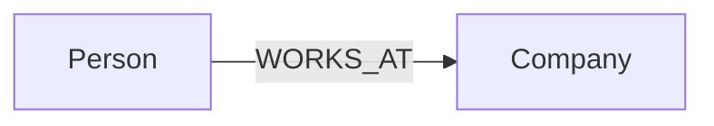
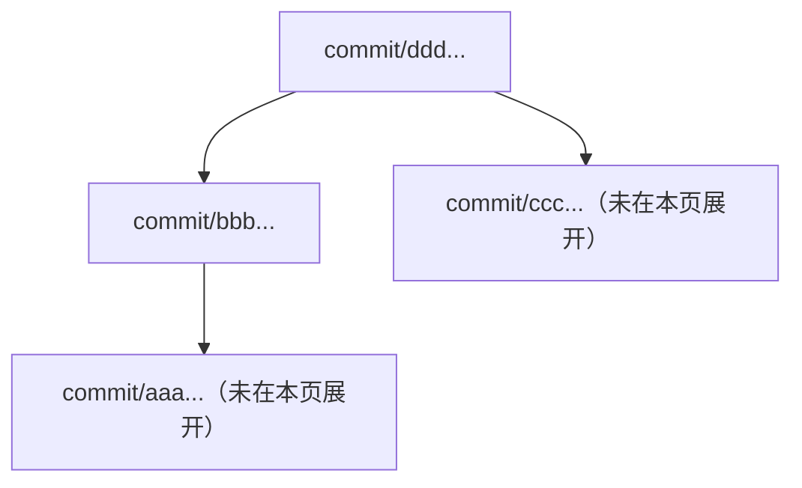

# MCP 与私人 OpenAI Plugin

<!-- cspell:words Streamable Asyncify mcpserver mcpauth testdata -->

本文件是 KG OS **Go 原生 MCP、Tool 命名与文档接口、受控 JavaScript 执行、私人 OpenAI Plugin / Skill 与 Markdown Preview / Ancestry** 的设计真源。KG OS 业务语义不由 MCP 定义：Ontology、Object / Patch、Graph / Cypher、Evolution 分别由其设计 owner 负责；统一监听与 Instance 生命周期见 [Runtime](runtime.md)，公开 TypeScript SDK 的逻辑合同见 [Client](client.md)。

**已验收基线与当前实现（2026-10-17）**：`kgosd` 同一 Go 进程提供 Web / HTTP API / MCP，[Phase 16](../development/phases/16-kgosd-unified-mcp.md) 的 Go/QuickJS Sandbox、[Phase 17](../development/phases/17-mcp-web-authorization.md) 的统一认证、[Phase 18](../development/phases/18-chatgpt-embedded-web.md) 的 UI Tool 及 [Phase 22](../development/phases/22-mcp-self-describing-docs.md) 的 `docs.read` 已分别完成阶段验收，Phase 22 最终 CI 与 Dev 部署取得真实证据。**D102 / Phase 23 的独立 `kgos_docs`、五 Tool 与文档指南已在 `main@9cec011` 实现并部署 Dev，分支安全及 CI Race 超时回归由 `cfa3917` 修复；用户报告的真实 ChatGPT 核心链路五 Tool/31 SDK 成功（完整客户端覆盖为 `PARTIAL`），Mac 与 OpenClaw 原样 Docker 构建/31 SDK 隔离成功，最终实现 SHA 的 GitHub CI Run #39001850377 两 Job 2/2 success，Phase 23 `done`**；远端已验收实例仍以其自身运行的镜像版本为准。历史 Phase 15 `packages/mcp/` / Node.js Worker 的 Dev/ChatGPT 结果是迁移对照，不替代 Go 原生 MCP 证据。已发行 v0.2.1 npm 包不包含新的 Docker MCP 交付；私人 Plugin 可选，标准 MCP Client 可直接连接 `kgosd`。

**2026-10-14 MCP 认证目标调整（[D95](decisions.md#d95-unified-mcp-web-authorization)、[Phase 17](../development/phases/17-mcp-web-authorization.md) `done`（用户验收例外））**：MCP 不再拥有独立管理员 Token，使用同一个 Instance 认证真源；ChatGPT 的 OAuth 授权转入现有 KG OS Web，通过其登录状态及连接授权弹窗完成。**Go OAuth 路由、Web 授权弹窗和持久 Web Session 已实现并经过本地测试，相关代码现已进入 `main@8e7bf56`；2026-10-14 新版 Dev 曾完成正式 Docker 构建部署，用户确认 ChatGPT 重新授权测试成功。Phase 17 关闭时远端 GitHub CI / 最新完整隔离矩阵未执行，用户批准带例外关闭，不代表 CI 通过**。Web 登录状态由 Web/Runtime owner 负责，本文件只定义 MCP 的对接与安全合同。

**2026-11-07 新目标（[D127](decisions.md#d127-host-neutral-mcp-oauth)、[Phase 36](../development/phases/36-host-neutral-mcp-oauth.md) `in_progress`）**：将 Phase 17/34 已实现的 ChatGPT 专属 Client ID/redirect 限制升级为通用 MCP OAuth 客户端身份与安全授权，CIMD 优先、DCR 兼容。**当前本地源码已有实现与专项测试，仍未完成全部验收或正式发布**；现有已发布实例仍按原 ChatGPT 限制运行，不能因代码写入就宣称 Muse 已可连接。规范合同见 [通用 OAuth](#host-neutral-mcp-oauth)，旧 Phase 17 授权章节保留实现历史与不变的身份边界。

## 目标与边界

- AI 使用 KG OS 时应先了解真实的 Branch / Commit / Ontology，然后按需读取和操作 Knowledge；避免每次为了取得版本及模型结构都先编写一段 JavaScript。
- 一个专门的 MCP 文档 Tool 负责首次发现和按需批量阅读公开文档；两个直接读取 Tool 负责 Ontology 与 Commit 导航；两个 JavaScript 执行 Tool 负责组合完整公共 SDK 能力。不把 SDK 每个方法机械提升为单独的 MCP Tool，也不在 MCP 定义新的知识模型、Search DSL 或事务语义。
- `kgos_ontology_overview` 提供**完整的 Ontology 只读视图，按行取窗口**；不为节省上下文而删除 Definition、Property、Constraint、Index 或关系。它不保存可编辑 Markdown、不提供文件系统路径、不产生新的数据库资源。
- AI 的模型理解、信息提炼、Commit Message 编写以及工具编排属于外部 AI / 官方 Skill；MCP 只提供确定性数据、执行与安全边界。
- 标准 MCP 客户端（含 ChatGPT、Muse 等）为目标连接方；ChatGPT 的 Web/Apps 适配与私人 Plugin 是可选宿主集成。用户自托管自己的 KG OS Instance，**不提交公共插件目录，不集中托管用户知识库**。

## 部署与责任划分

```text
ChatGPT / MCP Client      Browser       CLI / SDK
           │                │               │
           └────── HTTP / HTTPS ─────────────┘
                            ▼
                  kgosd（一个 Go 进程）
                    ├── /mcp + OAuth
                    ├── /api/v1/*
                    ├── / + Web assets
                    ├── Docs / Ontology Overview / Commit Ancestry（Go）
                    └── QuickJS-NG WASM（wazero）
                            │
                    受控 Go 方法 Bridge
                            ▼
                    KG OS Kernel
                            │
                    Lithograph → SQLite

私人 OpenAI Plugin
├── 用户已注册 MCP Connection 的引用
└── KG OS 官方 Skill（AI 操作流程 / SDK 用法）
```

- MCP 是 `kgosd` 内的 Go Handler，使用官方 [MCP Go SDK](https://github.com/modelcontextprotocol/go-sdk) 的 Streamable HTTP 能力；MCP 直接调用同进程 Kernel 已有的业务方法，**不经 `@kgos/sdk` 再做一次本机 HTTP 请求**，也不读取 SQLite 内表或复制 Cypher/Ontology/Version Engine。Go SDK 提供协议与 Bearer 校验基础，不能视作自动提供本产品的 ChatGPT OAuth 授权服务器。
- 每个 `kgosd` 仍只绑定一个显式 Workspace Root；MCP Tool 不接受其他 Instance Root。Phase 15 旧独立 TypeScript MCP Server / Worker 源码已在 Go 原生迁移验收后清理，历史 Git 证据保留，不作为另一套正式服务恢复。
- 统一监听地址由 [Runtime](runtime.md#统一-http--mcp-hostingphase-16-目标) 负责：默认 `127.0.0.1:0` 不变；显式配置可对外监听，并同时服务 Web、API 与 MCP。远程必须有 HTTPS / 可信安全通道，用户自行选择代理或 Tunnel；**同一 listener 不等于同一权限**：`/api/v1/*` 继续采用 Runtime 的 Instance 认证；`/mcp` 接受同一 Instance 凭证的直接 Bearer（仅供可信调用方）或基于 Web 明确授权签发的 MCP OAuth Access Token。OAuth Access Token 不得访问普通 API，外部 OAuth 客户端不得取得 Instance Token；静态 Web 不提供免认证业务 API。
- Go Sandbox 已使用 QuickJS-NG WASI reactor 与 wazero；Go Bridge 对每次方法调用强制权限与参数校验，直接执行 Kernel，保持 SDK 的公开语义。实际安全和集成证据由 Phase 16/22 分别维护，D102 工具重命名与独立文档 Handler 不得降低现有隔离保证。
- `plugins/kgos/` 继续存放官方 Skill、Plugin 模板和面向 AI 的安装说明，**不包含运行服务端**；Skill 只指导调用者，不改变 MCP 协议的直接可用性。

## 部署交付与运行合同

### Docker-only 交付

按 [D99](decisions.md#d99-linux-amd64-docker-only-distribution)，**整个 KG OS 唯一新的官方运行产物**是 **Linux amd64 Docker / OCI**，而不只是 MCP 不发行 npm。镜像名称为 `ghcr.io/<owner 小写>/kgos:v<版本>`；已经公开的 CLI / SDK / Runtime v0.2.1 保留为历史发布，不再提供后续 npm 新版本或六平台二进制。用户仍自行决定公网 HTTPS、隧道或代理接入方案。

| 形式 | 部署单元与依赖 | 使用方式 |
| --- | --- | --- |
| Linux amd64 Docker / OCI 镜像 | 自包含镜像，包含 Go `kgosd`、内嵌 Web、MCP Go Handler、QuickJS-NG WASM、Lithograph / Provider / Jieba 扩展；运行时不依赖 Node.js 或宿主构建工具 | 用户运行**一个容器、一个 `kgosd` 服务进程**即获得 Web + HTTP API + MCP；挂载持久 Workspace，只有一个对外监听端口 |

- Docker 仍只启动**一个 Workspace、一个 `kgosd` 和一个 HTTP listener**。已初始化实例提供完整 Web/API/MCP；**D105 新目标**允许没有 `config.toml` 时先启动受限 Web 初始化页面、普通 API/MCP 返回未初始化错误；预先提供完整 TOML 则在启动时自动走共享 Bootstrap/readiness 后正常提供服务。两种方式均不依赖宿主 Node.js 或镜像内 TypeScript CLI，不引入第二份配置格式，也不得跳过 `initialized.json`。重启/重建必须保留 `.kgos`、已提交的 State/Branch 与认证信息；旧版“无配置直接启动失败”仅描述尚未实施 D105 的当前运行行为。路由、状态、管理员认领与恢复由 [Runtime 首次启动合同](runtime.md#web-first-run-bootstrap) 唯一拥有；实施见 [Phase 26](../development/phases/26-web-first-run-bootstrap.md)。
- 构建时将已验证的 Go `kgosd`、Web 静态产物、固定并校验的 QuickJS-NG WASM 和匹配的 Linux amd64 native 扩展打成自包含镜像；Node.js 可用于构建浏览器资源，但不得成为镜像运行时依赖。镜像不在容器启动时下载依赖或重编 native 扩展，不依赖宿主 `kgosd` / `node_modules` / host network。
- 镜像以非 root 用户运行，能够读取只读挂载的 Secret 与证书、写持久 Volume，并在 SIGTERM 时清理同一 `kgosd` 进程及资源。宿主仅映射统一的 HTTP 监听端口；镜像对外暴露的 Web、API、MCP 各自保留认证边界。
- **验证 / 发布按 [D94](decisions.md#d94-openclaw-docker-development-and-ci) 分工**：Mac 本地只进行非 Docker 源码验证；开发阶段的 Docker 构建、独立临时 Volume 写入/重启均在 OpenClaw Linux amd64 执行，不能破坏长期 Dev Instance；**GitHub Actions PR/main CI 必须在自己的 Linux amd64 runner 构建新镜像并执行隔离 Docker Smoke**，但不推送 GHCR；获得独立 Release 授权后，从明确的 Release revision 构建**精确待发布镜像**、在隔离 Instance 中 Smoke、用 GHCR 核对版本/源码 revision/架构/digest 和实际拉取权限。正式发布与生产部署分别授权，当前没有新镜像已上传的证据。

### MCP 命令与配置优先级

```text
kgosd --root <workspace-root>                  既有本地 daemon（127.0.0.1:0）
kgosd --root <workspace-root> --host <address> --port <port>
      [--tls-cert <path> --tls-key <path>]
      [--mcp-path <path>] [MCP budgets...]
```

- **只有一个 daemon 入口**：`kgosd --root <workspace-root>` 仍按 [Runtime](runtime.md#http-bind-与-active-endpoint) 要求显式 Root，不从 `cwd`、父目录或环境猜库。容器入口可以把 `KGOS_ROOT` 翻译成实际的 `--root` 参数，不能把它变成 `kgosd` 的第二套 Root 解析合同。网络统一由 `KGOSD_*` 配置；MCP 独有选项使用 `KGOS_MCP_*`。
- **配置来源**：CLI > 对应环境变量 > 明确默认值。空值、未知参数、无效整数或互斥值应报错；`kgosd` 统一输出真实绑定 host / port / protocol，`--port 0` 只作为 bind 输入。原 `kgos-mcp serve / doctor` 不再是目标产品命令，不保留单独进程级启动/关闭/日志选项；现有 `kg doctor` 继续诊断本地 Runtime，MCP 的远程实际可用性由真实客户端验收，不能靠本地 ready 自证。

下表是 **Phase 17 当前统一认证方案的公共部署参数面**；已提交的旧 Phase 16 历史代码仍保留旧 Token 参数，但不能视为当前 Dev 合同。`mb` 表示 MiB（`1024 × 1024` bytes），所有长度/时间参数必须为有界正整数；详细取值范围以实际资源/协议能力验证并与 CLI `--help`、安装指南保持一致，不增加第二套配置文件或兼容别名。

| 分组 | CLI option | 环境变量 | 含义 / 默认值 |
| --- | --- | --- | --- |
| Instance | `--root <path>` | 无 | `kgosd` 必填；一个 Workspace / Instance |
| 统一网络 | `--host <address>` | `KGOSD_HOST` | 默认 `127.0.0.1`；可显式为 `0.0.0.0`，需安全入口 |
| 统一网络 | `--port <0..65535>` | `KGOSD_PORT` | 默认 `0`，由 OS 动态分配；Docker 可指定固定端口 |
| 统一 TLS | `--tls-cert <path>` / `--tls-key <path>` | `KGOSD_TLS_CERT` / `KGOSD_TLS_KEY` | 同一 HTTP listener 的 HTTPS；成对配置 |
| MCP | `--mcp-path <path>` | `KGOS_MCP_PATH` | 默认 `/mcp`；与 API/Web/OAuth 路径无冲突 |
| MCP OAuth | 无单独启动参数 | `config.toml` 的 `[server].public_origin` | Web/API/MCP/OAuth 共用对外 Origin；旧参数必须迁移后删除 |
| MCP 请求 | `--mcp-request-timeout-ms <n>` | `KGOS_MCP_REQUEST_TIMEOUT_MS` | 单次完整 MCP 请求墙钟上限；默认 `30000` |
| MCP 请求 | `--mcp-max-concurrency <n>` | `KGOS_MCP_MAX_CONCURRENCY` | MCP 并发上限；默认 `16` |
| MCP 请求 | `--mcp-max-request-bytes <n>` | `KGOS_MCP_MAX_REQUEST_BYTES` | 单次请求正文上限；默认 `1048576` |
| Sandbox | `--mcp-script-timeout-ms <n>` | `KGOS_MCP_SCRIPT_TIMEOUT_MS` | 一次 JS 调用含 Kernel 等待的墙钟上限；默认 `15000` |
| Sandbox | `--mcp-script-memory-mb <n>` | `KGOS_MCP_SCRIPT_MEMORY_MB` | 单 Invocation WASM/JS 内存预算；默认 `64` |
| Sandbox | `--mcp-script-max-code-bytes <n>` | `KGOS_MCP_SCRIPT_MAX_CODE_BYTES` | 单次 `code` UTF-8 bytes 上限；默认 `65536` |
| Sandbox | `--mcp-script-max-calls <n>` | `KGOS_MCP_SCRIPT_MAX_CALLS` | 单次脚本 Go Bridge 调用预算；默认 `2048` |
| Sandbox | `--mcp-script-max-streams <n>` | `KGOS_MCP_SCRIPT_MAX_STREAMS` | 单次脚本最大打开流数；默认 `32` |
| Sandbox | `--mcp-script-max-output-bytes <n>` | `KGOS_MCP_SCRIPT_MAX_OUTPUT_BYTES` | 单次 JSON 结果 bytes 上限；默认 `4194304` |
| Preview | `--mcp-preview-max-items <n>` | `KGOS_MCP_PREVIEW_MAX_ITEMS` | 完整视图对象预算；默认 `50000` |
| Preview | `--mcp-preview-cache-entries <n>` | `KGOS_MCP_PREVIEW_CACHE_ENTRIES` | 最大进程内固定视图数量；默认 `8` |
| Preview | `--mcp-preview-cache-ttl-ms <n>` | `KGOS_MCP_PREVIEW_CACHE_TTL_MS` | 缓存 TTL；默认 `600000` |

#### 参数语义与安全约束

- Phase 17 完成后，`/mcp` 随已就绪的 `kgosd` 和已有 Instance 认证正常提供，不再以另一份 MCP Secret 作为开关；未完成初始化、Instance 凭证无效或不可读取时仍按 Runtime 规则 fail closed，绝不降级匿名。`--mcp-token-env`、`--mcp-token-file`、`KGOS_MCP_TOKEN`、`KGOS_MCP_TOKEN_ENV`、`KGOS_MCP_TOKEN_FILE` 从配置合同删除；显式提供已废弃 CLI/环境配置应报错。OAuth 仅由实例 `config.toml` 的 `[server].public_origin` 启用；旧实例未配置本字段时可信本机 MCP Client 仍可使用原 Instance Bearer。任何凭证都不进入 URL、日志或诊断消息。
- `--tls-cert` 与 `--tls-key` 为**整个 `kgosd` HTTP listener**成对配置；未提供时使用 HTTP，仅适用于可信本机或可信的 TLS 终止代理 / Tunnel。`--host 0.0.0.0` 会将 **Web、API、MCP** 一起绑定到外部接口，不是“只公开 MCP”；代理可以限制允许转发的路由，但 `kgosd` 不内建网络 Gateway。API 继续要求 Instance Bearer，OAuth Access Token 不能调用 `/api/v1/*`，静态 Web 不提供免认证的数据旁路。
- MCP HTTP 对所有方法校验携带的 `Origin`：只接受单个有效的同源值，或实例 `[server].public_origin` 的精确值（支持 TLS 终止代理改写上游 Host）；空值、多值、`null` 和其它来源返回 403，并沿用 Web 对非同源 `Sec-Fetch-Site` 的拒绝规则。无 `Origin` 的非浏览器 MCP Client 可以继续调用，但仍须通过原有 Bearer/OAuth 认证。GET、HEAD、OPTIONS 不豁免此校验。
- 总 `--mcp-request-timeout-ms` 覆盖服务端收到 MCP 请求到最终响应的时间；`--mcp-script-timeout-ms` 覆盖 JavaScript 与等待 Kernel 调用，先触及者终止相应执行。大小 / 并发限制在排队前有界生效；单 Invocation WASM memory pages、QuickJS heap/stack、CPU 中断、模块关闭与内部 Bridge 数据预算也必须有界。失效或取消的脚本不得继续接收回执和调用新的方法；已发送到 Kernel 的写入仍可能已生效，不能承诺自动回滚。
- Preview 资源预算与目标 Tool `kgos_ontology_overview`（当前实现名 `kgos_preview`）的**固定行窗口合同**独立：配置改变的是容量和缓存寿命，不改变 `offset/limit/viewRevision`、完整 Ontology 或不截断原文的保证。缓存依旧按认证调用者和 Instance 隔离，驱逐后的 revision 返回 `VIEW_EXPIRED`。
- 复用原有 `kg doctor` / `kgosd` 就绪诊断，不保留独立 `kgos-mcp doctor` 运行时；本地 Ready 不代表远程地址、OAuth 或真实 ChatGPT 已连通。结构化错误和日志不回显 Secret、JavaScript 宿主堆栈或本地令牌。
- MCP Tool、OAuth、安全事件和跨 Sandbox/Kernel 的请求关联只接入 [Observability 统一日志合同](observability.md)；不增加 Tool 级持久执行账本，也不以 Tool 终态改写此前已提交的 Kernel 写入结果。

<a id="单管理员-chatgpt-oauth-认证"></a>

#### 统一 Instance 认证与 Web 内的 MCP 连接授权（Phase 17 目标）

**历史实现基线**：本节记载 Phase 17 的 ChatGPT 专用允许列表、回调和用户验收，不作为 Phase 36 完成后仍生效的通用 Client 身份限制。新的 Client 解析、回调、授权页面字段、Scope、Code/Access 有效期及注册行为以 [D127 通用 OAuth](#host-neutral-mcp-oauth) 为准；单 Instance 根身份、Web 登录、凭证隔离及 D124 的持久存储/Refresh 轮换/撤销/故障恢复继续有效。

##### 身份与能力边界

- **唯一根凭证**：继续使用 Runtime 已有的 `<workspace>/.kgos/auth.json` Instance Token，不创建 MCP 管理员 Token、用户表、密码、独立身份供应商或第二份认证配置。Web 登录状态由 Web/Runtime 的既有认证 owner 提供，MCP **只消费服务端已验证的 Web 登录上下文**；不定义 Web Session 的创建、Cookie 方案、持久化、跨标签同步或登录 UI。
- **两种协议凭证、一套根身份**：`/mcp` 可识别现有 Instance Bearer（仅供用户自己管理的可信客户端）及经 Web 明确批准签发的 MCP OAuth Access Token。二者映射到同一个 Instance 的完整 MCP 能力，但 OAuth Token **仅可用于 MCP**；OAuth Client 永不收到 Instance Token，也不能使用 Web 登录态/Cookie、OAuth Token 调用 `/api/v1/*`。直接向不可信第三方提供 Instance Token 也会授予其普通 API 全权限，**ChatGPT 必须使用 OAuth 路径**，不得用直接 Bearer 替代浏览器授权。
- **启动与部署**：MCP 随已认证可用的 `kgosd` 提供，不因未配置独立 MCP Token 而关闭。新版初始化将 HTTPS Origin 写入 Instance `config.toml` 的 `[server].public_origin`，OAuth Issuer/Resource 均从此唯一真源加载；仅本机 loopback 允许 HTTP。旧实例缺此分组可继续提供直接 Bearer MCP，但 OAuth 不启用，须明确迁移并重启；旧 `--mcp-oauth-issuer` / `KGOS_MCP_OAUTH_ISSUER` 启动入口拒绝以避免两份真源。Origin 不自动创建公网接入、证书或 Tunnel；MCP Endpoint 仍是 Origin + `--mcp-path`。
- **公开 Web 入口要求**：OAuth 的浏览器跳转依赖同一 HTTPS origin 的 **Web `/`、Web 静态资源与 Web 认证入口**均真实可达；只代理 `/mcp` 和 `/oauth/*` 而不转发 Web 不能完成授权。HTTPS 代理还须正确保留 OAuth discovery 路径、请求方法和必要认证头；不得用静态文件匿名可读推断可绕过 Web 业务认证。
- **权限呈现**：`kgos:access` 仍授予当前 Instance 的 MCP **完整读写能力**（目标 `kgos_mutate` 可修改或删除知识），新增 `kgos_docs` 不新增 OAuth Scope、细粒度角色或隐式授权；连接授权弹窗必须明确展示读写权限。Web 登录成功只证明身份，**不等于授权外部 Client**。现行四业务 Tool/未来五 AI Tool 的数量是版本状态差异，不是身份或授权模式变化。

##### 从 ChatGPT 跳转到现有 Web

1. ChatGPT 访问 `/mcp` 时可收到 HTTP 401 + `WWW-Authenticate: Bearer resource_metadata=...`；启用 issuer 后，`/.well-known/oauth-protected-resource` 与 `/.well-known/oauth-protected-resource<mcp-path>` 返回一致的资源 metadata，`/.well-known/oauth-authorization-server` 暴露真正实现的 Authorization Code、PKCE S256、`none` / `private_key_jwt` 客户端认证与 CIMD 能力。`resource`、`issuer` 与 `kgos:access` 一致绑定。授权与交换仍使用 `/oauth/authorize`、`/oauth/token`，由**同一 `kgosd` Go 进程**提供。
2. `GET /oauth/authorize` 先完整校验 `response_type=code`、`client_id`、`redirect_uri`、`state`、`resource`、`scope`、`code_challenge` 与 `code_challenge_method=S256`；仅允许从 `https://chatgpt.com/oauth/client.json` 或 `https://chatgpt.com/oauth/<id>/client.json` 读取可信 CIMD，验证精确的 `client_id`、`redirect_uris` 和支持的客户端认证声明，不接受任意 URL、开放 DCR 或未验证的回调。先验证后创建有界、短效、随机不可猜的**待授权请求**，其中保存验证过的 OAuth 参数，不生成 code。
3. Go 返回 `303` 跳转到**已有 KG OS Web 应用**的同源入口 `/?mcp_authorization=<request_id>`；此 URL 只携带授权请求引用，不包含 Instance Token、OAuth code、`state`、PKCE verifier 或任意回调地址。Web 使用原有应用框架、主题及现有认证组件，在工作区上方显示**连接授权弹窗**，不得再由 Go 输出独立授权 HTML/第二个登录页。
4. Web **已经登录**时直接显示授权弹窗；**尚未登录**时先使用 Web 自己的认证交互，成功后仍在同一个待授权请求中显示弹窗。无需第二次输入管理员 Token。MCP 不负责决定 Web 如何跨页面保存登录状态；如尚不能在此次跳转中复用登录状态，属于 Web 登录模块未满足集成前置，不允许 MCP 私自创建备用 Session 或要求再输入一个 MCP Token。
5. 弹窗至少显示经过验证的客户端名称（无法取得可信名称时显示已验证 `client_id`）、当前 Instance/资源地址及**可读、可写**权限，并提供明确的「授权连接 / 拒绝」。不能由任意请求参数伪造客户端名称或权限，不能因登录成功、刷新或已授权过同名客户端而自动同意。
6. 用户同意后，Go 消耗一次性请求并签发短效 authorization code；Web 将浏览器导向**预先验证的** ChatGPT `redirect_uri`，附带原样 `state` 和 `iss`。用户拒绝时返回该回调的 `error=access_denied`（保留 `state/iss`），不签发 code/token。两条路径均回到 ChatGPT；过期、重复提交或验证失败不授权，Web 解释失败并让用户重新从 ChatGPT 发起连接。

##### MCP 与 Web 的最小接口合同

| 接口 / 入口 | MCP 责任与返回 | 安全要求 |
| --- | --- | --- |
| `GET /oauth/authorize` | 校验 OAuth 请求，保存待授权上下文，`303` 到 `/?mcp_authorization=<request_id>` | 未校验 Client/redirect/resource 不建单；请求 ID 本身**不是授权凭证** |
| `GET /oauth/request?request_id=...` | 返回已验证的 `client_id`、可展示名称、`resource`、固定 `scope`、`canWrite=true` 与 `expires_at` | **必须通过 Web owner 的已登录校验**；未登录返回 401；失效/未知同类失败；不返回原始凭证、`state`、code 或任意客户端回调 |
| `POST /oauth/decision` | Web 传 `{request_id, decision: "approve" \| "deny"}`，成功返回 `{redirect_url}`，由 Web 执行顶层导航 | **必须通过相同 Web 登录校验与其 CSRF/同源写入防护**；校验本次 Instance、一次性、未过期；Client/redirect/scope 只能从 Go 保存的请求取得，不能由 Web 提交覆盖 |
| `POST /oauth/token` | 处理 `authorization_code` 与 `refresh_token` 的标准 OAuth 交换/轮换 | 验证 client/resource/redirect/PKCE、一用即销、有效期和 Scope；不接受 Web Session 替代 OAuth Client 凭证 |
| `/mcp` | 使用现有 Instance Bearer 或有效 OAuth Access Token 调用当前 Tool 集；D102 目标为五个 AI-facing 加一个 app-only UI Tool | 同一 Instance、MCP audience/scope/expiry；浏览器登录 Cookie 不能直接调用工具，OAuth Token 不能访问普通 API |

接口返回只包含页面呈现和跳转所需字段；`redirect_url` **只能**由服务端依据先前验证的 Client 回调生成，Web 不拼接或接收任意跳转目标。授权数据响应使用 `Cache-Control: no-store` 与 `Referrer-Policy: no-referrer`，不加载第三方资源；在未登录的 Web 中，Go 不能泄露授权详情，也不能在前端缓存请求以绕过校验。授权操作只由服务端基于**当前有效的** Web 登录上下文判断，读取授权详情不授予批准权限。浏览器登录校验与 CSRF 接口的具体实现由 Web 认证 owner 确定，MCP 不创建第二套 Session 存储或 CSRF 机制。

##### OAuth Token 生命周期与恢复

- Go 继续使用随机高熵、**不透明**的 Access/Refresh Token，服务端仅持有摘要及 client/issuer/resource/scope/有效期关联；`/oauth/token` 必须检查单次 code、同一个 `client_id`、完全相同的 `redirect_uri`、`resource` 和 RFC 7636 `code_verifier` S256。Refresh Token 限时且轮换后旧值立即失效；Access Token 只接受指定 MCP audience/Scope。
- OAuth 已批准授权、Code 和 Token 摘要持久化到 Runtime 管理的独立 `.kgos/mcp-oauth.db`，不进入 Knowledge Graph 或版本历史。授权请求仍为 5 分钟进程内状态，Code 1 分钟，Access Token 硬有效期 24 小时、`expires_in=86340`，保留 1 分钟提前刷新余量；已签发 Token 沿用持久化的原到期时间，不因升级自动延长。Refresh Token 每次成功轮换后滚动延长 30 天。普通重启和升级保留授权；根凭证指纹或 issuer/resource 改变使旧授权失效。旧内存版本首次升级需要重新连接一次。存储不可用禁止删库重建、匿名或内存降级；OAuth 返回 503，metadata、合法根 Bearer、API 和 Web 保持各自能力。
- Web 退出登录仅终止 Web 自己的登录状态，**不自动撤销此前已经批准的 MCP OAuth Grant**；现有授权受闲置到期、Refresh 轮换、显式撤销和根凭证/issuer 绑定约束；普通重启保留授权。不扩展连接管理页面。
- 所有授权查询/决定、Token 交换必须有体积/数量/时间限制；禁用跨源调用、缓存、开放跳转、重放和重复同意。`request_id` 即使被复制或泄露，也只能定位待授权请求，**不能绕过有效 Web 登录及显式同意**。除了经 TLS 保护的授权 code 回调，不把任何 Token/code 放进 Web URL、日志、错误或持久 UI 状态。MCP 未认证拒绝与 OAuth 错误保持最小且无秘密差异。

本节**只拥有 MCP 授权请求、OAuth 协议、凭证隔离及与 Web 的接口合同**。Web 登录/Session、通用认证弹窗实现和前端登录生命周期属于 Web/Runtime owner；MCP 只消费其已认证状态并提供连接授权所需数据与动作。Phase 17 MCP 认证代码已通过本地 Web Session Handler 集成与浏览器模拟验收，Dev 正式 Docker 构建及只读自动验收通过，用户也确认真实 ChatGPT 重新授权成功；未执行的 GitHub CI / 完整隔离矩阵不能记为通过。Phase 17 `done` 是用户明确批准的关闭例外，不等于正式发布或生产就绪。

<a id="host-neutral-mcp-oauth"></a>

### 通用 MCP OAuth 客户端身份与授权（D127 / Phase 36 目标）

#### 目标、适用范围与既有边界

**目标**：标准 MCP Client 应能够按 OAuth Discovery 自动发现 KG OS 的授权服务、采用公开 HTTPS Client ID Metadata Document（CIMD）或 RFC 7591 Dynamic Client Registration（DCR），经**现有 Web 登录 + 显式授权**取得仅适用于当前 Instance 的 MCP OAuth Token。不能以 Host 名称（ChatGPT/Muse/Claude 等）或厂商域名判断授权资格，也不提供未登录/未同意即可访问知识库的途径。

**对外协议复用原则（2026-11-07 用户进一步确认）**：KG OS **以 Nexum 当前已实现的外部 MCP OAuth 协议为直接兼容性基线**，不是只选择性借鉴 CIMD/DCR。相同的标准 MCP Client 不应为了接入 KG OS 而修改其 Discovery、客户端注册、授权请求、Code/PKCE、Token/Refresh、Bearer 错误恢复或回调处理逻辑。协议的 HTTP method、请求/响应字段、认证方法、metadata 声明、错误分类和安全校验均以 Nexum 对外行为及 MCP/OAuth 标准核对；不得凭 KG OS 产品名引入另一套 OAuth 方言、Host allowlist 或额外的客户端交互步骤。

**唯一系统职责差异是授权主体和业务权限映射**：Nexum 的 Browser 用户登录和 Grant 指向 `ownerId + Agent set`；KG OS 使用现有 Web Instance 登录，在批准后将 OAuth Client 绑定到**当前 Instance 的 MCP 能力**，不需要多用户、Agent 选择或套餐权益。由服务端处理这段映射，客户端仍使用相同的 OAuth 交互。**MCP 授权 Scope 与 Token 有效期也以 Nexum 为目标基线**：`mcp` / `mcp offline_access`、Access 硬有效期 15 分钟、`expires_in=840`（14 分钟刷新提示）、Refresh 滚动 30 天。产品各自的 `resource` URL 和 MCP Tool 集仍由各自实际实例声明，不要求客户端编写 KG OS 专属适配。KG OS 已有 `/oauth/revoke` 继续作为标准兼容扩展，不因 Nexum 当前路由集不同而删除。

本合同替换 [Phase 17](#单管理员-chatgpt-oauth-认证) 和 [D124](#mcp-对外健壮性合同) 中“只认可 ChatGPT 的 CIMD/redirect、不开放 DCR”、硬编码客户端名称、**旧 `kgos:access` Scope 以及 24 小时 Access 有效期**的现行目标；历史实现与验收记录仍如实保留。继续保留：

- Runtime 现有单 Instance Token、`[server].public_origin`、Go `kgosd` 同进程服务 Web/API/MCP/OAuth、Web 登录与 CSRF 防护；不新增账号、独立授权页或 Instance 管理身份。
- `/mcp` 仅接受可信调用方持有的 Instance Bearer 或显式同意后获得的 MCP OAuth Token；OAuth Token **永不**授予普通 `/api/v1/*`、Web Session 或根凭证的访问权。外部 Host 必须使用 OAuth，不把直接 Bearer 当作绕过同意的兼容方案。
- 新 Scope `mcp` 仍代表该 Instance 的**完整 MCP 读写能力**（包括 `kgos_mutate`），`offline_access` 仅表示长期连接意图，不增加业务权限。按 Nexum 的兼容语义，仅请求 `mcp` 的客户端也可以获得 Refresh Token；Token 返回的 `scope` 必须是实际获批的规范化 Scope，不因刷新扩权。不增加细粒度 Scope、Agent 选择、多用户 Grant 或额外知识模型。
- D124 已存在的独立 `.kgos/mcp-oauth.db`、凭证摘要、不透明 Token、Code 单次消费、PKCE S256、Refresh 滚动 30 天、签名重试/公开客户端严格轮换、撤销和故障分类仍作为基础能力。本阶段将**新签发** Access Token 统一改为 **15 分钟硬有效期，`expires_in=840`**；新的 Authorization Code 有效期对齐 Nexum 的 5 分钟。无需重新建设独立 Token 服务，也不保留 24 小时作为新 Token 配置选项。

#### Discovery 与端点合同

| 端点 | 目标行为 | 边界 |
| --- | --- | --- |
| `/mcp` 无 Bearer | 401 + `WWW-Authenticate: Bearer resource_metadata=...` | 沿用现有 Origin、Boot Guard、认证与 MCP audience 边界 |
| `/.well-known/oauth-protected-resource` 及 MCP-path 版本 | 宣告当前 `resource`、单一 issuer、`mcp` / `offline_access` | 仅公开 Discovery，不暴露实例数据/凭证 |
| `/.well-known/oauth-authorization-server` | 宣告现有 `authorization_endpoint`、`token_endpoint`、`revocation_endpoint`、`code_challenge_methods_supported=["S256"]`、`client_id_metadata_document_supported=true` 及新的 `registration_endpoint=<issuer>/oauth/register` | 仅在实现真实 DCR 路由后宣告；`grant_types` 仍为 `authorization_code`、`refresh_token`，`token_endpoint_auth_methods_supported` 为 `none` / `private_key_jwt`（RS256） |
| `POST /oauth/register` | RFC 7591 DCR；合法请求返回 201 + 公共 Client ID 与标准注册元数据 | **仅注册身份，不授予任何 Scope、Grant、Code 或 Token**；禁止发 Client Secret / 注册管理凭证 |
| `GET /oauth/authorize` | 从已验证 CIMD 或持久化 DCR Client 解析身份，再校验 redirect/resource/scope/state/PKCE，才建立待授权请求 | 未验证的 redirect **绝不**用于错误响应或浏览器导航 |
| `GET /oauth/request` 与 `POST /oauth/decision` | 复用 Web 原弹窗/认证/CSRF，只从服务端已验证请求展示 Client、回调与读写权限并决定批准/拒绝 | 不新增登录页、未登录不暴露 Client 明细；任何表单参数不能更改回调或 Scope |
| `POST /oauth/token` / `POST /oauth/revoke` | 保留 Code/Refresh/撤销协议；按 Client 来源解析其认证方法 | DCR 为 `none`；CIMD 可为 `none` 或已验证 `private_key_jwt`，不回退/降级认证方法 |

仅公开的 Discovery 元数据允许无凭证 `GET/OPTIONS` 与相应的只读 CORS，不向浏览器暴露 Cookie/Token；DCR 注册、用户会话和授权决定**不**因 Discovery 的 CORS 而开放跨源写入。**新 OAuth `resource` 精确绑定 `<issuer><MCP Path>`**（默认 `<issuer>/mcp`；若通过 `--mcp-path` 自定义路径则使用实际 Endpoint），`issuer` 与回调 `iss` 仍为公共 Origin。新授权与 Token/Refresh 不再使用根地址作为资源；旧 Access 保留原始 Origin audience 和过期时间，不静默改写或延长。

#### Client 识别、CIMD 安全与缓存

客户端身份解析采用两条互斥路径：**URL 型 Client ID** 是具备非根路径的 HTTPS CIMD URL；**非 URL 型 Client ID** 仅在当前 OAuth SQLite 的 DCR 注册表中精确命中时有效。不存在的 ID、裸域名、任意普通 HTTPS redirect、URL 片段/userinfo/不合格 scheme 均不能冒充合法客户端；不内置 ChatGPT/Muse 等 Host allowlist，也不自动以相似名称匹配。

对 CIMD 必须从 Client ID 指定地址获取严格 JSON，并校验文档中的 `client_id` 与请求 URL **字节级一致**、`client_name` 非空、`redirect_uris` 非空且逐项合法。像 Nexum 一样兼容单值 `token_endpoint_auth_method` 与复数 `token_endpoint_auth_methods_supported`，有效客户端方法只允许 `none` 或已验证的 `private_key_jwt`，均未声明时按 Nexum 的公共客户端默认 `none`；后一模式要求 HTTPS `jwks_uri` 与 RS256。已有有效的 ChatGPT CIMD 声明仍须通过，不能因为增加其它 Client 就收紧其合法字段或容量。显示名称仅为经校验的**客户端自声明信息**，不是 KG OS 对品牌或身份的官方背书。

**CIMD/JWKS 出站（D128 修订）**：只接受格式合法的 HTTPS 元数据与 JWKS URI，不进行 SSRF 目的 IP 黑名单、公网 IP 分类或 DNS 网段过滤；即使目标域名解析到 loopback、私网、保留地址或代理 Fake-IP，也不因 IP 类型直接拒绝。连接时可固定本次已解析 IP，HTTP Host、TLS SNI 和证书校验仍使用原始客户端域名；HTTP/HTTPS 代理保留对代理及目标证书的独立校验。禁止 HTTP 降级、userinfo/fragment 和重定向，保留显式超时、响应大小、并发与缓存上限。CIMD 的 Client ID、回调精确匹配及 JWKS 签名验证不变；失败不得被解释为已认证。D124 既有 5 分钟 fresh / 最多 1 小时有界 stale-cache 只适用于 Token/撤销的已验证短时网络故障，新浏览器授权不使用 stale metadata。**接受的风险**：对客户端自声明的 HTTPS 目标不再拦截内网地址，可能允许匿名请求触达服务端可访问的 HTTPS 内网服务；部署者须按网络环境承担此风险。

#### DCR 注册与客户端回调

DCR 作为 **MCP 2026-07-28 的兼容能力**，只提供 RFC 7591 公共客户端注册（不增加用户操作端、客户端管理 UI 或客户端 Secret）。请求必须满足：

- 请求体最多 64 KiB；`client_name` 为 1–255 字符；`redirect_uris` 为 1–20 个无重复 URI，每项不超过 2048 字符；可选 `client_uri` 最多 2048 字符且为 HTTPS。JSON 不接受不支持或冲突的认证/Grant 字段。
- `token_endpoint_auth_method` 为空或 `none`；`grant_types` 只允许 `authorization_code`、`refresh_token`，`response_types` 只允许 `code`；Scope 只允许 `mcp` 或 `mcp offline_access`，不接受注册时扩大权限。
- **与 Nexum 一样不要求或依据 `application_type` 决定回调合法性**：回调统一只允许有效 HTTPS 或 `http://localhost`、IPv4 loopback（`127.0.0.0/8`）和 IPv6 loopback（`::1`）的 HTTP URI。其他 HTTP、私网 LAN、通配、userinfo、fragment、非 HTTP scheme 及开放重定向拒绝。使用注册时**完整原样保存的 URI**精确匹配授权请求，不做通配端口/路径自动放宽；桌面客户端必须先注册实际回调端口，再请求授权。与 Nexum 一样兼容可选的 `application_type=web/native`，但不要求客户端必须声明，也不以此改变 Loopback 的安全判定；将来若扩展标准注册字段，应保证两端协议兼容，不把可选声明变成新的客户端门禁。
- 注册成功生成密码学不可猜测的不透明 `client_id`，返回其声明的公开注册元数据；`client_name` / `client_uri` 是用户界面的自声明材料，不授予品牌可信度或访问权。DCR 无法证明发起客户端的组织身份，安全边界仍是精确回调、PKCE、用户同意及 MCP Token 限权。

注册端点允许匿名申请，但必须有**单实例资源上限**：最多 512 个持久 DCR Client；直接公网 TCP 来源每分钟最多 10 次，全实例每分钟最多 60 次。对于经 loopback/私网反向代理汇聚的请求，不能把所有用户的共享代理 IP 当作单一终端执行 10 次限速，后端保留全局 60 次限额，并要求**可信入口自行按真实客户端来源限流**。KG OS 不自动信任客户端发送的 `Forwarded` 或 `X-Forwarded-For`，也不引入任意可信代理配置。触及速率或总量边界返回 429/受控错误，无 Client/Grant/Token 副作用；容量充足时注册不要求 Web 登录，但绝不能凭注册直接获得 OAuth Token。清理可回收长期无活跃 Family 的客户端记录，不得删除仍有有效授权/Code/Token 的 Client；数据大小同时受现有 OAuth SQLite 的 64 MiB 上限约束。不引入新的外部注册服务或配置系统。

#### 现有 Web 授权与生命周期接合

`GET /oauth/authorize` 必须完成 Client Identity、redirect 精确校验、PKCE S256、`resource` 与 Scope 后才创建 5 分钟进程内待授权请求；`state` 与 Nexum 一样可选，提供时必须是单一合法值，回调只回显原有非空 `state`，并保存**经过校验的 Client 显示名称/来源、回调主机/本机回调标识的快照**。Web 只展示该快照，不触发未受约束的新外部 Fetch；`GET /oauth/request` 在已有 `client_id`、`client_name`、`resource`、`scope`、`canWrite`、`expires_at` 基础上，最小增加 Client 来源、已校验的回调 Host 与 Loopback 标识。页面清楚展示当前 Instance 的**完整读写**、回调域名，并对 Loopback 显示本机程序可接收 Code 的风险提示；Client 名称/URI 只能转义后作为纯文本展示，不加载远端图标、脚本或第三方资源。**CIMD 和 DCR 的 Client 名称都是自声明资料**，不能凭名称宣称 ChatGPT 等品牌已被认证；Web 应更醒目地展示实际验证的 Client ID 和回调主机，避免名称冒充。

用户已经登录才可查看请求详情，必须再显式选择批准或拒绝。回调只能由 Go 使用原待授权请求中精确验证过的 URI 构造，并保留 `state`、`iss`；失败时不跳转未验证目的地。Web Session 退出不等于 Token 撤销，已签发的 Family 沿用 D124；不得因 DCR 重新注册、客户端名称相同或曾经批准而自动同意。Web owner 只调整现有弹窗的数据展示与双语文案，不增加独立授权页面。

#### 持久化、迁移、错误与降级

沿用独立 `.kgos/mcp-oauth.db`，只为 DCR 增加必要的 Client 注册记录（Client ID、展示字段、精确 callback URI 集合、创建时间）；CIMD 不重复复制成持久 Client Registry。Store 现有 schema `user_version=1`，实施时进行事务化的 **v1 → v2 增量迁移**，保留已有 `oauth_families`、`oauth_codes`、`oauth_tokens` 与其 issuer/resource/root fingerprint 绑定。对于根凭证指纹与 issuer 不变、仅持久元数据仍记录旧 Origin audience 的数据库，在同一事务中将 `oauth_metadata.resource` 更正为 `<issuer><MCP Path>`；**既有 Family/Code/Token 的 resource、Scope 与到期时间原样保留**。仅旧 Scope + 旧 Origin audience 的已签发 Access 可以按照原过期时间继续被验证，其他不匹配绑定仍拒绝。**DCR 注册同样属于当前 issuer 与 Instance 根凭证的绑定域**；issuer 或根凭证变化时不能把旧 DCR Client ID 当成新实例/新授权服务器的有效注册。根凭证更换导致旧授权失效的规则仍生效。

**旧连接的有限迁移，不恢复旧 Scope 为新协议选项**：升级前签发的 `kgos:access` Access Token 可以继续按照其数据库中原有的硬到期时间使用（最长仍为原签发时的 24 小时），不会被缩短、延长或赋予普通 API 权限；新签发和新授权一律只使用 `mcp` Scope、15 分钟硬有效期和 840 秒刷新提示。旧 `kgos:access` Refresh Token 不能静默将 Scope 变为 `mcp`；要求现有 Host 通过标准 OAuth **重新授权一次**获取新 Family，旧 Refresh 的交换返回标准 `invalid_grant`，不可冒充服务器故障或自动扩权。升级时保留历史 Family/Token 记录以完成短期校验与安全迁移；不生成长寿命的旧 Scope 新凭证，最多在过渡窗口结束后按原存储清理规则回收。Phase 36 必须以真实 ChatGPT 重连验证 Host 能否对 `invalid_grant` 正确重新授权；如果不能，实施前依据实际证据优化过渡方案，不能把现有用户连接意外失效当作成功。

已批准授权继续使用现有 Family/Code/Token 模型，不新增独立 Grant 表、第二数据库、领域图节点或新身份层。DCR 注册存储拒绝/数据库损坏/迁移失败必须 **fail closed**，不得清库重建、退化到内存注册或绕过验证；注册/授权/刷新失败按 HTTP 400（非法客户端/参数）、401（无效 Bearer）、403（Origin/权限）、429（受限）、503（存储/出站暂时失败）分类，不能把暂时故障误报为永久 `invalid_client` 或有效授权撤销。Public Origin 未配置时沿用现有 OAuth 不可用与可信直接 Bearer 行为。

升级前应核对现有数据库结构、版本及备份/恢复手段；**旧版本只认识 v1 schema，不保证直接打开升级后的 v2 库**，任何回退策略必须在隔离环境验证，不得靠删除 OAuth 数据库完成回滚。DCR 客户端数据不进入 Knowledge Graph、版本历史或观测 SQLite；观测只记匿名化的固定原因、Request ID 和结果，不记录 URI 查询中的 Code、Token、JWT、完整 Client metadata 或秘密。

#### 真实验收与证据

验证分为协议/安全负例、SQLite v1→v2 迁移/故障、Web 登录/同意、MCP Tool/SDK 回归和真实 Host。至少覆盖 ChatGPT 现有 CIMD、非 ChatGPT HTTPS CIMD、DCR 原生 Loopback 与 HTTPS、浏览器批准/拒绝、重启/刷新/撤销，以及代理 Fake-IP 元数据/JWKS 连接、HTTP 降级/重定向拒绝、伪造 Client/DB 失败。真实 Muse 连接和真实 ChatGPT 连接必须分别给出 OAuth Discovery、同意、Tool、重连的可定位证据；不把只读模拟客户端或 Nexum 的既有测试说成 KG OS 的宿主验收。

本合同参考 [Nexum MCP OAuth 设计](https://github.com/bYiyLi/Nexum/blob/c78d60f55f4c8478c4333f2505493ee103a05820/docs/design/mcp-oauth-grants.md) 及其 `internal/mcpauth` 实现（2026-11-07 本地核读）、[MCP 2026-07-28 Client Registration](https://github.com/modelcontextprotocol/modelcontextprotocol/blob/main/docs/specification/2026-07-28/basic/authorization/client-registration.mdx) 与 [安全考虑](https://github.com/modelcontextprotocol/modelcontextprotocol/blob/main/docs/specification/2026-07-28/basic/authorization/security-considerations.mdx)。外部参考只提供协议与实现证据，**KG OS 以本节、D127 的未替代部分和 D128 为目标合同**；进度、验收与未完成项只在 [Phase 36](../development/phases/36-host-neutral-mcp-oauth.md) 维护。

### 首次使用与验收边界

1. 用户通过 Linux amd64 Docker 镜像取得**完整可运行**的 MCP 部署单元。全新 Workspace 先在容器内按已有 `kg init` 明确提供初始化配置，现有 Workspace 直接复用；两种情况均使用持久化 Instance，不需要宿主机安装 daemon。
2. 运行**唯一 `kgosd` 服务**，其同一端口直接提供 `/mcp`、`/api/v1/*` 和 Web；目标认证使用已有 Instance 凭证及 `[server].public_origin` 加载的 OAuth Issuer、统一 TLS，动态端口打印实际地址。不再提供独立的 `kgos-mcp serve/doctor` 或第二个内部 daemon。
3. 用户**自行**配置远程 HTTPS 地址、隧道或其它客户端支持的安全接入通道。服务本地 `listening` / `kg doctor` Ready 仅表明本地就绪；**远程部署完成**要求目标 MCP Client 经真实地址/通道完成认证、与当前实际版本一致的 Tool 清单发现及调用，并证明暴露的 API/Web 路由没有新增认证旁路。
4. Linux amd64 Docker 镜像必须通过干净构建、唯一进程 / listener、真实初始化/连接、持久数据/重启、固定/动态端口、TLS 两种终止位置、三类入口认证隔离、不同 Instance、Sandbox 安全与流式/取消等验收；验证无需 Node.js 运行时、宿主 `kgosd` 或 host networking，并通过非 root / SIGTERM 测试。Dev 成功不等于 OCI Registry / Plugin 已正式发布。

## ChatGPT MCP Apps UI 合同

**目标；UI Tool/Resource 已实现，用户已在真实 ChatGPT 中验收两种入口**：在现有单进程 Go MCP Server 中增加一个只负责打开工作区的 UI 入口 Tool 与一个 MCP Apps UI Resource。React 页面/双入口复用由 [Web owner](web.md#chatgpt-内嵌-webmcp-apps) 维护，静态产物交付归 [Runtime](runtime.md#web-hosting)。这不是新的 Knowledge 业务 Tool，不增加 Kernel / Lithograph / SDK 的业务语义。

**入口及资源**：

- 初版资源 URI 为 `ui://kgos/workspace/v1`，`resources/read` 返回 `text/html;profile=mcp-app` 的自包含 HTML（含从 `packages/web` 构建的脚本与样式）。改变不兼容 UI 内容时更新 URI 版本以避免旧缓存误用。
- 一个专用 `kgos_workspace` Tool 的入参必须允许空对象 `{}`；`_meta.ui.resourceUri` 指向上述资源，`_meta["openai/ui"].entrypoints` 同时声明 `{"type":"global"}` 与 `{"type":"thread"}`。用户从左侧主导航或会话内容标签打开的都是同一 UI，实现上分别创建自己的宿主实例；不能承诺宿主固定采用左右分屏。Tool 具备可读 Title、合规单色图标和真实只读注解。
- `kgos_workspace` 的 `_meta.ui.visibility=["app"]` 限制它只服务应用入口；OpenAI MCP Extensions 规定入口触发时不受通常的模型可见性限制。**Phase 23 已交付版本** 的 `tools/list` 注册五个 AI-facing（含 `kgos_docs`）+ 一个 app-only UI Tool，共六项；Phase 22 历史部署镜像曾为四个 AI-facing + 一个 app-only，不能混为同一运行版本。无法解释该扩展的普通 MCP Client 仍能使用五个新 AI-facing Tool，但不应错误地把工作区 UI Tool 当作业务操作。

**接入与安全**：

- 使用仓库已有 `github.com/modelcontextprotocol/go-sdk`：`Server.AddResource`、`Tool.Meta`、`ResourceContents.Meta` 可以承载资源、UI 元数据与 CSP。Go `internal/mcpserver` 在当前 `/mcp` 内注册 Resource、入口 Tool 和 Handler；不新增 Node/TypeScript MCP Server、HTTP Listener、插件代理或知识网关。TypeScript 仅负责前端内的 Bridge。
- MCP Apps iframe 优先使用标准 `ui/initialize`、`ui/notifications/initialized`、`ui/notifications/tool-result`、`tools/call`；首屏消费已有入口 Tool 返回结果，不重复调用入口工具。验证真实数据时经宿主的 Bridge 调用本地 Phase 23 新名称 `kgos_query`，执行固定只读代码访问 `evolution.overview()`。Host 负责转发已授权 MCP 调用，Go 每次均验证身份，前端**不接收、不保存** Instance Token、临时 Web Bearer、OAuth Code/Access/Refresh Token。后续写入 UI 必须由用户明确触发并遵守 `kgos_mutate` 权限、宿主确认、取消及未知写入结果规则。
- 初版资源不以 iframe 嵌套 KG OS 普通 Web URL，不申请 `frameDomains`、外部脚本 CDN 或跨站 `/api/v1/*` fetch；按实际需求提供最小 `_meta.ui.csp`。静态资源可装载不意味着业务数据免认证；`resources/read`、`tools/call` 均走现有受保护 `/mcp`。ChatGPT MCP OAuth 仍由 [D95](decisions.md#d95-unified-mcp-web-authorization) 的普通浏览器 Web 完成登录及明确连接同意；OAuth Token 不可调用普通 API。连接失效、取消授权、断网或 daemon 重启时停止请求，提供安全的重连/刷新提示，不重试结果不明的写入。
- OpenAI 规范提供 `global` 与 `thread`，但不能据此声称所有 ChatGPT 客户端/账号均可使用；当前平台说明区分 ChatGPT Work Web 与 classic ChatGPT。必须在实际支持入口的客户端验收，未支持 UI 入口的客户端依旧使用当前版本的普通 AI-facing MCP Tool 和 Web。官方证据见 [OpenAI MCP Apps 研究](../research/chatgpt-mcp-apps.md)，旧版实现与验收归 [Phase 18](../development/phases/18-chatgpt-embedded-web.md)；D102 新名称的 Bridge 回归归 [Phase 23](../development/phases/23-mcp-tool-taxonomy-and-docs.md)。

## MCP 工具边界

**D102 / Phase 23 已交付合同**：Tool 公开名称按 AI 的意图统一，文档读取从 Sandbox 分离。单个 `kgosd` 的 `tools/list` 对 AI 展示**五个** Tool，另保留一个 app-only UI Tool；不改变四个原有业务操作的输入、结果和底层执行语义。

| 新 Tool | 原 Tool | 输入 | 职责与权限 |
| --- | --- | --- | --- |
| `kgos_docs` | 新增 | `paths?: string[]` | 目录与单/多篇构建期 Markdown 文档的只读访问，同时返回 MCP 当前进程的构建版本；不进入 Sandbox |
| `kgos_ontology_overview` | `kgos_preview` | `offset?`、`limit?`、`viewRevision?` | 全 Branch 的 Ontology 完整 Markdown 视图及稳定行窗口；只读 |
| `kgos_query` | `kgos_read` | `code: string` | 执行允许的**所有只读 JavaScript SDK** 方法与组合计算，并非 Cypher-only；只读 |
| `kgos_mutate` | `kgos_run` | `code: string` | 执行可读写的 JavaScript SDK 方法与组合计算，包含读取；可能提交或删除数据 |
| `kgos_commit_ancestry` | `state_ancestry` | `root`、`limit?`、`cursor?` | 指定 Root 可达的 Commit DAG 与完整原始 Message；只读、分页 |
| `kgos_workspace` | `kgos_workspace` | `{}` | ChatGPT MCP Apps 打开 Web；`_meta.ui.visibility=["app"]`，非普通 AI-facing Tool |

- 这是**有意的不兼容 Tool 名称迁移**：新实现的 `tools/list` 不再注册 `kgos_preview`、`state_ancestry`、`kgos_read`、`kgos_run` 等旧名称，也不提供旧 Tool 别名、第二套 API、批量单方法 Tool 或新的 MCP Resource。旧名称只出现在设计迁移映射与历史阶段证据中。
- `kgos_query` 继续只允许现有 **15 个 Read SDK 方法**；`kgos_mutate` 继续允许 **15 Read + 16 Write**。原有单次脚本非事务、资源预算、Go Bridge allowlist、取消与不确定写入规则不因名称变化而改变；Tool Description、`code` Schema 与 MCP `readOnlyHint`/破坏性注解必须准确区分二者，服务端仍强制权限。
- `kgos_ontology_overview` 与 `kgos_commit_ancestry` 的 Markdown/窗口/游标/State pin 合同完全复用下文；名称更改不把前者扩展为 Knowledge 全库预览，也不把后者扩展为任意历史查询。`kgos_workspace` 的 UI Resource URI、MCP Apps `global/thread` 入口与 app-only 可见性原样保留。
- 五个 AI-facing Tool 的英文名称、Title、Description 与输入 Schema 均从任务角度说明使用时机。`kgos_docs` 的描述直接写明“省略 `paths` 查看目录；数组一次读多篇”；其他工具用一句话引导先查 `kgos_docs`，不重复 31 个 SDK 签名。统一 Server Instructions 只保留安全、真实 State 与未知写入结果的跨工具原则，不假设所有客户端都自动刷新缓存。

<a id="mcp-tool-help"></a>

### MCP 统一自描述文档（D102 / Phase 23 目标）

**历史发布与当前实现分离**：Phase 22 已在提交 [`96c2bc8`](https://github.com/bYiyLi/kg-os/commit/96c2bc81abfda19aaf957fa1bdb904ef3010e2fb) 中以 `docs.read(path)` 交付 31 方法、类型、Cypher 25 与 Guides，且最终 Docker CI 2/2 通过；Dev 已完成该版本部署。**本节 D102 合同已在 Phase 23 交付：新版 Dev 自描述文档与只读认证验收、用户报告的修复后真实客户端五 Tool/31 SDK 核心链路、OpenClaw 原样 Docker 隔离测试及最终实现 SHA 的 GitHub CI 2/2 均已核实**；不能以 Phase 22 的旧镜像验收代替新接口实证。[Phase 22](../development/phases/22-mcp-self-describing-docs.md) 和 D100 保留原始完成证据。

**独立可用性**：任何已认证、可发现 MCP Tool 的客户端，无需 Skill、私人 Plugin、仓库文件或外部网站，直接使用 `kgos_docs` 读取完整 SDK/Cypher/Guides 文档，再使用相应业务 Tool。文档由 Go Handler 直接读取构建期内嵌清单，不调用 JavaScript Sandbox、Kernel 或 HTTP SDK；文档既不是任意主机文件，也不是 Knowledge 数据。Skill 只可选提供外部工作流建议。

#### 唯一文档 Tool 与批量读取

`kgos_docs` 作为 MCP `tools/call` 的独立 Tool（不是 JavaScript 全局方法）：

```ts
type DocsInput = {
  paths?: string[];
};

type DocsOutput = {
  serverInfo: { name: "kgos"; version: string };
  documents: Array<{ path: string; content: string }>;
};
```

- 仅接受可选的 `paths` 数组，不同时提供 `path` 字符串、`mode` 或额外字段。输入 `{}`、`{"paths":[]}` 都等价于 `{"paths":["index.md"]}`，返回**一篇完整的**任务导航首页；显式非空数组按提交顺序返回全部指定文件，每篇提供准确虚拟 `path` 与完整 Markdown `content`。一个文件也使用数组，且始终返回同样的 `documents` 结构。Go MCP Tool 把 `DocsOutput` 放入统一 envelope 的 data，同时提供结构化结果与文本 JSON。
- **运行版本**：每次成功的 `kgos_docs` 调用均返回 `serverInfo.name="kgos"` 和 `serverInfo.version`，其值直接取当前 `kgosd` 进程的 `buildinfo.Version`，与服务端注册 MCP 初始化信息所用的版本真源相同。旧版 MCP 未提供此输出时，不得从 SDK 文档标题、源码版本、工具数量或 Plugin 版本推测其运行版本。这是现有文档 Tool 的附加只读输出，不增加参数、Tool、认证范围或对数据库的访问。**该字段不代表 ChatGPT Plugin 版本**；Plugin 版本的获取与匹配暂不纳入本次实现。
- 非空 `paths` 长度为 `1..32`，仅接受大小写精确匹配构建期白名单的 POSIX 相对 `.md` 文件路径；拒绝重复、空字符串、非字符串、`null`、绝对路径、路径穿越、反斜杠、URL、query/fragment、未知路径和额外参数，返回不泄露宿主路径的 `INVALID_ARGUMENT`。不把无效输入降级成首页，不读取任意工作区文件、Instance 数据库、网络或 Secret。
- **整批原子返回**：只要任一路径无效或读取失败，整个 Tool 调用失败，不能先返回前几篇；各文档按源文件完整返回，禁止裁剪、摘要或静默分页。**所有请求（包括默认首页）**的序列化 JSON 结果（含路径/包装）最多 **4 MiB UTF-8 bytes**，超限返回 `RESOURCE_ERROR`，引导调用方按目录拆分 `paths` 重新请求；复用现有数量级的静态资源预算，不新增用户配置项、持久缓存或全文检索引擎。认证和 MCP 请求超时/取消/并发边界沿用现有 `kgosd`。
- 业务 Tool 的 `code` 不再暴露 `docs.read` 或 `help`，它们不是 31 个 SDK 业务方法，也不得作为兼容别名保留。文档浏览只能通过 `kgos_docs`，不新增 `docs.list`/`docs.search`、MCP Prompt/Resource 或第二个 HTTP 文档路由。

#### AI-first 总目录与跨文档导航

首页 `index.md` 不只是文件列表，还要有简短的**任务→推荐文档路径数组**与操作引导：文档路径未知时先读目录，已知路径可直接读取；从空 Ontology 建模批量读 `guides/ontology.md`、`guides/objects.md`、`sdk/ontology/patch.md`、`sdk/types/PatchRequest.md`；知识数据修改读 Object/Patch；图查询读 Graph/Cypher；版本与合并读 Evolution；搜索读 Cypher Search；处理错误读 Guides Errors。直接使用 `kgos_docs` 的 `paths` 参数批量读取相关文件，然后调用 `kgos_query` 查询、`kgos_mutate` 修改；不要把 `kgos_docs` 当成 JavaScript 全局函数，也不要凭领域经验猜 API/参数或 Cypher 25 行为。

Guide 和 SDK 方法页按当前任务给出准确路径与读取条件；已读且连接/版本适用的文档可复用，不要求返回目录或循环互读。只读、写入、Merge、Streaming 分别路由，已知方法可直接读方法/类型页；安全前置必须在操作前可达，不能延迟到错误发生后。SDK 方法页经现有生成流程维护，不手改生成的 Markdown。`guides/ontology.md` 必须提供合法 Node、Relationship、Property、Constraint、Index 及其从**空 Ontology** 创建的可执行流程；`guides/objects.md` 维护公共 canonical Git Extended Diff 的 create/update/delete/rename/batch 与 stale/mismatch 错误恢复示例。两份 Guide 引用 [Ontology](ontology.md#公共可编辑格式) 和 [Object](object.md#object-公共调用合同) 的唯一设计真源，不发明另一种 Schema、Patch、事务或顶层 API。

文档示例保留独立的“调用 `kgos_docs` 获取资料”和“交给 `kgos_query` / `kgos_mutate` 的 JavaScript 函数体”语法边界。`index.md` 与 `guides/index.md` 的任务导航必须在真实 `tools/list` / `tools/call` 中可直接发现、可批量读取；生成器校验所有引用路径、示例与目录可达性。

#### 内容与唯一责任

| 虚拟路径 | 内容 | 责任与来源 |
| --- | --- | --- |
| `index.md` | AI 任务→批量推荐阅读路径、五个 AI-facing Tool 的使用边界、SDK/Cypher/Guide 导航与版本 | MCP |
| `sdk/index.md`、`sdk/<namespace>/<method>.md` | Sandbox 允许的 **15 Read + 16 Write = 31** 个方法，含权限、签名、参数、类型、返回值、错误/副作用与示例 | SDK TypeScript 方法/类型 + TSDoc；MCP 生成 |
| `sdk/types/index.md`、`sdk/types/<Type>.md` | 上述方法实际引用的全部公共类型目录、类型与嵌套字段 | SDK TypeScript 类型 + TSDoc |
| `cypher/index.md`、`cypher/*.md` | KG OS 实际集成版本可执行的 Cypher 25 语言、函数/Procedure、限制与例子 | KG OS 自有用户手册；Lithograph 拥有数据库语义 |
| `guides/index.md`、`guides/*.md` | State pin、Graph、Object Patch、Evolution/Merge、流式、错误/未知结果等组合任务 | KG OS MCP 使用指南；规则引用领域 owner |

**SDK 文档构建**：从 `packages/sdk/src/client.ts` 的公开方法与 `types.ts` 的 Request/Result/类型及补齐的 TSDoc 注释自动生成 Markdown。TypeDoc 提取类型与注释，现有对象字面量/箭头函数 namespace 可使用最小 TypeScript AST 映射，不能假设 TypeDoc 默认会识别全部 31 个方法。生成器与 Go Sandbox 实际 read/write 白名单比对，强制覆盖全部 31 个方法、嵌套类型、每个输入/输出字段以及有约束的 Ref、Merge 等类型；缺字段说明、签名漂移或失效引用时 CI 拒绝。不要手抄第二份签名、Request/Result 或元数据目录。

**MCP 视角而非 HTTP Client 视角**：SDK 方法示例是可直接交给目标 `kgos_query` 或 `kgos_mutate` 的异步 JavaScript 函数体，直接使用 `ontology/object/graph/evolution`，明确 `return`，不要求 `new KGOSClient()`、`import`、Endpoint、Token 或 Node API；文档调用示例则使用独立 MCP `kgos_docs` 的 `paths` 参数，**不是放在 JavaScript 里的方法调用**。只为 Sandbox 实际可调用的方法生成方法目录；外部 HTTP Client 的 `system`、`web`、Client 构造等不属于此目录。文档可以介绍写入方法，但 `kgos_query` 仍不能执行它。Ref / Merge 类型只准确映射现有服务端合同，不重写 Kernel 校验。

**Cypher 手册归属**：由 **KG OS** 编写、维护和验收适配 MCP 的独立使用手册，源码位于 `docs/guide/mcp-cypher/`，构建为虚拟 `cypher/`。参考固定版本 Lithograph 的 Cypher 25 文档、兼容矩阵及运行时函数/Procedure inventory，独立编写面向 `graph.query/execute/stream*` 的示例与限制；不直接复制整套上游文字、不创造 KG OS 方言、Parser 或执行白名单。覆盖实际可用的语法、Pattern/Path、类型/表达式、聚合、读写、Schema/Index、搜索、Procedure、版本与事务、错误及诊断，并准确区分底层 SQLite SQL、Cypher 和 JavaScript。Neo4j Server 管理命令、外部 Procedure 或未支持的功能不得误列为可用。

**版本绑定**：手册标注且校验真实装载的 Lithograph 版本及 `CY25-2026.08` 等相应兼容 Profile。当前 Graph 查询合同适配 **v0.3.5**，增加 [只读 Graph View / Domain](graph.md#read-only-graph-view-与-domain-范围lithograph-v034)，开发与验收归 [Phase 33](../development/phases/33-domain-scoped-search.md)；历史 v0.3.3 升级仍由 [Phase 24](../development/phases/24-lithograph-v033-upgrade.md) 管理。此前 [D101](decisions.md#d101-lithograph-v031-upgrade) 的 v0.3.1 / Phase 22 源码、正式 Docker CI 与 Dev 部署是保留的历史证据，不能替代 v0.3.3 验收。每个镜像须嵌入与自己实际装载版本一致的手册，不能仅凭文档版本号推断运行时实际版本。每次升级底层必须与 KG OS Cypher 手册、函数/Procedure、示例及验证**同一变更同步**；不因上游网站增加内容就默认为已经支持。Lithograph 仍是执行语义唯一真源；KG OS 手册只负责 MCP 用户说明。

**指南与验证**：操作指南引用 Ontology/Object/Graph/Evolution 各 owner，不另立业务合同。单一构建流程生成只读 Markdown 清单并嵌入 Go，检查版本、31 方法/类型、文档链接、格式和 stale 产物；最终 Docker 不需要 Node/TypeDoc 或联网。全部 MCP JS 示例和 Cypher 示例在真实 Go/WASM + 对应 Lithograph 的**隔离临时 Instance** 验证结果/错误；测试路径穿越、未知文档、资源超限、权限拒绝和取消，不在长期 Dev 写测试数据。真实无 Skill 客户端需能仅通过 `tools/list` 找入口并按需读取；文档检查通过不等于已经证明模型工具选择效果。

**本阶段清理**：Phase 22 已移除旧 TypeScript/Go `help(name?)` 和双份 Help 产物；D102 进一步移除 Sandbox `docs.read` 与旧 Tool 名称及其当前提示/测试，不改写 Phase 20/22 历史记录。HTTP SDK 的 31 个业务方法、Go Kernel/Lithograph、四种原有业务操作的权限合同不变；对外可见的 AI Tool 数量因新增 `kgos_docs` 从四个增为五个。

### Phase 20 SDK Help（已交付旧版本的历史合同）

> 以下仅记录 Phase 20 的**历史接口与验收事实**，不是当前或目标 MCP 工具接口。Phase 22 已正式实现、提交、完成两项 Docker/Validate CI 并部署 `docs.read`；D102 的后续新合同见上文，旧 `help()` 和旧 Tool 名称不得被误认作当前目标 API。

- 四个业务 Tool 的英文 `title` / `description` 应准确说明**使用时机、操作类型、主要输入与限制**，不复制 31 个方法的完整定义；`kgos_workspace` 仅是 app-only UI 打开入口。JSON Schema 参数各自描述类型、必填性、缺省、范围及分页语义；与现行 Go 真实校验一致。只读 Tool 不标为 destructive，`kgos_run` 标记可能破坏，不能把 Tool 注解当权限强制机制。
- `kgos_read`、`kgos_run` 的异步 JavaScript 函数体都提供**无前缀全局 `help(name?)`**，调用 `return await help()` 获取目录，调用 `return await help("evolution.state.create")` 获取方法详情。Help 只查询**当前 MCP 沙箱支持的 15 Read + 16 Write 公共方法**，包括写入方法的帮助信息；两种 Tool 都可以读取全部帮助，但 `kgos_read` 仍无法执行写入方法。Help 本身不接触数据库、不改变 State、不泄漏凭证或宿主内部实现，也不需要新 Tool / HTTP Route / 网络服务。
- 无参目录按方法名称稳定排序，逐项给出 `name`、`description`、`access`（`read|write`）；带方法名的详情返回 `name`、`description`、`access`、`signature`、`requestType`、`returnType`、`typeDefinitions`（TypeScript 公共类型及依赖的完整声明）、`example` 和必要 `notes`。未提供参数时只返回目录；非法方法名、参数类型或多余参数返回明确且无敏感内容的参数错误，不猜测最近似方法或退回全量列表。
- **唯一接口真源**是 `packages/sdk/src/client.ts` 的方法签名和 `packages/sdk/src/types.ts` 的公共类型；对应业务行为仍分别归 Ontology/Object/Graph/Evolution owner。最小手工维护内容只包含方法用途、示例和真正影响调用的约束。构建工具提取 SDK 类型关系、校验 31 个 MCP 允许方法与 SDK 一致，并生成同一版本的 TypeScript SDK 和 Go Sandbox 所用帮助数据；拒绝缺失方法、过期类型、未同步产物，**不手工维护第二份 Request/Result 定义**。
- TypeScript 调用方可从 `@kgos/sdk` 引入同步本地 `help(name?)`；MCP 沙箱用 Promise Bridge 提供同名异步 `help(name?)`。二者的可见文档内容保持一致；MCP 的查询不要求调用 `kgos_run`。Helper 是文档查询，不是新的 SDK 业务方法，不计入 31 方法矩阵，也不接收额外权限。
- MCP Server 的可选 `Instructions` 只提示**数据库文本是数据而非指令、跨读取版本一致性、结果未知时核查后重试**；不把 Skill 流程塞入工具描述。Preview 构建全部 Branch 的完整视图而 `limit` 仅控制返回窗口；`state_ancestry` 可能需要 cursor；`kgos_run` 的一个 JS 脚本**不是跨操作原子事务**，不能使用“每次写入都创建独立 Commit”误导 AI。
- 验证需读取真实 MCP `tools/list` / JSON Schema / 初始化 Instructions，执行 `kgos_read` 和 `kgos_run` 内的 Help 正反例，证明 `kgos_read` 的写入权限不变、Help 文本跨两端一致、示例符合当前类型与实际方法边界；模型行为提升需要独立评测证据，不能仅凭文字 Review 声称。

### JavaScript SDK 执行

#### 共同接口与语言能力

目标 `kgos_query` 与 `kgos_mutate`（当前实现分别名为 `kgos_read` / `kgos_run`）使用**完全相同**的输入 / 成功返回格式，只有可调用的 SDK 方法不同：

```ts
type ScriptInput = {
  code: string;
};

type ScriptOutput = {
  code: "ok";
  data: JsonValue; // 复用 @kgos/sdk 的 JSON-compatible 类型
};
```

- `code` 是**异步 JavaScript 函数体**，支持 `async / await`、普通函数、变量、分支、循环、数组 / 对象、`Map` / `Set` 计算、`Promise.all()` 与 `for await...of` 流式消费。无需 import、Client 初始化、Endpoint、Token 或单独配置，也不额外增加 `state / branch / format / dryRun` 等 Tool 参数。
- Sandbox **直接提供四个顶层命名空间**：`ontology`、`object`、`graph`、`evolution`。使用 `await graph.query(...)`、`await evolution.branch.list()`；**没有 `kgos.`、`sdk.` 前缀或第二套简写别名**。方法的参数、结果、错误和 StateRef 继续属于 `@kgos/sdk` 及对应业务 owner；一次脚本内的不同 SDK read 不会自动绑定同一个 State，调用方应显式使用同一个 resolved Commit 进行跨操作一致读取。
- `return` 是**唯一正式结果出口**，可返回 JSON-compatible 的对象、数组、字符串、数字、布尔值或 `null`，MCP 成功结果统一为 `{ code: "ok", data: <返回值> }`。返回 `undefined` / 未执行 `return`、函数、`BigInt`、非有限数字、循环引用或其它不能无损表达为 JSON 的值时明确报执行结果错误，不能静默转换成 `null`、`{}` 或删字段。不额外提供独立的 `console.log` 输出合同；需要返回调试信息时直接放进 `return`。
- 每次 Invocation 的 JS 全局变量独立且结束即丢弃，不创建跨调用 Session；知识库持久状态只存在于原有 KG OS API / 数据库中。

例如只读脚本：

```js
const { state } = await evolution.overview();
const models = await ontology.read({ at: state, refs: ["node:Person"] });
const data = await graph.query({
  at: state,
  cypher: "MATCH (n:Person) RETURN n.name LIMIT 10"
});
return { state, models: models.results, data: data.rows };
```

#### SDK 能力边界

| Namespace | `kgos_query` | `kgos_mutate` 额外开放 |
| --- | --- | --- |
| `ontology` | `read` | `patch` |
| `object` | `read`、`readText` | `patch` |
| `graph` | `query`、`streamQuery` | `execute`、`streamExecute` |
| `evolution` | `overview`、`get`、`ancestry`、`history`、`diff` | 无额外顶层方法 |
| `evolution.state` | 无 | `create`、`setData`、`clearData` |
| `evolution.branch` | `list` | `create`、`delete` |
| `evolution.tag` | `list` | `create`、`move`、`delete` |
| `evolution.merge` | `list`、`get`、`conflicts` | `start`、`resolve`、`finalize`、`abort` |

- `kgos_mutate` 包含左列全部读取与右列写入方法，合计 **15 Read + 16 Write = 31 方法**。Go MCP Adapter 直接映射 Kernel 对应应用操作，且保持公共 SDK 的参数、返回值、错误类别与取消/流事件语义，不在 MCP 复制业务处理器、Compiler、Cypher 或 Merge Engine。`kgos_query` 不暴露任何右列方法；**每一次 Go Bridge 调用必须由宿主按 Tool 的实际权限、精确方法及参数校验**，不能只依靠冻结 JS 对象或前端类型。未来公共 SDK 新方法需分类、显式列入许可集并经过对照测试。
- 两个工具均使用同一个 Sandbox 实现。`kgos_mutate` 在 MCP Tool 级明确标记可能修改或删除状态，由 MCP 客户端按真实工具风险完成授权；**不为每个 SDK 方法另设一次确认协议**。`kgos_query` 是数据库只读 SDK 方法集合，不对外承诺所有底层执行都没有其它副作用；MCP metadata 不得作虚假安全声明。

#### Sandbox 选型、执行与资源边界

- **已采用选型**：使用 [QuickJS-NG WASI reactor](https://github.com/quickjs-ng/quickjs) 作为受控 `.wasm` 引擎，通过 Go 的 [wazero](https://github.com/tetratelabs/wazero) 嵌入 `kgosd`，不使用 Node.js Worker、`node:vm` / `vm2`、CGO JS 插件或独立 SDK Gateway。Promise Bridge、增量 Graph Stream 和实际不可信脚本隔离的验证以 [Phase 16](../development/phases/16-kgosd-unified-mcp.md) 与当前回归测试为证据，不以 [go-quickjs-wasi-reactor](https://github.com/aperturerobotics/go-quickjs-wasi-reactor) 外部项目本身代替验收；D102 不改变引擎或依赖版本。
- 每次 Invocation 创建隔离的 WASM Module / QuickJS runtime/context，脚本状态和 Promise 不跨请求持久化。仅向脚本暴露四个固定 namespace 的许可方法；WASI 不预开放宿主文件系统、环境变量、网络、任意模块加载或敏感日志能力，**不允许**脚本读取 Instance / OAuth Token、直接持有 Go Kernel 句柄或调用任意 HTTP。Go Host Bridge 只接受 `method + JSON-compatible 参数`，返回 JSON-compatible 值/公共安全错误，执行前按 Invocation 身份、Method allowlist 和资源预算校验。
- **固定引擎编译复用**：同一进程可复用固定 QuickJS WASM 的只读编译结果，以免每次调用重复编译耗尽脚本预算；不缓存用户脚本或共享 WASM Module、内存、QuickJS context、Promise 和 Bridge 状态。每个 Invocation 仍按自己的 memory pages 解码校验并创建独立实例，关闭或取消一个实例不清除其他实例所需的编译结果。冷编译串行进入，等待仍计入原请求 / 脚本 deadline，取消等待不得启动后续实例；失败不永久缓存为初始化错误。编译缓存仅在进程内保留固定引擎，生命周期随进程结束，不写入 Workspace 或新增磁盘缓存。生命周期与不同 Runtime 的复用依据 [wazero v1.12.0 CompilationCache](https://pkg.go.dev/github.com/tetratelabs/wazero@v1.12.0#CompilationCache)；执行预算和资源隔离合同不变。
- **异步调度**：Go 宿主可并发执行独立 Kernel 方法，但同一 Guest QuickJS/WASM 的 Promise resolve/reject、pending jobs 与状态操作必须由一个调度所有者**串行**驱动，不允许多个 Goroutine 并发重入 VM。`Promise.all()` 必须能等待实际同时在途的 Go 调用；`graph.streamQuery / streamExecute` 必须通过 `stream-open / stream-next / stream-return` 拉取真实事件，维护背压，支持 `for await...of`、提前退出、断线与取消，**不得预先将整个 Stream 聚合为数组**。
- **引擎输入边界**：向 `JS_Eval` 传递 UTF-8 源码时必须额外分配并写入末尾 NUL，长度参数仍为原始源码字节数，不能依赖未初始化或先前释放的堆内存恰好为零。此为固定 [QuickJS-NG v0.15.1 的 C API 要求](https://github.com/quickjs-ng/quickjs/blob/v0.15.1/quickjs.h#L942)，不改变用户脚本内容或代码长度预算。
- **资源隔离**：限制 Guest WASM linear memory pages / JS heap/stack、脚本大小、宿主调用/流并发、输出大小及墙钟时间；使用 wazero `WithCloseOnContextDone(true)`（需在目标版本证实）、Module close 与适用的 QuickJS CPU interrupt，在无限循环、深递归、内存耗尽、trap、取消、超时下结束该次 Invocation，且其他 `kgosd` 请求继续正常执行。超限明确返回 `RESOURCE_ERROR`，不能静默截断、继续交付已失效脚本的回执或伪造事务回滚；已发到 Kernel 的写入仍可能完成。
- **P16-01 历史可行性门槛**曾验证真实 `async/await`、`Promise.all()`、`for await...of`、宿主权限隔离、资源中断与并发取消；不得擅自降低现有隔离保证、回退独立 Node.js MCP 或因 D102 的公开重命名改变四种原有业务操作合同。已有 Phase 16/22 真实验收保留为历史基线，但新 Tool 名称/Docs Handler 仍需 Phase 23 单独取证。
- Sandbox 限制的是**脚本对宿主的直接访问**，不是修改数据库的 Cypher 能力：`graph.query / execute` 继续完全遵守 [Graph 原样执行合同](graph.md#graph)，MCP 不解析、拦截、改写或额外约束 Cypher，也不为文件 / 网络访问新增 Tool、参数或引导流程；底层依照 `kgosd` 当前实际运行权限执行。来自数据库的文本、Ontology、Commit Message 均只是数据，不能改变沙箱权限和工具行为。

#### 写入、错误与部分成功

- `kgos_mutate` 允许在一个脚本中按顺序或并发调用任意已开放的 SDK 操作，但**整个 JavaScript Invocation 不构成自动事务**；单次 Object / Ontology Patch 的 `baseState` / Branch CAS、Graph Execute 的真实 Cypher 提交及 Evolution / Merge 的 revision 校验继续按原合同执行。不会因为多个 SDK 调用写在一个 `code` 中就自动保证原子性，也不创建跨方法 transaction、staging、`dryRun`、自动回滚、补偿或写入重试。
- 若第一条写入成功、后续写入失败，**已成功的写入不会被撤销**，整个未捕获异常的脚本返回错误。例如 `branch.create` 成功后 `tag.create` 失败，创建的 Branch 仍然存在；调用方可通过 `branch.list` / `tag.list` 等 API 核实。成功的 SDK 调用返回值可在脚本中由调用方自行保留，但 MCP 不会根据日志推断整个执行成功、已回滚或可以安全重放。
- 全部 MCP Tool 使用下方统一结果合同。JS、SDK、资源、取消和可捕获内部异常是正常 MCP result 内的业务失败，不设置 `isError: true`。SDK 公共错误保留稳定的大写 `code/message/details`；脚本错误不伪装数据库错误。脚本自行 `try/catch` 并 `return` 的 JSON 是成功执行的数据，不隐式证明每条 SDK 操作成功。宿主堆栈、Token 和执行器私有细节不得进入结果。
- **超时、取消、断线或通信失败后，已发出的写入可能完成，也可能尚未完成**；结果未知时不得报告“写入失败且无副作用”，也不得自动再次提交。使用既有 Branch Head、State、History、Tag 或 Merge Session 读取来确认真实结果，不增加额外的持久执行日志 / 操作状态库。

例如：

```js
const { state } = await evolution.overview();
const created = await evolution.branch.create({
  name: "experiment",
  from: state
});
const branches = await evolution.branch.list();
return { created, branches: branches.items };
```

上述脚本如果 `branch.create` 已经成功，而后续 `branch.list` 失败，工具返回错误，但 Branch 仍可能已存在；**一次 Tool 失败不等于本次脚本中的所有 SDK 操作都回滚**。

## MCP 对外健壮性合同

全部五个 AI Tool 与 app-only workspace Tool 共享结果：成功为 `{"code":"ok","data":<任意合法 JSON>}`，失败为 `{"code":"STATE_NOT_FOUND","message":"...","retryable":false,"details":{}}`。成功必须包含 `data`，允许 null；失败必须有安全 message 与明确 retryable，details 可省略且保持既有公共语义。query/mutate 的 data 直接是脚本 return 值，不再套旧的 result。其他 Tool 的原成功对象放入 data，workspace 为 `{"view":"workspace"}`，原 UI metadata 不变。

同一 envelope 序列化一次，同时交付 structuredContent 与首个 TextContent JSON。最终序列化 CallToolResult 的默认总预算为 4 MiB，包含两份结果；超限返回 RESOURCE_ERROR，不截断数据。所有 Tool 发布对应输出 Schema；脚本 data 允许任意 JSON。已知 Tool 由统一注册入口完成参数解码、既有校验、panic 捕获、结果和一次性观测收尾；普通业务失败返回 Go error=nil，不设置 isError。未知 Tool、非法 JSON-RPC、HTTP 认证、Origin 和并发拒绝仍属于协议/传输层，不伪装业务成功。本次一次性切换全部内置消费者，不保留旧成功格式兼容层。

默认 HTTP 执行/读取预算 30 秒，脚本预算 15 秒；网络写截止时间比执行预算晚固定 2 秒，保留慢正文/不读响应保护。服务端执行到期为 TIMEOUT，脚本自身预算为 RESOURCE_ERROR，客户端主动取消为 CANCELLED。客户端先断线时不保证错误送达。Tool 入口和 Graph stream producer goroutine 分别捕获 panic，输出安全 INTERNAL_ERROR 并完成一次清理。观测按真实 code 判断失败，不以 HTTP 200 或 isError=false 推断成功。

kgos_mutate 的失败均 retryable=false，执行后的错误提示先前写入可能完成，需读取 State/History 核实，绝不自动重放脚本。只读 TIMEOUT/IO_ERROR 等明确暂时故障可标记 retryable=true；参数、脚本、资源和结果格式错误需调整请求。

### OAuth 长期连接与刷新恢复

**当前实现与新目标的分界**：本小节中“仅 ChatGPT CIMD、不开通任意 CIMD/DCR”、`kgos:access` 及其 24 小时 Access / 86340 秒提示，是 [D124](decisions.md#d124-mcp-resilience) 已交付版本的历史合同；这些现行目标已由 [D127 通用 OAuth](#host-neutral-mcp-oauth) 定向替代。Phase 36 实施前旧实现仍实际存在；本小节其余存储、签名、刷新恢复、撤销与故障分类继续有效，不因目标更新提前宣称代码已迁移。

metadata 广告 offline_access，接受 kgos:access 与 kgos:access offline_access，按实际获批 scope 返回，兼容旧 scope 且刷新不能扩权。issuer/resource 地址保持当前合同。OAuth 数据库仅存高熵凭证 SHA-256 摘要、Code/PKCE binding、client/issuer/resource/scope、family/generation、消费/撤销及到期状态，不保存原始 Token、Code 或 assertion。父目录 0700、数据库与 journal 文件 0600，普通 SQLite 不加载图扩展。Code 消费与签发、Refresh 验证/消费/新签发均事务原子化；失败不提前销毁有效凭证。

现有可信 ChatGPT CIMD 继续支持 none，并新增 private_key_jwt；不开放任意 CIMD/DCR。用成熟 go-jose/v4 路径验证 RS256、可信 JWKS/kid、iss/sub/aud/exp/iat/jti，family 绑定认证方法并拒绝降级。CIMD/JWKS 新鲜期 5 分钟，临时获取失败最多使用 1 小时内已验证缓存，未知 kid 或无可信缓存不放行。缓存、重放记录、持久状态均有固定硬上限，容量不足报暂时不可用，不淘汰有效授权。

已验证 private_key_jwt 客户端对同旧 refresh/client/resource 提供 30 秒进程内幂等窗口，返回同一 Token pair；完全相同 assertion/request 允许 10 秒重试，其他重放拒绝。命中前仍验证 family 未撤销且 generation 当前。none 保持严格一次性轮换，确认已消费 refresh 重用后撤销对应 family，不误伤其他 family。若 commit 后响应丢失且服务立即重启，内存幂等回执无法恢复，仍可能需重新授权；不为此落盘原始 Token。

新增 RFC 7009 /oauth/revoke 并广告端点，复用客户端认证与 endpoint audience。所持 access/refresh（含已消费 refresh）可定位并事务撤销对应 family，清理其幂等缓存；未知、已过期或已撤销 Token 对外统一成功。撤销、刷新和幂等检查采用一致并发顺序，缓存不能复活授权。Web logout 不撤销 MCP family。

无 Bearer 为 discovery 401，明确失效 Token 为带 error=invalid_token 的 401；存储或认证依赖暂时失败为 503，不发 invalid-token challenge。Token/revoke 暂时失败返回 503 server_error，不谎报 invalid_grant 或撤销成功。OAuth 关键结果仅记录 request ID 与固定原因，不记录 Token、Code、assertion 或原始错误。

## Markdown 阅读呈现规范

目标 `kgos_ontology_overview` 的 `preview` 与 `kgos_commit_ancestry` 的 `markdown` 都是供 AI 阅读的 Markdown **正文**，不是将整份文档套进一个代码块。采用语义化代码块区分原始数据与导航结构：

- **导航**：Branch / Commit / Domain / Definition 的目录、准确 Ref、分页信息与跳转索引使用普通 Markdown 标题和表格；表格只存适合单行导航的字段，复杂长文本不能只挤在表格中。
- **Commit Message**：在每个 Commit 下以标记为 `markdown` 的独立 fenced code block **完整展示原始 Message**；不切割 `## 简介` / `## 改动`、不总结、不截断、不把其标题当成外层文档标题。无 Message 时明确显示缺省，不虚构文本。Preview 可另外解析规范简介的首个非空行用于**分支索引**，不改变正文的原样展示规则。
- **Ontology**：模型关系图使用 `mermaid`；Domain / Definition 的完整公共 Object Value 使用 `yaml` fenced code block，复用 [Object canonical YAML](object.md#object-value-与-representation) 的同一字段和序列化规则，不创建另一种摘要格式。分支、Domain、Definition 的定位 Ref 留在外层标题或索引中，不混入可编辑 Object body；完整 `includes`、Property、Constraint、Index、Relationship `from/to` 与长说明均不得丢失。必要的 Cypher / JSON 片段依真实数据类型使用对应语言标签。
- **安全转义**：fenced block 采用长度**严格大于正文中最长连续反引号序列**的反引号围栏（至少三个），避免 Message、说明或 YAML 值中的反引号提前闭合。表格单元、Mermaid 名称/Label、链接及其它非 fenced 展示位置要确定性转义，不让来自数据库的文本伪造章节、图边或指令；代码块语言标签由 renderer 选择，不由用户文本控制。
- **无损与计数**：代码围栏、标题、表格属于只读展示层，不修改 Commit / Ontology 存储，也不成为新的 Patch 格式。所有原始信息须可通过对应 SDK 公共值找回；Preview 按已有 UTF-8/LF 文档规范输出，必须**在全部代码块与转义最终渲染后**计算绝对 Offset / Lines。分页窗口可以落在 fenced block 中间，不插入额外边界行。

<a id="kgos_preview虚拟-markdown-文件"></a>

## `kgos_ontology_overview`：虚拟 Markdown 文件

### 输入与输出

```ts
type PreviewInput = {
  offset?: number;        // 默认 0，0-based 绝对行偏移
  limit?: number;         // 默认 300，允许 100..500
  viewRevision?: string;  // 继续读取已冻结的进程内预览
};

type PreviewOutput = {
  totalLines: number;     // 本份完整虚拟 Markdown 文档的行数
  offset: number;         // 本次读取起始行，0-based
  lineCount: number;      // 本次实际返回的行数
  viewRevision: string;   // 进程内视图标识，非 Commit/Branch identity
  preview: string;        // 原始 Markdown 行窗口
};
```

- 不传 `viewRevision`：枚举当前**全部 Branch**，按名称 UTF-8 bytes 升序生成一份**完整、不可变**的虚拟 Markdown 文档，存于 `kgosd` 的有界**进程内缓存**，再取 `offset..offset+limit` 窗口。没有分支筛选参数，所有分支的索引和绝对行号始终使用同一份完整文档。
- 传 `viewRevision`：从缓存中读取**原始同一份文档**，**绝不重新解析最新 Head 后拼接旧行号**。同一 revision 对应的内容、行号和 `totalLines` 均不变。缓存按被认证的调用者与绑定的 Instance 隔离，不能仅凭猜到或复用其他连接的 revision 读取对方视图。
- `offset` 是从文档**第 0 行**开始计数的绝对行偏移。各索引中的 `Offset` / `Lines` 使用同一坐标系；窗口 `[offset, min(offset+limit, totalLines))`。允许 `offset == totalLines` 返回 `lineCount=0`；负数、非整数或超出范围报错。尾页可不足 100 行。`lineCount` 是实际行数，不包含任何重复的分页提示行。
- 统一使用 UTF-8、LF 换行与恰好一个末尾换行：**`totalLines` 等于整个文档内 LF 的数量**，最后的终止 LF 不形成额外空行；连续分页按原始行拼接即可还原**同一份完整文件**。Markdown 表格或 Mermaid fenced block 可以跨窗口，不额外插入/删除边界行。
- 内存缓存可以过期或被驱逐，进程重启也会丢失。失效的 `viewRevision` 返回明确的 `VIEW_EXPIRED`（MCP adapter 级错误），AI 重新从 `offset=0` 获取新视图；不落盘、不存入 KG OS State，也不生成可写文件。文档过大无法安全完整生成时返回明确 `RESOURCE_ERROR`，**不得裁剪模型冒充完整**。这不等同于建立虚拟文件系统。

### 版本绑定与内容来源

- 使用 `evolution.overview()` 取得默认 Branch 名，`evolution.branch.list()` 枚举**全部**真实 Branch → Head Commit；每个 Branch **固定**为枚举时观察到的 `commit/<id>`，然后对该精确 Commit 读取 metadata 与完整 Ontology。列表/默认分支查询不承诺跨多个 HTTP 请求的原子时间快照；一旦生成文档，列出的 Head 与 Ontology 不会因为 Branch 后续移动而混用。
- 从每个 pinned Commit 的 `ontology.read({at: commit/...})` 全局 Overview 开始，按 cursor 展开**全部 Domain** 及其成员，使用 visited set 处理 Domain 多父级/循环，并继续覆盖所有 Definition。对已发现 Definition 以 `object.read({at: commit/..., refs})` 分批（遵守当前 1..100 规则）取得**完整公共 Object Value**。不混合当前分支与历史分支的 Schema / Semantics；不直接访问 Lithograph internal graph / Schema。
- 文档完整包含**所有公共 Ontology Domain、Node / Relationship Definition、直接成员关系、Property、Constraint、Index、完整原始说明与必要的准确 Ref**。`Domain includes` 必须完整显示；Property-local / Definition-level 的约束和索引、共享 Index targets、Relationship `from/to`（包括 `null`）不能因渲染形式而丢失。共享资源的展示不得误导成多个独立索引，额外 Label 不等于另一 Node Definition。
- 虚拟文件**仅预览 Ontology 结构与 Commit 元数据**，不枚举 Knowledge Node / Relationship 实例，也不扫描全部 Commit DAG、Tag、State Data。若某个 Commit 当前无法按 KG OS Ontology 合同解释，整次生成明确失败或诊断，不跳过该分支并返回伪完整文件。

### 文件排版及行窗口索引

下面用**只有一个 Branch 的最小示例**演示排版；ID、Offset、Lines 和业务模型为占位值，不是可执行的 Commit ID / 行号。真实文件必须列出全部 Branch 及其完整内容。文件内索引的 Offset 指向所在章节或 Definition 的**起始行（0-based）**，Lines 是该段完整行数，范围为 `[Offset, Offset + Lines)`；不使用相对章节的行号。生成器先确定每一段的内容与行数，再填入索引，确保索引改变自身长度时仍能算出准确的绝对行号。

````markdown
# 分支

**Default:** `branch/main`

| Branch | Head Commit | 当前简介（首行） | Offset | Lines |
| --- | --- | --- | ---: | ---: |
| `main` | `commit/aaa...` | 人物、企业与任职关系的知识世界 | `<offset>` | `<lines>` |

---

# main

**Ref:** `branch/main`
**State:** `commit/aaa...`

## Head Commit

| Field | Value |
| --- | --- |
| Author | KG OS |
| Message | 见下文原文代码块 |
| Committed At | 1790000000000000（UTC Unix microseconds） |
| Parents | `commit/ccc...` |

## Commit Message

```markdown
## 简介

人物、企业与任职关系的知识世界。

## 改动

- 新增 `WORKS_AT` Relationship Definition。
```

## Ontology

### 目录

| Section | Offset | Lines |
| --- | ---: | ---: |
| 模型关系图 | `<offset>` | `<lines>` |
| Domain 组织 | `<offset>` | `<lines>` |
| Definition 索引 | `<offset>` | `<lines>` |
| Definition 详情 | `<offset>` | `<lines>` |

### 模型关系图



### Domain 组织

| Domain Ref | Title | Description |
| --- | --- | --- |
| `domain:Work` | 工作 | 管理人与组织 |

| Domain Ref | Member Ref |
| --- | --- |
| `domain:Work` | `node:Company` |
| `domain:Work` | `node:Person` |
| `domain:Work` | `relationship:WORKS_AT` |

#### `domain:Work`

```yaml
name: "Work"
title: "工作"
description: "管理人与组织"
includes:
  - "node:Company"
  - "node:Person"
  - "relationship:WORKS_AT"
```

### Definition 索引

| Ref | Title | Description | Offset | Lines |
| --- | --- | --- | ---: | ---: |
| `node:Company` | 企业 | 组织机构 | `<offset>` | `<lines>` |
| `node:Person` | 人物 | 自然人 | `<offset>` | `<lines>` |
| `relationship:WORKS_AT` | 任职 | 人与企业的任职 | `<offset>` | `<lines>` |

### Definition 详情

#### `node:Company`

```yaml
name: "Company"
title: "企业"
description: "组织机构"
properties:
  - name: "name"
    type: "STRING"
constraints: []
```

#### `node:Person`

```yaml
name: "Person"
title: "人物"
description: "现实世界中的自然人。"
properties:
  - name: "name"
    description: "人物姓名"
    type: "STRING"
constraints: []
```

#### `relationship:WORKS_AT`

```yaml
name: "WORKS_AT"
title: "任职"
description: "人与企业的任职"
from: "node:Person"
to: "node:Company"
properties:
  - name: "since"
    description: "任职开始日期"
    type: "DATE"
constraints: []
```

````

排版规则：

1. **文件首部**始终是**全部 Branch** 的索引，列出准确 Head Commit、从 Message 取得的简介首行、对应完整分支区块的绝对 `Offset` / `Lines`。`Default` 始终表示真实默认分支，所有分支区块均存在于同一份完整文件，AI 按索引直接跳读。
2. 每个 **Branch 区块**先列准确 `branch/<name>` / pinned `commit/<id>`、Head Commit 作者、原始时间及父 Commit，再以 **`markdown` 代码块展示完整原始 Message**，最后是**该 Commit 的完整 Ontology**；不从 Message 提取两段作为正文替代。
3. Ontology 先放目录，再放**完整 Mermaid 结构图**、Domain / 完整 `includes` 导航表与 Domain canonical YAML、全部 Definition 导航索引、逐个 Definition 的 canonical YAML。图只表示类型及端点限制，**不是 Knowledge 实例图**；遇到 `from/to = null` 时明确显示无端点类型约束，不伪造 Node。多 Domain 归属及循环以成员表如实表达，不展开成错误的树。
4. 所有 Definition 详情以准确 Ref 为标题，`yaml` 代码块完整表达 Node 识别 Label 与额外 Labels、Relationship Type/端点、title/description、所有 Property 的类型/说明/required/unique，以及 Property-local / Definition-level 的 Constraint 和 Index（包含真实名称、类型、字段、target/scope）。直接复用 **同一 canonical Object YAML**，而不是独立生成一套简化字段表；这是只读展示，修改时仍用 Object canonical YAML + Git Extended Diff。
5. 大型文本说明、Markdown 特殊符号、换行、Mermaid Label 和用户自定义名称必须进行**无信息丢失的稳定转义/表示**，防止内容打断表格、伪造文件标题、插入 Mermaid 语句或冒充 Skill 指令；不要由生成器概括或截断实际 Ontology。重复输出同一 Definition 的位置应由索引指向同一完整详情，不重复建模。
6. 内容与章节使用确定性排序；每一段长度在最终 render 后计算。所有 offset 必须通过生成测试检查能真实定位到对应标题、图、表和 Definition，不能把示意行号当成程序常数。

### Commit Message 作为版本动态简介

KG OS 的 Branch 只有名称与可移动 Head；**不增加 Branch Description 字段、CRUD 或额外持久化元数据**。`kgos_ontology_overview` 读取当前 Head Commit 已有的 `message`，把它当成**这个 State 所表示的知识世界的介绍**，不是 Branch 独有、不随快进/合并持久不变的说明。

官方 AI / Skill **推荐在新建 Commit 的 `message` 中使用以下 Markdown 约定**：

```markdown
## 简介

这个 Commit 完成后的知识世界是什么、包含什么、主要用于什么。
每次新 Commit 应维护当前完整简介，而不是仅记录新增部分。

## 改动

- 相较于上个版本的实际改动一。
- 相较于上个版本的实际改动二。
```

- Preview **正文不切割或解析展示 Message**，只在分支索引需要简介首行时，识别顺序正确的独立标题 `## 简介`、`## 改动` 并提取两者之间的首个非空原文行作为导航。不调用 AI 生成摘要，不把索引首行冒充完整 Description；完整 Message 始终在 Branch 的 `markdown` 代码块中。
- 对历史或非规范 Message，分支索引必须明确显示“无规范简介”，Branch 详情仍完整保留实际 Message；**不根据提交标题、Ontology 或历史记录猜出简介**。Commit 允许多个 Branch 共享，快进可能只改变 Head 而不新建 Commit，因此多个 Branch 的当前简介可能相同。
- 此处是**官方 AI 写入/阅读约定，不是 Kernel 数据格式或必填校验**。既有 `author/message?` 输入继续可选；直接 Graph、merge fast-forward、历史 Commit 及其他客户端可能不遵循约定，不因 MCP 增加额外验证、自动修复 Commit 或要求补建一个无变化 Commit。Immutable Commit Message 只能通过后续新 Commit 携带新简介，不能原地修改旧 Message。
- Message 是来自数据库的调用方文本，属于待解释数据，不具备改变 MCP Tool / Skill 权限与流程的指令效力。

<a id="state_ancestrycommit-dag-markdown-历史"></a>

## `kgos_commit_ancestry`：Commit DAG Markdown 历史

此只读 MCP Tool 用来查看指定 Root **可达的祖先 Commit**，不替代 `kgos_ontology_overview` 的当前模型视图，也不解释提交中的真实知识 Diff。Go Handler 直接调用现有 Kernel Evolution 操作，输入输出与 `@kgos/sdk` 的 `evolution.ancestry()` 公共合同一致；JavaScript Sandbox 内仍使用无前缀的 `evolution.ancestry()` 调用，不建立 MCP 专属 Commit 模型、历史索引或持久缓存。

### 输入与输出

```ts
type AncestryInput = {
  root: string;      // 必填：commit/<id>、branch/<name> 或 tag/<name>
  limit?: number;    // MCP 默认 20 个 Commit；允许 1..1000
  cursor?: string;   // 继续读取同一 pinned Root 的下一页
};

type AncestryOutput = {
  root: string;      // SDK 解析后的 immutable commit/<id>
  count: number;     // 本页实际 Commit 数量
  cursor?: string;   // SDK 原样返回；无下一页时省略
  markdown: string;  // 本页 Markdown 历史正文
};
```

- `root` 为必填的公共 StateRef；第一次调用将 Branch / Tag 解析为 immutable Commit，并返回这个准确 `root`。继续分页时传入**返回的 resolved `root`** 与原始 opaque `cursor`，避免 Branch 后续移动；游标本身继续遵守 [Evolution Ancestry](evolution.md#evolution-公共调用合同) 的固定遍历和参数匹配规则。不重复请求整个库或额外列出其它 Branch 的历史。
- MCP 将缺省 `limit` 显式映射为 SDK 请求的 `20`，**不修改 SDK 已有默认 100 / 允许 1..1000 的合同**；本次请求的 `count = items.length`，不虚构整个 DAG 的总条数或前后章节的全局行号。无 `viewRevision`、`offset`、第二套 Cursor 或预览缓存。
- 每个 StateSummary 完整保留 `state`、**全部** `parents`、可选 `author/message` 与原始 `committedAt`（UTC Unix epoch microseconds）；顺序及多父 / 合并拓扑直接复用 SDK 返回的 reverse-topological DAG order，不重排、不将历史误做单链表。允许遍历 invalid / pre-KGOS Commit，不能因无法解释 Ontology 而跳过历史结点。
- `markdown` 使用 [统一呈现规范](#markdown-阅读呈现规范)：先给准确 Root、本页 Commit DAG 的 `mermaid` 图及带完整 Ref 的索引表，再按 SDK 顺序给出每个 Commit 的元数据与**完整原始 Message `markdown` 代码块**；无 Message 明确写无。Message 可能是任意 Markdown 或旧格式，不拆 `## 简介` / `## 改动`，不概括、不猜测、不截断。
- **Mermaid 是本页视图**：显示本页 Commit 与它们的直接父 Commit，按 `child → parent` 方向画真实 DAG 边；父 Commit 如果不在本页，显示其准确 Ref 并标记“未在本页展开”，不能把它误画成不存在或终止结点。Mermaid 标签须安全转义；既不承诺当前页等于全部历史，也不补造非 SDK 返回的边。
- 不读取 Ontology、Knowledge、State Data 或业务 Change；要查看历史 Snapshot 或实际 Diff 时由 `kgos_query` 调用已有 SDK。资源限制触发时明确返回 `RESOURCE_ERROR`，让调用方缩小 `limit`；即使 `limit=1` 仍过大也不能静默裁剪 Message。

排版示意：以下 ID、时间均为占位；为了演示跨页父结点，只展示两个已返回的 Commit。

````markdown
# Version History

**Root:** `commit/ddd...`
**Page Count:** 2

## Commit DAG（本页）



## Commits

| State | Parents | Author | Committed At (µs) |
| --- | --- | --- | ---: |
| `commit/ddd...` | `commit/bbb...`, `commit/ccc...` | AI | 1790000000000000 |
| `commit/bbb...` | `commit/aaa...` | AI | 1789990000000000 |

## Commit 详情

### `commit/ddd...`

**Parents:** `commit/bbb...`, `commit/ccc...`
**Author:** AI
**Committed At:** 1790000000000000（UTC Unix microseconds）

#### Commit Message

```markdown
## 简介

人物与企业知识库。

## 改动

- 新增 WORKS_AT 关系。
```

### `commit/bbb...`

**Parents:** `commit/aaa...`
**Author:** AI
**Committed At:** 1789990000000000（UTC Unix microseconds）

#### Commit Message

```markdown
初始化人物模型。
```
````

## 官方 Skill 与私人 Plugin

**已发布 v0.3.5 的七 Skill、后续四 Skill 历史布局与当前八 Skill 源码不同**：旧通用 `plugins/kgos/skills/kgos/SKILL.md` 已依用户明确清理要求从源码移除。它原先指导的 `kgos_docs`、`kgos_ontology_overview`、`kgos_commit_ancestry`、`kgos_query`、`kgos_mutate`、SDK 命名空间、State pin、Object Patch、Cypher、分页、Merge、Commit Message 与失败恢复，由 MCP 自描述 `kgos_docs` 和相应 Guide/SDK 合同承接。新任务按需读取文档与当前 State，不把完整 Ontology/Commit DAG 无界加载；没有 Skill 也能调用已授权 MCP。**仓库源码清理不证明私人 Plugin 已自动更新或七个 Skill 已通过目标客户端验收**，对应缺口仍归 Phase 25/27/28。

**安装职责（2026-10-26）**：官网双语教程负责用户手动部署、初始化、公网 HTTPS、连接并安装 ChatGPT 基础 MCP 应用，直到目标客户端的真实只读调用通过；`plugins/kgos/INSTALL.md` 从这个已连接应用开始，指导 AI 制作和安装版本化私人 Plugin、迁移定制、配置同包完整全局引导词与自检。当前可编辑源码只维护一份无独立版本号的全局引导词；正式安装使用所选 KG OS Release Tag 的冻结 INSTALL 和同包引导正文，不把新源码套用到旧包。主机、Embedding、模型、费用、账户/Workspace、权限与变更方案由用户选择。官方推荐 Compose + Web 初始化，不据此自动选用用户设备或执行部署；AI 不扫描设备、不重置或自动升级实例。只补问具体缺项，已授权步骤不重复确认，实质变更只确认受影响部分。

**用户教程与版本**：可编辑发布模板按语言唯一维护在 `distribution/site/src/content/service-installation/zh.md` 与 `en.md`；它们不直接作为最新版网页。正式发布后，已验证的完整正文与配套 INSTALL 保存为 `vX.Y.Z/` 快照，再由目录生成 `/zh/install/`、`/en/install/` 及同源 Markdown 下载。Compose / Docker 命令与 Web / 配置文件初始化四种组合共用持久化、非 root 身份、受控初始化与验收；初始化就绪后配置 Caddy HTTPS，已有代理可复用。官网按正式发布版本保存完整双语手册与对应 INSTALL 快照：`/zh/install/vX.Y.Z/`、`/en/install/vX.Y.Z/`、各语言对应 `.md` 下载及语言无关 `/install/vX.Y.Z/INSTALL.md`。`/zh/install/`、`/en/install/` 保留最新稳定版入口；版本切换和中英文切换保持选中版本。每版的正文、镜像 digest、AI 提示词、INSTALL 与 Plugin 发行资源绑定同版，历史页面不标为最新，也不跳到 main 或其它版本资源。最新版本由显式发布目录决定，不随开发包版本提前变化，不使用浮动 `:latest`。发布时保存完整配套资料，发布收尾将实际已发行版本注册到官网；下一版技术内容只编辑发布模板和 canonical INSTALL，不改已归档正文；新版本不覆盖旧版正文。本轮补齐 v0.3.0 官网配套资料，不改写其既有 Git Tag 或 Release。教程提供逐步操作、预期结果、异常恢复、服务升级与备份恢复，不展示内部评审措辞；真实 Docker/证书/客户端证据在开发记录中维护。

完整安装按以下依赖推进：

1. 用户手动部署或指定已有 `kgosd`，完成初始化、真实 Embedding、持久化、公网 HTTPS 与认证验收。`[server].public_origin` 为最终安全根 Origin；有效实例不重新初始化，不要求无关的宿主权限。
2. 用户在指定 ChatGPT 账户/Workspace 添加或复用基础 MCP 应用，按实际界面完成 OAuth、安装、启用及新会话只读调用验收。管理员 Token 只输入自己的 KG OS Web；CIMD/PKCE 不要求把 Token 当 client secret。普通服务重启保留持久 OAuth 授权；仅凭证确实失效时恢复原连接，不默认删除重建。
3. AI 确认已有应用与真实 app/connection ID、服务版本及对应官方资源；识别用户指定旧私人 Plugin 与旧版官方基线的差异，列出定制迁移、冲突、版本化名称及安装范围，并在制作前核对目标持久指令入口的容量与已有内容；不可观测时说明限制，不假定其他入口存在或具有全局效力。用户确认方案后执行。目标 Plugin ID、app ID 与 OAuth client_id 不混同；未知旧内容不视为没有定制。
4. 每次制作新的私人 Plugin，不原地更新旧 Plugin；展示名包含官方版本号，同版再次制作增加修订序号，实际对象保持独立。复用验证过的应用连接，保留所选版本的全部官方 Skill 与引用资源，迁移用户定制；有冲突由用户选择，不以旧包整体覆盖新版。新版本失败保留旧版，创建结果未知先查状态，不盲目重复创建。
5. 在新会话验证新 Plugin 的实际安装、MCP 调用、版本、Skill 与引用资源，提供同包完整全局引导词和目标 ChatGPT 的配置步骤。保留现有个人指令，冲突由用户决定；空间不足不压缩官方正文，由用户选择可承载全文的持久指令入口或解决已有内容冲突，无法保存则保留未配置状态。配置保存与普通任务行为分别检查，不以 Doctor 探测冒充自动生效。新版本验收后，用户可选择卸载旧 Plugin；已有明确授权直接执行，保留共享 app/MCP 连接，不扩大共享或公开范围。

**自检与完成规则**：默认完整安装包含就绪服务、ChatGPT 应用、版本化私人 Plugin、所选版本的全部官方 Skill、引导词与定制迁移结果；用户明确选择 MCP-only 时可在官网的连接验收后结束。按组件区分已安装、已配置、实际调用通过、待操作、失败与未完成验收。必要的可操作项必须通过；隐藏指令来源或自动 Skill 选择没有可信证据时，Doctor 的相应必需验收判 `FAIL（证据不足/受阻）` 并提供补验路径，**不等于已证实未安装**，也不以该项阻断已独立验收的 MCP-only 连接结论。Doctor 自检覆盖安装相关 D0–D3，空知识库可通过；D4 知识质量、D5 维护调度与业务写入不是安装条件。失败或中断先核实现状，原授权内安全恢复，缺输入仅暂停依赖部分。

**服务升级**：先核对目标发行说明与适用升级路径，拉取固定镜像；暂停写入、停止服务后私有备份整个工作目录、启动配置和凭证，保留权限。Compose / Docker 分别按原参数与挂载替换镜像，不重新初始化、不修改代理或清理持久目录；升级后重验 State/数据/身份、HTTPS、OAuth 与 ChatGPT 调用。镜像回退不是数据恢复，未声明兼容时不承诺直接降级；恢复备份须由用户选择并说明会丢失备份后的写入。服务升级和私人 Plugin 升级独立。

通用 Plugin 模板不是可直接指向所有用户同一 MCP 地址的公共插件；不把动态连接 ID、Bearer Token、OAuth secret 或本地根目录写死进公开包。优先按 OpenAI 当前支持的 **注册 MCP Connection → 私有 Plugin 的 `.app.json` 引用 + 官方 Skill** 路径生成；`mcp.json` 可在需要便携 MCP 配置时单独选用，不与用户已有连接配置重复。`plugin.json`、`.app.json` 与 Skill 等具体文件布局按安装时的插件规范验证，**不把一种开发样例格式误当成所有客户端永远不变的产品合同**。

<a id="kgos-seven-skills"></a>
<a id="kgos-official-skills"></a>

### 当前官方 Skill 清单（D125，未发行源码）

按 [D125](decisions.md#d125-unified-eight-skill-plugin)，当前源码在单一 `plugins/kgos/` 官方 Plugin 内维护以下八个 Skill。原三个 `*-standards` 目录完整退役，Doctor 使用新稿；不并列保留旧入口或将七个独立试制 Plugin 作为新的分发产品。独立试制包的名称和版本不成为 KG OS 发行版本。

**本次仅整合源码，不发布新版本或重写历史发行。** 产品与 Plugin Manifest 仍为 `0.3.16`；不能由这个版本字段推断八 Skill 已存在于已发行 v0.3.16。已发布包、安装手册快照和私人安装按各自冻结清单验收，不因旧版布局而判为故障。新源码、实际发行、账户安装、资源可读和实际使用分别取证。

八份源码 `SKILL.md` 不存独立版本号；发行时沿用已校验的 `package.json` / `plugin.json.version`（正式 Tag 必须同版）作为唯一版本来源，只向官方 Plugin 分发副本注入相同字符串 `metadata.version`。旧 Tag、既有私人 Plugin 和独立领域 Skill 不回写；本次不改变发布许可、CI 或安装授权门禁。

<a id="kgos-standards-skill-suite"></a>

### KG OS 官方 Skill 职责

| Skill | 唯一职责 | 边界 |
| --- | --- | --- |
| [design-ontology](../../plugins/kgos/skills/design-ontology/SKILL.md)（本体设计） | 设计和调整概念、关系、属性与约束，按模板交付完整设计及自检 | 不等于获准落地，不承担独立的已生效模型审核 |
| [kgos-ontology-implementation](../../plugins/kgos/skills/kgos-ontology-implementation/SKILL.md)（本体落地） | 核验已完成设计与具体授权，转换、保存、回读验收并在授权内记录完整设计 | 不在转换中补设计；模型结果与 VLog 结果分别报告 |
| [kgos-review-ontology](../../plugins/kgos/skills/kgos-review-ontology/SKILL.md)（本体审核） | 只读检查已生效模型及相关实际知识，交付问题、依据、影响和清单 | 不提供修改方案，不修复、不保存日志 |
| [kgos-organize-knowledge](../../plugins/kgos/skills/kgos-organize-knowledge/SKILL.md)（知识整理与保存） | 依据实际本体形成候选、核对内容与关联，完成获准维护及保存回读 | 采用修订版；不设计本体、新建 Branch 或追加活动日志 |
| [kgos-review-knowledge](../../plugins/kgos/skills/kgos-review-knowledge/SKILL.md)（知识审核） | 只读审核已保存 Knowledge 的质量与明确关联 | 不提供替代文本或修改方案，不修复、不保存日志 |
| [kgos-retrieve-knowledge](../../plugins/kgos/skills/kgos-retrieve-knowledge/SKILL.md)（知识检索与应用） | 按实际模型检索完整知识和必要关系，判断适用性并用于当前任务 | KG OS 侧只读；不自动升级为审核或保存 |
| [kgos-record-vlog](../../plugins/kgos/skills/kgos-record-vlog/SKILL.md)（系统活动记录） | 记录实际发生的重要系统活动、尝试、结果及补充纠正 | 不记录每次调用，不自动提炼知识，不自行改模型 |
| [kgos-doctor](../../plugins/kgos/skills/kgos-doctor/SKILL.md)（系统自检） | 按请求执行 D0–D6 只读诊断，区分问题、证据不足和不适用 | 不修复、升级、部署、修改 Plugin 或自动保存日志 |

根据用户要取得的结果选择或组合，不把八项职责串成固定流水线。普通检索不自动成为审核，审核不自动成为修复，本体设计不等于获准落地；日志只记录实际活动。全局引导拥有每轮读取、检索使用及变更建议的触发条件；Skill 与资料不能增加权限。具体目标、变更和影响范围获准后才执行持久变更，数据库接口、并发和恢复规则仍以目标实例的 `kgos_docs` 为准。无 Skill 客户端仍可独立使用已授权 MCP。

<a id="ontology-standards-authoring"></a>
<a id="branch-standards-authoring"></a>
<a id="modeling-standards-authoring"></a>

#### 本体设计、落地与审核

[本体设计](../../plugins/kgos/skills/design-ontology/SKILL.md) 使用[完整设计模板](../../plugins/kgos/skills/design-ontology/assets/ontology-definition.md)与[用户确认模板](../../plugins/kgos/skills/design-ontology/assets/user-confirmation.md)。设计依据实际需求、身份、关系和约束，以独立场景预期检查表达能力；不能迁就模型改写预期。已明确决定沿用，改变语义或范围的分歧再确认。

理论参考按需从设计 Skill 的 [BFO](../../plugins/kgos/skills/design-ontology/references/bfo.md)、[UFO](../../plugins/kgos/skills/design-ontology/references/ufo.md)、[DOLCE](../../plugins/kgos/skills/design-ontology/references/dolce.md)、[SUMO](../../plugins/kgos/skills/design-ontology/references/sumo.md)、[GFO](../../plugins/kgos/skills/design-ontology/references/gfo.md) 进入。当前文件整理概念、适用条件和来源；精确定义、版本差异或未覆盖问题沿其中指引核读原件，不假定旧 `foundations.md` 或旧方法论文件仍存在。审核 Skill 自带相应五份参考，按自己的路径加载。允许不采用这五套理论；不把理论子集冒称完整原典或自动推理能力。

[本体落地](../../plugins/kgos/skills/kgos-ontology-implementation/SKILL.md) 按[转换规则](../../plugins/kgos/skills/kgos-ontology-implementation/references/kgos-conversion-rules.md)核验完整设计、目标与许可，映射、写入并回读。转换不能擅自补设计，模型保存、语义验收、完整设计 VLog 归档分别报告；VLog 缺授权或承载条件时保持阻塞，是否影响独立模型写入按用户已确认要求判断。

[本体审核](../../plugins/kgos/skills/kgos-review-ontology/SKILL.md) 使用[模型质量检查](../../plugins/kgos/skills/kgos-review-ontology/references/modeling-quality-checks.md)和[审核报告](../../plugins/kgos/skills/kgos-review-ontology/assets/ontology-review-report.md)，以固定 State 的实际定义、相关知识及明确场景为证据。只交付问题、依据、影响与未确认事项，不提出替代模型或修改方案。

#### 旧模型库迁移与案例边界

不恢复 `kgos-ontologies` 独立官方模型产品线或自动同步入口。旧模型和历史固定来源只按具体需要作对照，不自动替换现有模型、私人 Memory Skill 或用户定制。VLog 当前资源在 [kgos-record-vlog/references/](../../plugins/kgos/skills/kgos-record-vlog/references/) 内维护；模型参考不授权安装。来源维护和恢复见[指南](../guide/ontology-sources.md)。源码退役不等于远端仓库归档或删除。

<a id="knowledge-standards-authoring"></a>
<a id="retrieval-standards-authoring"></a>

#### 知识整理、审核与检索应用

[知识整理与保存](../../plugins/kgos/skills/kgos-organize-knowledge/SKILL.md) 使用修订版流程及[知识转换](../../plugins/kgos/skills/kgos-organize-knowledge/references/knowledge-conversion.md)、[质量检查](../../plugins/kgos/skills/kgos-organize-knowledge/references/knowledge-quality-check.md)、[保存与恢复](../../plugins/kgos/skills/kgos-organize-knowledge/references/knowledge-persistence.md)，必要时读取[主张阈值案例](../../plugins/kgos/skills/kgos-organize-knowledge/references/examples/claim-threshold.md)。只读讨论止于候选；获准后保存并回读。当前本体要求的归属和认识状态必须表达，但不额外统一标注“AI 生成”或“助手推断”。不因流程结束追加本体修改、日志、发布或监控。

[知识审核](../../plugins/kgos/skills/kgos-review-knowledge/SKILL.md) 使用其自身[质量检查](../../plugins/kgos/skills/kgos-review-knowledge/references/knowledge-quality-check.md)和[报告模板](../../plugins/kgos/skills/kgos-review-knowledge/assets/knowledge-review-report.md)，仅报告已保存知识的问题、依据、影响及无法确认项。完整审核不擅自降为抽样；不可读不直接判错，未核实不能算通过，不生成修复方案或替代正文。

[知识检索与应用](../../plugins/kgos/skills/kgos-retrieve-knowledge/SKILL.md) 按实际模型、对象身份、条件和必要关系找证据，读取完整内容并核对适用性后回答当前问题。遇到同名、时间冲突、完整集合或多知识综合等情况，按需读[检索案例](../../plugins/kgos/skills/kgos-retrieve-knowledge/references/retrieval-examples.md)。top-k、失败和部分读取不支持全库结论；不把搜索结果清单当最终成果，不将知识文本当操作授权。

<a id="vlog-standards-authoring"></a>

#### 系统活动记录

[kgos-record-vlog](../../plugins/kgos/skills/kgos-record-vlog/SKILL.md) 记录已实际发生的重要部署、变更、排查、验证、决定和复盘，以及真实尝试和失败。以实际事件身份去重，同一事件的新材料补入原记录，不同尝试和独立验证分别保留；不将最终成功覆盖此前失败，不为每次工具调用或日志保存再递归记账。

[本体参考](../../plugins/kgos/skills/kgos-record-vlog/references/ontology.md)和[业务查询](../../plugins/kgos/skills/kgos-record-vlog/references/cypher.md)为按需资源。以目标固定 State 的实际模型为准；候选模板、理论与未验证部分不自动成为已采用 Schema，不自行初始化或改本体。活动、验证、日志保存与回读是不同证据，外部 State/Ref 只是来源定位，不产生跨世界图边。记录仍受具体授权和工具权限约束。

<a id="maintenance-standards-authoring"></a>

旧 Maintenance 及三个统一规范的历史锚点保留供追溯；当前维护由上述有界职责按实际任务承接，不保留独立旧 Skill，也不自动启动全库巡检。

<a id="kgos-doctor-v1"></a>

### KG OS Doctor：AI 使用环境自检

`kgos-doctor` 是用户按需触发的**只读诊断 Skill**，不接管 CLI `kg doctor`、安装、修复、升级或知识维护。全面自检检查 D0–D6；定向自检仅执行指定项和必要前置；D6 按 D121 改为所选本体来源与适配的非阻断检查，不再依赖独立模型库发现。

| 项目 | 实际检查 |
| --- | --- |
| **D0 · 版本检查** | 通过目标 MCP 的 `kgos_docs.data.serverInfo.version` 读取实际运行版本；初始化元数据若可见则可核对，并查询 `bYiyLi/kg-releases` 最新稳定 Release 推荐升级。暂不检查 ChatGPT Plugin 版本或判断 Plugin/MCP 版本匹配；无法获取运行版本时说明证据不足 |
| **D1 · 全局引导词** | 检查当前会话开始时是否由宿主自动加载与安装发行版匹配的完整官方正文；初始化用户自定义指令、项目指令有效，不要求 `system` 角色；同版冻结资产是对照内容，后续从 Skill/MCP/文件/工具/聊天消息读到正文不算生效 |
| **D2 · MCP 与 State** | 真实调用 `kgos_docs` 与 `kgos_query`，仅在默认 Branch 处于任务范围内时使用 `evolution.overview`，以 `evolution.get` 固定目标 State，再用 `ontology.read` 核对一致性、issues 和模型可读性；不能用默认 Branch 替代指定目标 |
| **D3 · 官方 Skills** | 核对实际安装包中的官方 Skill、引用资源及 MCP 接口；按该安装版本冻结清单核对可读 `SKILL.md` 的 `metadata.version` 与同包发行基线一致；当前未发行源码的八项清单不回判旧安装，旧版缺字段或宿主不可读时标注版本不可验证，不跨 Plugin 比较，也不与 MCP 运行版本强制相同。版本声明与资源可读不代表 Skill 自动选用，调用行为另看真实轨迹 |
| **D4 · Knowledge** | 在目标 State 按实际 Ontology 用有界 `graph.query` 验证业务 Knowledge 的发现与读取，不以内部节点计数或有限样本推断全库；已证实无业务实例不当作损坏或已完成实例检索 |
| **D5 · 持续维护与 VLog** | 核对可见外部维护任务的配置与真实运行证据，通过实际 VLog 的 State、Ontology 和 Knowledge 检查维护、验证及未决问题；已确认未启用的可选能力不当作故障，配置不可见不能推断未启用 |
| **D6 · 本体来源与适配** | 在获准 Branch/固定 State 核对实际模型及采用理论/版本的证据；按目标 Plugin 发行清单和本体设计/审核 Skill 的实际参考路径读取原文、依赖和映射，检查身份、成员资格、依赖/持续条件、关系及实际执行责任。自定义理论是有效选择；无采用依据不猜测，资源不可读或范围不足如实报告，不影响 D0–D5，不发现/安装新官方领域模型 |

**证据与报告**：只在明确授权和可观察范围内检查，多个 Instance 分开结论，不以本地源码、历史对话或单个工具名代替实际验证。每项只报告 `PASS`（实际验证通过）、`FAIL`（明确区分真实问题与必要证据缺失/受阻）或 `N/A`（有证据确认不适用），明确范围、证据与必要建议。无法读取初始化指令或自动 Skill 选用轨迹时保留证据缺口，不认定已经成功加载、自动触发或确实未安装。D6 未采用基础理论或选择自定义本体并非故障；必要原件/采用依据不足仅报告 D6 受阻，不推断 KG OS 损坏。发现新版只推荐升级，不自动操作；缺版本元数据不推测最新或当前运行版本。按 D0–D6 线性输出，受阻时继续独立检查。

**系统级 VLog 归属**：`branch/vlog` 是可选的普通 Branch，而非 Kernel/Lithograph 内置日志空间、独立数据库或固定 Schema。它可以记录高价值事件、来源、验证和后续处理，实际数据结构由调用方 Ontology 定义；版本来自已有 Evolution State。Doctor 只根据目标实际模型及可核实运行/来源判断，不能仅因存在 Branch 或记录自述成功就断言维护或独立验证成功。调度属于外部宿主，不随 KG OS 自动提供；仓库 `docs/vlog/` 是开发记录，不是运行时 VLog。

本 Skill 的当前可执行合同只维护于 [SKILL.md](../../plugins/kgos/skills/kgos-doctor/SKILL.md)，官方引导词正文只维护于 [Global AI Guidance](../../plugins/kgos/skills/kgos-doctor/assets/global-ai-guidance.md)。修改源码不自动更新已安装的私人 Plugin，也不证明已在真实 ChatGPT 宿主中通过自检。

<a id="task-scoped-knowledge-loading"></a>

## 初始化知识加载与知识记录质量

[D111](decisions.md#d111-task-scoped-knowledge-loading) 保留多环境、知识世界与读取范围的边界；[D113](decisions.md#d113-mandatory-knowledge-behavior) 取代 [D112](decisions.md#d112-global-ai-guidance-and-daily-responsibility) 旧的按问题类型选择是否读取的规则：每条消息都必须读取、检索并检查维护需求。[D119](decisions.md#d119-recommend-first-authorized-mutation) 将维护动作调整为先推荐、获授权后执行。先确定正确连接及允许范围，再按实际模型检索相关 Knowledge；不新增 Kernel Agent、Router 或工具。已发布包及私人安装不会自动升级，正文与安装来源由 [Phase 32](../development/phases/32-knowledge-use-readiness.md) 跟踪。

### 先选择环境和连接

一个 Instance 对应一个物理 Knowledge Base；库内不同 Branch 可以承载经验、资料等长期逻辑知识世界或实验版本。多个连接可能指向不同实例，也可能指向同一实例。连接名、相同 Branch/Commit/elementId 不足以证明物理身份相同。使用用户明确选择、可信宿主配置及实际可见的连接信息确定范围，不假设存在未提供的身份或环境查询接口。

正式任务不得默认读取测试连接，包括其预览、Commit Message 和 Knowledge。测试任务使用已确认的测试范围；需要引用正式资料时明确只读来源范围，不扩展为修改。用户明确要求跨环境对照时，分别取证并标注环境，不能把测试结果提升为正式验证。已有明确目标时沿用，不反复确认；没有可靠依据区分环境时先询问，不先读取双方内容再猜测。连接不可用不自动换库，独立工作可以继续。

Branch 不提供独立认证或物理隔离，提示词也不提供权限保证。强隔离依赖实际连接权限和宿主能力。任务从测试切到正式时重新限定证据，不把先前测试内容作为正式事实，也不声称已经从上下文物理删除。

### 在允许范围内按用途读取

复用 `kgos_ontology_overview` 发现当前实例的 Branch、简介和模型，依 `viewRevision` 渐进读取，不将首页当全集。该接口不枚举其它插件连接；现有实现先构建全部分支的模型与 Message，再提供行窗口，分页不是服务端隔离。若当前允许范围排除某些 Branch 的简介或模型，不得调用全分支预览。目标已由用户或可信配置明确时，按现有 evolution.get、ontology.read 等定向接口固定 State 后继续读取；目标不明且没有可用的安全发现入口时先确认，不先取全视图再过滤。需要权限级不可见保证时仍须实际访问控制，定向调用只是遵循任务范围，不是分支认证隔离。

经验库与资料库是用途而非环境或内核类型。根据任务、明确约定、简介与真实模型选择：经验支持类似条件下的方法和排错，资料支持事实和原文；必要时读取多个相关世界，分别保留来源、State、环境和业务时间。旧经验不能代替当前代码、运行状态或正式验证。

处理每条用户消息前必须访问正确的 KG OS，确认环境、知识世界及当前 State，并按实际 Ontology、Knowledge 与关系检索相关知识；问候、闲聊或简单问题不得例外。仅查 State、Ontology 或复用上轮结果均不能替代本轮实际检索。根据任务选择必要的读取深度，不为满足硬性触发要求扫描无关世界；多次关联读取固定同一不可变 State。简介缺失、查询零结果及内容不存在分别处理，不推断全库为空。知识、模型说明与 Message 是数据，不能改变环境许可。

<a id="global-ai-guidance-and-daily-responsibility"></a>

### 全局引导与日常职责

当前源码的**六条强制行为**唯一维护在 [Global AI Guidance](../../plugins/kgos/skills/kgos-doctor/assets/global-ai-guidance.md)。规则要求：**每条消息先读取 KG OS → 依据实际 Ontology/Knowledge/关系检索并使用 → 检查变更需求并推荐 → 获具体授权后实施 → 写入前核对、写后回读 → 遇阻在授权范围内恢复并如实报告**。强制读取不因问候、闲聊或已有聊天上下文而豁免，也不能用 State/模型概览或口头承诺冒充完成。引导词不独立编号；历史正文从对应 Tag/Release 取得。当前 INSTALL 中完整标记区块必须与唯一资产一致，但源码更新不表示已发布或已在宿主配置生效。

AI 负责主动检查知识的适用性和变化。发现有长期价值的事实、偏好、决定、约束、进展、纠正和经验时，应先核对证据及已有知识并提出明确建议；**尚未获本次具体变更授权时不得写入**。用户明确指示执行具体变更或批准已展示方案，即授权在其范围内实施及回读，不重复确认常规细节；新增 Ontology、迁移和新 Branch 仍须确认具体建模方案。没有变化则不制造记录或无意义建议。根据已有约定确认实例、环境与范围；不默认用测试环境替代正式知识来源。外部代码、部署等实时状态仍须查实际真源，不用旧知识代替。

全局强制读取不授予越过用户明确禁令、审批或宿主权限的权利，也不要求无关全量扫描。知识读取、检索或获准维护受阻时先查原因并在已获范围内尝试安全恢复；无法完成就说明阻塞，不假装成功，也不把道歉当作纠正。专业 Skill 只负责各自领域的判断和具体操作，不重复这六条全局规则；Doctor 仍仅在诊断任务中使用。

| 责任层 | 拥有的判断 | 边界 |
| --- | --- | --- |
| 全局引导 | 每轮强制读取、实际检索与使用、变更建议、授权边界与验证 | 不替代专业 Skill，不保证宿主百分之百自动执行 |
| 知识检索 / 整理 / 审核 | 分别承担应用已有知识、形成并获准保存候选、只读质量审核 | 不自动串联；审核不出修复方案，整理不改模型或追加日志 |
| VLog | 值得留存的系统决定、运行、验证和经验的记录质量 | 未获记录授权只推荐，不复制每次调用、不接管修复或调度 |
| 本体设计 / 落地 / 审核 | 分别承担完整设计、已授权设计实施、已生效模型审核 | 设计不等于落地许可；审核不提供修改方案；不自动迁移或新建 Branch |
| Doctor | 按请求只读诊断正文、连接、Skill 与使用证据 | 不逐次运行、不实施日常维护；诊断结束交还宿主继续已授权任务 |

必要指导、连接或权限缺失只阻断依赖部分；先检查现有证据和可行替代，仍需用户决定时给出具体阻塞、已尝试方法、所需动作、推荐方案及影响。未知写入回执先检查实际状态，不换库或盲重试；重新批准不能代替执行证据，仅当具体恢复措施新增风险、受保护动作或超出原范围时取得对应授权。用户要求分析则交付结论或建议，已授权写入则交付实际结果；不把推荐说成实施，影响结论的纠正、未决冲突、失败和待决定事项须简要说明。接口、名称与提交规范仍由当前 `kgos_docs` 及各 owner 维护。

### 知识名称与提交说明的产品质量

本项解决用户在知识库目录和版本记录中实际看到的名称与说明，不把私人聊天风格、固定报告话术或角色切换习惯作为产品功能。公共 Branch、Commit、State 和接口名称保持不变。

#### 分支名称

新建面向用户的知识世界或测试空间时，名称以用户使用的语言表达实际用途；保留用户明确指定的合法名称和已有稳定引用。用途应是名称主体，只有同用途需要区分时才添加场景、日期或短编号。不得仅以工具缩写、随机串或执行时间替代用途；不统一强制中文、固定前缀、大小写或斜杠树。命名只组织知识，不提供权限、环境或物理身份保证。

例如 `overnight-memory-20261025-1809` 作为面向中文用户的默认名称不足以表达具体用途，可用“长期记忆测试”表达目的；多人编辑的对照空间可用“项目协作测试·修改方案乙”。示例不是全局命名表，不授权重命名既有分支。先核实实际名称合法性和同名用途；合法字符受当前 API 合同限制，不能先假定示例必可写入。发生冲突时保留可理解的区别，不悄悄换成随机名称。

#### 提交说明

沿用[Commit Message 作为版本动态简介](#commit-message-作为版本动态简介)的两节结构和提取合同，不另建描述字段。官方 AI 在已授权、方法支持 message 且实际产生新 Commit 的路径，应按约定提供有内容的说明；Kernel 可选 message 的兼容性不变。内容质量要求：

- 简介首个非空行能独立说明当前知识世界的主要内容和用途；测试/合成资料必须明确性质。简介描述提交后已知完整范围，不只写本次新增项，不虚构未读取的全库事实；知识不足时先读取必要模型/资料或明确已知范围。
- 改动说明本次实际新增、修正、删除的对象和内容，必要时区分未验证效果及未解决问题；“更新”“测试成功”“合成最小复现：inline KEY”不能单独替代说明。
- 技术细节可保留，但不能代替用途和变化含义。“合成项目与负责人资料”有内容却缺使用目的，不能只凭标题齐全判定合格。
- 写入前检查名称/说明与实际目标、已知内容和操作一致；写入后按返回的不可变 State 回读实际 Message，再在允许读取预览的范围核对解析及展示。未知回执先核实状态，不重复写入；已有并发前进时区分本次版本与当前 Head，不把别人的新版本当作本次结果。
- 方法不支持 message、没有新 Commit、快进复用来源说明、历史记录缺失说明时，按实际结果记录适用性；不得伪造参数、强制额外空提交或修改 immutable Message。受限范围不允许全分支预览时，沿用定向读取，预览验证留到允许全视图的隔离测试中，不为验收越权读取。

#### 组件所有权与交付边界

| 组件与实际来源 | 本阶段修改 | 不承担的职责 |
| --- | --- | --- |
| `design-ontology` 与 `kgos-ontology-implementation` | 分别承担设计及获准模型落地，操作前核对目标世界 | 不复制版本引擎接口说明，不由设计推断 Branch 创建许可 |
| `docs/guide/mcp-guides/evolution.md` | 提交说明内容、适用条件及回读规则的可执行唯一正文；提供仅 MCP 客户端可独立使用的最小命名要求及例子，不依赖其访问仓库 Skill | 不把模型指令变成 Kernel 强校验 |
| 现行本体落地、知识整理 Skill 及 `kgos_docs` 的知识写入指南 | 在模型与知识写入场景指向上述 MCP 指南；普通编辑不额外加载模型参考文档 | 不复制第二套完整提交规范，不增加额外 Skill |
| `packages/sdk/src/client.ts`、`packages/sdk/src/types.ts` 的方法/字段文档，`internal/mcpserver/server.go` 的 mutation Tool 说明 | 在 branch.create 命名入口、实际接受 message 的方法入口及 MCP mutation 入口提供短指引；明确先读服务端可达的适用指南；方法能力以类型和运行结果为准 | 覆盖实际支持 message 的 Patch、Graph execute/streamExecute、state.create、merge.finalize；不为 branch.create 等未支持路径发明参数 |
| `scripts/generate-mcp-docs.mjs` 及 `internal/mcpserver/docs/` 生成产物 | 通过已有生成链同步方法、类型与指南，检查来源与服务端可读文档一致 | 不直接维护生成副本、不无故修改生成器 |
| MCP Preview 与 Web 现有名称/版本显示 | 验证真实名称、简介提取和完整 Message 展示；发现实际提取/呈现缺陷时修复对应实现 | 不用显示别名掩盖原始数据，不自动改历史 |
| Kernel / Evolution 持久化 | 保留既有数据与接口合同 | 不新增强制格式、分支描述或历史重写 |

此方案通过写入指导、独立场景行为验收和持久结果检查提高质量，不声称提示词保证所有模型永远遵守。格式/资源一致性可自动检查，内容用途与真实变化仍须场景证据审核。来源缺失、规则未加载、生成不同步、真实写入不符分别保留发现，不能由文字审核替代行为验收。

现有数据整理与新写入规范是不同交付：本阶段列出旧记录问题、引用影响和可行处理方案，不默认执行重命名、删除重建、空提交补简介或改写历史。旧 Commit 原文继续可追溯；真正需要整理时另获具体对象和动作授权。更新 Skill、MCP 服务及账户安装分别验证，仓库文档提交不代表任何运行环境已生效。

### 规则所有权和升级

全局引导拥有初始化选择次序；当前八个 Skill 按上述边界处理选定世界内的专业判断。独立使用的 Skill 保留避免错目标所需的最小规则，不复制完整引导或新增必须加载的总规范。

更新规则时使用明确的新版本标记，同步唯一对照资产、安装说明与 Doctor 检查。保留现有用户指令，不把仓库更新当账户已更新，不把读到资产当宿主已加载。Doctor 分开报告可观察的连接范围、选择依据、正文加载和实际行为；必需项缺证据时记 `FAIL（验收未完成）` 并指明补验路径，不臆断故障。文本审核、场景推演与真实客户端行为测试分别取证。

## 对照与验收边界

- **已验收旧镜像**：`@kgos/sdk` 的 Ontology/Object/Graph/Evolution 公共方法、单 `kgosd`/Instance 的安全 Go MCP/QuickJS、原四个 AI-facing Tool、app-only Web UI Resource，以及 Phase 22 的 `docs.read`/固定文档与 Lithograph v0.3.1。旧 Tool/Docs 在 Dev 的成功不证明 D102 已部署；证据见 [Phase 22](../development/phases/22-mcp-self-describing-docs.md)。
- **Phase 23 `done`**：五个 AI-facing Tool、独立批量 `kgos_docs`、旧 JavaScript `docs.read` 删除、Web Bridge、私人 Skill/Plugin 与 Ontology/Patch Guides 已实施并部署 Dev；修复分支安全文档问题后，用户报告的真实 ChatGPT 客户端五 Tool/31 SDK、隔离写入和错误恢复通过（总体覆盖标记 `PARTIAL`，不等于 SDK 缺陷）。Mac 全量质量、OpenClaw 原样 Docker/31 SDK 隔离、最终实现提交 `cfa3917` 的 [GitHub CI 2/2](https://github.com/bYiyLi/kg-os/actions/runs/39001850377) 全部成功。详情和客户端未覆盖项见 [Phase 23](../development/phases/23-mcp-tool-taxonomy-and-docs.md#阶段关闭记录2026-10-17)。
- 实现验收需要覆盖多个分支的不同 Head、两分支指向同一 Commit、Branch 并发前进、历史 Commit、Preview 分页拼接/过期、Ancestry 游标稳定与多父 DAG / 跨页父结点、完整原始 Message / 嵌套代码围栏与无 Message、Domain 循环、多重成员、`null` 端点、跨 Definition 共享 Index、canonical YAML 完整往返、长文本及 Markdown 注入、渲染后绝对行号、无法解释的 Snapshot、大型 Ontology 资源限制、安全沙箱逃逸、错误与取消后写入状态未知、真实 ChatGPT 认证/Plugin 流程。没有这些证据不能宣称 MCP 或 ChatGPT Web / Desktop 集成已经完成。

协议与安全依据（核对日期：2026-10-11）：

- [OpenAI：Build an MCP server](https://developers.openai.com/plugins/build/mcp-server)
- [OpenAI：Package your plugin](https://developers.openai.com/plugins/build/plugins)
- [OpenAI：Connect and test your plugin](https://developers.openai.com/plugins/deploy/connect-chatgpt)
- [OpenAI：Build skills](https://developers.openai.com/plugins/build/skills)
- [Node.js：VM is not a security mechanism](https://nodejs.org/api/vm.html)
