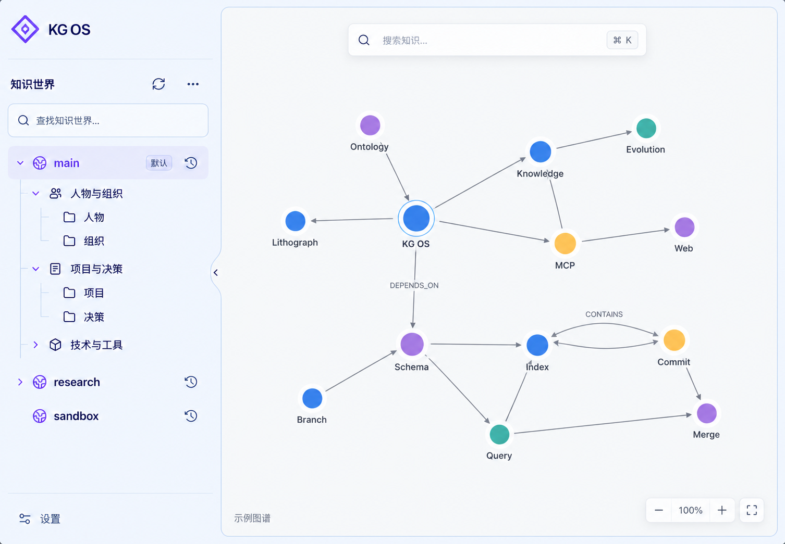
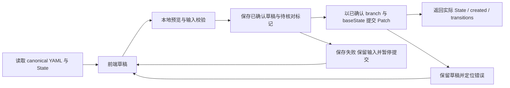

# Web 设计

<!-- cspell:ignore libfile WCAG languagechange Linkurious -->

本文拥有 KG OS **面向人的 Web 信息架构、图形阅读、查询结果帧、版本导航、前端编辑、国际化与连接交互**。产品定义见 [README](../../README.md)，职责索引见 [设计入口](../design.md)。数据与写入规则继续由 [Ontology](ontology.md)、[Object](object.md)、[Graph](graph.md)、[Evolution](evolution.md) 拥有；交付与认证边界由 [Runtime](runtime.md#web-hosting) 拥有。

## 依据与状态

2026-10-28 **画布背景还原**：用户要求恢复开发图谱卡片前的画布背景，并移除点击画布后额外出现的整圈蓝色描边。深浅两种主题恢复原底色、蓝紫渐变与 20×20px 点阵，沿用原透明度、位置和尺寸；保留原细边框和圆角，画布本身通过鼠标或键盘聚焦时均不叠加整圈描边，节点及按钮继续提供焦点提示。Q3 继续作为布局、搜索框及节点/连线的视觉依据，背景以本次还原决定为准；搜索、图谱直接操作与数据合同保持。实施与验收见 [Phase 14 背景还原](../development/phases/14-web.md#画布背景还原2026-10-28)。

2026-10-28 **统一左边框导航入口**：移除画布左上角的版本菜单按钮，各宽度统一使用画布左边框中间的弧形控制柄。桌面继续点击收放与拖动调宽；窄屏由控制柄打开现有覆盖式抽屉，不调宽或挤压画布。此决定替换 2026-10-14 基线中“窄屏隐藏边框柄、保留画布内独立入口”的规则；导航内容、历史弹窗和设置归属保持。具体行为见下方 App Shell 合同，实施与验收见 [Phase 14](../development/phases/14-web.md#左边框导航入口统一2026-10-28)。

2026-10-28 **图谱直接操作体验增量已完成本地实现与验收**：用户要求加强类似 Neo4j Browser 的双击、拖动和缩放体验。下方[直接操作与自动布局](#图谱直接操作与自动布局)是回应这一目标的工程映射，不是用户逐项指定的新增产品模型；顶部单搜索与连续画布布局、三路只读检索和实际数据边界保持。双击展开/收起、拖动固定、平移/缩放、右键菜单和布局已有本轮实际交互证据，与首轮 Q3 分别取证；范围与结果见 [Phase 14 直接操作增量](../development/phases/14-web.md#图谱直接操作体验增量2026-10-28)，完整 Phase 仍为 `in_progress`。

2026-10-28 **单画布知识探索与搜索外观已确认**：用户选择参考 Linkurious 的干净画布、节点比例与细连线，以 [Q3 单画布与搜索框](assets/web/Q3-linkurious-canvas-search.png)为当前右侧视觉依据。右侧整张卡片是一块连续图谱画布，顶部只保留一个简单搜索框；不再采用多行 Cypher 编辑器、独立结果帧流、知识/本体顶层 Tab 或常驻详情列。搜索找到知识起点后，通过点选、属性详情和有界邻居展开继续阅读。左侧 V7 Branch / Domain 树及历史弹窗沿用。当前视觉与探索合同见[知识图谱画布与搜索](#知识图谱画布与搜索)，本轮真实检索与图浏览增量见 [Phase 14](../development/phases/14-web.md#单画布搜索与图谱浏览增量2026-10-28)；用户进一步明确采用关键词、全文、向量三路混合检索；具体工程映射由该节维护，不从示意图推导业务字段。此决定替代旧 Q1/Q2 的主页面布局，不改变 Graph、State、Object/Patch 的底层语义。

2026-10-28 **领域树与 Branch 历史弹窗已确认**：日常侧栏改为 Branch → Domain → 子 Domain，Commit 历史移至每个 Branch 行末的历史图标，并以居中大弹窗展示真实 Git DAG。以 [V7 领域树](assets/web/V7-domain-tree-sidebar.png)和 [V7 历史弹窗](assets/web/V7-branch-history-dialog.png)为视觉依据；保留现有深浅主题、侧栏弧形控制柄、画布与底部设置。该领域树增量实施时右侧为占位画布，当前右侧见 [Q3 单画布合同](#知识图谱画布与搜索)；该增量本身只接入真实领域树、导航选中上下文及历史浏览，不宣称完成本体图或编辑。下文[版本区域](#版本区域)为当前规则；实施与验收见 [Phase 14 领域树增量](../development/phases/14-web.md#领域树与-branch-历史弹窗2026-10-28)。

2026-10-25 **平铺知识世界与满高版本导航历史基线（导航内容与历史入口已由 V7 替换）**：以 [V6 高保真](assets/web/V6-flat-world-sidebar.png)替换此前 V5 的世界下拉选择器。世界同级平铺，一次展开一个；点击世界行只展开/收起历史，点击某条版本验证成功后才同时确认浏览世界与 immutable State。版本区使用品牌/导航标题与固定设置入口之间的可用高度，历史溢出后内部滚动，末尾按需加载更早版本。侧栏与窄屏抽屉底部只保留“设置”；主题、语言和退出登录集中在设置，认证前仍可在认证/初始化界面切换语言。跨世界高级历史、真实 DAG、明确写入目标及旧帧/草稿归属保留；实施与验收见 [Phase 14 平铺导航增量](../development/phases/14-web.md#平铺世界与设置入口收敛2026-10-25)，不代表整个 Web Phase 完成。

2026-10-21 **Web 显示偏好更新**：语言与主题均以“跟随系统”为默认模式；有效的用户手动选择优先并持久化。主题选项由原先的“浅色 / 深色”调整为“跟随系统 / 浅色 / 深色”；下文 2026-10-14 所述“默认深色、双选项”只保留为当时的视觉基线，不再定义当前默认行为。既有深浅色 Token、布局和视觉风格不变。具体解析、切换及内嵌宿主边界以 [显示偏好合同](#显示偏好与主题)为准。

2026-10-15 **当时实现边界**：左侧版本示例已由真实 Evolution SDK/ChatGPT MCP 只读数据替换，支持多 Branch 筛选、已加载 Commit 搜索、分页和选中验证；下面 2026-10-14 的“静态版本示例”仅记录当时的视觉基线，不再描述当前左侧栏行为。当时右侧查询、图谱、编辑、草稿仍未接入，完整版本 DAG 与 Phase 14 验收尚未完成；当前右侧只读增量以 [Q3 合同](#知识图谱画布与搜索)及其本地验收记录为准。

2026-10-14 收起状态的卡片边界修正：侧栏完全隐藏时，**画布上下左右统一保留 12px 外边距**；控制柄轮廓以同一左边框为基准水平镜像，**向画布内部（右侧）凹入 14px**，填充页背景遮住凹入区域的原画布与竖线，箭头朝右。展开时仍向左凸出 14px、箭头朝左。两种状态保留 112px 曲线高度、连续边框、44px 透明点击区域和原来的拖动/键盘行为；此决定替换此前“收起后仍向左凸出、左边距 48px”的过时布局。

2026-10-14 侧栏弧形边框视觉微调：保留边框向左凸出的连续轮廓，但把原约 24px 的凸出收敛至约 **14px**，同时延长上下过渡曲线（轮廓高度约 112px），在顶点保持连续切线，形成更柔和的浅弧。箭头随轮廓向边框靠拢；不使用独立按钮、额外边线或高亮底色。透明点击区保持至少 44px 宽，展开 / 收起、拖动、键盘、双主题和移动端规则不变。

2026-10-14 **App Shell 侧栏边界交互基线**：桌面版取消侧栏底部的 Collapse 按钮与 72px 半收起状态。右侧画布卡片的**左边框在垂直正中连续形成箭头控制柄**，再平滑接回原边框；不是叠在边框上或画布内部的独立圆角按钮，不额外画一条竖线。展开时向卡片外（左侧）凸出、与画布同色；完全收起时向卡片内（右侧）凹入、用页背景遮盖凹入区域。边框保持同一低对比颜色，默认不发光；Hover / Focus 才局部增强边框与箭头。展开时箭头朝左表示收起，收起后箭头朝右表示展开。用局部遮盖原直线边框及单条连续轮廓实现视觉融合，不裁剪工作区。点击可完全隐藏侧栏（列宽为 0）或恢复；展开时保留水平拖动调宽（240–420px）、键盘左右方向键调整与先前宽度。交互与绘制层由画布外侧 Shell 管理，不受画布 `overflow: hidden` 裁剪；收起时卡片四边统一 12px。深浅主题、版本示例、右侧独立带边框空白画布均不变。窄屏仍使用原版本抽屉，不出现桌面拖拽控制柄。画布不引入欢迎文案、创建按钮或业务数据。

2026-10-14 主题控件保留**横向填满侧栏内容宽度、居中对齐的双选项**，太阳与月亮各占一半，选中态与真实主题保持一致；重复点击当前选项不改变主题。窄屏抽屉使用同一双选项主题控件。此前侧栏底部 Collapse 按钮和半收起小主题按钮已由上述最新的画布边框控制柄方案替换。

2026-10-14 **App Shell 深色视觉基线**：以用户选定的深海军蓝 / 低饱和紫蓝光感 Web 截图为基准，深色默认、浅色可切换。左侧 KG OS 品牌、版本树示意和 Branches 直接融入背景，**没有左侧大卡片，也不为当前 main 添加选中卡片**；原始底栏仅有明暗主题切换，现已在同一区域增加国际化语言入口。右侧**不设置独立头部**，但保留独立、有边框和圆角的空白点阵画布占位容器，其内部工具未接入时禁用。窄屏通过画布内版本入口打开抽屉，主题切换仍位于版本抽屉底部。不设 macOS 窗口按钮、Workspace 选择器、全局搜索、Branch / Clean 伪状态、用户头像、欢迎页或品牌口号。版本号、Commit hash 与 Branch 名称是**标记为示意的静态预览**，不代表真实数据。业务数据、查询编辑器、结果帧和 Graph 均等待 Phase 14；此前 Q1 / V1 材料继续作为未来业务交互结构依据，不决定当前外壳的默认视觉。

2026-10-04 核对基线：`main@181628b45c1600476514dfc129a5053c6d394b9e`，版本 `0.2.1`。2026-10-13 已在 [Web app shell](../../packages/web/src/app/app.tsx) 落地静态工作台布局；2026-10-14 已增加强制认证弹窗、已认证 `web.data.info` 启动信息、boot guard 和连接失效 / 显式重连，认证后才可操作外壳；2026-10-15 左侧版本导航先行接入真实只读数据。查询、图谱、编辑、持久草稿及完整版本 DAG 仍未实现，不代表 Phase 14 已完成。后端依据是当前 [SDK](../../packages/sdk/src/client.ts)、[类型](../../packages/sdk/src/types.ts) 和 [HTTP adapter](../../internal/daemon/api.go)，而非截图按钮。

| 状态 | 本文处理 |
| --- | --- |
| 用户已认可 | 图谱优先；语言/主题跟随系统并允许手动选择；左侧 Branch / 领域树与居中历史 DAG 弹窗；右侧单一知识图谱画布、顶部简单搜索框、局部点选/详情/邻居探索；Branch 前进提示刷新、不自动切换；Web 数据与草稿保存在 Workspace 的 `.kgos` 下并可恢复。旧查询编辑器/结果帧流布局已由 Q3 替换 |
| 沿用现有产品合同 | 全世界 immutable State、同 State 读取、Definition 聚合、strict base Object Patch、Graph 原样执行与 Evolution 专用操作 |
| 已落地工作台外壳 | `packages/web/src/app/layout/` 实现左侧品牌、可折叠侧栏、主题与窄屏导航；`app/styles/` 管理语义变量和外壳。当前右侧已接 `features/graph/` 的搜索、画布与局部控件，本轮只读增量已有本地真实 Runtime/浏览器验收；完整 Phase 仍按计划取证，不填充模拟知识 |
| 已实现的知识世界与只读版本导航 | `features/version/` 以真实默认世界为入口，提供平铺世界与独立展开、已加载历史分页、最新与当前浏览区分、跨世界高级筛选及单 root 真实版本关系图；普通浏览器与内嵌页面复用组件。指针观察不替换 pinned State，断连/失败保留或清除对应上下文；实际验收与完整 Phase 边界见 Phase 14 |
| 已落地认证与刷新恢复 | `features/connection/` 的强制弹窗、Token 显隐、错误反馈；首次根 Token 登录创建服务端持久 Web Session，刷新从 HttpOnly Cookie 自动恢复并取得临时 Web Bearer；根 Token 不持久化在浏览器；`core/client/` 仍通过 SDK Bearer + Boot Guard 访问 API，主动退出由服务端撤销 Session；未认证时背景模糊且不可操作 |
| 已实现的 Web 国际化基础 | `app/i18n/` 内置 English / 简体中文、浏览器语言解析与语言偏好；当前 Shell、强制认证与 MCP 授权弹窗均可切换，错误与相对时间随语言更新，定向浏览器/单测已通过；正式打包和阶段门禁仍按 [Phase 14 P14-00](../development/phases/14-web.md#a14-00-国际化基础与双语界面) 核对 |
| 当前只读画布增量，已完成本地实现与验收 | 三路真实搜索、固定 Node/Relationship 投影、按需详情与有界邻居、当前 State 隔离、局部视口及 Browser/MCP 构建已有本轮本地证据，见 [Phase 14 Q3 验收](../development/phases/14-web.md#单画布增量本地实施与验收证据)。后续表单到 Patch、持久草稿恢复、`.kgos/web/ui.db`、可丢弃缓存与按记录并发校验仍未完成，完整 Phase 保持 `in_progress` |
| 本轮决定更新 | 用户接受前两项默认，并追加“数据可以放到 kgos 下面，Web 临时数据也放里面”；按现有 Workspace→`.kgos` 合同理解，草稿不再默认随刷新丢失。随后明确“再简化点，不要过度设计”：首版只呈现常用工作流，保存 / 恢复在原编辑位置，缓存自动管理，普通错误就地短提示，真实冲突才打开比较。内部安全与持久化合同保留，均不代表已经实现 |

<a id="web-first-run-setup"></a>

### 四步 Token-first 初始化与路由（D110）

Web Setup 是部署后独立的全屏向导，不是新的账号体系。当前版本以 **管理员 Token → 对外访问地址 → Embedding → 初始化知识库** 为四步；用户进入未初始化实例的 `/setup` 首先领取并保存唯一根 Token、自动建立 Session，成功登录后才能继续。没有额外欢迎步骤；Token 第一步和前端主题/语言、桌面/移动布局继续复用现有已确认的视觉规范。

| 阶段 | UI 与交互 | 验证条件 |
| --- | --- | --- |
| **1 · 保护您的 KG OS 实例** | 没有 `auth.json` 时显示「生成访问令牌」，第一次调用 `POST setup/rotate-token` 原子生成并只回显一次；可显隐、复制并自动登录。已有 Token 时恢复现有 Session 或提示用户输入**已有管理员 Token**登录；没有旧凭证不能匿名再生成。认证成功才允许「下一步」，已有 Token 且已登录才显示「重新生成访问令牌」；轮换需要旧有效 Session，成功使旧 Token、Cookie 和 Web Access Bearer 失效，自动用新 Token 登录；失败不谎称登录成功。 | Token 缺失时仅首次匿名生成；已存在时必须有效 Root Token 或 Web Session，拒绝未认证轮换；刷新不重新认领 |
| **2 · 配置对外访问地址** | 必填 `server.public_origin`，默认 `location.origin`，只接受裸 HTTPS Origin 或本机 loopback HTTP，显示派生 MCP URL。 | 仅格式合法才能继续；不自动建立 DNS、HTTPS 或反向代理 |
| **3 · 配置向量服务** | URL、可留空 API Key、自选模型 ID、1..4096 维度及 cosine/euclidean；默认 `https://newapi.y2l.top/v1`、`qwen/qwen3-embedding-8b`、4096、cosine。 | 用当前 Web Bearer + Boot Guard 请求受认证的 `setup/validate-embedding`；真实验证成功且维度符合才进入下一步，参数修改使旧结果立即失效。允许管理员指定任意合法 HTTP(S) 地址，包含 Fake-IP、回环、私网与特殊地址；后端仍执行请求时长、大小、同源、禁止重定向、无环境代理保护 |
| **4 · 初始化知识库** | 对外 Origin、Embedding/Key 状态、Jieba 和缓存预览；真实配置提交、状态进度、失败恢复与完成态，保留原版画面风格和单一 Footer。 | 有效 Session 才能提交完整配置；合法 config 已发布但 receipt 缺失时仅可认证 `{}` resume；成功须经过当前 Runtime/Kernel authenticated readiness 与 receipt，不能伪造成功 |

**状态与导航**：首次无 Token 可公开读取最小 `setup/status`。Token 一旦存在，`setup/status`、测试/轮换/初始化全部要求当前 Instance 或 Web Bearer，未认证返回 401；普通 Web Session 的 `login|session|logout` 仍按现有合同提供登录与恢复。浏览器启动时读状态，遇到 401 时使用已由服务端决定的页面路径：未 ready 的 `/setup` 显示第一步登录，已 ready 的 `/` 进入现有业务登录；成功恢复 Session 后再读真实状态，不把路径当成业务就绪证明。初始化/ready 与异常场景沿用原 Runtime 状态/503 门禁。已有已初始化实例访问 `/setup` 由服务器重定向首页，未授权不能用 Setup 改写旧实例。

**视觉与文案**：保留暗/亮主题、简体中文/English、左侧紧凑进度与右侧表单的高保真风格；底部固定按钮不因已认证/未认证跳动。管理员 Token 只在本次生成时展示，不写浏览器持久存储。向量测试状态使用 Toast 提示，并在验证期间阻止重复提交；错误码与安全限制 owner 在 [Runtime](runtime.md#web-first-run-bootstrap)。Web 草稿只在内存中保持，单击下一步不写 config；仅最后一步提交完整显式 `server`、`embedding`、`cache`、`fulltext` 与空 extensions。配置损坏和旧数据不允许通过本向导重置。

### 前端代码架构

`packages/web/src` 采用四层模块化结构，而不是按技术类型建立全局
`components/hooks/services/stores/utils` 目录，也不机械套用
`pages/widgets/entities` 等额外层。当前层级与依赖方向为：

```text
main.tsx → app only within packages/web/src

app      → features / core / shared / @kgos/sdk
features → core / shared / @kgos/sdk
core     → shared / @kgos/sdk
shared   → browser / framework / generic third-party dependencies only
```

| 层 | 职责 | 边界 |
| --- | --- | --- |
| `app/` | React 应用根、主 Shell、全局 provider、主导航与 Feature 组合 | 不拥有 Graph / Patch / Merge 等业务规则 |
| `core/` | 跨 Feature 的 Web 应用基础能力；首版按真实需求形成 `client/`、`workspace/`、`persistence/` | `client` 只拥有显式连接、Web fetch / guard / 预算等浏览器生命周期，不建立第二套 SDK service/repository；`workspace` 拥有 pinned State 上下文；`persistence` 只负责记录/CAS/autosave/cache，不判断业务草稿是否仍可提交 |
| `features/` | 按完整用户能力垂直聚合；首版目标为 `connection/`、`query/`、`object-edit/`、`ontology/`、`versions/` | 不按按钮拆成 `run-query/rerun-query/move-tag` 等碎片；Feature 内可按真实复杂度继续分子目录 |
| `shared/` | 无 KG OS 业务语义的 UI primitive、通用库和样式 | 不依赖 `app/core/features`，也不承载 SDK / Object / State / Graph 模型 |

`@kgos/sdk` 继续是公共 HTTP Client 与 wire contract 的唯一 TypeScript
实现；Web 不新增 `ObjectService`、`GraphRepository` 或 DTO 镜像层。Feature
可以直接使用 SDK 公共类型，并通过 `core/client` 取得带 Web 生命周期约束的
`KGOSClient`。需要共享 Object 编辑时，`query` / `ontology` 复用
`features/object-edit` 的公共入口；其它 Feature 默认保持独立，出现真实复用再建立
公开边界，不为理论纯度增加中转层。

源码目录只在出现第一个真实 owner 时创建，不提交 `.gitkeep`、空
`index.ts` 或占位 controller。单元测试与源码 colocate；仓库级真实浏览器流程继续放在
`tests/e2e/`。Dependency Cruiser 强制 `main.tsx` 在 Web 内部只组合 `app`，并拒绝
`app/core/features/shared` 对 entrypoint 的反向依赖，以及
`shared → app/core/features/sdk`、`core → app/features`、
`features → app` 的反向依赖；现有 no-circular 规则继续禁止实际循环。

当前 App Shell 工程落点为：

```text
src/
├── main.tsx
├── app/
│   ├── app.tsx
│   ├── layout/        # Header / VersionSidebar / SidebarHandle / Workspace / VersionDrawer
│   └── styles/        # tokens.css / global.css / layout.css
└── shared/
    ├── ui/           # 按需 shadcn Base UI 控件、Lucide Icon 与 UI Provider
    └── lib/          # class 合并与 document 主题同步
```

设计变量集中于 `tokens.css`，`global.css` 负责 Tailwind 样式入口、语义映射与页面基础规则，`layout.css` 拥有顶层容器、间距、响应式及窄屏版本抽屉样式。新外壳无独立顶栏；浏览器在 100% 缩放下使用紧凑布局；桌面侧栏默认 280px，可在 240–420px 间拖动调整或通过方向键按 16px 微调，收起时宽度为 0；右侧独立点阵画布保留细边框与圆角，收起后画布四边距均为 12px。画布左边框中置的连续轮廓由 `SidebarHandle` 绘制，展开时向左凸出、收起时向右凹入，并局部覆盖原直线边框；不是分离按钮，且不被画布裁剪。桌面侧栏与窄屏版本抽屉底部只保留设置；主题、语言和退出登录均在设置中。左侧真实版本导航已先行接入；2026-10-28 领域树与历史弹窗按本轮增量实施；查询、图谱、本体、编辑等其余业务 Feature 仍按 Phase 14 实现，不用静态预览或局部完成替代业务验收。

导航入口在所有宽度都使用同一弧形边框柄，不再保留画布内菜单按钮。宽度大于 900px 时控制桌面侧栏；不大于 900px 时，边框柄采用向右凹入的收起轮廓与右箭头，保持 44px 点击宽度和 112px 曲线高度，按实际画布左边距对齐，点击或轻触打开覆盖式版本抽屉，不执行拖动或方向键调宽。抽屉保留 Base UI Dialog 的 Esc、关闭按钮、遮罩退出与键盘焦点管理；关闭抽屉或从抽屉进入设置再关闭时，焦点回到边框柄，历史弹窗仍逐层关闭。跨断点进入桌面时关闭窄屏抽屉，保留桌面先前的折叠状态与宽度、当前世界和 State，以及图谱选择和相机。

### 通用 UI 组件体系

Web 通用控件统一采用 **shadcn/ui 的 Base UI 实现 + Tailwind CSS v4 + Lucide**。保留 React / TypeScript / Vite 和 i18next，不重新创建应用，不引入第二套通用 UI 框架。以 [shadcn/ui Base UI 组件](https://ui.shadcn.com/docs/components/base/button)、[Toast](https://ui.shadcn.com/docs/components/base/toast) 和 [Vite 集成](https://ui.shadcn.com/docs/installation/vite) 为上游依据；不使用依赖 Sonner 或 Radix 的替代实现。

组件源码按需放在现有 `shared/ui/`，`components.json` 指向该目录，通用 class 合并函数位于 `shared/lib/`。保留上游许可和来源；允许为本项目紧凑尺寸、主题、国际化和实际使用范围调整源码，不另建 package、组件注册系统或重复包装层。新增通用控件先检查已安装组件与 shadcn/ui；没有实际调用方的组件不安装。`SidebarHandle` 的拖拽/连续轮廓、Canvas、版本导航和 Setup Wizard 仍是业务组件，不用组件库模板重写。

`tokens.css` 是唯一颜色、密度和圆角真源；shadcn 语义变量只映射这些 Token，不复制默认黑白配色。Tailwind v4 通过 Vite 插件编译；保留既有页面 reset，不叠加改变原有标题/表单默认值的全局 Preflight。组件必要的基础规则限于组件作用域。Browser 和 MCP Apps 使用同一个样式入口与 Provider；主题同步到各自 document 根，使挂载到 body 的 Dialog、Select、Popover、Tooltip、Toast 继承正确颜色，内嵌文档不修改宿主主题。

Dialog 的焦点圈定、焦点恢复、Escape、遮罩和键盘行为由 Base UI 负责。认证弹窗不可通过 Escape 或遮罩绕过；MCP 授权的退出继续走现有 deny/cancel 合同，提交决定时不得关闭；移动端版本抽屉保留正常关闭与焦点恢复。分支筛选使用 Popover + Checkbox，算法选择使用 Select；现有模型输入仍允许自由文本，不变成固定 Provider 或模型枚举。

通知只使用官方 shadcn/ui Base UI Toast 及其 Manager。每个应用根拥有独立 Provider，不自行实现事件总线、队列或计时器。向量验证在顶部显示同一条通知：Loading 不自动消失；Success 约 3.5 秒后消失；Error 保留至手动关闭、重新验证、修改配置或离开该步骤。更改配置或卸载必须取消请求并使旧结果失效；关闭消息不改变验证结果。消息文案在渲染时按当前语言解析，语言/主题切换不重发验证请求。所有图标按钮、弹层和关闭控件均有本地化可访问名称。

### ChatGPT 内嵌 Web（MCP Apps）

**设计目标；共享 Shell 与双入口已实现，用户已在真实 ChatGPT 中验收两种入口**：同一 `packages/web` 面向普通浏览器和支持 MCP Apps 的 ChatGPT 宿主提供两种入口，使用相同的 React UI、设计变量、国际化资源与业务 Feature，而不是复制管理后台。Sidebar App（`global`）与 Conversation Panel（`thread`）使用同一个 MCP App UI Resource；二者是宿主内的独立 UI 实例，并非两个新服务。Go MCP Tool / Resource 元数据与认证归 [MCP owner](mcp.md#chatgpt-mcp-apps-ui-合同)；交付边界归 [Runtime](runtime.md#web-hosting)。

`packages/web/src/main.tsx` 保留浏览器入口，增加 `mcp-main.tsx` 作为 MCP Apps HTML 启动入口；`app/` 抽取复用的工作区 Shell，`features/` 保留领域功能，`shared/` 保留无 KG OS 业务语义的 UI。浏览器入口组合现有 Web Session、强制登录弹窗和 HTTP SDK；MCP Apps 入口组合宿主 Bridge、连接状态和同一 Shell，**不挂载 Web 根 Token 登录、Web Cookie 恢复或 MCP OAuth 连接授权弹窗**。不新建 `packages`、第二套业务组件、独立 Web Router 或新的服务端。

```text
packages/web
  ├── main.tsx          -> Browser App -> Web Session -> @kgos/sdk HTTP
  ├── mcp-main.tsx      -> MCP App     -> MCP Apps Bridge -> /mcp tools
  └── app / features / core / shared（共用 UI / 业务组件）
                                      -> 同一个 kgosd / Kernel / Instance
```

**数据与认证隔离**：ChatGPT iframe 不假设能携带原站 `SameSite=Strict` Session Cookie，也不从 `localStorage`、URL、页面 DOM、宿主对象读取 Instance Token、Web Bearer 或 MCP OAuth Token。嵌入页面经标准 `ui/initialize` / `tools/call` Bridge 请宿主代发已授权 MCP 请求，由服务端逐次认证；`window.openai` 仅作有能力检测的 ChatGPT 专属扩展。独立 Web 的 `@kgos/sdk` 仍为 HTTP 合同真源；内嵌 UI 不直接请求 `/api/v1/*` 作为认证捷径，不将 OAuth Token 变成普通 API Token。

**分阶段真实数据**：Phase 18 首次经 Bridge 调用当时的 `kgos_read`，以固定安全脚本读取 `evolution.overview()` 证明连接；V5/V6 随后接入真实 Evolution 列表、分页与版本选择，这些保留为对应阶段的历史证据。当前普通浏览器通过原认证 HTTP SDK 读取；MCP Apps 使用现有 `kgos_query` 固定只读调用，分别读取 `evolution.branch.list / tag.list / ancestry / get`。本轮领域树再按[版本区域](#版本区域)补充 `ontology.read / object.read`，仅传输领域摘要与公共 Domain JSON，不通过 Bridge 传输完整 Knowledge Snapshot。

Script 方法名固定、参数 JSON 编码、取消信号传给 Bridge；普通 MCP 工具错误在对应导航/弹窗内提示重试，宿主拒绝调用或服务端明确返回认证/授权失败码则使内嵌连接失效并清除旧连接数据。当前 Branch / State / Domain 选择仍是只读导航上下文，未接入右侧图谱/查询功能。其余查询、图谱、Ontology/Knowledge 编辑、业务 History、Diff、Merge 仍由 [Phase 14](../development/phases/14-web.md)开发验收；不预建全部 HTTP API → JavaScript 的通用网关或重复业务语义。写入使用 `kgos_mutate`，`kgos_workspace` 与 `ui://kgos/workspace/v1` 沿用 [MCP Tool 真源](mcp.md#mcp-tool-help)；宿主不支持某能力时显示不可用，不绕过认证。

**布局、状态与降级**：复用响应式 Shell，遵守宿主实际视口，主题、English/简体中文均可用，但不假定 iframe 存储与独立站点共享；支持时读取宿主提供的 theme/locale，缺失时沿用 Web 已有选择与回退规则。`global` 与每个 `thread` 有各自的选择、暂存输入和当前页面状态，**不保证实时同步**；同一 Instance 的实际知识由服务端共享。外部 AI 修改 Branch 时不自动切换 pinned State，用户明确刷新再读取。宿主没有入口或不支持 MCP Apps 时，仍保留目标版本的五个 AI-facing MCP Tool（Phase 22 旧版为四个）与独立 Web；不退回直接嵌套整站 iframe 或跨站 Cookie。官方规范对 classic ChatGPT 网页端和 Work/桌面端支持范围有区别，真实验收见 [Phase 18](../development/phases/18-chatgpt-embedded-web.md)。

### 显示偏好与主题

浏览器 Web、首次初始化向导、认证弹窗和主工作区共享同一套主题选择规则，MCP Apps 在其独立文档中沿用同一规则。主题偏好有 `system`（默认）、`light`、`dark` 三种模式；本地存储键为 `localStorage["kgos.web.theme"]`，只持久化有效的显式 `light` / `dark`。无记录、损坏记录或明确选择 `system` 时均跟随系统，选择系统模式时移除旧记录，不把系统当前解析出的颜色永久保存为手动选择。手动选择立即生效并保留到刷新后；存储不可用时仍允许本次会话切换，刷新后重新检测。

跟随系统模式用浏览器 `prefers-color-scheme` 检测并响应其变化；缺失浏览器能力时安全回退至深色。ChatGPT MCP Apps 内嵌宿主提供有效 `theme` 时，它是**自动模式的**优先来源；宿主缺失时回退系统颜色，手动选择始终优先于宿主。Host 状态变化不触发 MCP 数据请求。初始化页和工作区共用主题实现，Portal 跟随当前文档根的深浅色 Class；在首屏脚本执行时优先应用已保存或系统主题，避免初次 React 渲染前出现错误颜色；不修改 ChatGPT 宿主自身的主题。

主题切换入口位于设置的显示偏好分类，侧栏与窄屏抽屉底部只提供设置入口；首次初始化页仍在现有页头使用同一三选项控件；语言与主题均不要求首次安装时填写，不增加后端设置 API、额外全屏设置页或持久化数据库。

### 国际化与语言偏好

2026-10-21 **语言偏好模式更新**：默认 `system` 根据浏览器有序语言列表解析；用户显式选择 `en` 或 `zh-CN` 后，按原 `kgos.web.locale` 键持久化并优先于系统与内嵌宿主语言。语言控件提供“自动 / EN / 中文”三个模式，选择自动时移除手动偏好并即时重新检测，跟随模式响应浏览器 `languagechange`；内嵌宿主提供有效 `locale` 时只作为跟随模式优先来源，未支持的语言按浏览器列表回退，最终回退 English。初始化、授权与工作区沿用同一 i18n Context，不修改任何业务数据、认证或 OAuth 状态。

Web 作为浏览器中的人类界面，首版统一支持 **English (`en`)** 与**简体中文 (`zh-CN`)**；默认跟随浏览器语言，无法匹配时才回退 English，与 [CLI 国际化](cli.md#国际化)的语言范围及英文回退方向一致，但 Web **不读取 CLI 的 `LC_*` / `LANG`**，也不共享 CLI 的文案或 locale 解析实现。当前已将原先中英文混用的 Shell、认证及 MCP 授权组件接入统一资源，`index.html` 默认 `lang="en"`，启动后按实际语言更新；后续业务 Feature 仍须遵守本节国际化合同。

**语言确定与存储**：

1. 优先读取当前浏览器 origin 的 `localStorage["kgos.web.locale"]`；只有值恰为 `en` 或 `zh-CN` 才生效，其它值按未设置处理。
2. 无有效手动偏好时，按 `navigator.languages`（不可用时用 `navigator.language`）的顺序查找第一个受支持的语言：不区分大小写，`zh` 及 `zh-*` 映射 `zh-CN`，`en` 及 `en-*` 映射 `en`；没有匹配时使用 `en`。不因时区、IP 或服务器语言推断用户语言。
3. 切换语言立即更新 React 文案，并尽力写入上述浏览器偏好；存储不可读、禁用、超额或写入失败时不阻断页面，仍允许本次会话切换，刷新时重新按可用来源解析。非浏览器渲染/测试中这些 API 缺失时安全使用 English，不使模块初始化抛错。语言选择不依赖是否已认证，不在 `.kgos/web/ui.db`、Knowledge、Cookie、URL、Token、SDK 或 OAuth 凭证中保存，也不提供新后端设置 API。

**展示范围与切换入口**：

- 所有 KG OS 自有可见文案统一翻译：App Shell、桌面侧栏与窄屏抽屉、强制认证弹窗及其帮助、未来连接授权弹窗、查询/编辑/版本流程、加载/空态/成功/失败、placeholder、tooltip、`title`、`aria-label` 与辅助说明。未认证时在现有认证弹窗上方提供可键盘访问的语言切换，不增加关闭/绕过认证入口；已认证时通过设置的显示偏好切换，侧栏完全收起时可先展开；窄屏从版本抽屉的固定设置入口进入。不得为切换语言添加顶栏、独立页面或权限检查。
- 语言切换仅影响展示，保持输入、认证状态、已连接 Instance、当前 State/Branch、草稿、结果帧、焦点及弹窗开关状态；网络请求与写入不应因为切换被重新触发。Phase 17 的 MCP Web 连接授权弹窗只复用同一个 Web 语言上下文，其 OAuth 协议、同意/拒绝及登录 Session 规则由 [MCP 认证 owner](mcp.md#统一-instance-认证与-web-内的-mcp-连接授权phase-17-目标)负责，不能在国际化任务中另建认证机制。
- `document.documentElement.lang` 与当前选中语言同步，页面首次 React 交互前完成语言解析，静态 HTML 使用英文作为安全回退；浏览器标题和描述等 KG OS 自有文案按选中语言显示。保持布局弹性，英文长文案/中文换行均需满足 [响应式与键盘规则](#键盘与响应式)。

**实现边界**：在 `packages/web/src/app/i18n/` 用 `i18next` + `react-i18next` 管理应用级初始化和本地 `en.ts` / `zh-CN.ts` 资源；React 组件通过翻译 Hook 读取有语义的稳定 Key，`features/` 和 `shared/` 不反向导入 `app/`。两个语言目录的 Key / 插值参数保持一致，English 为缺失文案的运行时回退；开发与测试应检查完整性，避免把原始 Key 作为正常可见文案。v1 只需一个资源命名空间，不引入 HTTP 翻译后端、语言检测插件、CDN、翻译管理服务、新持久层或通用配置框架。日期、时间、相对时间、数量及复数按当前语言使用浏览器原生 `Intl` / i18next 规则；静态示例的“2 hours ago”等也应由语义值格式化而不是当作不可翻译的固定英文。

**数据与错误边界**：Branch/Tag/Ref、用户定义的 Schema 名称、节点 Property、Cypher、JSON/YAML、SDK 请求和响应、机器错误码、配置 Key 与 OAuth 参数不翻译，不改写其存储和 wire 值。UI 错误依据稳定的错误码、HTTP 状态或客户端传输错误类别映射到翻译 Key；未知错误给当前语言的简短通用提示，原始诊断可按既有设计查看。已出现的错误、按钮加载态和空态在切换语言后应立即改用新语言，不能把旧语言的完整错误字符串永久存入组件状态。翻译包含变量时仍由 React 安全转义，不把用户数据插入翻译 HTML。

当前代码与定向验收证据见 [Phase 14 P14-00 / A14-00](../development/phases/14-web.md#a14-00-国际化基础与双语界面)。国际化基础已在当前 Web 可见组件中实现，不代表后续业务页面已实现、正式内嵌 Runtime/CI 或完整 Phase 14 已验收。

### 功能式设计材料

视觉材料统一按 Q / E / O / V / R / A 功能组织，入口见 [Web 功能材料与覆盖矩阵](web-materials.md)。该索引管理十四张功能 / 任务示意、五张状态组件规范、来源与规则引用，不对应十四个产品页面；交互语义仍由本文拥有，数据与写入继续依所属 owner。PNG 已齐套，R1 / R2 已按本轮简化决定替换；本页嵌入两张入口图，不表示应用实现或动态验收完成。

离线浏览材料可使用[功能图册 PDF](assets/web/KGOS-Web-Design.pdf)，主功能画板与状态组件 / A1 适配附录分别组织；图册不建立额外页面或产品能力。



旧 [Q1 查询帧图](assets/web/Q1-query-workspace.png)与 [V1 版本覆盖图](assets/web/V1-version-overlay.png)保留为历史材料；当前左侧以 V7、右侧以 Q3 为准。

图中的 State 符号、短 hash、时间、实体与计数是注明范围的设计示例；JSON 阅读示意不能作为 wire 编码，图中的动作不能建立额外 API。原件和组件变体的适用范围、来源版本及局部核对项统一见材料索引；一致数据见 [Web 样例](web-examples.md)。

## 信息架构与当前上下文

当前 App Shell 没有独立顶部栏：左侧负责 KG OS 品牌、同级平铺的 Branch 与按真实包含关系展开的领域树，底部只保留设置入口；每个 Branch 行末提供历史图标，历史在独立弹窗展示。右侧保留独立画布卡片，本轮领域选择只维护导航上下文，尚不展示领域模型内容。知识世界是 [Branch 使用语义](../../plugins/kgos/skills/kgos-ontology-standards/SKILL.md)，不是新的 Kernel 对象或权限边界。只展示真实 Branch 名称与实际版本信息，不新增世界别名、Description、分类、Owner 或知识数量。未来业务连接后，在对应上下文展示当前 Instance、用户选择的 Branch / Tag / State 与完整 resolved State 的可展开标识。设置按下节五分类承载显示偏好与实例配置，帮助链接现有操作指南。没有账号头像、角色、权限分级或远程部署入口。

### 五分类设置弹窗（2026-10-25）

用户已批准五张高保真方案并授权实现。侧栏底部与窄屏抽屉提供设置入口；桌面采用大弹窗、固定左侧分类、右侧独立滚动内容与固定底部操作区，沿用现有深浅主题、紫蓝强调、Base UI Dialog 和双语文案。窄屏分类可横向排列，弹窗不能溢出视口；关闭恢复原工作区与触发器焦点。

| 分类 | 真实数据与操作 |
| --- | --- |
| 显示偏好 | 复用浏览器主题、语言偏好，即时生效，不写实例配置 |
| 连接与访问 | 读取当前生效及已保存的对外地址、真实 MCP 路径、凭证状态；修改对外地址并保存，复制 MCP 地址，沿用退出登录 |
| 检索与模型 | 显示真实服务、模型、维度、算法、分词器与凭证来源；初始化固定项只读；测试当前生效连接，单独更新实例私有文件管理的密钥 |
| 存储与扩展 | 显示真实数据库路径；保存缓存路径/预算与额外 SQLite 扩展列表；不增加磁盘容量保证、清库或清缓存入口 |
| 运行与诊断 | 只读展示实际运行参数与来源、版本/平台及现有进程诊断；不在浏览器修改部署环境或自动重启 |

配置接口与凭证边界由 [Runtime 设置管理](runtime.md#已初始化实例的-web-设置管理)拥有。保存与验证分别反馈，需重启的值不能冒充已生效；每组独立保存，修改后才提供保存/取消，切换分类或关闭有未保存输入时先在弹窗内确认丢弃。加载、失败与空值只展示真实状态，不使用效果图的示例数据。密钥不回填、不进入浏览器持久存储；请求结果未知先重新读取核对，不自动重放写入。ChatGPT 内嵌入口可使用显示偏好，实例管理引导到独立浏览器，不新增 MCP 管理工具或绕过宿主认证的 HTTP 通道。

右侧日常主页面是[单画布知识探索](#知识图谱画布与搜索)：顶部只有搜索入口，搜索结果与后续邻居读取共同组成当前固定 State 下的可视子图。对象详情按需展开，避免常驻列挤占画布。旧“知识图谱 / 本体图谱”顶层 Tab、多行查询编辑器及结果帧流不再属于当前主页面。本体的 Domain / Definition 图与聚合编辑能力仍保留在[本体图谱](#本体图谱)的后续范围；版本详情、两 State 差异和 Merge 继续从版本区域进入，不因当前布局调整删除其业务合同。

首版围绕版本选择、搜索与单画布知识阅读，以及后续本体阅读、显式编辑与提交。自动保存和恢复就在原编辑位置，用小标识说明正在保存、已保存或需处理的问题；不增加恢复中心、缓存管理页、容量面板或回执中心。连接使用简短 dialog；完整 YAML / Patch、执行摘要和技术诊断按需展开。导入 / 导出、整份 UI 数据清理与容量维护保留为工程 / operator 合同，不设为首版常驻入口或恢复必经步骤。

普通失败在发生处显示简短原因，只提供当前适用的重试读取、重新连接或继续编辑。原始 code、失败阶段和存储诊断可在详情中查看；写入结果未知先核对，不显示盲目重试。只有实际内容差异、记录 CAS 冲突或后端 Merge conflict 才进入相应比较；不能为完整展示状态规范而常驻多组错误卡或确认面板。

当前上下文是前端页面状态，不是新的服务器对象或 connection-local checkout。它保存用户所选 StateRef、解析后的 immutable State，以及需要写入时显式选择的目标 Branch。它不能把浏览中的历史 State 当作 Branch head，也不能从 Branch 轨道颜色猜写入目标。

| 操作 | 读取上下文与展示规则 |
| --- | --- |
| 选择 Branch / Tag / commit | 用 `evolution.get({state: StateRef})` 解析；成功前保留旧视图并显示“正在切换”，失败不替换已可用上下文 |
| 搜索、对象详情与邻居展开 | 同一画布使用同一个 resolved State；所有 `at`、对象与邻居读取传该 commit，不能把最新 Schema 或另一版本节点混入当前子图 |
| 选择另一版本 | 验证成功后切换当前画布上下文，取消旧搜索/详情/邻居读取并失效其 generation；旧版本图元素和对象选择不混入新画布。切换失败保留已可用的旧上下文与视图 |
| Branch 后续前进或 Tag 被移动 | 当前画布继续固定原 commit，显示观察到的指针目标并提示显式刷新，不自动追随 head |
| 从图中对象进入本体或对象历史 | 链接携带当前画布 State + Ref；显示局部历史上下文，不能用另一版本 Schema 解释当前节点 |
| 查看历史 / Tag / 明确 commit | Snapshot 阅读模式只读；继续编辑须显式选择或创建 Branch，并建立符合其 head 的新草稿 |

搜索执行、邻居展开和当前选中对象各自核对连接、画布 resolved State 与 request generation；响应只能更新自己的有效操作。A→B 选择后 A 的迟到详情不能覆盖 B，切版本后的旧响应不能写回新画布。布局、选择与视口属于当前画布；跨操作缓存键至少含连接的库绑定、State + Object Ref。观察到 Branch 前进时提示刷新，用户显式刷新 / 选择版本后才改变上下文；不自动跟随 head。旧查询帧独立 State 的记录只在下方历史方案中保留，不要求当前主页面维护多个可见帧。

跨 Web / CLI 的指针变化用现有接口观察，不假定推送：已连接且页面可见时，约每 15 秒通过 `branch.list / tag.list` 读取当前关注类别的完整有界列表，再按所选 name 对照目标；当前没有独立的 per-ref head 读取接口，不为轮询调用包含一致性诊断的 `evolution.get`。ref 列表打开时更新其标注，关闭时仅更新所关注目标和提示。页面重新聚焦 / 变为可见、显式检查更新、恢复连接及本页 mutation 后立即核对；同一观察任务不重叠，失败退避、隐藏 / 断开时停止。显示最后观察时间，检查失败标指针信息可能过期，不把旧观察值写成最新 head；不替换 pinned commit 或旧 cursor。所选 ref 被删除时标“引用已不存在”，仍可按原 commit 读取就继续只读浏览，草稿不能提交到不存在的 Branch；不能静默切回 main。State Data / Merge 详情需显式重读其 mutable metadata，不用 commit 缓存充当最新值。

## 版本区域

<a id="紧凑提交列表"></a>

### Branch 与领域树导航

默认侧栏采用 **Branch → Domain → 子 Domain** 的领域树，不再把 Commit 列表放在 Branch 下。顶部保留“知识世界”、刷新/更多与“查找知识世界…”；搜索只过滤已取得的真实 Branch 名称，不遍历领域或历史。真实默认引用才标“默认”，不猜测 `main`，不从共享 Head 推断世界身份。初次连接沿用 `evolution.overview.defaultBranch` 与其 immutable State，并展开默认 Branch；同一连接最多展开一个 Branch，领域可分别展开多层。

Branch 行的名称、展开箭头和历史图标是三个独立操作。点击名称验证并选择该 Branch 当前观察到的 Head，清除领域选择；点击展开箭头只展开/收起领域，不改变当前浏览世界或 State。有子领域的行显示展开箭头，叶领域没有箭头；已确认没有任何 Domain 的 Branch 只显示自身，不补空领域或空白子项。未加载时展示读取状态，不把未知或失败当作无领域。历史图标常驻 Branch 行末，有可访问名称，点击不传播成名称选择或展开操作。

点击领域验证后原子选择其所属 Branch、已固定 State 与准确 Domain Ref；同一 Ref 的共享领域可以出现在多条路径，数据按 Ref 识别，展开、焦点与树行身份按路径记录。领域名称优先显示声明的 `title`，缺少时显示 `name`，准确名称/Ref 仍可查看；不由前端自动分类或生成别名。当前只读选择不等于右侧模型视图、写入目标或新增服务器对象。

树的边来自 [Domain 的 `includes`](ontology.md#domain业务组织)，只把指向 Domain 的组织边投影为子领域；Definition 不在本轮侧栏伪装成领域。全局结果包含全部 Domain 和未归类 Definition，不能只看首个分页或把全局清单直接当作树根。先读取同一 State 的完整分页领域清单，再每批最多 100 个 Domain 通过 `object.read` 读取公共 JSON 的 `includes`，不解析 Markdown、不访问内部 Schema / graph marker；结果均核对 resolved State。该读取只取得领域组织信息，不加载 Knowledge 或完整 Definition。

没有父领域的 Domain 先作为入口，子领域放在父级下。对这些入口仍不可达的循环部分，按完整 Ref 的确定顺序选择尚不可达的 Domain 补充入口，直到所有领域可发现。共享子领域允许在多个父级下展开；递归只检查当前路径，遇已在路径中的 Domain 展示引用提示并停止继续递归，不能用全局去重隐藏另一个父级的合法成员。树是导航投影，不把底层可共享、可循环的组织图改成单父存储模型。

领域数据按连接与 immutable State 缓存，只在需要展示对应 Branch 时读取；同一次领域读取的分页与批量必须使用同一 State。完整拓扑取得之前不判定树根或最终无领域；部分读取、字节预算/`RESOURCE_ERROR`、取消、失败或响应 State 不匹配均不能冒充完整树，保留此前已确认导航并提供重试。只渲染已展开路径；导航使用品牌、标题/搜索与固定设置之间的可用高度，在唯一导航容器内部滚动。长名称和深层树不撑开页面，浅色/深色及窄屏复用相同语义和数据。

展开对象、浏览上下文、历史弹窗对象分别记录。快速选择、展开、分页、断连与重连均隔离请求 generation；迟到结果不得覆盖新 Branch / State 或强制重开已收起路径。引用消失时保留其原名称与可读 pinned 数据并标“引用已不存在”，不伪造活跃引用或自动切回默认世界；换连接清理旧上下文。Branch 前进只提示新版本，用户显式选择/返回最新后才替换 pinned State。切到历史版本时清除原领域选择并重读对应 State 的领域树，不能用最新领域解释旧数据。

<a id="覆盖式纵向-git-dag"></a>

### Branch 历史弹窗与纵向 Git DAG

每个 Branch 行末的历史图标按需打开 **居中大弹窗**，标题明确显示该 Branch；即使该 Branch 没有展开，也能查看其历史。弹窗对象与领域展开对象分开，单 Branch 模式使用该 Branch 已固定的 immutable ancestry root、原始 reverse-topological 顺序与原 cursor，不用跨世界时间排序推断拓扑，不默认合成全库 DAG。Branch 的可达历史包含已合入路径，但不自动包含其他尚未合入 Branch 的后续变化。

弹窗为匹配当前主题的不透明面板，带细边框、适度圆角、柔和阴影、淡背景遮罩和可见关闭按钮，四周留出空间；窄屏在视口内保留边距，内容内部滚动。开关不改变底层工作区盒子、结果帧图尺寸或相机，不调用 fit-to-view、不重新计算知识图布局。弹窗开启时背景 inert 并锁住背景滚动；已有查询可继续运行，返回结果不触发自动缩放。

主体以连续轨道和 `parents[]` 展示纵向 fork / merge，保留全部已知多父边；新 State 向更旧 parent 连接，图例明确 parent 方向，不按轨道颜色猜 Branch 独占归属。未加载 parent 使用明确的继续加载端点，不补假节点。只渲染可见节点/边及少量缓冲；大历史渐进读取，不一次下载和布局全图。多泳道允许弹窗内部横向平移/滚动，不把图压成不可追踪的单列。

节点旁以版本说明为主，Hash/时间为辅；`committedAt` 是 immutable UTC epoch microseconds，缺少 message/author 如实显示缺省。规范 `## 简介` / `## 改动` 只取首个有意义正文行作标题，原文保留在详情提示；State Data 不冒充提交摘要。Branch/Tag 标签只标实际指针，“最新”只对应该 Branch 当前观察到的 Head；只有 Branch 名称和完整 State 同时匹配才标“当前浏览”，共享 Commit 不使其他 Branch 同时选中。

点击节点先以 `evolution.get` 验证完整 immutable State，成功后才原子确认 Branch 与浏览版本、清除原领域选择并加载该版本领域树；失败保留原上下文。“正在浏览历史版本”与“返回最新”就近显示，返回最新是显式验证该 Branch 观察到的 Head，而不是自动跟随。打开、关闭或仅加载历史不切换浏览位置，也不移动写入目标、旧帧或草稿。引用已删除但原 root 仍可读时保留只读图并标明引用已不存在。

切换入口和结果不能只靠行底色或小标签表达。已加载版本整行可点击，行末持续显示“切换到此版本”；已确认当前行改为勾选图标与“当前浏览”，请求中的目标行显示加载图标与“切换中”，并保留可访问的忙碌状态。点击后立即给出可见反馈，验证成功前原行仍是当前浏览；成功后更新当前行而不自动关闭弹窗或增加确认步骤，失败保留原选择并在弹窗内显示错误。没有其他待切换目标时，重复点击当前浏览行不重复发起请求；正在请求的同一目标也不重发。点击当前浏览行可替换其他待完成目标；仍可选择其他版本，只有最后一次有效选择可以更新上下文。

弹窗顶部持续保留当前浏览摘要，显示已确认的知识世界、短 Hash 及最新/历史状态，并与弹窗标题所指的历史对象区分；查看另一 Branch 的历史不把该 Branch 当成当前浏览世界，共享 State 也不混淆世界身份。切换期间显示目标 Hash 与进行状态，已确认摘要不提前替换；成功后当前版本信息和勾选状态共同确认结果。历史或已观察到新版本时提供明确的“返回最新”/“查看最新”按钮，返回后摘要仍保留，避免图区域因提示出现或消失而上下跳动。侧栏历史提示同样显示当前短 Hash，使关闭弹窗后仍能辨认浏览版本；完整 State 保留为可查看信息。

底部显示已加载数量。存在 cursor 时提供“加载更早版本”；只有已确认遍历耗尽时显示“已到最早版本”，不能把已加载集合称作完整历史。初页复用现有约 20 条的有界读取，接口允许 1..1000，cursor 绑定原 immutable root；加载新 Head 另起分页，旧 root/cursor 不混用。失败留在弹窗就地重试，追加内容保留阅读位置。

更多菜单保留“跨世界历史”，进入同一历史弹窗的独立模式，复用现有多选筛选、去重、已加载 Commit 搜索和各 root 分页；不再让历史模式替换侧栏领域树。跨世界列表对已加载集合按 `committedAt` 降序、完整 State ID 升序排列，不冒充完整 DAG 顺序或全库最新历史；筛选、搜索和分页只改变阅读范围，不切换 Branch/State 或写入目标，明确“已加载历史内搜索”。跨世界版本选择保留显式 State，不根据可达颜色或第一个 Branch 名称猜归属；单 root DAG 与跨世界扁平列表不能互换。

`ancestry` 提供 topology，`history` 提供 `all / ontology / knowledge / object` 的业务变化范围，两者不能替代。后续对象范围携带合法 anchor State + Ref，过滤结果保留必要父节点或标明跨过滤连接，不造新 parent 边；未实现的业务 History / Diff 不因本轮弹窗而宣称完成。

关闭按钮、遮罩、Escape 使用同一关闭路径，不改变选中 State；焦点回到触发历史图标或可用的逻辑接续位置。选中节点未完整可见时按最近边缘进入可见区域，已可见的行保持原阅读位置，不因每次点击强制居中；分页追加也保留阅读锚点。关闭后恢复侧栏展开状态与阅读锚点；状态动效尊重减少动态效果，不使用改变布局尺寸的切换动画。焦点圈定、背景隔离和窄屏规则见[键盘与响应式](#键盘与响应式)。

## 知识图谱画布与搜索

### 单一画布与顶部搜索

[Q3 高保真](assets/web/Q3-linkurious-canvas-search.png)是右侧布局、搜索框与节点/连线的视觉依据；图中节点、关系、名称与数量均为示例，不进入真实 Instance。整张右侧圆角卡片是一块连续画布，保持原 Shell 边界和弧形控制柄。背景按用户最新决定还原：浅色底为 `#F8FBFF`，深色底为 `#0C1530`，两种主题均保留原来的淡蓝紫渐变与 20×20px 点阵，沿用原透明度、位置和尺寸，不增加内容分区。卡片保留原有 1px 细边框与圆角；画布本身的键盘焦点不再叠加整圈描边，节点及操作控件仍保留各自的焦点提示。节点采用克制的纯色小圆、贴近节点的名称、细灰有向边；选中对象用清晰细环和关联高亮表达，不复制效果图中的业务类型或派生通用 `name/title` 要求。

顶部只放一个居中悬浮搜索框，桌面初值约 420–480px 宽、44–48px 高；使用白色/主题面板底、细边、轻阴影、约 10–12px 圆角与充足内边距。左侧为搜索图标，正文为单行输入，右侧可放小快捷键提示；搜索框不随图相机缩放。窄屏按画布可用宽度居中收缩，不再为旧左上角菜单预留空间，不出现横向溢出；导航入口位于左边框中部。正常页面支持 Cmd/Ctrl+K 聚焦搜索；模态弹窗、认证、其它可编辑输入和输入法组合期间不抢夺快捷键或错误提交。输入可清空，清空只影响搜索/本地展示状态，不删除知识。

画布右下角保留局部缩小、当前比例、放大和适配范围，所有控件有双语可访问名称与可见焦点。拖动画布和节点只改变本地相机或布局，选中后按需打开属性详情；主页面没有常驻检查器列、多行 Cypher 编辑器、结果帧流、Graph/JSON 顶层切换、知识/本体 Tab 或独立顶栏。原始 typed 值和诊断可在对应对象/操作详情按需阅读，不为此挤占常驻画布空间。

### 搜索与局部探索合同

用户本轮明确要求接入真实知识搜索与图谱浏览。当前入口固定已解析 immutable State，通过现有 `graph.query` 的 JSON 响应和参数化 Cypher 读取真实 Knowledge；通用 streaming / 任意语句导入仍在后续范围；不新增 Search DSL、独立 traversal API 或第二套对象身份。搜索只针对当前版本，不把屏幕上已显示节点的过滤伪装成知识库检索，也不把字段/索引未确认、读取失败或资源受限显示成“全库没有匹配”。

**用户确认四路候选检索（2026-10-29）**：最近节点、关键词、全文、向量共同组成当前 immutable State 的可视 Knowledge 子图。最近节点通道在有无关键词时始终执行；另外三路仅在用户提交非空关键词时执行。进入画布、清空搜索、切换已确认 State/连接时自动显示最近节点，不增加新接口或索引。左侧选择 Domain 后，四路候选检索、最近节点及局部探索自动限定为该 Domain 与所有子领域的 Node Definition 并集；未选择 Domain 时仍按当前 Branch 的全部 Knowledge 检索。领域切换取消旧请求并重置画布；切换 Branch 清除旧领域。

| 路径 | 本轮工程映射与呈现 |
| --- | --- |
| 最近节点 | 当前 State 中排除内部节点，按数值型 element identity 的顺序降序取最近 200 个普通 Node；这是分配 ID 的近似次序，**不等同于真实创建时间或最近修改时间**，不存在统一时间属性时不得标称时间排序。始终独立执行，查询失败不伪装为无知识 |
| 关键词 | 在当前 State 的普通 Knowledge 节点全部 STRING 属性中做不区分大小写的关键词包含匹配；不强制统一 `name/title`，参数化输入，不把任意属性值或普通 Map 猜成节点 |
| 全文 | 发现当前 State 的 `entityType=NODE`、`type=FULLTEXT` 索引后，调用底层公开 Full-text procedure；没有索引如实标“未配置”，不新建隐式索引、不声称搜索了未覆盖字段 |
| 向量 | 发现当前 State 的 `entityType=NODE`、`type=SEMANTIC` 托管语义索引后，按已有 String query procedure 检索；不把底层 raw `VECTOR` 索引当成托管语义索引。无索引标“未配置”，Provider/配置/网络失败如实反馈，不伪造向量结果或在前端自行生成 embedding |

四路以同一 State 与取消生命周期执行；全文/语义各索引先提供排名，再在关键词、全文、语义三路之间做两层 Reciprocal Rank Fusion（当前工程初值 `k=60`、路间等权），按 State + 节点 element identity 去重。**最近节点不参加 RRF 评分**：先按三路相关性排名保留真实匹配，再以最近节点顺序补足剩余画布席位；重叠对象仅显示一次。即使三路无匹配，仍展示真实最近节点并明确提示“本次无匹配，当前展示最近知识”；若最近通道失败但其余成功，保留成功结果并提示部分完成。原始分数不跨量纲直接相加，融合排名不是概率，也不把仅由最近通道返回的节点标为查询匹配。相关性顺序只属于 Web 当前可视查询，不写入 Knowledge、Relationship 或 Ontology。

当前有界工程初值如下，由定向测试与真实接口验收核对，不能当作 OS RSS/heap 或完整全库搜索保证：

| 范围 | 当前初值与含义 |
| --- | --- |
| 检索候选与索引 | 最近通道取 200 个节点；关键词、全文、语义每路最多 50 个候选，融合后按匹配优先、最近补位总共最多 200 个起点；全文与托管语义每类最多查询 16 个真实节点索引，额外一项仅用于识别受限 |
| 搜索并发与超时 | 四路中的实际查询共用并发上限 4；单请求超时 15 秒，用户可取消正在进行的读取；邻居操作有自己的取消生命周期 |
| 响应与累计行预算 | 普通浏览器 HTTP Graph JSON 响应在 SDK 解码前最多 16 MiB；一次四路读取累计 rows 的 UTF-8 JSON 编码最多 32 MiB，后者是累计读取量而非浏览器或 OS 实际内存占用 |
| 邻居与画布 | 一跳展开最多取 25 条关系结果，检索候选最多 200 Node，累计可视图最多 400 Node / 800 Relationship；额外一条用于识别受限，不伪装成完整邻居集合 |
| 完整属性与投影 | Property 必须可完整验证，嵌套深度最多 64、访问值最多 100,000；超限按读取/投影失败或受限反馈，不截断后冒充完整属性或可编辑对象 |

各路完成时立即发布真实的融合进度，展示运行中、完成、未配置、失败与受限状态及数量；有可用路先展示真实结果，仍有在途或失败路时明确结果未完整。无匹配不等于最近通道为空；无索引、Provider 失败和预算终止分别表达。取消/清空搜索中止旧任务并清理旧操作上下文，随后自动恢复最近节点视图；新搜索同样使旧任务失效；迟到结果不改变当前输入、State、选择或图内容。

分批结果到达后，用户可以点选对象查看详情、平移和缩放画布；三路融合仍在进行时，展开邻居与隐藏动作在控件及操作 Hook 两层暂停，全部路完成后再启用。这样后续进度更新不会覆盖用户刚加入的邻居或重新显示已隐藏元素；暂停的是改变当前子图的探索动作，不妨碍已返回内容的阅读。

当前入口只发固定的节点检索与一跳 Node/Relationship 查询，不提供任意 Cypher/Path 结果导入。搜索找到起点后在当前画布中阅读；通过实际 element identity + State 去重，保留真实 Label、single Type、关系方向、平行边/自环与端点。普通 Map 不猜成节点。邻居读取返回完整的两端节点与关系；缺失或不一致响应不补造端点/属性。点选节点/关系后按需展示当前真实返回的类型保真属性，选择变化使旧详情失效。扩展邻居采用参数化、有界只读 Cypher，说明本次范围与上限；已有元素位置和选择尽量保留，新元素局部布局，不因每次展开自动 fit。隐藏元素只改变可视子图，不删除 Knowledge。

搜索、详情和邻居各有取消与迟到响应保护；切版本或换连接后旧请求不能把原 State 数据加入新画布。普通失败在搜索框附近、详情或本次展开位置短提示，保留仍有效内容。空知识库、搜索零匹配、暂未加载、加载失败和达到显示预算分别表达。所有节点、边和计数来自真实返回；未收到数据时保持真实空画布，不用示意图/静态数组填充。底层只读/读写、typed value、取消及预算规则继续服从 [Graph](graph.md#graph-公共调用合同)与下方保留的协议约束。

### Domain 选择与 Graph View 的 UI 范围

左侧选中 Domain 的 Ref 与当前 pinned State 一起交给公共 Graph 只读 API 的 domain 参数；索引元数据 SHOW 不附带领域参数，关键词/最近节点/全文/语义的候选读取、候选连边及邻居一跳展开均须附带同一个 domain。Graph View 由 KG OS Kernel 解析，不在 Web 自行执行全局 Top-K 后过滤，也不按每种 Definition 独立搜索和拼接；它的精确范围和空 Domain 行为参见 [Graph 公共范围合同](graph.md#read-only-graph-view-与-domain-范围lithograph-v034)。搜索框附近显示当前 Domain 上下文，Branch 全图与领域内查询可区分。进度/失败要如实呈现，不能在领域解析失败时静默扩大为全图。

### 图谱直接操作与自动布局

本节是本轮直接操作体验的工程映射，当前实施与验收状态由 [Phase 14 增量](../development/phases/14-web.md#图谱直接操作体验增量2026-10-28)维护。界面继续保持整卡片画布和顶部单搜索框；操作提示只用小浮层表达“双击展开/收起 · 拖动 · 滚轮缩放”，不增加常驻大面板。

| 操作 | 行为与边界 |
| --- | --- |
| 单击节点或关系 | 只更新选中、高亮、标签与真实属性详情，不启动环绕重排，也不改变节点坐标；小幅指针移动仍按点击处理，不误触发平移 |
| 双击节点 / Shift+Enter | 展开其同 State 的有界一跳邻居；再次触发收起该节点贡献的展开结果。保留搜索种子、其它展开仍依赖的节点和关系，不删除知识库数据；右键菜单和可聚焦按钮提供键盘/触屏替代入口 |
| 背景或关系上拖动 | 超过移动阈值后平移相机；从边上开始的拖动也可平移，未越过阈值则保留关系点选。节点上的双击不会冒泡成背景适配 |
| 节点按住与拖动 | 持续按住主键满 280 毫秒或实际拖动才启动环绕重排；拖动节点跟随指针，邻居逐跳缓动，松手保留位置但不自动 Pin。只有显式 Pin/Unpin 或键盘定位保留人工固定；整理布局重排非固定节点，不写 Knowledge |
| 滚轮与触屏缩放 | 普通滚轮围绕光标锚点连续缩放；Ctrl/Meta 触控板捏合和触屏双指可用，避免缩放时图面在指针下跳动 |
| 背景双击 / F / 0 | 显式适配当前图范围；加减键对应缩放。图键盘命令只在图获得焦点、目标不是可编辑输入且无更上层模态时生效，Escape 只关闭当前局部交互或清除图选择，不抢搜索、浏览器或编辑输入 |
| 隐藏与撤销 | 隐藏只影响当前可视子图，提供撤销最后一次隐藏；不隐式重跑检索或修改数据库 |

图内 Shift+F10 / 菜单键提供与右键相同的入口，打开后焦点进入首个可用动作。点击搜索框时菜单关闭并聚焦搜索；Escape 关闭菜单后，焦点回到发起菜单的图对象或画布。节点及画布的快捷键保留浏览器修饰键组合，不让 Alt+方向键或带修饰键的 Delete/Backspace 触发移动、固定或隐藏。

最终四路选出的可视种子之间，自动补读两端都在当前可视 ID 集合内的已有真实关系：同一 State、参数化、最多 200 个种子，最多显示 400 条边，额外一条只用于识别受限；不因为连边引入命中集合外的邻居。该补读不算第五路检索，也不改变四路原本的结果与状态。连边失败保留节点，就地短提示并提供重试；不造边或写成没有关系。融合 busy 期间仅阅读已返回内容，展开/收起、隐藏/撤销等改变子图的动作暂停，避免后续进度覆盖用户操作。累计可视图达到 400 节点 / 800 关系上限时邻居扩展仍按现有受限预算反馈，不以丢弃匹配节点悄悄腾出空间。

每个发起节点的展开有独立生命周期；同一节点在途请求去重，选择 B 不取消 A 的展开，可并发执行 A/B 并按各自有效身份接收反序结果。收起只移除当前节点独有的展开贡献，保留搜索种子、自动种子连边和其他活跃展开的共享依赖。仍在读取的展开保留其真实发起节点并计入统一预算：收起来源展开时，该节点不会暂时消失；成功后归入自己的展开贡献，失败、收起或隐藏则清除在途保留，撤销隐藏不复活已取消的请求。清空、新搜索、切版本/连接和卸载统一取消所有相关请求并失效 generation，旧响应不能复活已收起或已隐藏的内容。所有补读与展开继续共用现有 State、typed identity、只读和图预算边界。

自动节点在节点/边变化时进行有界的短时布局松弛：新增节点从相关邻居附近开始，已人工固定的节点保持位置；完成、无有效变化或卸载后停止动画，不启动无限 requestAnimationFrame 循环。减少动态效果时直接使用稳定布局，不播放松弛动画。展开和布局变化不随意触发适配或重置相机，适配只由明确动作触发。

自动节点布局会避让节点操作区与显示标题，人工固定造成的重叠保留人工位置。显式适配按节点操作区、显示标题及关系曲线/自环范围计算边界，并为顶部搜索框与底部操作区留出空间。

**径向布局与真实邻居探索（2026-10-29，用户修正）**：四路检索及最近通道返回的最多 200 个候选**必须全部显示在图谱上**，并绘制这些入口之间已经读取到的真实关系；无需缩放到一屏，节点可以超出可视卡片，用户通过拖动画布与缩放探索。不得擅自减少为 10 个、增加“显示更多”步骤或以分批隐藏代替排版优化。相关性和邻接结构引导初始排列与间距，但不改变检索候选或真实图数据。为保证最多 200 个检索入口不会独占邻居空间，当前可视合并预算扩大至最多 400 Node / 800 Relationship，达到预算时明确提示部分结果，不假装已经加载所有邻居。

双击一个节点必须调用已有 KG OS 后端同 State 的参数化一跳查询，真实返回之后**仅将新发现的节点**均匀放在该节点周围，优先占第一圈，超出一圈可读容量时按同一跳的第二个视觉环继续排列。不能把排版第二圈冒充图论上的两跳。每次后端读取最多 25 条真实关系；未读到的关系、端点或属性不能在 Web 中生成。原有节点、已固定位置、搜索排名、相机、右侧卡片与当前检索均保持；随后双击任意邻居，形成下一层局部探索。展开、收起仍遵循搜索种子、共享依赖、pending 保留及取消语义，不因共享节点而复制身份。图谱重排只在明确“整理布局”时对非固定节点全局运行；局部拓扑改变仅做新邻居定位及必要的有限放松，不能反复使整个旧子图漂移。

选中节点时，直接相连的一跳节点及其有向关系保持清晰，其他图元素降低不透明度；选中关系时保持其端点清晰，空白点击恢复全局。密集图在未选中时降低连线视觉重量、缩小时隐藏冗长标签，选中或聚焦时仍能查看完整可访问名称。单击查看属性，**双击优先展开/收起且不弹出覆盖节点的详情面板**；事件、键盘 Shift+Enter、右键菜单和正在进行的读取不得互相抢焦点。拖动使用 G6 原生节点拖拽和分层弹性响应，保持指针跟手但松手不自动固定，邻居只作局部物理反馈；响应式尺寸、减少动态效果与无障碍节点代理继续保留。以上均为 Web 展示与临时交互状态，不改变 Knowledge、Schema、关系数据、API 或数据库索引。

**按真实最短跳数渐进聚焦与局部有序布局（2026-10-29）**：用户单击节点后，以**当前 State 已经读取并显示在画布上的真实 Relationship** 为无向邻接边做 BFS 最短跳数计算，不能推断未加载关系，也不能把视觉上排在第二圈的同一跳节点当成真正二跳。当前节点（0 跳）与直接邻居（1 跳）100% 可见，2 跳 90%，3 跳 80%，4 跳 65%，5 跳 40%，6 跳及更远 10%，未连通的节点 10%；相关边按照两端中较大的最短跳数渐淡，第一跳内部的真实关系保持清晰。选中 Relationship 时保留该关系和两端节点全亮，并以两端作为 BFS 起点对其余已加载关系递减；空白取消选中后恢复全亮。无论选中、再次选中或切换目标，G6 都必须从基础 opacity 重新计算、替换旧状态，不叠加残余灰化。节点标签优先呈现 0/1 跳，较远层不显示冗长标签，图中所有真实节点和关系仍存在且可被鼠标、键盘访问。

布局采用**已加载图关系分层、当前位置角度排序、局部环绕**：关注节点位置和 G6 相机保持不变，允许不局限于一屏；只在持续按住主键满 280 毫秒或真实拖动时，将当前已加载且可达的未人工 Pin 节点按最短跳数分到相邻径向环，同层按已有空间角度稳定排序避免交叉，环半径随节点数扩大；未连通节点、共享节点的身份及人工固定节点保留当前坐标。不得重新执行整张图的 force layout、改变相机/搜索或写入数据库。双击仍独立执行原有同 State、25 关系预算的一跳后端查询，成功返回的新节点沿用既有环状插入；更新当前已加载 BFS 距离与高亮，但不把后端未返回的数据当成已加载。显式“整理布局”仍可重新排列所有非固定节点。减少动态偏好不引入连续动画。

外部交互参考仅取 [Neo4j Browser 官方 Graph result frame](https://neo4j.com/docs/browser/operations/result-frames/)（2026-10-28 核对）：Browser 双击节点展开、再次双击撤销展开，并支持直接拖动节点；普通结果帧滚轮需要修饰键，全屏视图可直接滚轮缩放。KG OS 的整卡片画布采用直接滚轮是本轮工程选择，不声称与 Browser 普通帧完全相同；Bloom/Explore 的双击详情语义与此不同，不能混称。

**渐进关系线与弹性径向拖拽（2026-10-29，后续修正优先）**：选择或拖动关注节点后，按当前已加载的真实最短跳数同时更新 Node 和 Relationship 的视觉层级。0/1 跳关系线全亮、统一强调色、宽度 2.6（单独选择关系时 3.4）；2 跳 90% / 2.4，3 跳 80% / 2.15，4 跳 65% / 1.9，5 跳 40% / 1.6，6 跳及更远 10% / 1.3；未连通 10% / 1.25，保持普通边色。边层级由其两个端点中**更远的最短跳数**决定，允许有向边、平行边和自环，不虚构缺失关系；切换节点时从完整基础样式重新计算，不留下上一轮的灰化。

上一轮“只排列 1/2 跳、远处保持坐标”和“拖动后自动固定”均被本轮用户反馈修正。持续按住主键满 280 毫秒或实际拖拽节点时才以该节点当前位置为圆心，为已加载且可达的所有跳数规划逐层环绕；同一跳在相邻角度均匀分布，优先保持共享一跳分支的连续角度。G6 原生 `drag-element` 直接负责**被抓住节点的鼠标跟手**，局部弹性跟随只调整其他未人工固定的已加载节点，距离越远移动越慢、每帧位移有上限；**开始运动时约 210ms 平滑加速，松开、拖拽结束或取消手势后约 210ms 平滑减速到零**；不瞬间启停，也不在松手后长时间继续收敛到目标环。停止后保留当前位置，不自动 Pin。再次按住或拖动仍可重新布局；不使用 `drag-element-force` 在每帧重启全局 `d3-force`，也不刚性平移整张图。只有显式 Pin/Unpin 及现有键盘固定动作才改变人工固定集合。未连通节点、人工固定节点、相机与完整真实图数据保持；减少动态偏好不播放持续缓动。此修正优先于同节较早的布局描述。

### G6 交互引擎（2026-10-29）

图谱渲染、节点拖拽时的实时力反馈、布局、缩放和平移交由 **AntV G6 5.1.1** 负责，初始使用官方 `d3-force`，交互使用 `drag-element`、有界逐跳缓动、`drag-canvas` 与 `zoom-canvas`（不再拖后自动固定）。不继续维护重复的自研力计算与指针手势引擎；此替换只在 Web 表现层发生，Knowledge/Relationship 身份、真实 State、搜索/展开/隐藏及 API 都不变。

G6 的元素 ID 使用原样 `n:/r:` elementId；加载新搜索、切换 State/连接要重置本地布局，当前图局部展开或隐藏时复用尚在场的节点位置、人工固定位置及视口；只有显式 Fit 才适配新可见范围。物理计算须有停止条件，卸载与切换时销毁旧实例；减少动态效果时关闭过渡与持续模拟。画布颜色与排版沿用当前主题 Token、单搜索框和信息浮层，不暴露 G6 默认编辑工具栏或业务概念。

Canvas 绘制不再自动产生 SVG 节点的 DOM 焦点，因此需要提供可聚焦的节点/边键盘操作代理，保留单击/Enter 选中、Shift+Enter 展开、箭头移动或平移、上下文菜单/焦点归还、显式 Pin/Unpin 与空白画布快捷键。新画布实际交互与屏幕阅读器可达性分别验证，不能把 Canvas 绘制成功当成可访问性验收。

### 固定中心相关性布局与轻鱼眼（2026-10-29）

**关系优先布局与避让（2026-10-30 后续修正，替代原先的搜索排名径向力）**：当前可视结果仍是一个 G6 图谱，显示全部已返回的搜索候选及已经读取到的真实关系。初次展示与显式“整理布局”按已加载 Relationship 的真实连通分组确定起始位置，关联节点优先靠近、不同连通组适度分开，并优先选择较少连线交叉且不与已有节点重叠的位置；随后使用 G6 `d3-force` 的关系弹簧、节点斥力与碰撞避让进行有界调整。搜索 RRF / 最近结果的顺序仍用于确定候选与搜索结果次序，**不再把排名强制映射到节点径向半径**，避免一条真实关系两端被拉向远处。无真实连边的节点不伪装成相关节点，不据未加载数据推断社区；密集、共享节点或人工拖动造成的连线交叉不可能保证全部消除。

当前子图局部展开仍保留原有节点、人工固定坐标及相机，只将新节点排列到相关起点附近的可用环形位置，并同时避让现有节点与同批新增节点；排列区域可以超出当前视口，不为挤进一屏牺牲间距。人工 Pin/Unpin、拖动的弹性跟随与平滑启停、显式 Fit、中心鱼眼效果继续遵循现有合同。所有布局与显示坐标只存在于 Web 表现层，不改变 Knowledge、Relationship、State、搜索权重或 API。

鱼眼**始终固定在画布可视区域中央**，不是跟随指针、点击或拖动定位的 G6 内置 Fisheye 插件。采用平滑径向放大：中心节点及标签约 **1.8 倍**（2026-10-29 从 1.5 倍略增强），外围仍平滑回落至原有的 0.82 倍，影响半径及平滑曲线不变；关系线随真实 G6 坐标绘制。相机缩放、平移或尺寸变化时按当前屏幕空间重新计算，不把变形后的位置写回图模型或固定坐标。无论指针在哪里，视觉焦点都固定在视口中心；无额外鱼眼边框，不引入新图库、动画循环或新 API。低动态偏好保留静态强调，不增加持续动画；键盘代理与鼠标命中仍对应真实元素。

**固定全景 Canvas 与独立右侧卡片边框（2026-10-29 修正）**：右侧必须始终表现为带原有圆角、边框、点阵和底色的**完整卡片**，而不是将全屏卡片放到左侧栏后方，让其左侧边框消失。桌面上，侧栏展开时卡片左边界位于侧栏右边，收起时卡片恢复到页面边缘；卡片边界可移动、可裁剪，但**内部知识图谱、搜索框、状态、操作控件等内容保持同一屏幕坐标**。内部 G6 Canvas 固定为侧栏收起时的最大视口尺寸，通过与卡片水平边距相反的偏移补偿，保持图谱实例、节点位置、相机和中心鱼眼不动；展开时超出右侧卡片的内容被卡片本身裁剪。卡片和内容偏移采用同步的 180ms 过渡，不让内容在过渡中滑动。不因侧栏展开/收起触发 G6 `resize`、再次 Fit、重新检索、重算物理布局或无意义元素状态更新；只有浏览器窗口真正改变尺寸才更新 Canvas。窄屏保留原有覆盖式抽屉与卡片布局。无需额外渲染层、API、数据库模型或依赖。

<a id="知识查询工作区"></a>

## 历史查询帧与执行参考

本节保存 2026-10-04 起的查询编辑器与独立帧方案。**其主页面布局已于 2026-10-28 被上方 Q3 单画布方案替代**；“每次运行另建可见帧”、帧工具栏和顶层 Graph/JSON 不再是当前页面要求。旧 Q1/Q2 图只作历史结构参考。State 固定、typed 值保真、只读/读写边界、AbortSignal、完整/部分结果和有界接收等仍是有效底层约束；后续实现将其应用于当前画布的搜索/详情/邻居操作，不必复制可见帧容器。高级执行与写入交互仍在后续专门范围，不能从本次搜索框推导任意自然语言执行或写入能力。

### 编辑器与结果帧流

顶部始终有“新查询”编辑器，支持多行 Cypher、参数 JSON、格式清晰的运行状态与当前读取 State。主动作“运行查询”调用只读 `graph.query / streamQuery`；另有明确的“高级执行”模式选择目标 Branch，调用 `execute / streamExecute`。不按语句关键字猜读写、不自动将 query 失败升级为 execute。

每次运行创建一个独立帧并插在流顶部，旧帧可以折叠。用户正在读较旧帧时保持滚动锚点并提示有新结果，不自动抢焦点或跳到顶部。重跑另建帧，原帧仍是原执行记录；编辑历史语句时用“复制到新查询”或帧内重跑入口，不能让原结果搭配后来改过的文本。

每帧拥有：执行语句与 params、读取或执行模式、输入引用、resolved State（执行帧还区分执行前观察值与结果 State）、状态、前端测得耗时、已接收行数、去重图元素计数、局部结果与视口。耗时从请求发起到 terminal / 失败，明确是客户端观察值，不伪装成数据库 profiling。创建帧用前端局部标识，不发明持久 KG OS Object。

运行时一次性冻结所见语句、解析后的 params、明确模式、目标 commit / Branch 和输入引用，作为新帧请求快照；后续编辑输入或切版本不修改它。上下文切换尚未完成时，主运行与按当前版本新跑都暂停，避免显示新引用却读取旧 commit；解析失败仍保留可用旧上下文，由用户明确恢复后运行。

帧头提供重跑、折叠、全屏、关闭；运行中显示取消。折叠保留语句、State、状态和计数，运行仍继续；全屏只扩大当前帧，退出恢复原位置与图相机。运行中关闭的动作写为“取消并关闭”，不能用移除 DOM 冒充后端取消成功。关闭一个完成帧不删除知识、State 或其他帧。

取消先记录本窗口的取消状态，再 abort 原请求；关闭还设置 closed 并失效该帧执行 / 邻居 / 属性请求 generation，abort 这些请求。更新 rows、计数、选择、缓存或 autosave 前均检查对应生命周期，已经缓冲的 row / summary 不能把取消帧改成正常完成、重新打开关闭帧或覆盖另一帧。正常完成已确认的记录不因随后关闭改成取消。关闭状态通过该记录的 CAS 保存；迟到回调不使用最新 revision 回写旧整条记录。仅停止 async iteration 不等于取消 HTTP，必须沿同一个 AbortController 的 signal 中断。

图谱、原始 JSON / 行结果、写入摘要都在该帧内切换。多个帧之间不共用选中对象检查器，不增加全局底部 console，也不让切换图 / JSON 改变其他帧。

### State 固定与重跑

读取在新帧创建前从当前上下文取得 immutable commit，并传给 query 的 `at`。这也解决现有 NDJSON `columns / row` 未带 State、仅 `summary` 返回 State 的问题：流中可以显示“读取 State”，完成后核对返回的 `summary.state`；不一致按协议错误处理。邻居展开、属性详情和本体链接使用同一帧 commit。

历史只读帧的重跑入口必须清楚区分“按原 State 重跑”和“按当前 State 新跑”，展示将使用的 commit，不能默默换数据。**主动作按原 State，菜单提供按当前 State 新跑，均另建帧。** 当前 State 解析未完成时禁止后者。原帧无成功结果、但已有 pinned read commit 时也可按原 commit 重跑；原 State 已不可读时保留记录并显示实际错误，不自动换当前版本。

高级执行只有 Branch 上下文，没有 `baseState`；不能提供“在原历史 State 写入”的重跑。再次执行须明确显示目标 Branch、重新观察的 head 与原语句，由用户触发；观察 head 不构成 CAS 保证。允许改到另一 Branch 时必须显式选定；不自动重试 execute。结果 State 仅由成功返回的实际 summary 确定，不假定一定新建一个 State。

任意 execute 的 rows 仍服从底层 procedure / transaction 语义，不能一概当作最终 `summary.state` 的一致快照。执行前观察的 head 不是 pinned read base；未成功返回 summary 时结果 State 未知。从执行帧继续探索或简单编辑，先在实际返回 State 新建只读查询帧并重新读取对象，不把执行 rows 直接装入只读 State 缓存。

### 查询状态与反馈

| 状态 / 输入 | 帧内表现与可用动作 |
| --- | --- |
| 解析上下文 / 开始请求 | 显示目标引用和正在解析 / 执行；没有结果时显示占位，不借上次帧数据填充 |
| 流中收到 rows | 增量更新行数及图，标“接收中，结果未完整”；绘图批量刷新、有界缓冲，不逐行强制全图重排 |
| 唯一 summary 且流正常结束 | 标完成，显示实际 State；零 rows 为“查询完成，0 行”，不是断流；非图 rows 进入 JSON；summary 后还有数据按协议错误处理 |
| 用户取消 | `AbortController` 对该请求 abort；保留已收 rows，标“已取消，部分结果”，取消不表示结果完整 |
| non-2xx / terminal error | 就地显示简短失败说明与适用动作；已收数量保留，公共 code/message 与失败阶段放在可展开详情。SDK 将 NDJSON error 转为异常，不能当数据行 |
| 解析错误 / 缺 terminal / 断连 | 标“结果不完整”及连接 / 协议原因；保留部分结果，不显示完成或“0 行” |
| 达到图投影 / 接收预算 | 图投影受限只标显示范围，原 rows 在接收预算内仍可读取；接收触顶主动 abort 并标部分结果。两者不能冒充完整服务端分页 |

取消是 HTTP request 的中断路径，当前没有独立 query-id cancellation endpoint。只读帧的部分数据仍来自 pinned State，但不代表完整查询结果；允许查看已收到的完整元素及在该 State 另发邻居查询。新增邻居结果作为该帧的“展开结果”计数，与原查询 rows 分开；失败只影响本次展开。

写入取消、断流或响应丢失可能已有 durable 副作用，显示“执行未完整返回，写入结果待核对”，不能写“已撤销”。语法错误、底层验证错误和 transport 错误保留原 code；前端不自行猜已提交范围。

### 接收与显示预算

当前 SDK 的 NDJSON reader 会先缓冲整条 event 再 JSON.parse，HTTP 的 16 MiB 是请求体上限，都不能保证浏览器响应内存有界。Web 使用现有 `KGOSClientOptions.fetch` 注入点包装响应流：在 SDK 解码前按 UTF-8 bytes 计数、把交付 chunk 切成不超过 32 KiB，单 NDJSON event 初值不超过 1 MiB；未知规模的 Graph 默认用 streaming。非 streaming JSON / 缓存读取也在解析前限制响应为 16 MiB，容纳单条 8 MiB 记录及 envelope，超限完整失败，不展示截断 Object 表单；显式 SQLite 下载是独立下载流，不送入 JSON decoder。包装保留 SDK 的唯一协议解析器，不复制 error / value decoder，也不改变 CLI / 第三方 SDK 默认合同；上述 Web adapter 尚未实现。

初始前端预算为每帧最多保留 8 MiB 完整 rows 编码或 10,000 rows，整页 rows 最多 32 MiB，同时活跃流不超过 4；本窗口新运行超出并发数时排队并显示冻结的请求上下文，可取消待执行任务。达到接收 / rows 预算时主动 abort，保留已确认接收的部分，标前端预算原因、取消 / 不完整；没有正常 summary 与 EOF 就不标完成、不写完整缓存，execute 仍标写入结果待核对。这些是可调整的工程初值，不是准确的 JS heap 上限或已验证容量。

每幅图初值最多显示 1,000 Node / 2,000 Relationship；投影采用有界迭代，最多访问 100,000 个值、嵌套深度 64，超出显示投影范围而不构造假完整图。仅图投影受限且原 rows 完整时，JSON 仍可显示完整已保留结果；接收截断时二者均是部分。JSON / 长属性只渲染当前展开片段，显示预览截短不改写原值。大整数与 tagged values 的原编码保持保真。

整页预算不足时先释放关闭 / 折叠的已完成帧 rows，再释放其他当前不可见已完成帧，保留语句、State、状态和原计数；不淘汰草稿或默默重新查询。重开时显式按需加载完整缓存，缺失仍按原 State 另建帧重跑。邻居展开共用所属帧的接收 / 图预算，不能绕过上限；无法释放时不启动新增请求，已运行请求按接收预算规则 abort 并标部分结果，不建立暂停 / 恢复查询语义。邻居超限只结束本次展开，保留原查询已确认的完成状态；完整缓存只保存原查询完整 rows / columns，不混入部分展开结果。实际堆内存、布局性能和流处理压力需在实现后验证。

### 图投影与帧内检查器

从 Lithograph JSON v1 的真实 typed Node / Relationship / Path 值提取图元素；支持同一 row 内的标量、List / Map 和图值共存。只读帧按该帧 State + element identity 去重，不按 name/title 合并节点，不把含 `$type` 的普通业务 Map 猜成图实体。保持原 rows 供 JSON 查看；不把 scalar、Vector 或任意嵌套字段造为新 Object。相同 identity 出现不一致 payload 时不拼成一个虚构对象；高级执行中这类结果保留 JSON，并提供在实际 State 重新查询的入口。

关系方向、single Type、真实 `start/end` 和多重边来自结果本身；自环 / 平行关系可区分和选中。只返回关系而缺端点详情时，先显示标注为“未加载”的 endpoint 占位，再按该帧 State 查询；不能补造 Label / Property 或全局相邻关系。图中隐藏或筛选只是帧内展示，不修改 query rows 或 Knowledge。

右侧检查器属于当前帧。未选中时显示**当前帧已显示子图**的 Label / Type 分布、元素数和范围；选中节点显示 element identity、全部 Labels 与类型保真的 Property，选中关系显示 identity、一个 Type、方向、两个实际端点及 Property。多 Label 的分类数可能重叠，不能相加当节点总量。空 Label 节点用“无 Label”显示，不隐式套 Definition。

“扩展邻居”通过参数化、有界的只读 Cypher 返回该元素邻接子图；查询使用帧 State，明确本次 limit 与范围，不宣称独立 traversal / neighbor API。展开保留现有元素位置和选择，新元素局部布局，不自动 fit。画布提供缩放、回到选中项与显式适配范围；拖动布局不写入知识库。

“查看属性”用原 typed value，必要时用 `object.read` 获取公共 Object；简单编辑前额外使用 `object.readText` 取得 canonical YAML。Graph 可返回内部图或高层不支持的值，仍可查看原结果；只有成功按公共 Object profile 读取的对象可进入高层编辑，无法解释时给出能力原因，不伪装为可保存表单。

节点显示文案是前端展示配置，不新增通用的 Knowledge `title/name` 必填规则；缩略标签可用调用方数据中的合适字符串，完整 Ref 和全部属性仍可查阅。样例主题色不是固定业务类型系统。

### 高级执行与无图写入结果

对应画板见 [E3 高级执行与安全边界](assets/web/E3-raw-cypher-safety.png)。

高级模式的执行入口与 Object 编辑分开。执行前显示目标 Branch 和原语句，并说明直接 Cypher 使用底层事务 / procedure 合同；无通用 preview、strict base、affected IDs 或高层 Schema/Binding 修复保障。此处不是 Neo4j Bloom 的可视化写入模型。

有真实图返回时可显示图；只有 scalar / map / rows 时显示 JSON；无 rows 时显示**写入 / 执行摘要**：实际 `state`、后端返回的 counters（存在时）、语句与完成状态。缺失的 counter 不能填成零，counter 不能转换成 affected Object 清单。执行未创建 Commit 时如实显示返回的原 State。

后续通过新查询定位相关对象，用户可复制语句或已知业务条件到新编辑器；不依据计数虚构选中节点、不保证自动高亮所有改动。若 execute 返回的数据涉及无法解释的 Snapshot，可通过 `evolution.get.consistency` 诊断；高层读取失败不能被 UI 自动修复或掩盖。

## 前端草稿与提交

### 显式编辑工作流

简单编辑是 KG OS 自有前端能力，以 Object 合同实现。检查器的“编辑”、图工具的“新建节点 / 新建关系”、删除入口先进入草稿；查看属性、双击展开和拖动节点不触发写入。编辑状态可留在当前画布的对象详情中，预览 / 提交面板属于该草稿任务；编辑成功不把原 base 的读取记录改写成新 State。

编辑表单附近只保留保存状态、简短变更摘要和明确的提交动作；canonical YAML 对照与完整 Patch 按需展开。下面的保存顺序是内部可靠性流程，不要求用户走多步向导、单独点击保存或进入回执中心。提交前仍须展示并确认本次具体变化、Branch 与 baseState。

对应画板见 [E1 对象草稿](web-materials.md#功能覆盖矩阵)与 [E2 Patch 预览及回执](assets/web/E2-patch-submit-receipts.png)；图稿局部修订状态以材料索引为准。



一个草稿绑定 Instance、immutable `baseState`、目标 Branch、base canonical bodies 和显式修改。跨 Ontology + Knowledge 的同一次编辑可以形成一个通用 Object Patch；只有模型修改时可用 `ontology.patch` 的 kind 限定入口。不存在每个 Property 的私有保存按钮、服务端 staging area 或第二套 JSON Patch。

已存在对象先在草稿 base 读取 canonical YAML，表单保留未知于 UI 但公共合同支持的 typed value，避免数值精度、null / 缺失或复合字段顺序丢失；前端无法无损编辑的字段保持只读并说明。生成普通 Git Extended Diff，base 文本来自 `readText`，不拿 Graph JSON 直接当 diff base。新增顶层对象使用 `new:<kind>:<alias>`；同请求新建关系可引用新节点 alias，成功才获得正式 `n:/r:`。

预览展示用户明确的新增 / 改动 / 删除、canonical YAML 对照与待提交 Patch，并列已知依赖和影响范围。输入校验覆盖空值、重复字段 / Label / Ref、合法类型、参数 JSON、Definition 最少一个字段等能在本地确定的内容；结果标“前端检查通过 / 失败”。现有 API 没有独立 dry-run / validate / preview；数据唯一性、约束收紧、引用与最终事务校验仍由真正提交时的 Kernel / Lithograph 完成。前端不能显示“全库数据验证通过”或完整迁移影响清单。

提交按钮显示目标 Branch 与完整可展开 baseState，用户确认本次具体变更后调用 Patch。提交期间抑制重复动作并保留原草稿；无 effective delta 返回原 State，不能把它当作新提交。成功只依据返回 `state / created / transitions`，映射新增 alias 与直接 Ref transition，保留原 base 与读取记录供核对，提供“查看新 State / 刷新当前分支”的显式动作，不自动切换顶部当前版本。知识提交与 Web 记录保存没有共同事务，恢复边界见[保存与知识提交](#保存与知识提交)。

### 节点、关系与删除影响

| 变化 | 草稿 UI 与现有合同 |
| --- | --- |
| 新建 / 编辑 Node | Labels 是 0..N 集合；Property 按真实 typed value 编辑，element identity 只读；业务唯一键来自已确认模型 |
| 新建 Relationship | 一个 Type、实际 `start/end` Node Ref；表单将 Definition endpoint 约束与实例端点分开；允许同请求 alias |
| 改 Relationship Type / endpoint | 显示可能 replacement，直接修改的对象以返回 transition 导航；不能承诺旧 `r:` 永久有效 |
| 删除 Relationship | 只删除明确这条关系；新 State 中移除，原 State 保持可读 |
| 删除 Node | 有 incident Relationship 时 reject，除非同 Patch 明确删除或重构这些边；不自动 DETACH DELETE |
| 批量派生关系 replacement | 不承诺全部旧新 Ref 一一 mapping；新 State 重新查询，Diff / History 查看集合变化 |

删除预览显示已知对象、目标 State / Branch、明确选择的依赖处理；当前画布的部分子图不能当全库依赖计数。可按 baseState 增发有界只读查询辅助核对，未完整获取时标范围未知。任何直接 Cypher detach 行为只能在高级执行由用户明确写出，不混入高层删除按钮。

### 草稿状态与恢复

| 情况 | 处理 |
| --- | --- |
| 草稿未提交 | 有显著“前端草稿”标识与修改数量；没有新 State，也不移动 Branch |
| 切换对象 / 页签 / 版本或关闭编辑器 | 已确认保存的草稿自动保留，正常离开不反复确认；只有尚未确认保存的输入才提示可能丢失并允许取消离开。显式放弃另行处理；保留的草稿仍绑定原 Instance / Branch / baseState，不能带到另一个目标直接提交 |
| Branch 任意前进 | 预检查或提交报 `STALE_BASE_STATE`；保留文本、显示原基底与最新 head；无关对象的提交同样使基底陈旧 |
| 重新建立草稿 | 用户阅读新 base 对照后手动迁移修改，重新生成 canonical diff；不自动 replay / rebase / merge |
| 本地 / 后端校验失败 | 在原表单定位公开 Ref / 字段路径并给出短提示，保留输入；后端没返回具体对象或数量时不补造影响明细 |
| 提交取消 / 超时 / 断连 | 标“结果未知”，先读 Branch、相关对象与历史核对；当前无 request idempotency / submission-status API，不盲目重发 |
| 断连或 401 | 保留本窗口未确认保存的输入和 daemon 已保存版本；暂停服务器动作，重新连接后重新检查保存 revision、Branch / baseState |
| 刷新 / 浏览器重开 / daemon 重启 | 有效 Session 自动恢复登录（失效后才要求根 Token），再从当前 `.kgos` 恢复已保存草稿到原编辑位置；尚未确认保存的输入仍可能丢失，离开提示仅针对这部分，不通过恢复中心或导入 / 导出完成正常恢复 |
| 恢复旧草稿 | 重读原 `baseState` canonical bodies，再检查 Branch head；陈旧、原 State 不存在或 base bytes 不符时保留文本，禁止直接提交，不自动 replay |

导出 / 导入保留为补充维护资料合同，不属于首版用户恢复流程：文件保留格式版本、来源库绑定、原 Instance locator、baseState、Branch、精确 base bodies、编辑后内容与 Patch，不含 token。未来接入导入时只创建恢复副本，不执行或覆盖同 ID 草稿；先核对当前库、原 base 与 Branch，再允许预览。动态 endpoint 仅是 locator，不能证明库归属；新增 Web 数据方案使用 daemon 的实际库绑定，仍不提供浏览器跨端口发现或全局物理 Instance identity。

## Web 工作区数据

下述持久化仍是未实现的后续工程合同；其中 `frame` / editor 的旧记录术语不要求恢复当前已取消的可见帧流。接入时按单画布读取记录、搜索输入、选择/视口和草稿的实际 owner 做最小映射，保留库绑定、CAS、可靠保存与缓存边界，不在本次只读画布增量提前建立存储层。

自动恢复与真实多窗口冲突见 [R2 工作区恢复](assets/web/R2-workspace-recovery.png)，开发状态规范见 [R2 状态表](assets/web/R2-states.png)。正常恢复留在原编辑位置，状态表不建立异常管理入口；材料已按本轮简化决定修订，持久化功能均为下述待实现方案。

### 存储基线与目录

现有 [Runtime](runtime.md#instance-root) 固定一个 Workspace 对应 `<root>/.kgos`、一个 `kgos.db` 与最多一个 daemon；当前 [路径实现](../../internal/runtimeprofile/profile.go) 没有 Web 数据目录，[HTTP adapter](../../internal/daemon/api.go) 和 [SDK](../../packages/sdk/src/client.ts) 也没有 Web 存储接口。下列是本轮新增工程设计，尚未实现；“保存到 kgos 下”不另建顶层 `kgos/`。

```text
<root>/.kgos/web/
├── ui.db             # 持久 UI、查询记录、收藏与草稿
├── ui.db-wal / -shm   # 普通 SQLite 的运行文件（如采用 WAL）
└── cache/            # 可删除的只读结果缓存与写入临时文件
```

`ui.db` 是 daemon-owned operational 数据，用现有 Go SQLite driver 打开普通 SQLite，采用 WAL 与 `synchronous=FULL`，不调用 Lithograph Host、不加载图扩展、不添加 Knowledge 表。它与 `kgos.db`、Embedding Provider 的 `.kgos/cache/` 分开；UI 保存不创建 State、不移动 Branch、不进入 Ontology / Knowledge、Snapshot Diff / Merge，也不使用 [State Data](evolution.md#state-data可修改的状态注释) 的每 State 注释槽。

浏览器只经当前 daemon 的受控 API 访问；不能读取本机文件或指定 root、文件路径、SQL、外部 URL。服务端从已解析 Instance Directory 定位固定目录，仅接受规定的 record kind 与 UUID ID；缓存文件名由服务端产生。Web 目录和文件采用当前用户私有权限（POSIX `0700/0600`，Windows 对应私有访问控制），拒绝 Web 管理目录内的路径逃逸与符号链接重定向。Bearer 仍只在当前页面内存和 HTTP header 中，`auth.json` 不复制到 UI 库、缓存、导出或日志。

### 持久记录与可丢弃缓存

| 数据 | 保存内容与生命周期 |
| --- | --- |
| `workspace` | 当前浏览引用及 pinned commit、页签、版本列表滚动锚点、显示设置；恢复 pinned 上下文，再提示已观察到的新 head，不自动切换 |
| `editor` | 尚未运行的 Cypher、参数编辑文本和明确模式；语法未完成也可保存，不因 JSON / Cypher 不合法而丢输入 |
| `frame` | 查询历史与独立执行记录：原语句 / params、模式、原 read commit 或 execute Branch / 观察 head / 实际返回 State、完成 / 部分 / 未知状态、原计数 / 耗时；帧顺序、开关 / 折叠、选择、相机与布局位置。Graph 大结果不放这里 |
| `query` | 用户显式收藏的命名查询及参数模板；使用它只填入编辑器，执行前显示明确上下文，不自动执行或新增领域模型 |
| `draft` | 库绑定与 UI 草稿 subtype。Object 草稿保留 Branch、immutable baseState、Ref / alias、精确 base canonical bytes、编辑文本、已生成 Patch（若有）与提交状态；Merge / State Data 的未发送输入见下文。非法或未完成文本也保留，显式放弃或核对提交完成后才处理，不设 TTL |
| 结果缓存 | 仅成功完整接收、未截断且有 pinned commit 的只读 rows / columns；键含 storeId、databaseId、commit、精确查询 / 参数及值编码版本。缓存有界且可重建，不能作为 Patch base 或高层对象编辑来源 |

持久记录无自动 TTL 或 LRU 删除；关闭帧只保存关闭状态，普通“清查询历史”不能连带删除草稿 / 收藏。删除草稿、收藏或清全部持久 UI 的工程能力需明确列出类别与数量、由用户显式操作；“清结果缓存”只清 `cache/`，整份清理不设首版独立管理入口。UI 记录引用 commit 不成为数据库 GC root，不隐式创建 Tag / Branch / Merge Session，因此原 State 以后可能不可读；仍保留文本并提示原版本不可用，详情保留 `STATE_NOT_FOUND`，不把持久 UI 承诺成永久保留知识历史。

`draft` 复用同一个记录 / CAS / 无 TTL 生命周期，用 subtype 区分已有编辑任务，不要求非 Object 输入提供 canonical Patch base：Merge 草稿保存 session token、pinned targetState / sourceState、最后观察的 Session revision，以及按 opaque conflictId 记录的未发送 choice / 原始 value 文本；State Data 草稿保存 immutable State、观察到的 hasData / data、set / clear 意图与原始 JSON 文本。它们只记录前端输入，不建立第二套 Merge Session 或 State Data。恢复 Merge 先 `get / conflicts` 核对 Session、revision 与 conflictId；变化、已完成 / 消失或 pinned State 不可解释时保留文本供比较，不自动套到新 Session、resolve 或 finalize。恢复 State Data 先重读该 State 的当前 sidecar，展示与观察值的差异；提交仍是明确的 set / clear，现有 API 没有 sidecar CAS，UI revision 不提供后端并发覆盖保护，也不自动 setData。

删除记录在同一 UI transaction 中清空 `data`，tombstone 仅保留 kind / id / revision / deleted / mutation metadata。删除 frame 同时使关联缓存逻辑失效：read 返回 miss，晚到 write 被拒绝，文件清理可 best effort。清查询历史按所列 frame 删除，不能只隐藏列表却继续提供旧缓存；同样不删除其他草稿或收藏。查询正文、参数、结果及草稿是可能敏感的用户内容，会按上述范围落盘 / 导出；连接 token 与 Authorization 字段不属于任何 UI payload，缓存与导出临时文件也采用同一私有权限并在完成 / 失败后清理。这里定义逻辑清理，不承诺擦除原文件、外部备份或导出副本的物理残留。

初始工程预算：单条记录 JSON UTF-8 不超过 8 MiB，有效持久记录及 deleted-ID metadata 的逻辑编码总量不超过 64 MiB；SQLite 页面与 WAL 另设 256 MiB 合计空间预算，按需 checkpoint，空间不足或无法在预算内提交时拒绝保存，不通过删除 tombstone 腾空间，也不宣称文件大小恰好等于 JSON 预算。预算超出返回 `RESOURCE_ERROR`，保留上一份确认版本和本窗口输入；不截短 YAML、自动删旧草稿或改变 Knowledge API 的大小边界。首版在原编辑位置提示未保存，具体用量与维护诊断按需查看，不增加容量面板或清理 / 导出流程。结果缓存总预算 128 MiB、单项 8 MiB、写入后 TTL 7 天，后台按 LRU 自动淘汰；超大的完整结果仅保存帧 metadata，不能截断后冒充完整缓存。缓存参数是可调整工程初值，不是结果永久保存承诺。

缓存使用临时文件完整写入、同步并原子发布，失败时视为 cache miss；不能让缓存失败抹掉草稿或阻断已有 Kernel 能力。恢复完整结果用小标识说明来自已保存结果，元素数写当前实际载入范围；缓存缺失 / 过期时保留原执行 metadata，在原帧显示“结果暂不可用，可重新运行”，提供按原 State **另建帧**重跑，不能自动补跑。缓存原因放在详情，不要求用户管理缓存清单。任意 Cypher 可读取外部文件 / 服务，固定 commit 也不保证重跑还原原执行 rows。execute、取消、部分流与结果未知不存完整结果缓存，也不自动执行恢复。

### 库绑定、格式与恢复

UI 库的 metadata 至少含独立 `formatVersion=1`、随机 `storeId` 和 daemon 启动时已验证的 Lithograph `databaseId`；record 含 `kind/id/revision/deleted/data/lastMutationId`。`revision` 是递增的十进制字符串，客户端只作相等比较，不转换为可能失真的 Number；`data` 是各 kind 的 versioned JSON payload，草稿文本原样保存。SQLite 保存与 Knowledge State 无共同版本号或事务。`storeId` 只识别这一份 Web 存储的创建 / 显式重置，不是 Object Ref、StateRef 或新物理 Instance 身份。

每个 daemon 只打开自己 `.kgos` 下的 UI 数据。内部 `databaseId` 当前已存在，但新的 Web API 读取这项绑定属于待实现的 adapter 合同。换端口不会改变目录归属；目录内换成不同 databaseId 的 `kgos.db` 时保留旧 `ui.db`，仅允许读取 / 导出其恢复资料，禁止套用到新库或继续保存。v1 不提供浏览器整体 reset / 文件替换接口；operator 明确停止 daemon 并完整归档旧 UI 库及其运行文件后，下一次 Web 请求才可为当前库建立新 storeId。数据库和整份 Workspace 的复制可能保留 databaseId / storeId，不意味着同一物理实例；不同 Workspace 各自管理本地记录，不按相同 ID 跨目录合并。完整备份恢复也要重新检查 State / Branch。

Web 存储首次缺失可在已认证 Web 请求中创建空库，不能加入 `init` / Kernel readiness 的前置条件。首次创建由 daemon 内互斥串行化，在同目录私有临时 SQLite 完成 schema / metadata transaction、关闭并同步后原子发布；失败不把半建文件发布成 `ui.db`。已有库先核对格式 / 库绑定，再启用正常读写 / WAL 或明确迁移；现有文件损坏、库绑定不符或未来格式不支持时保留原文件并报告，不能静默重建空库。格式版本独立于 KG OS package / Lithograph storage format；只进行有明确迁移器、事务校验及可恢复原件的升级，失败保留旧数据，未知更高版本只读诊断 / 导出并返回 `UNSUPPORTED_OPERATION`。UI 子系统故障不阻断已有 Ontology / Object / Graph / Evolution API。

刷新或浏览器重开先验证服务器 Web Session Cookie，成功后取得本次进程的临时 Web Bearer，不再要求根 Token；失效才重新认证，然后读取当前 daemon 的 Web store 和持久记录（Web 持久记录功能尚未实现）；Browser storage 不作为恢复真源。恢复帧不自动跑查询；本窗口没有原请求的连接时显示“未连接原执行，结果待核对”，不把共享运行中记录写成中断 / 终态，因为另一窗口可能仍在接收流。实际持有请求的窗口根据 summary、失败或中断更新执行记录；恢复窗口可显式重读记录。原提交中草稿同样作为结果待核对恢复，不能推断请求失败。恢复 Object 草稿先在原 commit 读取 canonical bodies，核对精确 bytes 和目标 Branch head；原 base 不存在、与当前 renderer 不一致、Branch 不存在或 stale 时保留输入、禁止直接提交，用户可对照新 base 手动重建。视口 / 选中 Ref 在对应帧 State 重新加载后才恢复可用状态，不能用顶部新 Schema 解释旧选择。

### 受控 API 与多窗口保存

本轮方案使用 SDK `web.data / web.cache` 和 POST `/api/v1/web/data/*`、`/api/v1/web/cache/*`，与当前业务 API 共用 Bearer 和错误 envelope。目前仅 `web.data.info({})` 已实现并用于连接保护；其余记录 / 缓存 / 导出接口尚未实现。请求继续受现有 16 MiB transport 上限约束；单条 8 MiB 预算避免全工作区 replacement，list 只返回轻量 headers，默认 100、1..1000、opaque cursor。UI list 是存储记录分页，不是全历史搜索或 Object discovery。

| 拟新增调用 | 最小合同 |
| --- | --- |
| `web.data.info({})`（已实现基础连接信息） | 已认证后返回本次进程的 `daemonBootId` 与 `storageStatus=unsupported`；Web UI store 尚未实现，因此不返回格式、storeId 或数据库绑定字段。将来存储可安全读取时才附格式、库绑定及用量，异常时仍需返回 boot 与共享诊断。daemonBootId 用于下文连接失效校验，不依赖 UI 库成功打开 |
| `web.data.list({storeId, kind, limit?, cursor?})` / `read({storeId, kind, id})` | list 返回 kind/id/revision/deleted 等 headers，read 返回单条完整 record；cursor 绑定 storeId/kind 与该分页快照，不复用到新一组读取 |
| `web.data.save({storeId, kind, id, expectedRevision, mutationId, data})` | 新记录用新 UUID 和 `expectedRevision=null`；已有记录用最后观察 revision。daemon 在同一 SQLite transaction 比较并发布新 revision，只有 commit 确认后才返回“已保存” |
| `web.data.delete({storeId, kind, id, expectedRevision, mutationId})` | 仅删除明确记录并清空正文，保留 deleted ID/revision 以拒绝旧窗口重新创建；重用已删除 ID 不视为新建。批量清理逐条显示实际成功 / 失败，不宣称跨条原子 |
| `web.data.export({})` | 从固定 `ui.db` 生成一致、压缩的 SQLite 副本，包含已提交内容而不带已删除正文的 free pages；使用服务端固定临时路径的 `VACUUM INTO`，成功后才下载，不把原文件 / WAL 直接打包，也不接收路径。有效但较新格式 / 库绑定不符时不解释 payload，仍可导出逻辑原件；压缩 / 备份失败明确报错，保留原件、不降级为带残留的普通副本。响应为下载流，SDK 返回 Web Platform Blob |
| `web.cache.write({storeId, frameId, result})` / `read({storeId, frameId})` / `clear({storeId})` | 只读完整帧的 best-effort 缓存；result 保留 typed rows 和对应 state。服务端限制格式 / 大小、绑定帧 / 库 / commit；不存在或 deleted frame 的 read 返回 miss，write 拒绝，不接受文件名 / 任意路径 |

record ID 与 Web store metadata不成为公共 Object；autosave 只验证存储 envelope、kind 的 UI payload shape、格式及预算，不要求其中的草稿是有效模型或可提交 Patch。保存失败使用[Web 持久数据错误方案](contracts.md#web-持久数据错误方案)，不能用 `STALE_BASE_STATE` 代替 UI revision 冲突。

导出使用压缩副本是清理合同的工程编码：[SQLite VACUUM INTO](https://www.sqlite.org/lang_vacuum.html) 提供一致的逻辑副本并去除删除内容；普通 [Backup API](https://www.sqlite.org/backup.html) 的按位快照不具备同样的删除清理边界。临时副本不加载 extensions、不依赖可变 ROWID 作 UI record identity，未完成时不提供下载；此行为仍待实际 driver 与跨平台验证。

编辑约 500ms 无新输入时保存，一条记录最多一个 in-flight 请求；新输入保持 dirty，旧响应只确认发送时那一版。编辑器附近用小标识显示“正在保存 / 已保存 / 未保存”；保存冲突或结果未知时给出适用的局部处理，不展开常驻诊断卡。未确认保存才显示离开提醒，浏览器关闭事件不被当作保证可完成最后写入。响应丢失后 read 对应 ID，核对 `lastMutationId` 与内容，不能仅因 revision 增加就声称本窗口已保存；未能核对前保留本地输入，暂停依赖可靠保存的提交。

不同记录独立 revision，两个窗口修改不同草稿可以分别成功。同一记录竞争返回 `WEB_DATA_CHANGED`，保留两侧版本，本窗口重读后才打开局部比较，由用户保留新 ID 副本或选择版本；不能“拿新 revision 再发送旧整条数据”自动覆盖他人。deleted ID 也拒绝旧保存；operator 归档后建立的新 storeId 使旧窗口停止保存并先核对恢复资料、保留输入。共享的 workspace / editor / frame 记录同样服从 CAS；各窗口的当前显示不因别处保存自动切 State、替换语句或跳视口。UI revision 与 Knowledge baseState 是两项独立校验，UI 保存成功不证明 Patch base 仍是 head。

### 保存与知识提交

用户确认时冻结本次 Branch、baseState、精确 canonical bytes 与 Patch；先可靠保存这一版及“提交结果待核对”标记，收到确认后才发送一次该版本的 Object Patch，不能等待保存后再从可变表单重建请求。最小实现从确认至本次保存 / 提交不再在途暂时禁用本草稿修改，保留原文；前置保存失败则恢复编辑并暂停提交。结果未知仍先核对，不因恢复编辑重发旧请求；后置回执不能把未包含的输入标为已完成。此记录不是服务器 staging 或 submission-status 服务，不能证明 Patch 已收到或已执行，也不改变 Kernel 的提交合同。

Patch 成功后立即显示真实 `state / created / transitions`，再保存提交回执及草稿完成状态；后者失败只报告“知识已提交，Web 回执未保存”，不能把它改成知识失败、回滚或重发。恢复待核对标记时先读取 Branch、对象与历史核对，不自动重试 Patch；新建 alias 的正式 Ref 若未可靠保存，不能根据名字猜 mapping。execute 的 Branch / 原语句与结果未知记录同样可保存，但仍不获得 strict base、统一 all-or-nothing 或自动重试能力。

## 本体图谱

对应材料见 [O1 组织导航](assets/web/O1-ontology-organization.png)、[O2 聚合编辑](assets/web/O2-definition-aggregate.png)与 [O2 状态表](assets/web/O2-states.png)；示例变体的适用范围见 [材料索引](web-materials.md)。

本体页直接用图形展示 Node / Relationship Definition、Domain 组织与字段 / 约束 / 索引 / 端点。全局与 Domain 导航沿用 `ontology.read`，详情与编辑通过同 State 的 `object.read / readText` 获取结构化 aggregate，不解析阅读 Markdown 来保存字段。

Node Definition 用类型卡片，Relationship Definition 用可选中的关系定义标识及端点连接；连接含义是**类型端点约束**，不是某个 Knowledge 实例。`from/to=null` 显示“此端不限制类型”，不画错误端点、假 Node Ref 或假 Any Definition。`name` 是 identifying name、`title` 是显示名，缺 title 时回退 name；Ref 全程带 kind。

端点 Definition 位于当前 Domain 外时也显示准确 Ref 与可跳转的端点引用；需要详情再在同 State 读取，未加载时明确标注。不能因当前组织阅读范围隐藏跨 Domain 关系。

Domain 用独立形状与组织连线展示 `includes`。有多父 / cycle 时复用相同 Ref、visited-set 去重、有界展开，显示已展开 / 未加载范围；无 Domain 时未归类 Definition 仍可发现。Domain membership 不能画成 Knowledge 关系、权限或 namespace。Domain 翻页必须使用返回的 resolved State + 该 Domain cursor，不递归下载全模型。

Definition 检查器展示自身说明、Node 附加 Labels 或关系 from/to、Property 类型 / required / unique、具名 Constraint 和实际 Index 名称 / targets / properties。Property / Constraint / Index 只在所属 Definition 聚合内部展开编辑；共享 Index 在多个参与 Definition 显示同一个完整资源与全部 targets，不创建独立顶级 CRUD。

| 模型变化 | 用户必须读到的规则 |
| --- | --- |
| 字段 / 约束 / 索引 | Node / Relationship Definition 均至少一个字段；required、unique、key 与索引分别展示；unique 不是关系基数 |
| 收紧类型、required、unique、附加 Label 或 endpoint | 可能与现有 Knowledge 冲突，提交失败时保留草稿；不自动加 Label、填值、删重复或迁移关系端点 |
| 改 title / description | 只是说明变化，不伪装成 identity rename，也不复制到 Knowledge Object |
| 改 identifying name | Definition / Domain 用显式 Git Rename entry；Property 用所属 Definition 的 `renameFrom`；按返回 transition 与新 State 重读 |
| 共享 Index 调整 | 修改 targets 改覆盖范围；显式删除整条声明会全局删索引，预览显示全部参与 Definition，不写“仅移除当前引用” |
| 删除 Definition / Property | 无隐式 Knowledge 删除；剩余实例值 / Schema 依赖必须同 Patch 明确处理，否则 reject |
| 删除 Domain | 只删除组织与自身，不删成员 Definition / Knowledge |

单字段规则、复合规则与共享规则的放置遵守 [Ontology 公共格式](ontology.md#propertyconstraint-与-index-的组织)。只能跨 Definition 共享 Full-text / Managed Semantic；Range / Text / Point 保持 Definition-local。索引 `vector` 在本体表单显示为托管语义索引，不给 Knowledge 加内部向量 Property，不新增 `filterProperties`、cardinality 或 per-index options。

全局 / Domain 结果有准确 `total` 和 cursor 时显示其范围总量；Definition 详情不分页，超限就是错误，不能展示截断表单并允许保存。模型读取失败与空模型分开；invalid Snapshot 显示 `get.consistency` 诊断，Graph 原始结果仍按其能力可用。

## 版本详情、差异与合并

对应材料见 [V2 State 详情](assets/web/V2-state-detail.png)、[V3 State Diff](assets/web/V3-state-diff.png)、[V4 Merge](assets/web/V4-merge-session.png)与 [V4 完成及并发状态](assets/web/V4-merge-outcomes.png)。图中的展示标签与 API 字段映射见 [材料索引](web-materials.md)。

### State 详情与两 State 差异

State 详情显示 immutable metadata、parents 与当前 mutable State Data，二者分组。State Data 使用通用 JSON 编辑，区分 absence 与显式 null；不定义固定 title/stage 字段、不让它进入 Snapshot Diff / Merge。修改 sidecar 仅改变注释，界面不能显示新知识版本。显式 `state.create` 可创建 Snapshot 无变化的新 State；空 Diff 不等于没有该 State。

Diff 明确选择 before / after 的 resolved State，使用 `evolution.diff`，按 `all / ontology / knowledge / object` scope 分页展示结构化 Change。中心图以新增 / 删除 / 改动与图例叠加，检查器展示 public path 与 before / after；颜色同时配文字或线型。跨 State 元素用各自 identity；只有明确的 Ref continuity / rename 证据才连为同一对象，不靠同名匹配。

Change 可能只包含字段片段，不能从一个 scalar before/after 补造完整图对象。需要图形详情时按两侧各自 State + Ref 分别 batch `object.read` 或受限 Graph 查询；删除对象从 before 读，新增对象从 after 读，1..100 Ref 的 batch 边界与缺失错误原样处理。未加载完整详情时只显示已知变更范围。

对象过滤携带 `anchorState + ref`，anchor 必须是 before 或 after；History 的 anchor 必须在 root ancestry 内。删除对象显示“这一侧不存在”；无差异、对象不存在、invalid State 与读取失败分别提示。分页范围不冒充全库变化数，筛选变更类型目前在已加载结果内进行。**Evolution 结构化 Diff 不是可直接提交的 Git Extended Diff**；草稿 Patch 的文本预览是另一个明确任务。

### Branch 与 Tag

用独立 ref 列表读取各目标并在图中标注。创建 Branch 必须显式 from，历史只读视图可“从此 State 创建分支”；新建 Branch 不修改原 Snapshot。Tag create / move 必须选目标，move 明确展示旧目标与新目标；普通写入不移动 Tag。删除只操作 ref，不写成删除所有历史 State，失败保留输入并显示实际错误。

当前专用 Branch API 只有 list / create / delete，不能用截图推导 rename、reset 或任意 move；Tag 才有专用 move。ref enumeration 现有接口没有 cursor，前端可以过滤 / 虚拟化已返回项，但不能宣称有服务端 ref 分页。操作后读真实列表核对；多调用方期间显示的旧目标只是观察值，不虚构这些 mutation 的 expected-head 参数。

### Merge Session

Merge 面板明确目标 Branch 与 source StateRef；`start` 后显示后端实际 pinned `targetState/sourceState`、session、revision、status 与 unresolved。当前公共结果没有共同基底字段，不能画一个保证准确的“唯一共同基底”或依据截图编造它。

冲突通过 `conflicts` 分页读取，按 opaque `conflictId` 选择 ours / theirs / value，显示公开 Object Ref、path、relatedRefs 与 base / ours / theirs。absence 与显式 null 分开；同一 path 的多条 conflict 不合并 ID。未发送的解决输入是前端提案；成功 resolve 更新的是 operational Session，不是知识 State。

resolve / finalize / abort 都携带最后观察到的 `expectedRevision`。resolve 成功后更新 revision 并丢弃旧 conflict cursor，保留未发送输入待核对。`MERGE_SESSION_CHANGED` 重新读 Session；`BRANCH_HEAD_MOVED` 保留方案并显式重建 Session，不自动重放。校验失败展示公开错误，Session 保留且不声称 Branch 已前进；无法安全解释的 conflict 按一致性错误处理。

未解决冲突阻止完成；完成动作调用 `finalize`，由后端对精确 revision candidate 做一致性检查。按实际 status 显示 `up_to_date / fast_forward / merged`，只有 merged 创建两 parent State。关闭面板保留可恢复 Session，list / get 可重开；显式“放弃合并”才 abort，不把关闭当 abort。状态失败 / 结果未知不自动重复 finalize。

## 连接、认证与恢复

**D110 当前入口顺序**：本节以下内容继续是已初始化业务工作区的现有 Session/Bearer/Boot Guard 合同；但首次页面加载必须先执行 [Web-first Setup 状态检查](#web-first-run-setup)，只有 `ready` 才继续本节的 Session 恢复和普通认证弹窗。未 ready 时只显示初始化/进度/不可用指引，第一步生成或登录管理员 Token 后才允许继续配置/探测；不能因为旧 Session 不可恢复就抢先弹业务认证框，更不能从 `/setup` 绕过已初始化实例的登录流程。

沿用 [Runtime 单 Token 实例认证](runtime.md#单-token-实例认证)与 [SDK 显式 token](client.md#kgossdk)。正式 Web 与 API 使用当前 daemon 的同源动态 loopback endpoint；浏览器没有读取 `.kgos/kgosd.lock / auth.json` 的特权，不默认扫描端口、自动启动 daemon 或重新定位另一个 workspace。

本机一体化开发的 Vite 5173 仅反向代理 `/api` 到动态 daemon endpoint，必须保留浏览器原始 `Host`（`changeOrigin: false`），使 Web Session 请求的 `Origin` 与后端收到的 `Host` 完全一致。禁止通过放宽后端的 Origin / Host / Sec-Fetch-Site 校验来适配开发代理；正式 daemon 直连不依赖此代理设置。

当前适配方案是：用户按本地 Runtime locator 打开当前 endpoint，在认证弹窗手动提交 Instance 根 Token；daemon 校验成功后在独立私有文件中保存可撤销 Web Session，将只包含随机会话 ID 的 HttpOnly、SameSite=Strict Cookie 交给浏览器，HTTPS 时附加 Secure。浏览器不持久保存根 Token；当前页面 SDK 只接收该进程中有效的临时 Web Bearer，并携带 Boot Guard。刷新、关闭再打开或 daemon 重启时，Web 优先验证 Cookie 并取得新页面的临时 Web Bearer，不需再次输入 Token；会话过期、根 Token 更换或服务端撤销时才展示强制认证弹窗。Session 有效期、Cookie、同源保护与撤销合同由 [Runtime 持久 Web Session](runtime.md#持久-web-session-与刷新恢复) 拥有。根 Token 不进入 URL、Cookie、localStorage、草稿或日志；显式退出必须由服务端成功撤销 Session 才算完成。端口变化仍需重新打开正确的 Instance locator，不扫描其它服务。

认证弹窗使用用户确认的深海军蓝高保真方向。认证之前它是唯一可操作区域：不显示静态数据，背景模糊且不可交互；弹窗无关闭或取消动作，Esc 与点击遮罩均不能退出，必须服务端凭证校验成功才显示工作区。当前已实现该 UI、Web Session 登录/自动恢复、`web.data.info` bootstrap 和带 boot guard 的 `evolution.overview` 认证读取；旧连接失效时回到不可关闭的认证弹窗，保留页面内未发送输入，页面重新加载则先尝试有效 Session。UI 持久草稿与完整业务 State 恢复仍待 P14-01–03，不能把登录恢复当作草稿恢复。

原有设计材料见 [R1 显式连接](assets/web/R1-local-connection.png)、[R1 状态表](assets/web/R1-states.png)与 [R1 / R2 覆盖矩阵](web-materials.md#功能覆盖矩阵)；其中的 UI 记录存储、草稿持久化与业务视图恢复方案仍需实现。

已实现的连接生命周期机制为：每次 daemon HTTP handler 启动生成内存中的随机 v4 UUID `daemonBootId`，首次显式连接经已认证 `web.data.info({})` 取得；之后 Web 借 SDK `fetch` 注入点对其 API request 携带 `X-KGOS-Expected-Daemon-Boot`。HTTP adapter 在 Bearer 认证后、执行操作前比较该可选 header，不符返回 `WEB_CONNECTION_CHANGED` / 409；浏览器侧同步失效旧会话、取消其它请求并要求显式重新认证，不能自动获取新 boot 值继续发送。使用已认证 Web 上下文的 `/oauth/request`、`/oauth/decision` 也随该 guard 拒绝旧进程请求。没有 header 的现有 CLI / 第三方 SDK 行为不变。Web 首次登录或 Session 恢复后均取得新进程的临时 Bearer 与 boot ID，尚未取得 boot 值前不发业务操作。

此 guard 不是第二个 secret、账号权限或稳定物理 Instance identity。它解决完整复制 `.kgos` 保留 token / databaseId / storeId、另一个 daemon 复用旧端口时旧页面继续发送的情况；正常 daemon 重启也会使旧页面 guard 失效；新加载的页面可凭有效 Web Session 恢复登录。已连接且页面可见时 Web 约每 15 秒用受 guard 保护的 `info` 检查进程，页面重新可见或获得焦点时立即检查，隐藏时暂停轮询；网络异常、401 和 boot 变化均停止旧连接请求，不自动重新执行写入。旧页面不能自动把旧写入请求迁移到新 boot；新加载页面凭有效 Session 恢复登录后再核对原 store / 库绑定。`daemonBootId` 不进 UI 持久记录或导出，不用 endpoint、PID 或持久 ID 冒充进程生命周期。当前 `web.data.info` 仅可提供 boot 与 `storageStatus=unsupported`，不创建 UI store、不虚构格式、storeId 或数据库绑定。

| 连接状态 | 页面行为 |
| --- | --- |
| 未提供凭证 / 正在连接 | 连接面板说明本地 Instance；显式连接的 authenticated `web.data.info` 取得 boot / store 诊断，再用带 guard 的 `overview` 读取 ref 与 State；UI 存储故障时 info 仍可返回进程 guard 与存储诊断，不能因此停用 Kernel 浏览 |
| 正常 | 显示简短连接状态与已解析 State，endpoint 在详情中可查，不展示 token；只承诺单完整权限 credential |
| `AUTHENTICATION_FAILED` / 401 | 显示“凭证不可用，重新连接”，暂停服务器动作、清除失效内存 token、保留草稿；不能猜成账号过期或承诺刷新 token |
| `WEB_CONNECTION_CHANGED` | 显示“连接已变化，请重新连接”，停止旧连接操作并保留输入；显式重新连接后才取得新 guard，不能自动跟到端口复用的另一目录 |
| 连接拒绝 / 超时 / daemon 停止 | 保留只读结果与页面草稿，标离线 / 结果不完整；提供重试读取与当前本地操作指南 |
| SDK 协议 / NDJSON 解码失败 | 就地报告响应异常，不替换成空知识库；保留已确认的同 State 子图与读取记录 |
| 恢复连接 | 显式重新连接、取得本次 boot / store 绑定，读取目标 Branch 与 State，重新检查草稿 base；查询重试可用，写入不自动重试 |

daemon 重启可能改变端口但复用 token。旧页无法凭浏览器现有 API 自动发现新端口，用户重新打开当前 locator，由有效 Session 自动恢复登录（失效后才需根 Token），然后从同一 `.kgos/web/ui.db` 恢复已保存记录；未确认保存的输入在当前页保留，连接恢复后再核对并保存。此处不新增账号、role/scope、rotation API、LAN 或公网部署方案。

## 视觉与交互规格

默认采用用户新确认的低饱和深色紫蓝开发工具视觉，浅色作为可切换主题；不堆积渐变卡片或霓虹装饰。彩色节点与版本轨道用于类型 / 拓扑辨认，配图例和标签。下列数值是可调的前端初始规格，语义名称是 Web 样式参数，不改变数据合同。

| 用途 | 初始规格 |
| --- | --- |
| 深色页面 / 侧栏 / 画布 | 沿用现有 `#080D22` / `#111831` / `#0C1530` Token 基线；画布恢复原来的淡蓝紫渐变与 20×20px 点阵，保留细边界；禁止大面积发光色块 |
| 浅色页面 / 面板 / 图背景 | 页面/面板沿用 `#F6F8FC` / `#FFFFFF`，画布底色恢复 `#F8FBFF` 并叠加原来的淡蓝紫渐变与 20×20px 点阵；两主题共享布局与语义变量 |
| 深色主文字 / 次文字 | `#F0F2FF` / `#AAB5D4`；浅色文字沿用 `#172554` / `#52627A` |
| 主动作 / 选中 / focus | 深色默认克制紫蓝、独立可见 focus ring；浅色沿用蓝色动作与淡选中背景；不能仅靠背景传达状态 |
| 错误 / 警示 / 成功 | `#B42318` / `#854D0E` / `#067647`，搭配图标和文字 |
| 分隔 / 边界 | `#D7E2F2` 用于装饰；关键输入边界、图边与可交互对象需另测对比，不仅依赖浅色线 |
| 字体 | 本机系统 sans-serif（含中文 fallback），代码 / hash 使用系统 monospace；不依赖外部字体请求 |
| 字号 / 密度 | 当前工作台小段正文约 13px，标题与操作按层级放大，代码和密集列表辅助信息约 11–12px；后续长篇业务内容阅读使用 14–16px，行高约 1.45–1.6；4 / 8 / 12 / 16 / 24 / 32px 间距 |
| 初始桌面尺寸 | 无全局顶栏；侧栏默认 280px，可调 240–420px 或完全收起；右侧画布铺满剩余空间并留页面边距；未来按需对象检查器 280–320px，历史 DAG 采用居中大弹窗，宽约 960–1040px 且始终留出视口边距 |
| 圆角 / 动效 | 常规面板 8–12px，节点按图形类型区分；反馈约 120–180ms，列表↔DAG 约 180–240ms，尊重减少动态效果 |

Graph 数量始终写明当前返回 / 展开 / 已显示范围；没有后端总量就不写全库节点 / 关系数。按钮用明确动词，disabled 附原因；仅当当前对象适用时展示对应动作，不以静态按钮存在证明可执行。长 name/title/hash 可截短展示但完整值可复制；说明、错误、JSON/YAML 支持折行 / 内部滚动，typed value 不因显示格式丢精度。

图标可紧凑显示，但动作点击区至少 44 × 44px，触控入口留足间隔；选中 / 运行 / 禁用有可见反馈。必要操作不能仅在 hover 出现，节点上下文动作同样有键盘和触控入口。

### 键盘与响应式

当前画布外观以 Q3 为准；[A1 窄屏、缩放与焦点](assets/web/A1-responsive-accessibility.png)继续提供可访问性参考，其旧编辑器/缩略帧布局不再作为当前主页面组件要求。

桌面当前主流程全部可键盘完成：Cmd/Ctrl+K 聚焦搜索、提交与清空输入、版本选择、历史导航、图对象选择与详情、邻居展开、缩放及适配。搜索输入的 Enter 在非组合输入时提交明确的只读检索；快捷键遵守模态与可编辑焦点边界。图节点和关系提供当前画布内可访问对象导航，焦点、选择与读取顺序可知；缩放 / 适配按钮替代纯滚轮，位置调整不要求必须拖动。后续草稿预览 / 提交、冲突解决继续按其各自 owner 验收，旧多行编辑器快捷键不属于当前搜索框。

历史弹窗和窄屏导航抽屉均按模态 dialog 处理：有标题与关闭名称，开启后焦点进入最上层 dialog，Tab / Shift+Tab 在内循环，背景 inert，Escape 关闭；历史弹窗返回对应 Branch 的历史图标，导航抽屉返回其展开按钮或逻辑接续位置。对象详情等按需浮层保留自己的关闭动作与焦点返回；先关闭最上层，不一键丢弃多层编辑。依据 [WAI-ARIA dialog pattern](https://www.w3.org/WAI/ARIA/apg/patterns/dialog-modal/)。

新结果到达、执行状态和验证反馈用节制的 live status，不逐 row 播报；错误摘要可链接到字段。单靠颜色不能区分类型、Branch、diff 或错误；图标按钮必须有可访问名称。正常文字目标对比至少 4.5:1，关键交互 / 图形边界至少 3:1；数值需在实际实现中测量，不能从静态图宣称已达标。

在 200% 缩放和窄窗口，Branch / 领域树收为覆盖入口，搜索框按可用宽度缩放并避开导航入口，详情按需以适配视口的浮层展开。画布与局部控件保持连续区域，不恢复单列编辑器/帧流；DAG 历史弹窗仍在可用宽度内保留边距。图 / DAG 保持二维平移区域，但表单、说明、连接面板不要求页面双向滚动；支持 320 CSS px 阅读和长文本重排，依据 [WCAG Reflow](https://www.w3.org/WAI/WCAG22/Understanding/reflow.html)。桌面尺寸与动态转换仍需真实浏览器验收。

<a id="当前能力与待确认项"></a>

## 当前能力与工程待办

### 接口能力核对

以下是 2026-10-04 当前代码核对结果，不代表 Web 已接入；HTTP method 均为 POST，使用同一个 Bearer credential。

| UI 需要 | 当前 SDK / HTTP | 前端责任或缺口 |
| --- | --- | --- |
| Ontology 概览 / Domain / Definition | `ontology.read` → `/api/v1/ontology/read` | 图布局、直接成员分页与范围提示；无 Ontology search |
| 公共对象 / canonical base | `object.read / readText` → `/api/v1/object/read`、`read-text` | 结构化检查器与表单，保留 typed values；无 object list/search |
| 统一高层提交 | `object.patch / ontology.patch` → 各自 `patch` | 本地草稿、Git Extended Diff、strict base 反馈；无独立 preview/validate 或提交状态接口 |
| 查询 / 执行 / NDJSON | `graph.query / execute / streamQuery / streamExecute` → `/api/v1/graph/query`、`execute` | 当前 Q3 用固定只读 JSON 查询接入三路节点检索/邻居；普通浏览器 Graph JSON 解码前 16 MiB 与搜索累计 rows 编码预算已接入并有本轮定向/本地集成证据。通用 NDJSON 有界 reader、任意非图结果/写入摘要仍未接入当前搜索框；无 affected IDs 或保证的任意图返回 |
| 取消 | SDK `RequestOptions.signal` + HTTP disconnect | 每请求 AbortController；无 query-id cancel，写入副作用不能由取消推断 |
| 版本导航 / 详情 | `evolution.overview / get / ancestry / history` → 对应 `/api/v1/evolution/*` | 先 pin、DAG 虚拟化、局部文本搜索；summary / parents 不含 State Data 的快照内容 |
| 两 State 差异 | `evolution.diff` | 结构化 Change 图与字段对照、有界分页；不是提交 Patch 文本 |
| Branch / Tag / State Data | SDK `evolution.branch / tag / state` → 对应 route | 原样接现有操作；Branch 无专用 move/rename，ref list 无 cursor |
| Merge | SDK `evolution.merge` 的 start/list/get/conflicts/resolve/finalize/abort | 精确 revision 工作流与恢复；无公开共同基底字段或高层全局影响预览 |
| 连接 | SDK 显式 `endpoint/token`、`web.data.info`、fetch 注入点与 401 公共错误；Web 通过同源 info + 带 guard 的 `evolution.overview` 做首次 Bearer 校验 | 已实现强制 Token 输入、内存 credential、boot guard、401 / 409 / 离线失效、连接轮询与显式重连；Web 存储恢复、浏览器自动凭证交接、稳定 Instance identity 和跨端口发现仍未实现 |
| Web 持久 UI / 草稿 / 结果缓存 | 当前无 SDK namespace / HTTP route / Web store | 按[本轮存储与 API 方案](#web-工作区数据)新增 daemon adapter 与 SDK；不借用 State Data、Knowledge Patch 或任意文件接口 |

没有把剩余工作解释为 Object / Ontology 尚未设计；高层模型、身份与生命周期已经有 owner。缺口是 Web 工程接入、局部可视化、本轮新增的 UI 存储 / API 与真实动态验收；下列默认行为已按用户本轮决定更新。

<a id="待确认产品选择"></a>

### 已确认默认与本次持久化方案

| 默认行为 | 已确认方向与工程处理 |
| --- | --- |
| 只读画布版本 | 搜索/详情/邻居同用当前 pinned State；显式选择另一版本后隔离旧请求与图元素，不自动追随 Branch head。旧帧重跑规则仅保留在历史方案 |
| Branch 前进或本页写入成功 | 当前视图保持 pinned，仅提示刷新；成功后提供“查看新 State / 刷新当前分支”显式动作，旧版本读取记录仍绑定原 State，不混入新画布 |
| 跨刷新恢复 Web 数据与草稿 | 用户已认可数据放在 KG OS 目录；本轮在已有 `.kgos/` 下设计 `web/`，隔离持久 UI 与可淘汰缓存。有效 Session 恢复登录后再读取已保存记录，草稿无自动 TTL；尚未确认保存才提醒可能丢失 |
| 首版交互范围 | 用户已要求简化：保存 / 恢复留在原编辑位置，缓存后台自动管理，普通失败短提示，真实内容 / CAS 冲突才比较；不设恢复中心、缓存 / 容量管理页或常驻诊断卡，维护导入 / 导出 / 整份清理不进入首版常用流程 |

首次根 Token 输入、服务器持久 Session、自动登录恢复、退出撤销和 Boot Guard 已实现并取得定向验收；记录 CAS、格式与分页、预算 / 缓存 TTL、未实现的存储错误映射及业务组件尺寸仍待实现和动态验证。自动交接 credential 或远程部署需另有明确需求和合同，当前不为它新增接口。

### 设计自查与后续动态验收边界

本文和样例按以下有限用例核对。文字与资产核对可确认方案一致性；交互、性能、后端集成仍待产品实现后取得证据，不在此新建开发阶段。

| 场景 | 应观察到的结果 |
| --- | --- |
| 当前画布从 S1 切到 S2 | 新搜索/详情/邻居同用 S2；S1 的迟到响应、选中对象和图元素不混入新画布，切换失败保留旧上下文 |
| 图结果、混合值、零匹配、取消、terminal error、断流 | 只更新对应搜索/详情/邻居操作，区分空结果与失败/部分结果，只有真实完整响应才标成功 |
| 无图 execute、取消写入、响应丢失 | 实际 summary 或结果未知；无 fabricated IDs、预览或“已回滚” |
| 新建 / 编辑 / 删除节点关系，历史浏览 | 草稿与提交分离；0..N Labels、single Type、无隐式节点 detach，历史只读 |
| 收紧 Schema、删除共享 Index、Domain cycle | 聚合内编辑、影响范围明确、数据冲突不自动修复、有界去重展开 |
| Branch 无关前进、Patch no-op、直接关系 replacement | stale 同样拒绝；no-op 无新 State；仅使用实际 returned transition |
| 大历史、多泳道、筛选无匹配、抽屉开关 | 可见范围渲染、继续加载 parent、过滤不造边、背景尺寸 / 相机不变、选择连续 |
| Diff 空 / 删除 / rename，Merge revision 或 head 改变 | 公共 structured changes、合法 anchor、opaque conflictId、旧 cursor 作废、不自动 replay |
| 401、daemon 换端口、已保存草稿恢复 | 保留已有输入、重新连接、恢复到原编辑位置、重新核对 base / Instance、不自动重发 mutation |
| 刷新 / 重开、缓存过期、原 State 不存在、两窗口保存竞争 | 已确认保存的记录恢复；无缓存不补跑；保留失效 base 草稿；同记录 CAS 冲突不覆盖，UI revision 不替代 strict base |
| 保存 quota / I/O 失败、较新格式、不同 databaseId、Patch 成功但回执未保存 | 原件与输入保留、UI 故障不阻断 Kernel；不把知识成功改成失败，也不把较新格式或换库当空 UI 重建 |
| Tab / Escape、减少动态效果、200% zoom、320px、长文本 | 焦点可达可见、遮罩不漏焦点、关闭返回触发点、二维图与可重排表单分开处理 |

2026-10-28 视觉参考为 [Linkurious 官方工作区](https://doc.linkurious.com/user-manual/latest/page.html)的干净画布、节点比例和按需详情；探索交互参考 [Neo4j Bloom 搜索](https://neo4j.com/docs/bloom-user-guide/current/bloom-visual-tour/search-bar/)及 [Aura Explore 场景操作](https://neo4j.com/docs/aura/explore/explore-visual-tour/scene-interactions/)。参考只用于用户已选择的呈现与局部阅读方式，不自动引入外部产品的搜索语法、权限、写入模型、图库依赖或完整工具面板。KG OS 的 State、图身份、版本 DAG、Object Patch 与 Definition 聚合继续依各自 owner。
